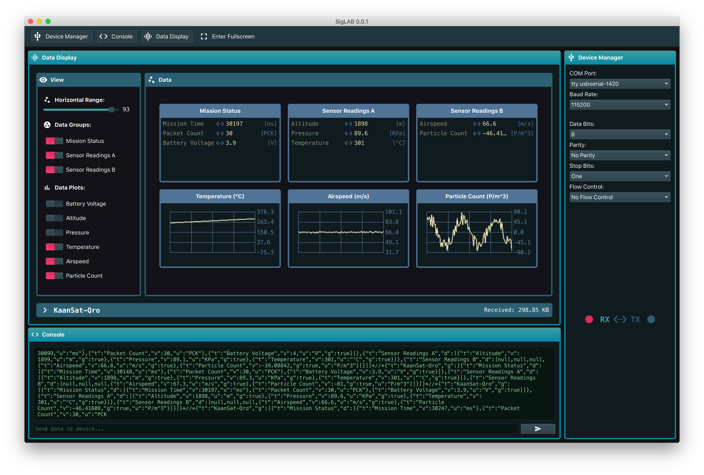

#  Serial Studio

[](https://github.com/Serial-Studio/Serial-Studio/releases/)
[](https://www.paypal.com/donate?hosted_button_id=XN68J47QJKYDE)
[](https://store.serial-studio.com/checkout/buy/e33e6d04-639f-46b7-bd68-b46d341c5b16)
[](https://app.codacy.com/gh/Serial-Studio/Serial-Studio/dashboard?utm_source=gh&utm_medium=referral&utm_content=&utm_campaign=Badge_grade)

**Serial Studio** turns the numbers your hardware prints into a live dashboard.

You already call `Serial.println` on an Arduino, ESP32, STM32, Teensy, or Raspberry Pi. Serial Studio reads those lines over serial and draws plots, gauges, maps, and 3D views. It also reads Bluetooth LE, network protocols, and industrial buses (Modbus, CAN bus, OPC UA, MQTT), and logs to CSV or SQLite. It runs on Windows, macOS, Linux, and Raspberry Pi.



## Quick start

Upload this sketch to an Arduino Uno-class board. Sensors on A0 and A1 are best, but open wires work too: floating pins give moving noise, enough to see a plot. On an ESP32, replace `A0` and `A1` with ADC pins such as `34` and `35`.

```cpp
void setup() {
  Serial.begin(9600);
}

void loop() {
  int sensorA = analogRead(A0);
  int sensorB = analogRead(A1);
  Serial.print(sensorA);
  Serial.print(",");
  Serial.println(sensorB);
  delay(100);
}
```

Then:

1. [Download](#download) and start Serial Studio.
2. In the Device Setup panel, set **Operation Mode** to **Quick Plot (Auto-Detected Format)**.
3. Choose your serial port, set the baud rate to `9600` (the value in `Serial.begin`), and click **Connect**.

Two traces appear in the dashboard, one per column. Touch a sensor and watch a trace move. Garbled text in the console almost always means the baud rate does not match the sketch; nothing is broken. If your port is not listed, unplug and replug the board and close the Arduino IDE Serial Monitor, which holds the port open. Named values work too: `temp:21.5,hum:40` plots two traces called `temp` and `hum`.

That is the whole setup. No project file needed.

To keep what you see, click **Menu** in the dashboard taskbar and choose **Save as Project**. The Project Editor opens, where you rename channels, set units, and pick widgets. The [getting started guide](./doc/help/Getting-Started.md) walks through each step, including problems; [`/examples`](./examples) has Arduino sketches, ESP32 code, and Python scripts.

### Operation modes

The Device Setup panel offers three modes, all free ([Operation Modes](./doc/help/Operation-Modes.md) has the details).

| Mode (Device Setup) | Use it when |
|---------------------|-------------|
| **Quick Plot (Auto-Detected Format)** | Your device prints one line of values per sample (comma, semicolon, tab, or space separated, or `name:value` pairs). |
| **Parse via Project File** | You want a custom dashboard: you describe groups, datasets, and widgets in the Project Editor. Recommended for anything beyond a quick look. |
| **Console Only (No Parsing)** | You want a plain terminal with no dashboard. |

### Free or Pro?

- The official binary runs without a license. Free features have no time limit. The first time you use a Pro feature, Serial Studio offers a 14-day Pro trial (no account or payment; registering it needs an internet connection). When the trial ends, Pro features lock and the free features keep working.
- A GPL build compiled from source has the free features only.
- Commercial use of the official binary requires a Pro license.

The full feature matrix is in [Pro vs Free](./doc/help/Pro-vs-Free.md); the [editions table](#picking-the-right-version) compares the three ways to run Serial Studio.

## What you can do with it

Pro features are tagged (Pro); everything else is in the GPL build.

**Connect to a device.** Serial/UART, Bluetooth LE, and network sockets (TCP, UDP, WebSocket, HTTP) are free. MQTT, Modbus TCP/RTU, CAN Bus, OPC UA, Siemens S7comm, EtherNet/IP, IEC 60870-5-104, audio input, raw USB, HID, and Process I/O are Pro, as is running several devices in one project. Pro also turns Modbus register-map and CAN DBC files into projects.

**Read PLCs without a gateway (Pro).** OPC UA browses a controller's address space, and you tick the tags you want. S7comm, EtherNet/IP, and IEC 60870-5-104 read Siemens, Allen-Bradley, Omron, and substation equipment directly. These three drivers are read-only, so connecting cannot change a running machine. Addressing examples and controller lists are on the [S7](./doc/help/Drivers-S7.md), [EtherNet/IP](./doc/help/Drivers-EtherNet-IP.md), and [IEC 60870-5-104](./doc/help/Drivers-IEC-104.md) pages.

**Visualize data.** Line plots, gauges, bar charts, meters, GPS maps, FFT spectrum, accelerometer, gyroscope, compass, data grids, LED panels, a terminal, and multi-channel plots are free. Pro adds 3D Plot, Waterfall (spectrogram), Image View (live camera), and the Canvas widget, a JavaScript `paint(ctx, w, h)` callback with 18 starting templates.

**Build dashboards.** The Project Editor defines groups, datasets, and widgets through forms. Custom workspaces (Pro) split big projects into tabs with a searchable taskbar.

**Parse and transform data.** A frame parser is a small function that turns one frame (usually one line of text) into numbers. Frame parsers are Built-In templates (no code, the default for new projects), JavaScript, or Lua. Script templates cover MAVLink, NMEA, UBX, MessagePack, COBS, SLIP, JSON, and others. Per-dataset transforms and Variables (Pro) filter, scale, and derive values every frame. Serial Studio parses 256,000 frames per second, enforced as a CI benchmark gate ([Benchmark](./doc/help/Benchmark.md)).

**Send commands back (Pro).** A slider can send `G1 X10` over serial. Buttons, sliders, knobs, toggles, and text fields run JavaScript templates that emit GCode, SCPI, Modbus, NMEA, or CAN, on demand or on a timer.

**Record and replay.** CSV export is free. MDF4, session recording into SQLite, PDF session reports, file transfer (XMODEM, YMODEM, ZMODEM), and a live InfluxDB 2.x sink are Pro.

**Automate it.** The API Server is off until you turn on **Enable API Server** on the General page of Preferences, so a fresh install exposes nothing. It then listens on TCP port 7777 and exposes hundreds of commands over TCP ([API reference](./doc/help/API-Reference.md)). In official binaries the same switch also starts a gRPC server on port 8888, with the same commands and live frame streaming; a source build includes it only with `-DENABLE_GRPC=ON` ([gRPC server](./doc/help/gRPC-Server.md)). An MCP server lets Claude Desktop or any MCP host call the same surface.

**Let an AI edit the project (Pro).** The AI Assistant is a bring-your-own-key chat panel that edits the project, with local models supported for offline use. Mutating actions show an Approve/Deny card first. See the [AI Assistant docs](./doc/help/AI-Assistant.md).

## Download

Serial Studio is available as source code and as official precompiled binaries for Windows, macOS, and Linux.

- [Latest stable release](https://github.com/Serial-Studio/Serial-Studio/releases/latest)
- [Pre-release builds](https://github.com/Serial-Studio/Serial-Studio/releases/continuous)

### Windows

Download the file ending in `-Windows.msi` (installer) or `-Windows-Portable.zip` (no installation). Requires the [Microsoft Visual C++ Redistributable (x64)](https://learn.microsoft.com/en-us/cpp/windows/latest-supported-vc-redist?view=msvc-170#latest-microsoft-visual-c-redistributable-version). On first launch Windows may warn about an unknown developer. Click _"More Info"_, then _"Run Anyway"_ to continue.

### macOS

Download the file ending in `-macOS.dmg`, a universal build for Apple silicon and Intel. Open the DMG and drag **Serial Studio** into **Applications**. The first time, right-click the app and choose Open. You can also install it via Homebrew:

```bash
brew install --cask serial-studio
```

The Homebrew cask is community-maintained and not tested by the project.

### Linux

The recommended way to install on Linux is via the official [AppImage](https://appimage.org/). Download it from the [latest release](https://github.com/Serial-Studio/Serial-Studio/releases/latest), then make it executable and run it. Replace `<version>` with the version you downloaded; the ARM64 file ends in `Linux-arm64.AppImage`. The name says Pro because the one official binary contains the Pro features; it runs without a license (see [Free or Pro?](#free-or-pro)).

```bash
chmod +x Serial-Studio-Pro-<version>-Linux-x64.AppImage
./Serial-Studio-Pro-<version>-Linux-x64.AppImage
```

For better desktop integration (menu entries, icons, updates), use [AppImageLauncher](https://github.com/TheAssassin/AppImageLauncher).

All Linux packages (AppImage, DEB, RPM, x64 and ARM64) bundle their own glibc. The host's glibc version does not matter (see [Linux Installation](./doc/help/Linux-Installation.md)).

#### Flatpak (Flathub)

Serial Studio is on [Flathub](https://flathub.org/apps/com.serial_studio.Serial-Studio).

#### Raspberry Pi / ARM64

An ARM64 AppImage is available for Raspberry Pi and similar boards. It needs a 64-bit Linux distro (Raspberry Pi OS 64-bit, Ubuntu, Debian, and so on).

## Documentation

- [Help center](https://serial-studio.com/help): FAQs, use cases, comparisons, troubleshooting. The Markdown source is in [doc/help](./doc/help).
- [Getting started](./doc/help/Getting-Started.md): first connection, the three operation modes, and common problems.
- [Use cases](./doc/help/Use-Cases.md): worked scenarios across ten fields, from rocketry and drones to industrial automation, with the hardware and data rates involved.
- [Comparison](./doc/help/Comparison.md): how it differs from the Arduino IDE Serial Plotter, Processing, MATLAB, LabVIEW, and Grafana.
- [Pro vs Free](./doc/help/Pro-vs-Free.md): the full feature matrix for both editions.
- Automation: the [API reference](./doc/help/API-Reference.md) (with an [API client example](./examples/API%20Test)), the [gRPC server](./doc/help/gRPC-Server.md), and an [MCP client](./examples/MCP%20Client).
- [AI agent guide](AGENTS.md): for ChatGPT, Claude, and other assistants.

## Building Serial Studio

### Requirements

- **Qt 6.11.2**, the version CI builds. Older Qt versions are not tested. Required modules: QtCore, QtGui, QtWidgets, QtQml, QtQuick, QtQuickControls2, QtGraphs, QtSvg, QtSql, QtSerialPort, QtBluetooth, QtCore5Compat, and Qt LinguistTools at build time.
- **A C++20 compiler:** GCC, Clang, or MSVC.
- **CMake 3.20 or later.**
- Platform toolchain (see [Platform specifics](#platform-specifics)).

#### Platform specifics

##### Linux

```bash
sudo apt install libgl1-mesa-dev build-essential
```

##### macOS

```bash
xcode-select --install
brew install qt@6
```

##### Windows

Visual Studio with the C++ workload, and Qt from the official installer.

### Build instructions

All C/C++ dependencies (zlib, expat, OpenSSL, KissFFT, and so on) are vendored in `lib/` or fetched automatically via CMake's FetchContent. No package manager is needed.

```bash
cmake -B build -DPRODUCTION_OPTIMIZATION=ON -DCMAKE_BUILD_TYPE=Release
cmake --build build --config Release -j$(nproc)
```

On Windows the default generator is Visual Studio, which is multi-config: it ignores `CMAKE_BUILD_TYPE` and builds `Debug` unless you pass `--config Release` to the build step (as shown above). Skipping it builds the Debug config, which mixes MSVC's `/RTC1` runtime checks with the production `/O2` flags and fails with `'/O2' and '/RTC1' command-line options are incompatible`. Alternatively, configure with the single-config Ninja generator (`cmake -B build -G Ninja ...`), which honors `CMAKE_BUILD_TYPE`.

You can also open `CMakeLists.txt` in Qt Creator or any CMake-aware IDE without extra setup.

The default build is the GPLv3 edition: the free features only, with no Pro modules compiled in. Some Pro modules depend on proprietary Qt modules (Modbus, CAN Bus, MQTT, OPC UA); others are commercial-licensed code in this repository. The GPL edition cannot create or edit per-dataset transforms, Variables, or custom workspaces, and a project that contains a transform or a Variables table needs Pro to connect (removing them is free). See [Pro vs Free Features](./doc/help/Pro-vs-Free.md) for the full list.

If you are a Pro user or have a commercial license, [contact the maintainer](mailto:alex@serial-studio.com) for build instructions and activation details.

## Support the project

Serial Studio is developed and maintained by [Alex Spataru](https://github.com/alex-spataru).

If Serial Studio is useful to you, here are a few ways to support it:

- [Donate via PayPal](https://www.paypal.com/donate?hosted_button_id=XN68J47QJKYDE): keeps the project active.
- [Buy a commercial license](https://serial-studio.com): unlocks Pro features and priority support.
- [Become an affiliate](https://store.serial-studio.com/affiliates): earn a commission by referring new customers.

## Licensing

Serial Studio uses a dual-license model that separates open source usage from commercial distribution:

- [LICENSE.md](LICENSE.md): overview of the dual-license structure, routing to the full license documents.
- [LICENSES/GPL-3.0-or-later.txt](LICENSES/GPL-3.0-or-later.txt): full GNU GPLv3 text for open source source code.
- [LICENSES/LicenseRef-SerialStudio-Commercial.txt](LICENSES/LicenseRef-SerialStudio-Commercial.txt): full terms for proprietary features and official binaries.

Source files are individually marked with SPDX headers, either `GPL-3.0-or-later`, `LicenseRef-SerialStudio-Commercial`, or both. The edition comparison is under [Picking the right version](#picking-the-right-version).

## Picking the right version

The table compares the three ways to run Serial Studio.

| Feature / use case     | GPL build *(compiled from source)*   | Official binary *(no license)*        | Official binary *(Pro license)*             |
|------------------------|--------------------------------------|---------------------------------------|---------------------------------------------|
| **Free features**      | ✅ Included                          | ✅ Included, no time limit            | ✅ Included                                  |
| **Pro features**       | ❌ Not included                      | 14-day trial, then locked             | ✅ Included                                  |
| **Commercial use**     | ✅ Permitted under GPLv3             | ❌ Requires a Pro license             | ✅ Fully licensed                            |
| **Official support**   | ❌ Community only                    | ❌ Community only                     | ✅ Priority support                          |
| **Usage restrictions** | Must comply with GPL and Qt terms    | Bound by the EULA, no redistribution  | Bound by commercial license terms           |
| **Precompiled binary** | ❌ Must build from source            | ✅ Provided                           | ✅ Provided                                  |
| **Qt licensing**       | Requires GPL-compatible Qt           | Qt licensing covered by vendor        | Qt licensing covered by vendor              |
| **Activation system**  | ❌ Not applicable                    | None; the trial registers the machine | ✅ Requires a valid license key              |
| **Best for**           | OSS devs, students, contributors     | Hobbyists, personal evaluation        | Businesses, teams, commercial products      |

The GPL build carries the full GPLv3 grant: use for any purpose, commercial use included, with no restrictions beyond the GPL's own terms. It excludes the Pro modules. Pro features and official binaries are proprietary: the official binaries are governed by the [EULA](EULA.md), and using Pro features beyond the 14-day trial requires a commercial license. A file's SPDX header states its license; files marked commercial-only carry no GPL rights.

## Contributing

Contributions are welcome: bug fixes, new features, or doc improvements. [CONTRIBUTING.md](CONTRIBUTING.md) covers code style and pull request steps. Check existing [issues](https://github.com/Serial-Studio/Serial-Studio/issues) and [pull requests](https://github.com/Serial-Studio/Serial-Studio/pulls) first. Contributions to both GPL-licensed code and the commercial (Pro) modules are welcome; Pro contributions are accepted under the Contributor License Agreement in CONTRIBUTING.md.

For larger changes, open an issue first to agree on the approach with the maintainer.
