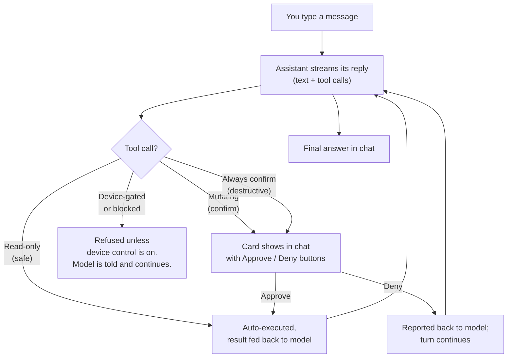

# AI Assistant (Pro)

Your Arduino prints `23.5,1013` and you want a plot without learning the Project Editor first. Open the Assistant and type:

> Add a UART source at 115200 baud and plot two comma-separated values.

The Assistant answers with a card that shows the command it wants to run (`project.source.add` and its arguments) and two buttons, **Approve** and **Deny**. Click **Approve** and the source appears in the Project Editor. Reading the project is automatic; anything that changes it waits for you. You still pick the serial port and connect from the toolbar, and then the plot fills.

The Assistant is a chat panel built into Serial Studio. It sets up sources, plots and widgets, and writes the small scripts that split each incoming line into values, by calling the same commands the API exposes. It is bring-your-own-key: you need an API key from a provider (paid or free tier, billed by the provider), or a model server on your own machine.

> **Pro feature.** The Assistant ships in the official (commercial) build. GPL builds do not include it, and operator deployments (`--runtime`) hide it. On a machine with no license, the first use of a Pro feature shows a Yes/No prompt that offers the 14-day trial (it needs an internet connection to register); once the trial has expired, the prompt offers activation or purchase instead. See [Pro vs Free Features](Pro-vs-Free.md).

## First run

1. Open the Assistant: click the **AI Assistant** item on the Dashboard taskbar, or use the AI command in the **Project Editor** toolbar.
2. Pick a provider in the top bar. If you have no preference, pick Anthropic. The key comes from your own account at the provider and is billed by them, not by Serial Studio; [Getting a key](#getting-a-key) has the signup link. The **Local model** option needs no key.
3. Click **Open API Key Setup** on the empty-conversation card, paste the key and save. The [Getting a key](#getting-a-key) section has the details.
4. Type a request and press **Enter**.
5. Click **Approve** on each card.

## What it can do

Most of what the Project Editor does, the Assistant can do for you, with two exceptions:

- **It does not touch the running connection.** Opening or closing a port, changing driver settings, writing bytes to the device, and clicking or typing into the window itself (`ui.automation.click`, `ui.automation.key`) are refused unless you tick **Allow device control** in the top bar settings menu. The [safety tiers](#the-safety-tiers) section has the rules.
- **It cannot start the trial or change your license.** The `licensing.*` mutations and the process launchers `system.exec` and `system.kill` are blocked outright.

When you ask about a feature it does not already know, it reads the matching manual page (see [Documentation lookup](#documentation-lookup)).

Typical requests:

- "List the sources in this project."
- "Add a UART source for an Arduino at 115200 baud, frame end on `\n`."
- "Write a CSV frame parser (the small script that splits each line your device sends into values) with three floats and a status byte."
- "Suggest dashboard widgets for this data."
- "Build me a workspace called *Engine* with the RPM gauge, oil-pressure plot, and the alarm panel."
- "Add a moving-average transform to dataset *Speed*."
- "Open the canvas widget docs and walk me through writing one for a compass."

The four chips on the empty-conversation card are starter prompts, reshuffled each time the card appears. Click one to send it.

## Picking a provider

Eight providers are wired in. Pick one in the combo box in the top bar; each provider keeps its own model selection.

| Provider | Default model | Notes |
|---|---|---|
| **Anthropic** (Claude) | Haiku 4.5 | Sonnet 4.6, Sonnet 5, Opus 4.7, Opus 4.8 and Fable 5 are also selectable. Extended thinking on Sonnet/Opus. |
| **OpenAI** | GPT-5 mini | GPT-5.2 and GPT-5.2 Chat, GPT-4.1, GPT-4.1 mini, GPT-4o and GPT-4o mini are also selectable. Reasoning-capable models run at `reasoning_effort: none`. |
| **Google Gemini** | 2.5 Flash (Free) | Selectable: 2.5 Flash (Free), 2.5 Pro, 2.0 Flash (Free). The Free models run on the AI Studio free tier; 2.5 Pro is paid. |
| **DeepSeek** | deepseek-chat (V3) | `deepseek-reasoner` (R1) is also selectable. |
| **Groq** | llama-3.3-70b-versatile | Free tier with daily limits. |
| **Mistral** | mistral-large-latest | The model picker lists the other Mistral models. |
| **OpenRouter** | anthropic/claude-haiku-4.5 | One key reaches Anthropic, OpenAI, Google, Meta, DeepSeek, Mistral and Qwen routes; some routes are `:free`. |
| **Local model** | (whatever your server has loaded) | OpenAI-compatible local endpoint. Nothing leaves your machine. |

Every provider streams its reply and can call tools. Anthropic and Gemini 2.5 also show the model's thinking.

### Local models

The Pro Assistant's Local provider needs a base URL, not an API key. Default is Ollama on `http://localhost:11434/v1`. To point at a different server, open **Manage API keys…**, edit the URL field on the Local card, and click **Apply**. The card also has a **Context window** field (tokens the model accepts; the dialog accepts 1024 to 1048576). Set it to what your model advertises, because a value larger than the server loaded can push the system prompt out of every request. Common alternatives:

- LM Studio: `http://localhost:1234/v1`
- llama.cpp `llama-server`: `http://localhost:8080/v1`
- vLLM: `http://localhost:8000/v1`

Whatever models are installed on the server show up in the model picker. Click the refresh icon next to the URL field to re-query the list after pulling a new model. Tool use works on any model that supports the OpenAI function-calling shape. Small models lose the thread on long tool chains.

### Getting a key

The empty-conversation card has a **Get a key from <provider>** link that opens the provider's signup page. Sign up, copy the key, then open the API keys dialog and paste it. The dialog opens from **Open API Key Setup** on the empty-conversation card, or from **Manage API keys…** in the wrench-icon settings menu in the top bar; both reach the same dialog. The dialog shows only a **Key set** / **No key** status pill, never the key itself. [Privacy and what gets sent](#privacy-and-what-gets-sent) says how the key is stored.

From the same dialog you can change provider or model, or revoke a key. Revoking the active provider's key drops you back to the welcome screen until you paste a new one.

## How a turn works

The Assistant changes your project by running commands. Reading is automatic; anything that changes the project shows a card with **Approve** and **Deny** buttons.

Each tool call shows up in the chat as a small expandable card with the command name, the arguments, and (after it runs) the result. You can click the card to inspect what was sent and what came back.

A turn runs at most 25 tool calls. The 26th is shown as a **Blocked** card, no further tools run, and the Assistant is made to summarize; send a follow-up message to continue.

### The safety tiers

Reading is automatic and changes ask you. A few things (device connection, licensing, launching programs) stay off-limits unless stated below. Every command carries one of five tiers in `app/rcc/ai/command_safety.json`:

| Tier | Behavior | Examples |
|---|---|---|
| **Safe** | Auto-runs. No prompt. Read-only inspection. | `project.group.list`, `dashboard.getStatus`, `io.uart.listPorts`, every `get*` and `*.list`; `fs.write` and `fs.append` too, limited to the `AI/` folder of your workspace |
| **Confirm** | Card with **Approve** / **Deny** buttons. Anything that mutates the project counts. Skipped when **Auto-approve edits** is on (see the toggle table below). | `project.group.add`, `project.dataset.update`, `project.workspace.add`, `project.template.apply` |
| **Always confirm** | Like Confirm, but still asks **even when Auto-approve edits is on**. Destructive or sensitive families: delete / clear / new / open-replace / install / uninstall, plus MQTT credential + TLS config and control-loop installs. | `project.new`, `project.group.delete`, `fs.delete`, `sessions.delete`, `controlScript.setCode`, `project.mqtt.publisher.setConfig` |
| **Device-gated** | Blocked by default; becomes **Always confirm** only when **Allow device control** is ticked. Driver settings, connection state, and anything that writes bytes to the device. | `io.connect`, `io.disconnect`, `io.setPaused`, `io.writeData`, `console.send`, every driver `set*`, and `ui.automation.click` / `ui.automation.key`, which act on the window as you would |
| **Blocked** | Refused outright; no toggle unblocks it. The model is told it isn't available. To run a process, the Assistant writes a Control Loop script (`controlScript.setCode`, Always confirm) that you read first. | `licensing.activate`, `licensing.enableTrial`, `licensing.setLicense` and the other `licensing.*` mutations, plus `system.exec` and `system.kill` |

Destructive actions the assistant takes are backed by automatic snapshots; see [Backups & Recovery](Backup-Recovery.md) to restore one, or ask the assistant to undo the change directly.

You can approve a single call (**Approve**) or, when the assistant queues several mutations in a row, approve the whole batch at once (**Approve all**). Denial is logged and the assistant is told. It will usually offer an alternative or back off, not retry blindly.

New commands default to **Confirm** until they're explicitly tagged, so adding an API method doesn't quietly grant the Assistant new powers. Two toggles in the wrench-icon settings menu in the top bar tune the tiers:

| Toggle | Effect |
|---|---|
| **Auto-approve edits** | Runs **Confirm**-tier project edits without asking. Always-confirm, device-gated and Blocked commands are unaffected. |
| **Allow device control** | Unblocks the device-gated commands behind a one-time warning. Each call still asks for approval, even with Auto-approve edits on. |

## The composer

The bar at the bottom is the input. Type a prompt and press **Enter** to send. The round button on the far right is **Send**; while the model is generating it becomes **Cancel**, which stops the stream. Whatever it already said stays in the chat, and a thin animated stripe under the message list shows it is still working.

The paperclip icon (tooltip **Attach files**) opens a file picker; dragging files or folders into the chat does the same thing, and a folder can only be added by dragging. Each attachment appears as a chip above the composer with its kind and size. The chip's close button removes it, and the assistant then loses permission to read that file. Attachments go out with your next message, and the sent message lists them by name.

What the assistant receives depends on the file:

| Attachment | How it is sent |
|---|---|
| PDF | The whole file goes to the provider, which reads its text, tables and figures. Anthropic, OpenAI, Gemini and OpenRouter only. |
| Image (PNG, JPEG, GIF, WebP) | The whole file goes to the provider. Anthropic, OpenAI and Gemini; on OpenRouter, the Anthropic, OpenAI and Google models. |
| Text file up to 256 KB | Its contents go inside your message, on every provider. |
| Folder, or a larger text file | Only its path goes in your message. The assistant reads it in slices with its file tool when it needs to. |
| Anything else (audio, video, office documents, archives) | Not sent. The panel says which file to remove. |

If the selected provider cannot take a pending attachment, the panel shows the reason in red and the message is not sent; remove the file or switch provider. Attachments are limited to 12 MB per message.

Things to know about PDFs:

- **Length.** Providers limit pages and context. A long reference manual can be refused; the error comes back in the chat. Attach the chapter you need when the whole document does not fit.
- **Cost.** The file is sent again with every later message in the chat, until older turns are trimmed from the history. Start a new chat when you are done with a document.
- **Reopened chats.** A saved chat keeps the attachment's name, not the file. When you reopen it, or switch to a provider that cannot read the file, the assistant is told the file is no longer attached; attach it again to continue.

Attached files are read-only, and the permission ends when you start a new chat or switch to another one.

## Chats and memory

The chat sidebar lists your chats. Use it to start a new chat, switch between chats, rename one (**Rename...**), continue one in a new chat (**Continue in new chat**), or **Delete** one.

The **Assistant memory** item in the top bar settings menu is on by default. The Assistant can propose a short fact to remember, and a chip asks you before it is stored. **Manage memory…** in the same menu opens the **Assistant Memory** dialog, where you can add and delete facts. Remembered facts are sent to your provider with the turn.

## Privacy and what gets sent

Every message you send goes to the provider you chose, so read this before pasting anything sensitive.

- **Sent on every turn**: your message, the conversation history so far, the tool catalog, your remembered facts when memory is on, and a snapshot of the live project state (sources, groups, datasets, frame parser code, transforms, and so on; the same JSON your `.ssproj` would contain). Frame parser scripts and transform scripts are part of that snapshot. Secrets are redacted from the snapshot and from tool payloads before they enter the model context.
- **Not sent**: live telemetry data, your raw serial bytes, your dashboard frames, your CSV/MDF4 logs, your Historian database, the API key for any *other* provider.
- **Sent with your message**: every PDF, image and small text file you attach, in full and without the credential scrubbing that tool results get. Check a file for secrets before you attach it.
- **Sent when a tool reads it**: the contents of any file the assistant opens, including attached folders and large text files and the application source it reads under `source/`.
- **Stored: API key.** Obfuscated in this machine's settings, scrambled with a key derived from the machine fingerprint. That keeps it out of the settings file as plain text and makes it useless on another machine; it is not encryption, so it does not protect the key from someone who already has your user account.
- **Stored: conversation history.** Local JSON files (one per chat, plus an index) in the app's data directory; they survive restarting the app. Deleting a chat from the chat sidebar deletes its file.

If your project file contains commercial firmware code or proprietary protocol notes inside frame parsers or transforms, that text will travel to the provider with each turn. Treat the provider's data-handling policy as the relevant constraint, not Serial Studio's.

## Documentation lookup

When you ask about a feature, the Assistant reads the matching manual page with `meta.fetchHelp` (read-only, Safe). Pages come off the Serial Studio GitHub repo at the commit your build was made from, so this needs an internet connection; a build compiled locally, which carries no commit, falls back to `master`. If a guessed page name 404s, it fetches `help.json` (the page index) and retries.

Before it writes or changes a script, it calls `meta.fetchScriptingDocs`, which returns the API reference for one of nine kinds: seven script kinds (`frame_parser_js`, `frame_parser_lua`, `transform_js`, `transform_lua`, `output_widget_js`, `painter_js`, `control_script_js`) plus `sdk_js` and `sdk_lua`, which return the generated SerialStudio SDK source itself. That is why the frame parsers it writes use real APIs and not made-up function names.

`meta.searchDocs` searches the bundled help and scripting docs. `meta.loadSkill` loads one of eighteen focused skill briefs, for example `frame_parsers`, `transforms`, `mqtt`, `can_modbus` or `alarms`.

## Reading the application source

The Pro AI Assistant can read Serial Studio's own source code, which the Pro build ships inside the executable. Ask why a driver reconnects or which field a project key maps to, and the answer comes from the code of the build you are running. The bundle sits under a virtual, read-only `source/` prefix (`fs.read` with `source/core/Devices/IO/Drivers/CANBus.cpp`, `fs.search` with `path: "source/core"`); a `fs.search` without a `path` never walks it. Nothing is unpacked or downloaded, and a build compiled without the bundle answers `source_unavailable`. A file the Assistant opens becomes part of the conversation that travels to your provider.

## Project templates

In the Pro AI Assistant, ask it to "use a template" and it calls `project.template.list` (Safe) and then `project.template.apply` (Confirm). **Apply replaces the open project** and discards unsaved state; pass `dryRun:true` to preview what would be discarded.

| Template id | What you get |
|---|---|
| `blank` | One default UART source, nothing else. |
| `imu_uart` | 9-DOF IMU over UART (accelerometer, gyroscope, magnetometer), comma-separated parser. |
| `gps_uart_nmea` | GPS over UART, NMEA 0183 (`$GPGGA`), with a map widget. |
| `scope_multichannel_uart` | 8 numeric channels over UART, each a plot. |
| `telemetry_udp` | CSV parser with 5 channels. It does not configure the UDP listener; set that up yourself. |
| `mqtt_subscriber` (Pro) | MQTT subscriber skeleton with one placeholder group. Configure the broker afterwards. |

## Frequently asked

**Does the assistant work offline?**
Yes, with the **Local model** provider (Ollama, llama.cpp, LM Studio or vLLM; the base URL is configurable, so any OpenAI-compatible server works). Documentation fetched with `meta.fetchHelp` needs the internet; the rest works offline. The cloud providers need a network connection.

**Can it write data to my device?**
Not directly. `console.send` and `io.writeData` are device-gated (blocked until you tick **Allow device control**, then approved per call). The Assistant can write a frame parser, transform or canvas script that calls `deviceWrite()` or `actionFire()`; you read the code before approving it, and once connected it runs on incoming frames, so check the logic before approving anything that writes on every frame. For one-off commands, use an [Output Control](Output-Controls.md). MQTT broker credentials are Always confirm, and `getConfig` never returns the stored password.

**Why does my project state show up in the prompt?**
The Serial Studio AI Assistant sends a snapshot of the open project so it can answer "what sources are configured?", "which datasets feed this group?", or "is the frame parser doing what I think it is?" without first running ten read-only tool calls.

**The assistant suggested an API call that doesn't exist.**
Tell it. It recovers with `meta.listCommands` or `meta.describeCommand`. A larger model from the same provider invents fewer commands.

**Where do I report a bug or a wrong answer?**
File an issue on the Serial Studio GitHub repo. Include the prompt, the reply, and ideally the project file (or a stripped-down repro). Provider name and model help too.

## See also

- [API Reference](API-Reference.md): the command surface the assistant calls into.
- [Project Editor](Project-Editor.md): the editor the assistant edits on your behalf.
- [Backups & Recovery](Backup-Recovery.md): the rolling snapshots behind every restore and undo.
- [Pro vs Free Features](Pro-vs-Free.md): the edition table.
