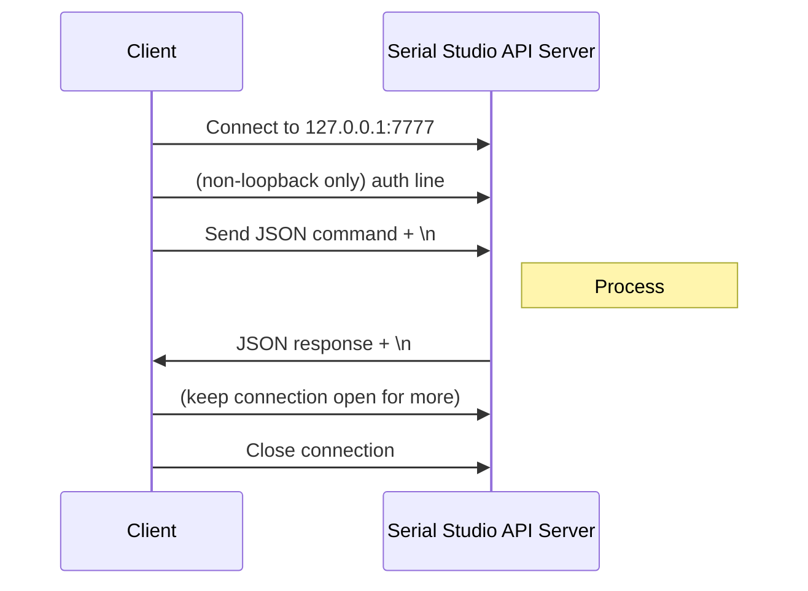

Your Arduino prints values with `Serial.println` and Serial Studio plots them. The API Server lets another program, such as a Python script, configure Serial Studio, connect to the device, start a CSV log and read the same values.

The [Complete Command Reference](#complete-command-reference) is a lookup table, not a tutorial.

## Table of Contents

- [Overview](#overview)
- [Getting Started](#getting-started)
- [Enabling the API Server](#enabling-the-api-server)
- [Security Considerations](#security-considerations)
- [Automation Use Cases](#automation-use-cases)
- [Connection Details](#connection-details)
- [Protocol Specification](#protocol-specification)
- [Complete Command Reference](#complete-command-reference)
- [Usage Examples](#usage-examples)
- [Calling the API from Frame Parsers, Transforms, and Canvas Widgets](#calling-the-api-from-frame-parsers-transforms-and-canvas-widgets)
- [Client Tools and Libraries](#client-tools-and-libraries)
- [Best Practices](#best-practices)
- [Troubleshooting](#troubleshooting)
- [Advanced Topics](#advanced-topics)
- [MCP Integration](#mcp-model-context-protocol-integration)
- [Additional Resources](#additional-resources)

## Overview

### The API Server

The API Server is a TCP server inside Serial Studio. It is off by default and listens on port 7777 unless you change the port. Each message is one line of JSON, and each command gets one line of JSON back. With the server on (see [Quick Start](#quick-start)), this shell command asks Serial Studio for its connection state:

```bash
echo '{"type":"command","id":"1","command":"io.getStatus"}' | nc localhost 7777
```

```json
{"type":"response","id":"1","success":true,"result":{"isConnected":false,"paused":false,"busType":0,"configurationOk":false}}
```

The reply is trimmed here to its first fields. The `id` is any string you choose, and the response echoes it so you can match answers to requests. If a device is streaming, frames also arrive on the same socket as extra lines that no command asked for (see [Server-Push Messages](#server-push-messages)). The answer is the line with `"type":"response"`.

> **Identifier conventions.** Most API commands address objects through some combination of `sourceId`, `groupId`, `datasetId`, `index`, and `uniqueId`. They look interchangeable but are not. See the [Dataset Identity Model](Identity-Model.md) for the rules of thumb (mutate by `(groupId, datasetId)`, read by `uniqueId`, position by `index`).

### Free and Pro Commands

The API Server is in every edition. Commands for the free drivers and features (UART, Network, Bluetooth LE, CSV export and playback, Console, Dashboard, Project, I/O Manager) work in all of them. Commands for the Pro drivers (Modbus, CAN Bus, MQTT, MDF4 export and playback, Audio, USB, HID, Process I/O) belong to [Serial Studio Pro](Pro-vs-Free.md). In a GPL build they are not registered and answer `UNKNOWN_COMMAND`. A few commands in the free sections, such as `project.source.add`, answer `COMMERCIAL_REQUIRED` in a GPL build. In the official binary, the first Pro feature you use offers the 14-day trial with a Yes/No prompt. It needs an internet connection.

In the catalog, a green circle marks a command available in every build and a blue circle marks a Pro-only one.

### Find the Live Command List

The command sections below are a structured tour. The running server is authoritative, and any of these lists its commands:

- **JSON over TCP**: send `api.getCommands` (no params). It returns `{name, description}` for every registered command.
- **MCP**: send `tools/list` over JSON-RPC 2.0 (see [MCP Client](../../examples/MCP%20Client/)) for the same surface plus the input schema of each command.
- **Python client**: `python test_api.py list` from [examples/API Test/](../../examples/API%20Test/).
- **AI Assistant**: `meta.listCategories`, then `meta.listCommands` and `meta.describeCommand`.
- **In the app**: the [Macros](Macros.md) window lists the live catalog with parameters, and runs commands and scripts in process without the API Server.

## Getting Started

### Quick Start

1. Start Serial Studio. The server lives inside the running app, so nothing below works while it is closed.
2. Click **Preferences** on the toolbar, go to the **General** tab, find **API & Plugins**, and turn on **Enable API Server**. The server starts at once and the setting persists across restarts.
3. Send a command. On Linux and macOS, run the `nc` (netcat) line from the [Overview](#the-api-server). Serial Studio answers with the `"type":"response"` line shown there.
4. No `nc`, as on Windows? Any system with Python 3 can use this small client, which the later examples reuse:

```python
import json
import socket


class Api:
    def __init__(self, host="127.0.0.1", port=7777):
        self.sock = socket.create_connection((host, port))
        self.lines = self.sock.makefile("r", encoding="utf-8")
        self.next_id = 0

    def send(self, command, **params):
        self.next_id += 1
        msg = {"type": "command", "id": str(self.next_id), "command": command}
        if params:
            msg["params"] = params
        self.sock.sendall((json.dumps(msg) + "\n").encode())
        for line in self.lines:
            reply = json.loads(line)
            if reply.get("type") == "response" and reply.get("id") == msg["id"]:
                return reply
        raise ConnectionError("server closed the connection")


api = Api()
print(api.send("io.getStatus"))
```

It prints the same response as the `nc` example, as a Python dictionary. `send` skips push lines and returns the response whose `id` matches.

The repository also ships a command-line client. Clone or download [Serial-Studio on GitHub](https://github.com/Serial-Studio/Serial-Studio), open a terminal in `examples/API Test/`, and run `python test_api.py send io.getStatus`. It needs Python 3 and nothing else. That script does the same job as the client above.

## Enabling the API Server

The API Server settings live in Preferences, on the **General** tab, under **API & Plugins**. Each change applies at once and persists across restarts.

| Setting | What it does |
|---------|--------------|
| **Enable API Server** | Starts and stops the server. Off by default. The [gRPC Server](gRPC-Server.md) on port 8888 starts and stops with it. Turning it off also turns **Allow External API Connections** off. If the port is in use, Serial Studio shows "Unable to start API TCP server" and the toggle returns to off; pick another **API Server Port**. |
| **API Server Port** | Listening port, 1024 to 65535 in this field (`--api-port` accepts 1 to 65535), default 7777. Enabled while the server is on. Changing it rebinds the server and drops open connections. |
| **Allow External API Connections** | Accepts connections from other machines after a Yes/No warning (default No). Enabled while the server is on. Changing it rebinds the server and drops open connections. |
| **API Access Token** | The 64-character token external clients must send. See [Authentication for External Connections](#authentication-for-external-connections). |

From the command line, `--api-server` enables the server at startup, `--api-port <1-65535>` sets the port and `--api-external` allows external connections. `--api-token <hex>`, `--api-token-file <path>` or the `SS_API_TOKEN` variable set the token (at least 32 hex characters). Prefer the file or the variable: other processes can read your command line. See [Command-Line Interface](Command-Line-Interface.md).

### Verify Connection

To check that something is listening, without sending a command:

```bash
# Linux/macOS
nc -zv 127.0.0.1 7777
```

On Windows, use the Python client from [Quick Start](#quick-start). If you changed the port, use that port here and everywhere else this page says 7777.

## Security Considerations

### Who Can Connect

The API Server accepts local connections only (127.0.0.1 and ::1) and asks for no token. Any process on the machine can control Serial Studio, including that forgotten script from last month. Turn the API Server off when you are not using it.

**Allow External API Connections** opens the server to the network. Every non-loopback client must then send the access token before any command is honored (see [Authentication for External Connections](#authentication-for-external-connections)). The server has no TLS, so across an untrusted network use a VPN or an SSH tunnel, and never expose the port to the internet. Local clients never need the token. The same server and token also carry the [Remote Dashboard](Remote-Dashboard.md) mirror: a second Serial Studio instance can attach as a read-only viewer of the local dashboard.

If a client writes to your device or changes scripts, Serial Studio shows a Yes/No prompt on screen and the client retries after you answer. The [Consent Prompts](#consent-prompts) section lists which commands ask.

### Authentication for External Connections

The access token gate applies **only to non-loopback clients** and **only when external connections are enabled**. Local (loopback) clients never need a token, so scripts running on the same machine are unaffected.

**Where to find the token**

1. Open **Preferences -> General -> API & Plugins**.
2. Enable **Allow External API Connections**.
3. The **API Access Token** field shows a 64-character hexadecimal token. Use the refresh button beside it to issue a new token. Regenerating leaves already-authenticated sessions connected; new connections must use the new token.

The token is generated automatically the first time external connections are enabled and persists across restarts.

**How a client authenticates**

A non-loopback client must send an auth handshake as its **first line**, before any other command:

```json
{"type":"auth","token":"<your-token>"}
```

On success the server replies, and the connection stays authenticated for its lifetime:

```json
{"type":"response","success":true,"result":{"authenticated":true}}
```

Any line that is not a valid `auth` message counts as a failed attempt. The first two get an `EXECUTION_ERROR` ("Authentication required"); the third gets "Authentication failed" and the connection is closed. Until the handshake succeeds, the connection also receives no frame, raw-data or connection-event broadcasts; they start with the first broadcast after the success reply. Loopback clients skip this step entirely.

**Example (Python)**

```python
import json
import socket

TOKEN = "paste-your-token-here"

sock = socket.socket(socket.AF_INET, socket.SOCK_STREAM)
sock.connect(("192.168.1.50", 7777))  # the machine running Serial Studio

# Authenticate first (required only for non-loopback connections).
sock.sendall((json.dumps({"type": "auth", "token": TOKEN}) + "\n").encode())
reader = sock.makefile("r", encoding="utf-8")
print(reader.readline())  # {"type":"response","success":true,...}

# Now send commands as usual.
status = {"type": "command", "id": "1", "command": "io.getStatus"}
sock.sendall((json.dumps(status) + "\n").encode())
print(reader.readline())
sock.close()
```

> **Token storage.** The token is kept in cleartext in Serial Studio's
> application settings, alongside other preferences. Treat it like a
> password: anyone holding it with network access to port 7777 can control
> Serial Studio. Regenerate it if you suspect it leaked, and keep external
> connections disabled unless you need them.

### Consent Prompts

Four prompts guard actions that can write to a device, run code, drive the interface or start a program. Each needs a one-time "yes" from the person at the screen. While a prompt is open the command is refused with `CONSENT_REQUIRED`, and the client retries after the answer. A
"no" holds until Serial Studio restarts and is never saved; a "no" to the launch prompt also ends
when the project is reopened.

| Prompt | Who triggers it | Covers | Remembered |
|--------|-----------------|--------|------------|
| **Allow API device control?** | Remote API/MCP/gRPC clients | `io.writeData`, `io.ble.writeCharacteristic`, `console.send`, raw-mode bytes, and `project.action.update` / `project.action.duplicate` when the call changes an action's payload, target or arming | Per session |
| **Allow API clients to modify project scripts?** | Remote API/MCP/gRPC clients | `controlScript.set`/`setCode`, `project.frameParser.setCode`, `project.source.setFrameParserCode`, `project.dataset.setTransformCode`, `project.transformLibrary.set`, `project.painter.setCode`, `extensions.install`, `extensions.addRepository`, every command that loads a project (`project.loadJson`, `project.open`, `project.template.apply`, `assistant.restore`, `sessions.regress`, `sessions.verify`, `sessions.replay`), and `project.dataset.update` / `project.group.update` / `project.outputWidget.update` when the call carries `transformCode` / `painterCode` / `transmitFunction` | Per session |
| **Allow API clients to drive the user interface?** | Remote API/MCP/gRPC clients | `ui.automation.click` and `ui.automation.key`, which press controls and type into the window as the person would, so they can do anything the person can (connect, save, delete). The read-only `ui.automation.*` commands need no prompt | Per session |
| **Allow this project to launch programs?** | Any script calling `system.exec`, including the project's own control script, and any Process I/O source starting its program, whoever chose the program | `system.exec`, and the Launch-mode start of a Process I/O source | Per project file; session-only for a project without a file |

Project scripts run with the application's full privileges: a script installed over the API
can call `system.exec` as first-party code, which is why installing one needs the second
prompt. The gate applies to the whole dispatch, so a `project.batch` op or an assistant
command that forwards to one of these commands is checked the same way as a direct call.

Loading a project runs the scripts inside it, so every command that loads one asks for the
script-changes prompt, whatever the project contains. That includes the Historian's
`sessions.regress`, `sessions.verify` and `sessions.replay`, which load the project stored with
a recording. The candidate project's code never runs before the prompt is answered, in the app
or in the helper process that `sessions.regress` and `sessions.verify` start.

Through the API, `assistant.restore` accepts only a checkpoint Serial Studio recorded for the
open project: the `backupPath` a mutation returned, or a path from `assistant.listCheckpoints`.
Any other file is refused with `INVALID_PARAM` and the open project's file is left untouched.
The Backup Recovery dialog in the app is unchanged.

The launch prompt guards every way a program can start, not only `system.exec`. A Process I/O
source in Launch mode asks it before it starts, whether the start came from the Connect button,
an `io.connect` call, a reconnect or a project load, and whether the program was chosen in the
Project Editor, by `io.process.setExecutable`, or through the generic source-property commands.
Once the project holds a "yes", later starts do not ask again. After a "yes", the refused connect
is retried once. See [Process I/O](Drivers-Process-IO.md#launch-consent).

When a remote client changes the scripts or the program of a project, or loads a project, that
project's remembered launch consent is cleared the first time this session, so its next launch
asks again. Once the person grants it again, later remote changes in the same session leave it
granted.

#### Consent by command class

The remote gate decides by what a command can do, not by its name. Every registered command
carries a classification, and a command with none is refused to remote clients. A test in the
build fails while any command is unclassified, so a new command cannot reach a remote client by
being forgotten. A command whose effect depends on its arguments is classified by what the
given arguments do: `io.uart.setBaudRate` never asks, and `project.dataset.update` asks for the
script-changes prompt only when the call carries `transformCode`.

| Class | Examples | What a remote client needs |
|-------|----------|----------------------------|
| Reads, and settings that change nothing that runs | `io.getStatus`, `dashboard.setFps`, `io.uart.setBaudRate` | No prompt |
| Installs script code | `project.frameParser.setCode`, `controlScript.set`, `project.dataset.setTransformCode`, `extensions.install`, `extensions.addRepository` | Script-changes prompt |
| Loads a project | `project.open`, `project.loadJson`, `project.template.apply`, `assistant.restore`, `sessions.regress`, `sessions.verify`, `sessions.replay` | Script-changes prompt |
| Writes to a device | `io.writeData`, `console.send`, `io.ble.writeCharacteristic` | Device-control prompt |
| Drives the user interface | `ui.automation.click`, `ui.automation.key` | Interface-driving prompt; the device-control prompt does not cover it, and consents never combine |
| Chooses the program a source starts | `io.process.setExecutable`, `io.process.setArguments`, `io.process.setWorkingDir`, `io.process.setMode`, `io.setBusType` switching to Process, `project.source.setProperty` with a program key | No prompt at the call; the first such change in a session clears the project's launch consent, so the next start asks |
| Starts a program | `io.connect` on a Process I/O source in Launch mode | Launch prompt, at the start |
| Control script only | `system.exec`, `system.kill`, `system.runningProcesses` | Refused to every remote client |
| Runs code with no effect | The dry runs and compile checks below | No prompt, because they have no side effects |
| Runs other commands | `project.batch`, `assistant.project.bulkApply`, `assistant.script.apply`, `assistant.workspace.addTile` | Each inner command is checked as if it were called directly |

Headless runs cannot show a prompt, so a remote-triggered action is denied and a warning names
the override: set `SERIAL_STUDIO_API_AUTO_CONSENT=1` to grant all four consents for that
process (used by CI). The grant is in memory only and is not saved. The one launch grant that
needs no override is the project named on the command line of a `--headless` run: the operator
who started the process chose it, so it may launch its programs for that run.

### Dry Runs Have No Side Effects

A dry run or compile check evaluates code a caller supplies, so it runs on an inert surface and
needs no consent prompt. That covers `project.frameParser.dryCompile`,
`project.frameParser.dryRun`, `project.dataset.transform.dryRun`, `project.dryRun.endToEnd`,
`project.outputWidget.dryRun`, `project.painter.dryRun`, `project.transformLibrary.dryRun`,
`controlScript.dryRun`, `project.validate` and `assistant.script.dryRun`, in JavaScript and Lua
alike, plus the previews in the Project Editor's transform editor. The code runs, but nothing it
does leaves the dry run:

- `apiCall`, `deviceWrite`, `actionFire` and the dashboard helpers (`clearPlots`,
  `setActiveWorkspace` and the rest) never take effect. Most dry runs answer them with
  `{ ok: false, error: "dryRun" }`; the output-widget dry run records the calls and answers
  `judged: true`, so a transmit preview still runs to the end. No command is dispatched, no byte
  reaches a device, and no process starts.
- `notify*`, `console.*` and `print` output is dropped, and `mqttPublish` returns `-1`.
- Tables and variables are a scratch copy at the project's starting values, not the live ones:
  writes are discarded with the dry run, so a live table never changes, and a dry run of the same
  code gives the same result whether or not a device is connected.
- A Lua dry run always uses the Safe-mode watchdog and memory budget, whatever the project's Fast
  Lua setting is.

The replies are unchanged: valid and invalid code report the same diagnostics as before, with no
extra field.

### Limits

| Limit | Value |
|-------|-------|
| Simultaneous clients | 32; further connections are rejected |
| Messages per client | 200 per 1000 ms; each line counts once and a batch is one line. The server answers "API rate limit exceeded" and disconnects the client |
| Bytes per client | 128 MiB per 1000 ms, then the same disconnect |
| Size of one message | 1 MiB |
| Receive buffer per client | 4 MiB |
| JSON nesting depth | 64; deeper messages get an `EXECUTION_ERROR` |
| Commands per batch | 256; more is `INVALID_PARAM` ("Batch size exceeds limit") |
| Failed authentication attempts | 3, then the connection is closed |

Connect, disconnect and authentication events are logged. The server never closes an idle connection.

### Not Implemented

- Per-command permissions
- TLS/SSL encryption
- Configurable bind address

## Automation Use Cases

The same few commands cover hardware-in-the-loop tests, production-line checks, lab runs and classroom demos: configure a source, connect, switch on an export, wait, close the export. This script logs an Arduino to CSV for 30 seconds. It uses the `Api` client from [Quick Start](#quick-start).

```python
import time

api = Api()
print(api.send("io.uart.listPorts"))

api.send("io.setBusType", busType=0)
api.send("io.uart.setBaudRate", baudRate=9600)
api.send("io.uart.setPortIndex", portIndex=0)
api.send("io.connect")

api.send("csvExport.setEnabled", enabled=True)
time.sleep(30)
api.send("csvExport.close")
api.send("io.disconnect")
```

`busType` 0 is UART and 1 is Network. `portIndex` is a position in the list that `io.uart.listPorts` returns, so run that first and pick your board's index; `0` is whichever port comes first. Use the baud rate from your sketch's `Serial.begin(...)`; 9600 is only an example. The CSV file lands in a `CSV/<Project Name>/` folder of your Serial Studio workspace (see [CSV Export and Playback](CSV-Export-Playback.md)). The same calls work from a shell with `python test_api.py send <command> -p key=value`, and from a CI job that starts Serial Studio on a machine with a display (or with `--headless`, see [Command-Line Interface](Command-Line-Interface.md)).

## Connection Details

### Network Protocol

- **Protocol**: TCP
- **Host**: `127.0.0.1` and `::1` by default; every interface when **Allow External API Connections** is on
- **Port**: 7777 by default, set under **API Server Port** (see [Enabling the API Server](#enabling-the-api-server))
- **Encoding**: UTF-8
- **Message Format**: JSON, one message per line, terminated with `\n`

### Message Flow



### Connection Lifecycle

1. Connect to the server's host and port.
2. A non-loopback client sends the `auth` line first (see [Authentication for External Connections](#authentication-for-external-connections)).
3. Send commands as JSON objects, each ending in a newline.
4. Read responses, one JSON line per command. Push lines may arrive between them.
5. Keep the connection open for as many commands as you like, and close it when done. The server never closes an idle connection.

The server accepts up to 32 clients at once. Command responses go only to the socket that sent the command. Push messages (frames, raw data, lifecycle events) go to every authenticated client except an MCP session. State changes made by one client are visible to all clients.

> **gRPC**: The same commands are available over gRPC on port 8888, with binary streaming. The gRPC server starts and stops with the API Server, which is off by default. See [gRPC Server](gRPC-Server.md).

## Protocol Specification

### Message Format

All messages are JSON objects terminated by a newline (`\n`). A connection stays open and takes any number of messages, one per line.

### Message Types

Two message types carry commands. A non-loopback client first sends an `auth` message (see [Authentication for External Connections](#authentication-for-external-connections)).

1. **Command**: Execute a single command
2. **Batch**: Execute multiple commands sequentially

### Command Request Format

```json
{
  "type": "command",
  "id": "unique-request-id",
  "command": "io.getStatus",
  "params": {
    "key": "value"
  }
}
```

**Fields:**
- `type` (string, required): Always `"command"` for single commands
- `id` (string, optional): Unique identifier for this request (echoed in response)
- `command` (string, required): Command name (e.g., `"io.connect"`)
- `params` (object, optional): Parameters for the command

### Batch Request Format

```json
{
  "type": "batch",
  "id": "batch-request-id",
  "commands": [
    {
      "command": "io.setBusType",
      "id": "cmd-1",
      "params": {"busType": 0}
    },
    {
      "command": "io.uart.setBaudRate",
      "id": "cmd-2",
      "params": {"baudRate": 115200}
    }
  ]
}
```

**Fields:**
- `type` (string, required): Always `"batch"` for batch requests
- `id` (string, optional): Unique identifier for the entire batch
- `commands` (array, required): Array of command objects

### Success Response Format

```json
{
  "type": "response",
  "id": "unique-request-id",
  "success": true,
  "result": {
    "isConnected": false,
    "paused": false
  }
}
```

**Fields:**
- `type` (string): Always `"response"`
- `id` (string): Matches the request ID
- `success` (boolean): `true` if command succeeded
- `result` (object): Command-specific result data

### Error Response Format

```json
{
  "type": "response",
  "id": "unique-request-id",
  "success": false,
  "error": {
    "code": "INVALID_PARAM",
    "message": "Invalid portIndex: 99. Valid range: 0-3"
  }
}
```

**Error Codes:**

| Code | Description | Example |
|------|-------------|---------|
| `INVALID_JSON` | Malformed JSON message | Missing closing brace, invalid syntax |
| `INVALID_MESSAGE_TYPE` | Unknown or missing message type | `"type": "unknown"` or missing `type` field |
| `UNKNOWN_COMMAND` | Command not recognized | `"command": "invalid.command"` |
| `INVALID_PARAM` | Parameter value out of range or invalid | Port index 99, negative baud rate |
| `MISSING_PARAM` | Required parameter not provided | Missing `baudRate` for `setBaudRate` |
| `EXECUTION_ERROR` | Command failed during execution | Disconnect when not connected |
| `COMMERCIAL_REQUIRED` | The command needs a Pro build | `project.source.add` in a GPL build |
| `OPERATION_FAILED` | Operation could not be completed | File I/O error, hardware error |
| `CONSENT_REQUIRED` | A prompt on the Serial Studio screen is open for this action | Retry after the prompt is answered; see [Consent Prompts](#consent-prompts) |

### Batch Response Format

```json
{
  "type": "response",
  "id": "batch-request-id",
  "success": false,
  "results": [
    {
      "id": "cmd-1",
      "success": true,
      "result": {"busType": 0}
    },
    {
      "id": "cmd-2",
      "success": false,
      "error": {"code": "INVALID_PARAM", "message": "..."}
    }
  ]
}
```

**Notes:**
- Batch `success` is `false` if **any** command fails
- Individual results are in `results` array
- Commands execute sequentially in order
- All commands execute even if one fails (no short-circuit)

### Server-Push Messages

Besides command responses, the server writes unsolicited JSON lines to every authenticated client except MCP sessions. Loopback clients count as authenticated; an external client receives them only after its auth handshake succeeds:

| Message | When it is sent |
|---------|-----------------|
| `{"frames": [{"data": {...}}, ...]}` | Batch of parsed dashboard frames, pushed as data arrives |
| `{"data": "<base64>"}` | Raw bytes received from the device, base64-encoded |
| `{"event": "connected"}` / `{"event": "disconnected"}` | Device connection lifecycle changes |

A client that issues commands on a long-lived socket while a device is streaming must sort incoming lines: a line whose `type` field is `"response"` answers a command (match it to the request by `id`); lines with a `frames`, `data`, or `event` key are push messages. A naive `recv()` after `send()` can pick up a frame batch instead of the response.

## Complete Command Reference

The API provides **440+ commands** across the modules listed below; enumerate the live surface
with `api.getCommands`, which is the source of truth for the build you are running.

Every command in this reference carries the badge of the build that registers it: 🟢 in every
build, 🔵 in commercial builds only. A handful of 🟢 sections hold individually gated entries
(`project.source.add`, `delete` and `update` answer `COMMERCIAL_REQUIRED` in a GPL build);
those carry the 🔵 badge inside the section.

When a command is invoked through the AI Assistant rather than a raw TCP/JSON client, it is additionally gated by a five-tier safety system (Safe, Confirm, Always confirm, Device-gated, Blocked); see [The safety tiers](AI-Assistant.md#the-safety-tiers). A batch (`project.batch`, `assistant.project.bulkApply`) takes the strictest tier among its operations: a blocked operation refuses the whole batch before anything runs, an always-confirm operation needs a click even with auto-approve on, a batch inside a batch is refused, and the approval card lists every operation.

**GPL Build (280 commands):**
- API introspection: 1 command
- I/O Manager: 8 commands
- UART Driver: 19 commands
- Network Driver: 17 commands
- Bluetooth LE Driver: 12 commands
- CSV Export: 4 commands
- CSV Player: 6 commands
- Console: 16 commands
- Console Export: 3 commands
- Dashboard Configuration: 14 commands
- Dashboard Window: 14 commands
- UI Automation: 6 commands
- Project Management: 75 commands
- Workspace Management: 20 commands
- Source: 9 commands
- Data Table: 13 commands
- Control Script: 6 commands
- Reference Script: 2 commands
- System: 4 commands
- Sample Stream: 2 commands
- Remote Dashboard: 2 commands
- Extensions: 10 commands
- Assistant Rails: 12 commands
- Problem Center: 3 commands
- Diagnostics: 2 commands

**Pro Build Additional (170 commands):**
- Modbus Driver: 22 commands
- CAN Bus Driver: 12 commands
- OPC UA Driver: 29 commands
- S7comm Driver: 7 commands
- EtherNet/IP Driver: 7 commands
- IEC 60870-5-104 Driver: 6 commands
- MQTT Client: 6 commands
- Historian: 21 commands
- InfluxDB: 3 commands
- Notifications: 8 commands
- Licensing: 9 commands
- MDF4 Export: 3 commands
- MDF4 Player: 6 commands
- Audio Driver: 14 commands
- USB Driver: 7 commands
- HID Driver: 3 commands
- Process I/O Driver: 7 commands

### API Commands (1)

#### 🟢 `api.getCommands`
Returns every command the live server exposes, with descriptions.

**Parameters:** None

**Returns:**
```json
{
  "commands": [
    {"name": "io.connect", "description": "Open the configured connection"},
    {"name": "io.uart.setBaudRate", "description": "Set the UART baud rate (params: baudRate)"}
  ]
}
```

**Example:**
```bash
python test_api.py send api.getCommands
```

> Over MCP, the equivalent is the standard `tools/list` JSON-RPC
> method, which returns the same surface plus per-command input
> schemas.

### I/O Manager Commands (8)

Connection and bus management:

#### 🟢 `io.getStatus`
Get current connection status and configuration.

**Parameters:** None

**Returns:**
```json
{
  "isConnected": false,
  "paused": false,
  "busType": 0,
  "busTypeLabel": "UART (serial port)",
  "busTypeSlug": "uart",
  "configurationOk": true,
  "readOnly": false,
  "readWrite": true,
  "busTypeName": "UART/COM",
  "_summary": "Not connected. UART (serial port) is configured and ready to open."
}
```

#### 🟢 `io.listBuses`
Get list of supported bus types.

**Parameters:** None

**Returns:**
```json
{
  "buses": [
    {"index": 0, "name": "UART/COM"},
    {"index": 1, "name": "Network Socket"},
    {"index": 2, "name": "Bluetooth LE"}
  ]
}
```

#### 🟢 `io.setBusType`
Set the active bus/driver type.

**Parameters:**
- `busType` (int): 0=UART, 1=Network, 2=BLE, 3=Audio, 4=Modbus, 5=CAN, 6=USB, 7=HID, 8=Process, 9=MQTT (3-9 require Pro)

**Example:**
```bash
python test_api.py send io.setBusType -p busType=0
```

#### 🟢 `io.setPaused`
Pause or resume data processing.

**Parameters:**
- `paused` (bool): true to pause, false to resume

**Example:**
```bash
python test_api.py send io.setPaused -p paused=true
```

#### 🟢 `io.connect`
Open connection to the configured device.

**Parameters:** None

**Returns:**
```json
{
  "connected": true
}
```

**Errors:**
- `EXECUTION_ERROR`: Already connected or configuration invalid
- `OPERATION_FAILED`: No license or trial covers this connect. The message names the reason: a Pro driver, a project with several data sources, or a project that contains dataset transforms or Variables.

**Example:**
```bash
python test_api.py send io.connect
```

#### 🟢 `io.disconnect`
Close current device connection.

**Parameters:** None

**Returns:**
```json
{
  "connected": false
}
```

**Errors:**
- `EXECUTION_ERROR`: Not connected

**Example:**
```bash
python test_api.py send io.disconnect
```

#### 🟢 `io.writeData`
Send data to the connected device.

**Parameters:**
- `data` (string): Base64-encoded data to send

**Returns:**
```json
{
  "bytesWritten": 12
}
```

**Example:**
```bash
# Send "Hello World" (SGVsbG8gV29ybGQ= in Base64)
echo -n "Hello World" | base64  # SGVsbG8gV29ybGQ=
python test_api.py send io.writeData -p data=SGVsbG8gV29ybGQ=
```

**Errors:**
- `CONSENT_REQUIRED`: The device-write consent prompt is open; retry after the user answers
- `EXECUTION_ERROR`: Not connected, or device write denied by the user
- `MISSING_PARAM`: Missing `data` parameter
- `INVALID_PARAM`: Invalid base64 encoding

> Device-write commands (`io.writeData`, `io.ble.writeCharacteristic`, `console.send`) sent
> by a remote API/MCP client trigger a one-time consent prompt; the user's answer is
> remembered for the rest of the session. See [Consent Prompts](#consent-prompts) for the
> headless override.

> Frame-detection mode and start/finish delimiter sequences are no longer
> live runtime commands. They are per-source project settings configured
> in the Project Editor (or via `project.source.update`) and persisted in
> the `.ssproj` file.

#### 🟢 `io.getLatestFrame`
Get the latest raw frame received from the device, including channel tokens not yet mapped to any dataset.

**Parameters:**
- `sourceId` (int, optional): Source filter; omit for the newest frame across all sources
- `encoding` (string, optional, default `text`): Payload encoding - `text`, `base64`, or `both`

**Returns:**
```json
{
  "hasData": true,
  "sequence": 42,
  "timestampMs": 123456,
  "ageMs": 8,
  "mirrorAgeMs": 3,
  "sourceId": 0,
  "text": "25.3,60\n",
  "valueCount": 2,
  "values": ["25.3", "60"]
}
```

**Notes:**
- `timestampMs` is a monotonic clock in milliseconds, not Unix epoch time; use it only for deltas between frames
- `mirrorAgeMs` is how long ago the copy served here was refreshed; `ageMs - mirrorAgeMs` is the bus silence the host saw, so a slow GUI cannot read as a silent link
- Capture runs only while a control loop is running or the API server is enabled; `hasData: false` means no data or no active consumer

### UART Driver Commands (19)

Serial port configuration, line control and the Connection Sequence. The settings commands act on
the serial port settings of the Setup Panel. The four live-control commands (`sendBreak`,
`setLiveBaudRate`, `getLineStates`, `runSequence`) act on a connected port instead: they take an
optional `sourceId` naming the Device in a multi-source project, default 0, and answer
`EXECUTION_ERROR` when that source is not a connected serial port. See
[Drivers: UART](Drivers-UART.md#connection-sequence) for the Connection Sequence itself.

#### 🟢 `io.uart.getConfig`
Get current UART configuration.

**Parameters:** None

**Returns:**
```json
{
  "portIndex": 1,
  "portName": "/dev/ttyUSB0",
  "baudRate": 115200,
  "parityIndex": 0,
  "parityName": "None",
  "dataBitsIndex": 3,
  "dataBitsValue": 8,
  "stopBitsIndex": 0,
  "stopBitsValue": 1,
  "flowControlIndex": 0,
  "flowControlName": "None",
  "dtrEnabled": true,
  "rtsEnabled": false,
  "autoReconnect": false,
  "isOpen": false,
  "configurationOk": true,
  "liveBaudRate": 115200,
  "sequenceStepCount": 3
}
```

`liveBaudRate` is the rate source 0's port runs at while connected, which a Connection Sequence or
`io.uart.setLiveBaudRate` may have changed; `baudRate` is the saved rate every connection opens at.

#### 🟢 `io.uart.listPorts`
Get list of available serial ports.

**Parameters:** None

**Returns:**
```json
{
  "portList": [
    {"index": 0, "name": "COM1"},
    {"index": 1, "name": "COM3"}
  ],
  "currentPortIndex": 0,
  "ports": [
    {"index": 0, "name": "None"},
    {"index": 1, "name": "/dev/ttyUSB0"}
  ]
}
```

#### 🟢 `io.uart.listBaudRates`
Get list of common baud rates.

**Parameters:** None

**Returns:**
```json
{
  "baudRateList": ["110", "150", "300", "1200", "2400", "4800", "9600", "19200", "38400", "57600", "115200", "230400", "256000", "460800", "576000", "921600"],
  "currentBaudRate": 9600,
  "baudRates": [
    {"index": 0, "value": 1200},
    {"index": 1, "value": 2400}
  ]
}
```

#### 🟢 `io.uart.setDevice`
Register a custom serial port device name.

**Parameters:**
- `device` (string): Device name (e.g., "COM3", "/dev/ttyUSB0")

**Example:**
```bash
python test_api.py send io.uart.setDevice -p device=COM3
```

#### 🟢 `io.uart.setPortIndex`
Select serial port by index from port list.

**Parameters:**
- `portIndex` (int): Index from getPortList

**Example:**
```bash
python test_api.py send io.uart.setPortIndex -p portIndex=0
```

#### 🟢 `io.uart.setBaudRate`
Set baud rate.

**Parameters:**
- `baudRate` (int): Baud rate (e.g., 9600, 115200)

**Example:**
```bash
python test_api.py send io.uart.setBaudRate -p baudRate=115200
```

#### 🟢 `io.uart.setParity`
Set parity mode.

**Parameters:**
- `parityIndex` (int): 0=None, 1=Even, 2=Odd, 3=Space, 4=Mark

**Example:**
```bash
python test_api.py send io.uart.setParity -p parityIndex=0
```

#### 🟢 `io.uart.setDataBits`
Set data bits.

**Parameters:**
- `dataBitsIndex` (int): 0=5 bits, 1=6 bits, 2=7 bits, 3=8 bits

**Example:**
```bash
python test_api.py send io.uart.setDataBits -p dataBitsIndex=3
```

#### 🟢 `io.uart.setStopBits`
Set stop bits.

**Parameters:**
- `stopBitsIndex` (int): 0=1 bit, 1=1.5 bits, 2=2 bits

**Example:**
```bash
python test_api.py send io.uart.setStopBits -p stopBitsIndex=0
```

#### 🟢 `io.uart.setFlowControl`
Set flow control mode.

**Parameters:**
- `flowControlIndex` (int): 0=None, 1=Hardware, 2=Software

**Example:**
```bash
python test_api.py send io.uart.setFlowControl -p flowControlIndex=0
```

#### 🟢 `io.uart.setDtrEnabled`
Enable or disable DTR signal.

**Parameters:**
- `dtrEnabled` (bool): true to enable, false to disable

**Example:**
```bash
python test_api.py send io.uart.setDtrEnabled -p dtrEnabled=false
```

#### 🟢 `io.uart.setAutoReconnect`
Set auto-reconnect behavior.

**Parameters:**
- `autoReconnect` (bool): true to enable, false to disable

**Example:**
```bash
python test_api.py send io.uart.setAutoReconnect -p autoReconnect=true
```

#### 🟢 `io.uart.setRtsEnabled`
Enable or disable Hold RTS: RTS is asserted when the port opens and held for the connection. Not
applicable under RTS/CTS flow control, where the port driver owns RTS.

**Parameters:**
- `rtsEnabled` (bool): true to hold RTS, false to leave it to the port's default

**Example:**
```bash
python test_api.py send io.uart.setRtsEnabled -p rtsEnabled=true
```

#### 🟢 `io.uart.sendBreak`
Send BREAK: hold a connected line in BREAK for `durationMs`, then release it. Bytes the device
sends meanwhile are discarded. Refused while a BREAK or a Connection Sequence already owns the
line.

**Parameters:**
- `durationMs` (int): BREAK duration in milliseconds (1-10000)
- `sourceId` (int, optional): Device to act on (default 0)

**Returns:**
```json
{"durationMs": 55, "sourceId": 0}
```

**Example:**
```bash
python test_api.py send io.uart.sendBreak -p durationMs=55
```

#### 🟢 `io.uart.setLiveBaudRate`
Change the baud rate of a connected port without closing it. The saved rate is unchanged, so the
next connection opens at it again. Refused while a Connection Sequence runs.

**Parameters:**
- `baudRate` (int): Baud rate in bits per second (1-15000000)
- `sourceId` (int, optional): Device to act on (default 0)

**Returns:**
```json
{"liveBaudRate": 115200, "baudRate": 9600}
```

**Example:**
```bash
python test_api.py send io.uart.setLiveBaudRate -p baudRate=115200
```

#### 🟢 `io.uart.getLineStates`
Read the modem lines of a connected port.

**Parameters:**
- `sourceId` (int, optional): Device to read (default 0)

**Returns:**
```json
{"cts": true, "dsr": false, "dcd": false, "ri": false, "rts": true, "dtr": true, "sourceId": 0}
```

**Example:**
```bash
python test_api.py send io.uart.getLineStates
```

#### 🟢 `io.uart.runSequence`
Re-run the Connection Sequence on a connected port, for a device power-cycled while the port
stayed open. The reply comes back at once; the Device stays connected, frames pause until the run
ends, and the outcome is written to the console (a failure also raises a notification). Refused
when no sequence is set or a BREAK or a sequence is already running.

**Parameters:**
- `sourceId` (int, optional): Device to act on (default 0)

**Returns:**
```json
{"started": true}
```

**Example:**
```bash
python test_api.py send io.uart.runSequence
```

#### 🟢 `io.uart.getSequence`
Get the Connection Sequence of the serial port settings.

**Parameters:** None

**Returns:**
```json
{
  "sequence": {
    "budgetMs": 10000,
    "steps": [
      {"kind": "break", "ms": 55},
      {"kind": "expect", "patterns": ["55", "5D ??"], "timeoutMs": 100, "optional": false},
      {"kind": "send", "data": "15 15", "hex": true, "eol": "", "checksum": ""},
      {"kind": "baud", "rate": 115200}
    ]
  },
  "stepCount": 4,
  "valid": true
}
```

Step kinds and their fields: `break` (`ms`), `wait` (`ms`), `line` (`line`: `dtr` or `rts`,
`high`), `send` (`data`, `hex`, `eol` as escape text, `checksum` name), `expect` (`patterns`,
`timeoutMs`, `optional`), `discard`, `baud` (`rate`) and `flow` (`mode`: `none`, `rtscts` or
`xonxoff`).

#### 🟢 `io.uart.setSequence`
Replace the Connection Sequence of the serial port settings; it runs on every open, before data
flows. A sequence that does not validate is refused with `INVALID_PARAM`, a message naming the
step, and the step's zero-based index in the error data (`-1` for the whole sequence). An empty
`steps` array clears the sequence. A project source's sequence is set with
`project.source.setProperty` and the key `connectionSequence` instead.

**Parameters:**
- `sequence` (object): `{budgetMs, steps}` in the shape `getSequence` returns

**Returns:**
```json
{"stepCount": 4}
```

**Example:**
```bash
python test_api.py send io.uart.setSequence -p '{"sequence": {"budgetMs": 10000, "steps": [{"kind": "break", "ms": 55}, {"kind": "expect", "patterns": ["55"], "timeoutMs": 100}]}}'
```

### Network Driver Commands (17)

TCP, UDP, WebSocket and HTTP client configuration:

#### 🟢 `io.network.getConfig`
Get current network configuration.

**Parameters:** None

**Returns:**
```json
{
  "socketTypeIndex": 0,
  "socketTypeName": "TCP",
  "remoteAddress": "192.168.1.1",
  "tcpPort": 8080,
  "udpLocalPort": 0,
  "udpRemotePort": 8081,
  "udpMulticast": false,
  "webSocketUrl": "ws://127.0.0.1:8080",
  "webSocketFormatIndex": 0,
  "httpUrl": "http://127.0.0.1:8080/",
  "httpMethod": "GET",
  "httpBody": "",
  "httpHeaders": "",
  "httpInterval": 1000,
  "ignoreTlsErrors": false,
  "isOpen": false
}
```

#### 🟢 `io.network.getStatus`
Get the link state and the HTTP poll counters. The counters cover the current connection only and reset on each connect.

**Parameters:** None

**Returns:**
```json
{
  "socketTypeIndex": 3,
  "isOpen": true,
  "isConnecting": false,
  "pollsOk": 41,
  "pollsFailed": 2,
  "pollsSkipped": 0,
  "consecutiveFailures": 0
}
```

#### 🟢 `io.network.listSocketTypes`
Get list of available socket types.

**Parameters:** None

**Returns:**
```json
{
  "socketTypes": [
    {"index": 0, "name": "TCP"},
    {"index": 1, "name": "UDP"},
    {"index": 2, "name": "WebSocket"},
    {"index": 3, "name": "HTTP"}
  ]
}
```

#### 🟢 `io.network.setRemoteAddress`
Set remote host address.

**Parameters:**
- `address` (string): IP address or hostname

**Example:**
```bash
python test_api.py send io.network.setRemoteAddress -p address=192.168.1.100
```

#### 🟢 `io.network.setTcpPort`
Set TCP port number.

**Parameters:**
- `port` (int): Port number (1-65535)

**Example:**
```bash
python test_api.py send io.network.setTcpPort -p port=8080
```

#### 🟢 `io.network.setUdpLocalPort`
Set UDP local port.

**Parameters:**
- `port` (int): Port number (0-65535, 0=any available port)

**Example:**
```bash
python test_api.py send io.network.setUdpLocalPort -p port=9000
```

#### 🟢 `io.network.setUdpRemotePort`
Set UDP remote port.

**Parameters:**
- `port` (int): Port number (1-65535)

**Example:**
```bash
python test_api.py send io.network.setUdpRemotePort -p port=9001
```

#### 🟢 `io.network.setSocketType`
Set socket type.

**Parameters:**
- `socketTypeIndex` (int): 0=TCP, 1=UDP, 2=WebSocket, 3=HTTP. Every transport is a client; Serial Studio never listens for inbound connections.

**Example:**
```bash
python test_api.py send io.network.setSocketType -p socketTypeIndex=0
```

#### 🟢 `io.network.setUdpMulticast`
Enable or disable UDP multicast.

**Parameters:**
- `enabled` (bool): true to enable, false to disable

**Example:**
```bash
python test_api.py send io.network.setUdpMulticast -p enabled=false
```

#### 🟢 `io.network.setWebSocketUrl`
Set the WebSocket endpoint. Rejected with `InvalidParam` unless the scheme is `ws` or `wss`.

**Parameters:**
- `url` (string): `ws://host:port/path` or `wss://host:port/path`

**Example:**
```bash
python test_api.py send io.network.setWebSocketUrl -p url=ws://127.0.0.1:8080/feed
```

#### 🟢 `io.network.setHttpUrl`
Set the HTTP endpoint. Rejected with `InvalidParam` unless the scheme is `http` or `https`.

**Parameters:**
- `url` (string): `http://host:port/path` or `https://host:port/path`

**Example:**
```bash
python test_api.py send io.network.setHttpUrl -p url=http://127.0.0.1:8080/telemetry
```

#### 🟢 `io.network.setHttpMethod`
Set the HTTP method used for every request.

**Parameters:**
- `method` (string): `GET`, `POST`, `PUT`, `PATCH` or `DELETE`

**Example:**
```bash
python test_api.py send io.network.setHttpMethod -p method=POST
```

#### 🟢 `io.network.setHttpBody`
Set the body sent with every HTTP request. Ignored by servers that do not accept a body for the chosen method.

**Parameters:**
- `body` (string): Request body

**Example:**
```bash
python test_api.py send io.network.setHttpBody -p body='{"probe":1}'
```

#### 🟢 `io.network.setHttpHeaders`
Set the custom HTTP request headers. This is where API keys, bearer tokens and `Accept` go; there are no dedicated credential fields.

**Parameters:**
- `headers` (string): One `Name: Value` pair per line

**Example:**
```bash
python test_api.py send io.network.setHttpHeaders -p headers='X-Api-Key: secret'
```

#### 🟢 `io.network.setHttpInterval`
Set the HTTP poll interval. `0` disables polling: the source then issues a request only when data is written to it.

**Parameters:**
- `interval` (int): Milliseconds, `0` or 10-3600000

**Example:**
```bash
python test_api.py send io.network.setHttpInterval -p interval=250
```

#### 🟢 `io.network.setIgnoreTlsErrors`
Accept an untrusted certificate on `wss://` and `https://` endpoints. Off by default; every connection that uses the bypass reports it on the console.

**Parameters:**
- `enabled` (bool): true to bypass certificate verification

**Example:**
```bash
python test_api.py send io.network.setIgnoreTlsErrors -p enabled=true
```

#### 🟢 `io.network.lookup`
Perform DNS lookup for a hostname.

**Parameters:**
- `host` (string): Hostname to resolve

**Returns:**
```json
{
  "host": "example.com",
  "addresses": ["93.184.216.34"]
}
```

**Example:**
```bash
python test_api.py send io.network.lookup -p host=google.com
```

### Bluetooth LE Driver Commands (12)

BLE device management:

#### 🟢 `io.ble.getStatus`
Get Bluetooth adapter status.

**Parameters:** None

**Returns:**
```json
{
  "operatingSystemSupported": true,
  "adapterAvailable": true,
  "isOpen": false,
  "deviceCount": 0
}
```

#### 🟢 `io.ble.getConfig`
Get current BLE configuration.

**Parameters:** None

**Returns:**
```json
{
  "deviceIndex": -1,
  "characteristicIndex": 0,
  "isOpen": false,
  "configurationOk": false,
  "deviceName": "Arduino BLE",
  "characteristicName": "Temperature"
}
```

#### 🟢 `io.ble.listDevices`
Get list of discovered BLE devices.

**Parameters:** None

**Returns:**
```json
{
  "deviceList": [
    {"index": 0, "name": "My BLE Device"},
    {"index": 1, "name": "Heart Rate Monitor"}
  ],
  "currentDeviceIndex": -1,
  "devices": [
    {"index": 0, "name": "Arduino BLE", "address": "00:11:22:33:44:55"}
  ]
}
```

#### 🟢 `io.ble.listServices`
Get list of services for selected device.

**Parameters:** None

**Returns:**
```json
{
  "serviceList": [
    {"index": 0, "name": "Generic Access"},
    {"index": 1, "name": "Heart Rate"}
  ],
  "services": [
    {"index": 0, "name": "Environmental Sensing", "uuid": "181A"}
  ]
}
```

#### 🟢 `io.ble.listCharacteristics`
Get list of characteristics for selected service.

**Parameters:** None

**Returns:**
```json
{
  "characteristicList": [
    {"index": 0, "name": "Heart Rate Measurement"}
  ],
  "currentCharacteristicIndex": -1,
  "characteristics": [
    {"index": 0, "name": "Temperature", "uuid": "2A6E"}
  ]
}
```

#### 🟢 `io.ble.startDiscovery`
Start scanning for BLE devices.

**Parameters:** None

**Example:**
```bash
python test_api.py send io.ble.startDiscovery
```

#### 🟢 `io.ble.selectDevice`
Select a discovered BLE device.

**Parameters:**
- `deviceIndex` (int): Device index from listDevices

**Example:**
```bash
python test_api.py send io.ble.selectDevice -p deviceIndex=0
```

#### 🟢 `io.ble.selectService`
Select a BLE service.

**Parameters:**
- `serviceIndex` (int): Service index from listServices

**Example:**
```bash
python test_api.py send io.ble.selectService -p serviceIndex=0
```

#### 🟢 `io.ble.setCharacteristicIndex`
Select a BLE characteristic.

**Parameters:**
- `characteristicIndex` (int): Characteristic index from listCharacteristics

**Example:**
```bash
python test_api.py send io.ble.setCharacteristicIndex -p characteristicIndex=0
```

#### 🟢 `io.ble.selectServiceByUuid`
Select a BLE service by UUID instead of index. The device must already be connected.

**Parameters:**
- `serviceUuid` (string): Service UUID (16-bit short form like `fff0` or full 128-bit UUID)

**Example:**
```bash
python test_api.py send io.ble.selectServiceByUuid -p serviceUuid=fff0
```

#### 🟢 `io.ble.setNotifyCharacteristic`
Subscribe to the notify characteristic with the given UUID for incoming data. A service must be selected first.

**Parameters:**
- `characteristicUuid` (string): Notify characteristic UUID (16-bit short form like `fff2` or full 128-bit UUID)

**Example:**
```bash
python test_api.py send io.ble.setNotifyCharacteristic -p characteristicUuid=fff2
```

#### 🟢 `io.ble.writeCharacteristic`
Write raw bytes to a BLE characteristic resolved by UUID, independent of the selected notify characteristic. Pairs with `io.ble.setNotifyCharacteristic` for split read/write devices. The device must be connected and the owning service selected.

**Parameters:**
- `characteristicUuid` (string): Target characteristic UUID (16-bit short form like `fff1` or full 128-bit UUID)
- `data` (string): Base64-encoded bytes to write

**Errors:**
- `CONSENT_REQUIRED`: The device-write consent prompt is open; retry after the user answers
- `EXECUTION_ERROR`: Not connected, no service selected, or device write denied by the user

> This is one of the device-write commands covered by the consent prompt described
> under `io.writeData` above; the same one-time prompt and
> `SERIAL_STUDIO_API_AUTO_CONSENT=1` override apply here.

### CSV Export Commands (4)

CSV file export control:

#### 🟢 `csvExport.getStatus`
Get CSV export status.

**Parameters:** None

**Returns:**
```json
{
  "enabled": false,
  "isOpen": false
}
```

#### 🟢 `csvExport.setEnabled`
Enable or disable CSV export.

**Parameters:**
- `enabled` (bool): true to enable, false to disable

**Example:**
```bash
python test_api.py send csvExport.setEnabled -p enabled=true
```

#### 🟢 `csvExport.setInterval`
Set the logging cadence. `0`, the default, writes one row per received frame; a positive value
switches the recorder to a fixed-interval snapshot log where every row carries the latest value
of every column, which is what a multi-source or high-rate project wants before per-frame rows
explode the file. Applies to an open recording and persists across restarts.

**Parameters:**
- `intervalMs` (int): Snapshot interval in milliseconds, or `0` for one row per frame

#### 🟢 `csvExport.close`
Close current CSV file.

**Parameters:** None

**Example:**
```bash
python test_api.py send csvExport.close
```

### CSV Player Commands (6)

CSV file playback control:

#### 🟢 `csvPlayer.open`
Open a CSV file for playback.

**Parameters:**
- `filePath` (string): Path to CSV file

**Example:**
```bash
python test_api.py send csvPlayer.open -p filePath=/path/to/data.csv
```

#### 🟢 `csvPlayer.close`
Close current CSV file.

**Parameters:** None

#### 🟢 `csvPlayer.setPaused`
Pause or resume playback.

**Parameters:**
- `paused` (bool): true to pause, false to resume

**Example:**
```bash
python test_api.py send csvPlayer.setPaused -p paused=true
```

#### 🟢 `csvPlayer.step`
Step the player by a number of frames.

**Parameters:**
- `delta` (int, optional, default `1`): frames to advance; negative steps backward

**Example:**
```bash
python test_api.py send csvPlayer.step -p delta=-1
```

#### 🟢 `csvPlayer.setProgress`
Seek to position in file.

**Parameters:**
- `progress` (double): Position from 0.0 to 1.0

**Example:**
```bash
python test_api.py send csvPlayer.setProgress -p progress=0.5
```

#### 🟢 `csvPlayer.getStatus`
Get player status.

**Parameters:** None

**Returns:**
```json
{
  "isOpen": true,
  "isPlaying": false,
  "frameCount": 1000,
  "framePosition": 500,
  "progress": 0.5,
  "timestamp": "00:05:23.456",
  "filename": "data.csv"
}
```

### Console Commands (16)

Console/terminal control:

#### 🟢 `console.setEcho`
Enable or disable echo mode.

**Parameters:**
- `enabled` (bool): true to enable, false to disable

#### 🟢 `console.setShowTimestamp`
Show or hide timestamps.

**Parameters:**
- `enabled` (bool): true to show, false to hide

#### 🟢 `console.setDisplayMode`
Set display mode.

**Parameters:**
- `modeIndex` (int): 0=PlainText, 1=Hexadecimal

#### 🟢 `console.setDataMode`
Set data mode.

**Parameters:**
- `modeIndex` (int): 0=UTF8, 1=Hexadecimal

#### 🟢 `console.setLineEnding`
Set line ending mode.

**Parameters:**
- `endingIndex` (int): 0=None, 1=LF, 2=CR, 3=CRLF

#### 🟢 `console.setFontFamily`
Set console font.

**Parameters:**
- `fontFamily` (string): Font name

#### 🟢 `console.setFontSize`
Set console font size.

**Parameters:**
- `fontSize` (int): Font size in points

#### 🟢 `console.setChecksumMethod`
Set checksum method.

**Parameters:**
- `methodIndex` (int): Checksum method index

#### 🟢 `console.clear`
Clear console output.

**Parameters:** None

#### 🟢 `console.send`
Send data to device.

**Parameters:**
- `data` (string): Data to send

#### 🟢 `console.getConfig`
Get console configuration.

**Parameters:** None

**Returns:**
```json
{
  "echo": false,
  "showTimestamp": true,
  "displayMode": 0,
  "dataMode": 0,
  "lineEnding": 1,
  "fontFamily": "Courier New",
  "fontSize": 10,
  "checksumMethod": 0
}
```

#### 🟢 `console.setEncoding`
Set the text encoding used to decode incoming bytes.

**Parameters:**
- `encoding` (int): Index into the `textEncodings` list returned by `console.getConfig`

#### 🟢 `console.setVt100Emulation`
Interpret VT100 / xterm escape sequences.

**Parameters:**
- `enabled` (bool): true to act as a terminal emulator for cursor, clear and scroll codes

#### 🟢 `console.setAnsiColorsEnabled`
Honor ANSI / xterm color sequences instead of printing them.

**Parameters:**
- `enabled` (bool): true to render SGR color escapes

#### 🟢 `console.setCollapseDuplicates`
Collapse consecutive duplicate lines.

**Parameters:**
- `enabled` (bool): true to collapse

#### 🟢 `console.setSearchCaseSensitive`
Make the console search case-sensitive.

**Parameters:**
- `enabled` (bool): true for case-sensitive search

### Dashboard Configuration Commands (14)

Dashboard settings and visualization control:

#### 🟢 `dashboard.getStatus`
Get all dashboard configuration settings.

**Parameters:** None

**Returns:**
```json
{
  "operationMode": 0,
  "operationModeName": "ProjectFile",
  "fps": 60,
  "timeRange": 10.0,
  "widgetCount": 3,
  "datasetCount": 12,
  "running": false,
  "plotMemory": {
    "historyBytes": 2457600,
    "railBytes": 536870912,
    "railBinding": false,
    "timeCurves": 12,
    "inexactCurves": 1,
    "inexact": [
      {"uniqueId": 3, "retainedRateHz": 4000.0, "bytes": 1048576, "reason": "ceiling"}
    ]
  }
}
```

`plotMemory.inexact` lists the time-plot curves whose history no longer keeps every sample;
`reason` is `ceiling` (per-curve limit), `rail` (the plot-memory limit), or `none` when no
limit was recorded.

**Example:**
```bash
python test_api.py send dashboard.getStatus
```

#### 🟢 `dashboard.setOperationMode`
Set the dashboard operation mode.

**Parameters:**
- `mode` (int): 0=ProjectFile, 1=ConsoleOnly, 2=QuickPlot

**Returns:**
```json
{
  "mode": 0,
  "modeName": "ProjectFile"
}
```

**Example:**
```bash
python test_api.py send dashboard.setOperationMode -p mode=1
```

**Operation Modes:**
- `0` - **ProjectFile**: Use a JSON project file to define dashboard layout
- `1` - **ConsoleOnly**: No parsing. Raw bytes flow only to the terminal, no dashboard.
- `2` - **QuickPlot**: Automatic plotting of incoming numeric data

#### 🟢 `dashboard.getOperationMode`
Get the current dashboard operation mode.

**Parameters:** None

**Returns:**
```json
{
  "mode": 0,
  "modeName": "ProjectFile"
}
```

**Example:**
```bash
python test_api.py send dashboard.getOperationMode
```

#### 🟢 `dashboard.setFps`
Set the visualization refresh rate.

**Parameters:**
- `fps` (int): Refresh rate in frames per second (1-240 Hz)

**Returns:**
```json
{
  "fps": 60
}
```

**Example:**
```bash
python test_api.py send dashboard.setFps -p fps=60
```

**Notes:**
- Higher FPS provides smoother visualization but increases CPU usage
- Default is 60 FPS
- Valid range is 1-240 FPS

#### 🟢 `dashboard.getFps`
Get the current visualization refresh rate.

**Parameters:** None

**Returns:**
```json
{
  "fps": 60
}
```

**Example:**
```bash
python test_api.py send dashboard.getFps
```

#### 🟢 `dashboard.setTimeRange`
Set the visible plot time window, in seconds.

**Parameters:**
- `seconds` (double): Visible plot time window in seconds (0.001-300)

**Returns:**
```json
{
  "seconds": 10.0
}
```

**Example:**
```bash
python test_api.py send dashboard.setTimeRange -p seconds=10
```

**Notes:**
- A longer window shows more history but increases memory usage
- Plots are time-based: the window length sets how far back samples are kept
- Affects all plot widgets in the dashboard
- Also exposed as `project.dashboard.setTimeRange` (per-project; survives project reload)

#### 🟢 `dashboard.getTimeRange`
Get the current visible plot time window, in seconds.

**Parameters:** None

**Returns:**
```json
{
  "seconds": 10.0
}
```

**Example:**
```bash
python test_api.py send dashboard.getTimeRange
```

#### 🟢 `project.dashboard.setWidgetTitle`
Set (or clear) a display-title override for the dataset or group with the given `uniqueId`.

Overrides come in two scopes. Without `widgetType` the override is **entity-level**: every
widget of that dataset or group displays it. With `widgetType` it is **widget-level** and
targets only that widget kind, so a dataset shown as Plot, FFT, and Waterfall can give
each its own name. Widget-level wins over entity-level, which wins over the canonical
title.

Display-only: widget window captions, freeze-mode headers, painted instrument titles
(Bar/Gauge/Meter), taskbar entries, and popped-out windows show the override. CSV/MDF4
exports, `dashboard.getData`, and every `project.*` response keep the canonical title, so
tooling keyed on dataset titles is unaffected. Overrides are persisted in the project
file under `widgetDisplay.titles` and survive group/dataset reorders (keyed by the stable
`uniqueId`, not a positional index).

**Parameters:**
- `uniqueId` (int): Stable uniqueId of the dataset or group the widget displays
- `title` (string, optional): Display title; empty or absent clears the override
- `widgetType` (int, optional): `SerialStudio::DashboardWidget` enum value; present =
  widget-level override for that widget kind only

**Returns:**
```json
{
  "uniqueId": 614,
  "title": "Pressure Spectrum",
  "previous": "",
  "canonical": "PT-01-RAW",
  "cleared": false,
  "scope": "widget",
  "widgetType": 7
}
```

**Example:**
```bash
# Rename every widget of the dataset at once (entity-level)
python test_api.py send project.dashboard.setWidgetTitle -p uniqueId=614 -p "title=Chamber Pressure"

# Give only the FFT its own name (widget-level, wins over the entity-level entry)
python test_api.py send project.dashboard.setWidgetTitle -p uniqueId=614 -p widgetType=7 -p "title=Pressure Spectrum"
```

**Notes:**
- Requires ProjectFile mode with a loaded project
- Fails with `INVALID_PARAM` when no dataset or group has the given `uniqueId`
- All display surfaces update live; the dashboard is not rebuilt

#### 🟢 `project.dashboard.getWidgetTitles`
Get every display-title override, each annotated with its scope and the canonical title
it shadows.

**Parameters:** None

**Returns:**
```json
{
  "titles": [
    { "uniqueId": 614, "title": "Chamber Pressure", "scope": "entity", "canonical": "PT-01-RAW" },
    { "uniqueId": 614, "title": "Pressure Spectrum", "scope": "widget", "widgetType": 7, "canonical": "PT-01-RAW" }
  ],
  "count": 2
}
```

`canonical` is `null` when the target dataset/group no longer exists (the entry is inert
and harmless). `widgetType` is present only on widget-level rows.

**Example:**
```bash
python test_api.py send project.dashboard.getWidgetTitles
```

#### 🟢 `project.dashboard.setWidgetFreezeTitle`
Set how one widget titles itself while the dashboard is frozen (Pro freeze mode).

Each widget is addressed by its `widgetType` (the `SerialStudio::DashboardWidget` enum
value) plus the `uniqueId` of the dataset or group it displays, so a Bar and a Gauge on
the same dataset keep independent modes. Persisted under `widgetDisplay.freezeTitle`.

**Parameters:**
- `widgetType` (int): `SerialStudio::DashboardWidget` enum value of the widget
- `uniqueId` (int): Stable uniqueId of the dataset or group the widget displays
- `mode` (string): `bar`, `painted`, `both`, or `hidden`

**Modes:**
- `bar`: panel-style freeze header shown (painted instrument titles are suppressed so the
  name appears exactly once); the default for every widget except Bar, Gauge, and Meter
- `painted`: title drawn on the instrument face, no freeze header; only valid for Bar,
  Gauge, and Meter, and their default
- `both`: panel-style freeze header and the painted face title together; only valid for
  Bar, Gauge, and Meter
- `hidden`: no title anywhere while frozen (label-free instrument faces)

Responses always carry the resolved mode, and writing a widget's own default removes its
stored entry instead of recording it, so project files only list widgets that diverge
from default behavior.

**Returns:**
```json
{
  "widgetType": 9,
  "uniqueId": 614,
  "mode": "hidden",
  "previous": "painted"
}
```

**Example:**
```bash
python test_api.py send project.dashboard.setWidgetFreezeTitle -p widgetType=9 -p uniqueId=614 -p mode=hidden
```

**Notes:**
- Requires ProjectFile mode with a loaded project
- Only affects freeze mode; normal-mode chrome and titles are unchanged

#### 🟢 `dashboard.getData`
Get the dashboard widget counts and the latest frame data. A dataset whose current value matches one of its value labels carries `label` (the label text) beside `value` and `numericValue`, which keep the number.

**Parameters:** None

#### 🟢 `dashboard.tailFrames`
Return the last samples, as timestamp and value pairs, for each plot-enabled dataset. Use it to
check "the values look wrong" without polling `dashboard.getData`. Only datasets whose plot flag
is on are returned; turn the flag on with `project.dataset.setOption` for the rest.

**Parameters:**
- `count` (int, optional): Samples per dataset, 1 to 256, default 32
- `uniqueIds` (array, optional): Only datasets whose uniqueId or alias is listed; unresolved
  aliases are skipped

Rows for time-axis plots also carry `historyBytes`, `retainedRateHz` and `exact` (false once
the curve's history is decimated).

#### 🟢 `dashboard.reprocess`
Re-run every dataset transform from the last received values and republish the frames to the
dashboard, with no export side effects. Transforms normally run only when a device frame
arrives, so call this after editing one.

**Parameters:** None

#### 🟢 `dashboard.tick`
Force a render from the current table and dataset state, synthesizing the project frame
structure when no device frame has arrived yet. Unlike `dashboard.reprocess`, it works before
the first real frame.

**Parameters:** None

### Project Management Commands (75)

Project file and configuration management:

> Project file I/O is exposed as runtime API commands: `project.new`,
> `project.open`, and `project.save` (with an optional `filePath` for a
> headless save-as), plus `project.loadJson` to replace the in-memory model.
> The GUI is one of several entry points. Programmatic project authoring can
> also use `project.exportJson` (read) plus the `project.group.*`,
> `project.dataset.*`, and `project.action.*` mutators documented below
> (write) on the in-memory model. `project.workspace.*` is a separate
> registered command family (see `WorkspacesHandler.cpp`); see [Workspace
> Commands](#workspace-commands-20) below.

#### 🟢 `project.getStatus`
Get project info.

**Returns:**
```json
{
  "title": "My Project",
  "filePath": "/path/to/project.json",
  "modified": false,
  "groupCount": 3,
  "datasetCount": 12
}
```

#### 🟢 `project.snapshot`
Composite read of the active project: title, sources, groups + datasets,
workspaces summary, and shared-tables summary, in one round trip. Prefer this
over chaining `project.group.list` / `project.dataset.list` / etc. Every
level (top, source, group, dataset) carries an `_explanations` object with
prose translations of enum/bitflag fields (`operationMode`, `busType`,
`frameDetection`, `frameParserLanguage`, `enabledOptions`, `transformLanguage`)
and a one-line summary of the project's operating shape.

**Parameters:**
- `verbose` (bool, optional): Include frame parser source and source-level
  frame settings (`frameStart`, `frameEnd`, `checksumAlgorithm`,
  `frameDetection`, `frameParserCode`) for each source.
- `sections` (array of string, optional): Which top-level blocks to include:
  any of `"sources"`, `"groups"`, `"workspaces"`, `"dataTables"` (default:
  all). `groupCount`/`datasetCount` always reflect the whole project even
  when a section is omitted.
- `offset` (int, optional): Skip this many groups before returning results
  (default 0); pass the previous reply's `nextOffset` to page through a large
  project's `groups` array.
- `limit` (int, optional): Max groups to return (default 0 = all).

**Returns:**
```json
{
  "snapshot": {
    "title": "My Project",
    "pointCount": 512,
    "filePath": "/path/to/project.json",
    "modified": false,
    "sources": [
      {
        "sourceId": 0,
        "title": "Serial Source",
        "busType": 0,
        "frameParserLanguage": 0,
        "frameParserSize": 256,
        "_explanations": {}
      }
    ],
    "groups": [
      {
        "groupId": 0,
        "title": "Sensors",
        "widget": "",
        "datasetCount": 1,
        "datasets": [ { "...": "same shape as project.dataset.list entries" } ],
        "_explanations": {
          "widget": "No group widget (datasets render independently)"
        }
      }
    ],
    "groupCount": 1,
    "datasetCount": 1,
    "workspaces": [
      { "workspaceId": 0, "title": "Default", "widgetCount": 4 }
    ],
    "dataTables": [
      {
        "title": "Calibration",
        "path": "Calibration",
        "registerCount": 6,
        "constantCount": 2,
        "computedCount": 1
      }
    ],
    "operationMode": 1,
    "_explanations": {
      "operationMode": "Project File (full dashboard with parser)",
      "summary": "Project File mode: 1 source(s), 1 group(s), 1 dataset(s), 1 workspace(s), 1 data table(s). Frame parser code is authoritative."
    }
  },
  "hint": "Pass verbose=true to include frame parser source and source-level frame settings. For per-table register details, call project.dataTable.get with the table name.",
  "projectEpoch": 9
}
```
When `groups` is windowed by `offset`/`limit` and more groups remain,
`snapshot.nextOffset` carries the offset for the next page.

#### 🟢 `project.loadJson`
Replace the current project with a JSON object, in memory only (no file association). The JSON must match the `.ssproj` schema (top-level `title`, `frameStart`, `frameEnd`, `frameDetection`, `decoder`, `frameParser`, `groups`, `actions`, ...). Prefer `project.template.apply` for canned starters.

**Parameters:**
- `config` (object): Full project JSON document
- `dryRun` (bool, optional): If `true`, return a `wouldDiscard`/`wouldApply` summary instead of loading

**Returns:**
```json
{
  "loaded": true,
  "title": "My Project",
  "groupCount": 3,
  "datasetCount": 12
}
```

With `dryRun: true`, no project is loaded and the response summarizes both sides of the replacement instead:
```json
{
  "dryRun": true,
  "wouldDiscard": {
    "title": "Old Project",
    "groupCount": 3,
    "datasetCount": 12,
    "sourceCount": 1,
    "filePath": "/path/to/old.ssproj",
    "groupTitles": ["Sensors"]
  },
  "wouldApply": {
    "title": "New Project",
    "groupCount": 1,
    "datasetCount": 4,
    "groupTitles": ["Telemetry"],
    "sourceCount": 1
  },
  "warning": "DRY RUN: no project was loaded. wouldDiscard shows what would be lost; wouldApply shows what would replace it. Confirm before re-issuing without dryRun:true."
}
```

**Errors:**
- `MISSING_PARAM`: Missing `config` parameter
- `INVALID_PARAM`: `config` is empty
- `EXECUTION_ERROR`: Project failed to load from JSON (validation error)

#### 🟢 `project.exportJson`
Export the current in-memory project as JSON, in the same schema used by project files on disk.

**Parameters:** None

**Returns:**
```json
{
  "config": {
    "title": "My Project",
    "schemaVersion": "1.0.0",
    "groups": [],
    "actions": [],
    "sources": []
  }
}
```

#### 🟢 `project.setTitle`
Rename the project (in-app title only). Does not move or rename the `.ssproj` file on disk; auto-save keeps writing to the existing file path. To save to a different file, use `project.save` with a `filePath`.

**Parameters:**
- `title` (string): Project title

**Returns:**
```json
{
  "title": "My Project"
}
```

**Errors:**
- `MISSING_PARAM`: Missing `title` parameter
- `INVALID_PARAM`: `title` is empty

#### 🟢 `project.activate`
Load the current in-memory project into FrameBuilder, making it the live frame-parsing
configuration. Fails if the project has no groups, or no datasets and no image/canvas group.

**Parameters:** None

**Returns:**
```json
{
  "loaded": true,
  "source": "API",
  "title": "My Project",
  "groupCount": 3,
  "datasetCount": 12
}
```

#### 🟢 `project.validate`
Walk the loaded project and report inconsistencies: missing source references, frame parser
compile errors, empty groups, duplicate dataset indexes, and similar issues. Call before
`project.save` when building a project programmatically. The compile checks it runs are inert: no
side effects (see [Dry Runs Have No Side Effects](#dry-runs-have-no-side-effects)).

**Parameters:** None

**Returns:**
```json
{
  "ok": true,
  "issues": [
    {
      "level": "warning",
      "location": "group[0]",
      "message": "Group has no datasets; nothing to display"
    }
  ],
  "groupCount": 3,
  "sourceCount": 1,
  "actionCount": 0,
  "issueCount": 1
}
```
`level` is one of `info`, `warning`, or `error`. `ok` is `false` when any `error`-level issue
is present.

#### 🟢 `project.template.list`
List the built-in starter project templates available to `project.template.apply`.

**Parameters:** None

**Returns:**
```json
{
  "templates": [
    {
      "id": "blank",
      "title": "Blank project",
      "description": "Empty project with one default UART source. Useful as a starting point when the user wants to build from scratch.",
      "file": "blank.json"
    },
    {
      "id": "imu_uart",
      "title": "IMU over UART",
      "description": "Single UART source with a 9-DOF IMU group: accelerometer (X/Y/Z), gyroscope (X/Y/Z), magnetometer (X/Y/Z). Comma-separated frame parser. Plots + accelerometer 3-axis widget.",
      "file": "imu_uart.json"
    }
  ]
}
```
Six templates are registered: `blank`, `imu_uart`, `gps_uart_nmea`, `scope_multichannel_uart`,
`telemetry_udp`, and `mqtt_subscriber`.

#### 🟢 `project.template.apply`
Replace the current project with a built-in starter template. Discards any unsaved state in
the current project; auto-save writes the new template to disk shortly after applying.

**Parameters:**
- `templateId` (string): Template id from `project.template.list` (`blank`, `imu_uart`,
  `gps_uart_nmea`, `scope_multichannel_uart`, `telemetry_udp`, `mqtt_subscriber`)
- `dryRun` (bool, optional): If true, summarize the template without applying it

**Returns:**
```json
{
  "templateId": "imu_uart",
  "title": "IMU over UART",
  "groupCount": 1,
  "datasetCount": 9
}
```

With `dryRun: true`, no project is replaced; the response summarizes both sides of the swap
instead:
```json
{
  "dryRun": true,
  "templateId": "imu_uart",
  "wouldDiscard": {
    "title": "My Project",
    "groupCount": 3,
    "datasetCount": 12,
    "sourceCount": 1,
    "filePath": "/path/to/project.json",
    "groupTitles": ["Sensors", "GPS", "Status"]
  },
  "wouldApply": {
    "title": "IMU over UART",
    "groupCount": 1,
    "datasetCount": 9,
    "groupTitles": ["IMU"],
    "sourceCount": 1
  },
  "warning": "DRY RUN: template not applied. wouldDiscard shows what would be lost; wouldApply shows what would replace it. Confirm before re-issuing without dryRun:true."
}
```

**Note:** The `mqtt_subscriber` template configures an MQTT subscriber-mode project. Applying
it works in any build, but the resulting project only receives data once an MQTT connection is
configured, which is a Pro feature.

#### 🟢 `project.group.add`
Add new group.

**Parameters:**
- `title` (string): Group title
- `widgetType` (int): Widget type (0-8): 0=DataGrid, 1=Accelerometer,
  2=Gyroscope, 3=GPS, 4=MultiPlot, 5=NoGroupWidget, 6=Plot3D, 7=ImageView,
  8=Painter

#### 🟢 `project.group.delete`
Delete a group by id.

**Parameters:**
- `groupId` (int, required): Group id to delete
- `dryRun` (bool, optional): If true, return the affected entities without
  committing. Auto-runs without an approval card.

**Returns:**
```json
{
  "deleted": {
    "groupId": 0,
    "title": "Sensors",
    "widget": "MultiPlot",
    "datasetCount": 1,
    "datasets": [
      {"datasetId": 0, "uniqueId": 1024, "title": "Temperature"}
    ]
  },
  "renumbered": [
    {"oldGroupId": 1, "newGroupId": 0, "title": "GPS", "datasetCount": 3}
  ],
  "backupPath": "/path/to/backup.ssbak",
  "warnings": [
    "groupId values shifted after deletion; uniqueIds of every dataset in renumbered groups are now stale -- re-read project state before further mutations.",
    "Pre-mutation snapshot saved at backupPath; pass it to assistant.restore to undo."
  ],
  "projectEpoch": 9
}
```
With `dryRun: true`, the response sets `"dryRun": true`, omits `backupPath`,
and nothing is written.

#### 🟢 `project.group.duplicate`
Duplicate a group by id.

**Parameters:**
- `groupId` (int, required): Group id to duplicate

**Returns:**
```json
{
  "groupId": 0,
  "duplicated": true
}
```

#### 🟢 `project.group.update`
Patch any subset of group fields by id.

**Parameters:**
- `groupId` (int, required): Target group id
- `title` (string, optional)
- `widget` (string, optional): Group widget identifier (e.g. `"MultiPlot"`)
- `columns` (int, optional)
- `sourceId` (int, optional)
- `painterCode` (string, optional): Same as `project.painter.setCode`, addressable
  through the generic patch endpoint

Unknown fields are accepted but ignored, and surfaced in `result.warnings[].fields`
with code `unknown_field`.

**Returns:**
```json
{
  "groupId": 0,
  "updated": true
}
```

#### 🟢 `project.group.move`
Reorder a group within the project. This renumbers `groupId` for the moved
group and every group it crosses. `uniqueId` is a persistent id assigned at
creation and is unaffected by the renumbering, so workspace refs and any
script that pinned a `uniqueId` keep working unchanged. Pass `dryRun: true`
to preview the renumbering without committing.

**Parameters:**
- `groupId` (int): Group id to move.
- `newPosition` (int): New 0-based position; clamped to the valid range.
- `dryRun` (bool, optional): If true, return the affected entities without
  committing. Auto-runs without an approval card.
- `expectedProjectEpoch` (int, optional): Same stale-project check as
  `project.dataset.move`.

**Returns:**
```json
{
  "oldPosition": 0,
  "newPosition": 1,
  "moved": true,
  "renumbered": [
    {
      "oldGroupId": 1,
      "newGroupId": 0,
      "title": "GPS",
      "datasetCount": 3
    }
  ],
  "warning": "Group reorder renumbers groupId. Dataset uniqueIds and Group.uniqueId stay stable, so workspace refs and xAxisId references survive untouched.",
  "projectEpoch": 9
}
```
With `dryRun: true`, the response additionally sets `"dryRun": true` and
`"moved": false`, and nothing is written.

**Errors:**
- `MISSING_PARAM`: Missing `groupId` or `newPosition` parameter
- `INVALID_PARAM`: `groupId` is out of range

#### 🟢 `project.search`
Case-insensitive substring search across every project entity type: datasets
(title, alias, units), groups, actions, sources, workspaces, and shared tables
(title/name). Returns compact typed rows, never full objects. The starting
point for finding anything in a large project; drill into hits with
`project.dataset.getByUniqueId` / `project.dataset.getByPath` or
`project.group.get`.

**Parameters:**
- `query` (string, required): Substring to find; must be non-empty
- `type` (string or array, optional): Restrict to one or more of `dataset`,
  `group`, `action`, `source`, `workspace`, `table`
- `groupId` (int, optional): Only datasets in this positional group
- `sourceId` (int, optional): Only entities bound to this source
- `offset` (int, optional): First match to return (default 0)
- `limit` (int, optional): Max rows (default 20, max 100)

**Returns:**
```json
{
  "_summary": "3 matches for \"pressure\".",
  "query": "pressure",
  "matchCount": 3,
  "rows": [
    { "type": "group", "groupId": 4, "uniqueId": 614, "title": "Absolute Pressure (psia)", "datasetCount": 8 },
    { "type": "dataset", "uniqueId": 731, "title": "PT-1", "path": "Absolute Pressure (psia)/PT-1", "groupId": 4, "groupTitle": "Absolute Pressure (psia)", "index": 3, "units": "psia", "matchedField": "units" }
  ],
  "window": { "offset": 0, "count": 3, "total": 3 },
  "projectEpoch": 7
}
```

Rows are grouped by type (sources, groups, datasets, actions, workspaces,
tables) and follow project order within each type, so `offset` paging over an
unchanged project is deterministic; `nextOffset` appears when more matches
remain. `matchedField` appears on dataset rows that matched via `alias` or
`units` rather than the title.

#### 🟢 `project.group.get`
Read one group plus a compact per-dataset summary without pulling the whole
project. Address the group by either id space, never both:

**Parameters:**
- `groupId` (int, optional): Positional id (0..N-1, shifts on reorder); what
  `project.group.update` and dataset CRUD take
- `uniqueId` (int, optional): Stable persisted id (sparse counter); what
  workspace widget refs carry under the key `groupId`
- `offset` (int, optional): First dataset-summary row (default 0)
- `limit` (int, optional): Max dataset-summary rows (default 50, max 200)

**Returns:**
```json
{
  "groupId": 4,
  "uniqueId": 614,
  "title": "Absolute Pressure (psia)",
  "widget": "",
  "sourceId": 0,
  "datasetCount": 8,
  "datasetSummary": [
    { "datasetId": 0, "uniqueId": 731, "index": 3, "title": "PT-1", "units": "psia" }
  ],
  "window": { "offset": 0, "count": 8, "total": 8 },
  "projectEpoch": 7
}
```

Passing both selectors, neither, or an id that matches no group returns an
explicit error whose hint explains the two id spaces.

#### 🟢 `project.group.list`
List all groups. Each group row also embeds the group's full nested `datasets`
array, so a single row can be large on a densely-populated group; on big
projects prefer `project.search` (compact rows) to find a group and
`project.group.get` to inspect one. Row order is positional, so a group's array
position equals its `groupId`.

**Parameters:**
- `offset` (int, optional): First group to return (default 0)
- `limit` (int, optional): Max groups to return; omit for all

**Returns:**
```json
{
  "groups": [
    {
      "groupId": 0,
      "uniqueId": 12,
      "title": "Sensors",
      "widget": "MultiPlot",
      "datasetCount": 5,
      "datasets": [ "...full dataset objects..." ]
    }
  ],
  "groupCount": 1,
  "window": { "offset": 0, "count": 1, "total": 1 },
  "projectEpoch": 7
}
```

`groupId` is the positional index (use it with `project.group.get` or the
CRUD/update commands); `uniqueId` is the stable id. `groupCount` always reflects
the whole project; when a `limit` windows the reply, `nextOffset` gives the next
page's offset.

#### 🟢 `project.dataset.add`
Add a dataset to a group.

**Parameters:**
- `groupId` (int, required): Group to attach the dataset to
- `options` (int, required): Dataset options (bit flags 0-127): 1=Plot, 2=FFT, 4=Bar,
  8=Gauge, 16=Compass, 64=Waterfall

**Errors:**
- `INVALID_PARAM`: Unknown `groupId`, or a group whose widget fixes its own dataset layout
  (Plot3D, Gyroscope, Accelerometer, GPS Map, Output groups and the like). Only plain,
  Multi-Plot, Data Grid and Bar Panel groups accept datasets; `project.dataset.addMany`
  applies the same rule.

**Returns:**
```json
{
  "groupId": 0,
  "options": 9
}
```

#### 🟢 `project.dataset.addMany`
Bulk-create multiple datasets on a group in one call (1-1024).

**Parameters:**
- `groupId` (int): Group to attach the datasets to
- `count` (int): How many datasets to create (1-1024)
- `options` (int): Visualization bit flags applied to every created dataset (same bits as `project.dataset.add`): 1=Plot, 2=FFT, 4=Bar, 8=Gauge, 16=Compass, 64=Waterfall
- `titlePattern` (string, optional): Title template, e.g. `"LED {n}"`. `{n}` is replaced with `startNumber + i`, `{i}` with the zero-based index. Omit to keep the auto-generated title.
- `startNumber` (int, optional): First `{n}` value. Default `1`.
- `startIndex` (int, optional): First parser-slot index to assign. Default `-1` (auto-assign the next free slot); `0` leaves the index unset; `1+` assigns consecutive slots starting there.

**Returns:**
```json
{
  "groupId": 0,
  "count": 3,
  "created": [
    {"groupId": 0, "datasetId": 4, "title": "LED 1", "index": 5, "uniqueId": "..."},
    {"groupId": 0, "datasetId": 5, "title": "LED 2", "index": 6, "uniqueId": "..."},
    {"groupId": 0, "datasetId": 6, "title": "LED 3", "index": 7, "uniqueId": "..."}
  ]
}
```

#### 🟢 `project.dataset.delete`
Delete a dataset by id.

**Parameters:**
- `groupId` (int, required): Owning group id
- `datasetId` (int, required): Dataset id within the group
- `dryRun` (bool, optional): If true, return the affected entities without
  committing. Auto-runs without an approval card.

**Returns:**
```json
{
  "deleted": {
    "groupId": 0,
    "groupTitle": "Sensors",
    "datasetId": 0,
    "uniqueId": 1024,
    "title": "Temperature",
    "units": "°C"
  },
  "renumbered": [
    {"groupId": 0, "oldDatasetId": 1, "newDatasetId": 0, "uniqueId": 1025, "title": "Humidity"}
  ],
  "backupPath": "/path/to/backup.ssbak",
  "warnings": [
    "datasetId values in groupId=0 were renumbered; cached uniqueIds for the affected datasets are now stale -- re-read project state before further mutations.",
    "Pre-mutation snapshot saved at backupPath; pass it to assistant.restore to undo."
  ],
  "projectEpoch": 9
}
```
With `dryRun: true`, the response sets `"dryRun": true`, omits `backupPath`,
and nothing is written.

#### 🟢 `project.dataset.duplicate`
Duplicate a dataset by id.

**Parameters:**
- `groupId` (int, required): Owning group id
- `datasetId` (int, required): Dataset id within the group

**Returns:**
```json
{
  "groupId": 0,
  "datasetId": 0,
  "duplicated": true
}
```

#### 🟢 `project.dataset.update`
Patch any subset of dataset fields by group id and dataset id. Changing `transformCode` to a non-empty value needs a license or an active trial and fails with `OPERATION_FAILED` otherwise; clearing it is always allowed.

**Parameters:**
- `groupId` (int, required): Target group id
- `datasetId` (int, required): Target dataset id
- `title`, `units`, `widget` (string, optional): `widget` is the widget identifier
  string (e.g. `"bar"`, `"gauge"`)
- `alias` (string, optional): Stable user-chosen dataset name used for script and API
  lookups. Must be unique across the project; an empty string clears it
- `graph`, `fft`, `waterfall` (bool, optional): Toggle the same flags as
  `project.dataset.setOption`; use here when patching multiple fields at once
- `index` (int, optional): 1-based parser-output slot (`0` = unassigned); must be `>= 0`
- `sourceId` (int, optional)
- `xAxisId` (int, optional), `waterfallYAxis` (int, optional)
- `fftSamples` (int, optional), `fftSamplingRate` (int, optional)
- `fftWindow` (int, optional): FFT window function, `0`-`14` (`5` = Blackman-Harris,
  the default); see the dataset fields table in [Widget Reference](Widget-Reference.md#dataset-fields-reference)
- `fftMin`, `fftMax`, `pltMin`, `pltMax`, `wgtMin`, `wgtMax`, `ledHigh` (number, optional)
- `alarmBands` (array, optional): Array of `{min, max, severity, color, label, blink}`
  objects, `severity` 0-3 for Info/Ok/Warning/Critical. Replaces the dataset's entire
  band list.
- `alarmLow`, `alarmHigh`, `alarmEnabled` (optional): Legacy 2-band simple mode, used
  only when `alarmBands` is not present
- `suppressAlarms` (bool, optional): Keeps the dataset's bands drawn but stops its band
  notifications, alarm points and sounds
- `alarmsWhileVisible` (bool, optional): The dataset's bands notify, raise an alarm point and
  sound only while a widget showing it is on screen (the active tab of a dashboard window that
  is not minimized, the widget not minimized or closed, or an open pop-out); revealing it while
  the value sits in a band counts as entering the band, hiding it removes the point.
  `suppressAlarms` wins when both are set
- `alarmDeadband` (number, optional, `>= 0`): Hysteresis in the dataset's units; the active band
  holds until the value leaves it by more than this, and a step into a more severe band is never
  delayed (0 = none)
- `displayTickCount` (int, optional, clamped to `>= 0`)
- `displayFormat` (string, optional): `""` (auto), `"0d"` to `"3d"`, `"sci"`, `"hex"` or
  `"bin"`. Hexadecimal and binary render the rounded value with a `0x` / `0b` prefix, two's
  complement at `formatWidth` when a fixed-point or bit-field format declares one
- `decimalPoints` (int, optional, clamped to `-1..15`)
- `format` (int, optional): Value decoder applied before the transform: `0` none, `1` fixed
  point, `2` bit field, `3` scale. Any other value is refused. On a computed dataset it decodes
  the transform's result
- `formatWidth` (int, optional, clamped to `1..64`), `formatSigned` (bool, optional): Raw
  integer width and two's complement, for fixed point and bit field
- `formatFractionBits` (int, optional, clamped to `0..63`): Fixed point divides the raw integer
  by `2^N`; refused unless below `formatWidth`
- `formatBitOffset` (int, optional, clamped to `0..63`), `formatBitWidth` (int, optional,
  clamped to `1..64`): Bit field; refused when `formatBitOffset + formatBitWidth` exceeds
  `formatWidth`
- `formatScale`, `formatOffset` (number, optional): Scale computes `raw * formatScale +
  formatOffset`
- `labels` (array, optional), `labelsDefault` (string, optional): Value labels, as in
  `project.dataset.setLabels`. Formats and labels are not Pro content
- `log` (bool, optional)
- `overviewDisplay` (bool, optional), `hideOnDashboard` (bool, optional)
- `transformCode` (string, optional): Per-dataset value transform source
- `transformLanguage` (int, optional): `-1`=inherit from source, `0`=JavaScript, `1`=Lua
- `virtual` (bool, optional): Set `true` when the value comes from `transformCode`
  rather than a parser-output slot; without it a dataset with no slot reads
  `channels[index-1]` and stays empty

Any applied field forces a tree rebuild, so the epoch-gated dashboard apply and editor
reload fire. Unknown fields are accepted but ignored, and surfaced in
`result.warnings[].fields` with code `unknown_field`.

**Returns:**
```json
{
  "groupId": 0,
  "datasetId": 0,
  "updated": true,
  "projectEpoch": 12
}
```
May also include `warnings` (unknown fields, stale-epoch), `warning` (transform
language/code mismatch), and `hint` (when `transformCode` is set but `virtual` is
`false` and `index <= 0`).

#### 🟢 `project.dataset.move`
Reorder a dataset within its group. This renumbers `datasetId` for the moved
dataset and every dataset it crosses. `uniqueId` is a persistent id assigned
at creation and is unaffected by the renumbering, so workspace refs and any
script that pinned a `uniqueId` keep working unchanged. Pass `dryRun: true`
to preview the renumbering without committing.

**Parameters:**
- `uniqueId` (int or string): uniqueId of the dataset to move. A string value is
  resolved as the dataset's alias.
- `newPosition` (int): New 0-based position within the group; clamped to the
  valid range.
- `dryRun` (bool, optional): If true, return the affected entities without
  committing. Auto-runs without an approval card.
- `expectedProjectEpoch` (int, optional): The `projectEpoch` this call assumes
  as current (from a prior `project.snapshot`/list read). When it no longer
  matches, the response carries a `stale_project` warning instead of failing
  the call.

**Returns:**
```json
{
  "uniqueId": 1024,
  "groupId": 0,
  "oldPosition": 0,
  "newPosition": 2,
  "moved": true,
  "renumbered": [
    {
      "groupId": 0,
      "oldDatasetId": 0,
      "newDatasetId": 2,
      "uniqueId": 1024,
      "title": "Temperature"
    }
  ],
  "warning": "Dataset reorder renumbers datasetId within the group. uniqueId stays stable across reorders, so workspace refs and xAxisId references survive untouched.",
  "projectEpoch": 8
}
```
With `dryRun: true`, the response additionally sets `"dryRun": true` and
`"moved": false`, and nothing is written.

**Errors:**
- `MISSING_PARAM`: Missing `uniqueId` or `newPosition` parameter
- `INVALID_PARAM`: No dataset has this `uniqueId`

#### 🟢 `project.dataset.setOption`
Toggle a single dataset option flag.

> **Deprecated.** Prefer `project.dataset.setOptions`, which takes the full
> bitfield in one call and removes the singular/plural ambiguity. Kept for
> backward compatibility with existing scripts.

**Parameters:**
- `groupId` (int, required): Owning group id
- `datasetId` (int, required): Dataset id within the group
- `option` (string or int, required): Preferred form is a slug (`"plot"`,
  `"fft"`, `"bar"`, `"gauge"`, `"compass"`, `"waterfall"`). An
  integer `DatasetOption` bitflag is also accepted (1, 2, 4, 8, 16, 32, 64).
- `enabled` (bool, required): Enable or disable

**Returns:**
```json
{
  "groupId": 0,
  "datasetId": 2,
  "option": 8,
  "optionSlug": "gauge",
  "enabled": true
}
```

#### 🟢 `project.dataset.setOptions`
Apply several `DatasetOption` flags at once (plural form of `project.dataset.setOption`).

**Parameters:**
- `groupId` (int): Owning group id
- `datasetId` (int): Dataset id within the group
- `options` (array or int): Preferred form is an array of slugs, e.g. `["plot", "fft", "waterfall"]`. An integer bitfield is also accepted: 1=Plot, 2=FFT, 4=Bar, 8=Gauge, 16=Compass, 64=Waterfall (Pro).

Any flag not present in `options` is disabled on the dataset. Bar/Gauge/Compass are mutually exclusive; if more than one is set, the highest bit wins. Updates the group's `compatibleWidgetTypes` immediately. Note: these are `DatasetOption` bitflags, not `DashboardWidget` enum values; the numbers do not line up with `project.workspace.addWidget`'s `widgetType`.

**Returns:**
```json
{
  "groupId": 0,
  "datasetId": 2,
  "options": 9,
  "optionsSlugs": ["plot", "gauge"]
}
```

#### 🟢 `project.dataset.setVirtual`
Toggle the virtual flag on a dataset.

**Parameters:**
- `groupId` (int): Owning group id
- `datasetId` (int): Dataset id within the group
- `virtual` (bool): Mark the dataset as virtual (computed by a transform, no slot in the parser output array)

**Returns:**
```json
{
  "groupId": 0,
  "datasetId": 2,
  "virtual": true,
  "updated": true
}
```

#### 🟢 `project.dataset.setTransformCode`
Set a dataset's per-value transform code. Setting non-empty code needs a license or an active trial and fails with `OPERATION_FAILED` otherwise; clearing it is always allowed.

**Parameters:**
- `groupId` (int): Owning group id
- `datasetId` (int): Dataset id within the group
- `code` (string): Transform source (Lua or JS, must match `language`). Pass an empty string to clear it.
- `language` (int, optional): 0=JavaScript, 1=Lua. If omitted, the dataset inherits the source's `frameParserLanguage` (Built-In sources inherit Lua).

If this dataset is compute-only (no slot in the parser output array), also set `virtual: true` via `project.dataset.setVirtual` or `project.dataset.update` -- otherwise the dataset reads empty channel data. A transform may read RAW values from any dataset but only FINAL values of datasets earlier in `project.dataset.getExecutionOrder`.

**Returns:**
```json
{
  "groupId": 0,
  "datasetId": 2,
  "codeLength": 42,
  "language": 1,
  "updated": true
}
```
When `language` was omitted, the response also includes `languageInherited: true` and an `inheritNotice` string. When the code's syntax looks like it does not match `language`, the response includes a `warning` string. When `code` is non-empty but the dataset is not virtual and has no parser slot (`index <= 0`), the response includes a `hint` string.

#### 🟢 `project.dataset.transform.dryRun`
Compile and run a value-transform script against sample values, without touching the live project or any dataset. Inert: no side effects (see [Dry Runs Have No Side Effects](#dry-runs-have-no-side-effects)).

**Parameters:**
- `code` (string): Transform source. Must define `transform(value)`.
- `language` (int): 0=JavaScript, 1=Lua
- `values` (array of number|string): Sample values to pass through `transform()`. Each entry may be a number or a string.

**Returns:**
```json
{
  "ok": true,
  "outputs": [50.6, "on", null],
  "hint": "outputs[i] is the result of transform(values[i]). null means transform returned a non-finite value -- the live runtime falls back to the raw value in that case."
}
```
Returns an error response (not `ok:false`) if the script fails to compile or does not define `transform(value)`.

#### 🟢 `project.dataset.getLabels`
Get a dataset's value labels.

**Parameters:**
- `groupId` (int): Owning group id
- `datasetId` (int): Dataset id within the group

**Returns:**
```json
{
  "groupId": 3,
  "datasetId": 0,
  "labels": [
    {"value": 0, "text": "Park/Neutral"},
    {"value": 255, "text": "Reverse"}
  ],
  "labelsDefault": "",
  "count": 2
}
```
`labels` is sorted by `value`. `labelsDefault` is the text shown for a value no row lists; empty shows the number.

#### 🟢 `project.dataset.setLabels`
Atomically replace a dataset's value labels.

**Parameters:**
- `groupId` (int): Owning group id
- `datasetId` (int): Dataset id within the group
- `labels` (array): Full replacement list. Each entry:
  - `value` (int): The integer the rounded dataset value is matched against. A non-integer `value` fails the whole call with `INVALID_PARAM`
  - `text` (string): Text shown in place of the number; entries with empty text are dropped
- `labelsDefault` (string, optional): Catch-all text for unlisted values

Entries with empty text and repeats of a value already listed (the first one wins) are dropped and counted in `droppedInvalid`. Wherever the value is shown as text, a matching label replaces it; plots, alarms, exports and every numeric field keep the number. Labels are not Pro content. Pass an empty array to clear all labels.

**Returns:**
```json
{
  "groupId": 3,
  "datasetId": 0,
  "count": 8,
  "updated": true
}
```

#### 🟢 `project.dataset.getAlarmBands`
Get a dataset's coloured alarm bands.

**Parameters:**
- `groupId` (int): Owning group id
- `datasetId` (int): Dataset id within the group

**Returns:**
```json
{
  "groupId": 0,
  "datasetId": 2,
  "alarmBands": [
    {"min": 80, "max": 100, "severity": 3, "color": "#ff0000", "label": "Overheat", "blink": true}
  ],
  "count": 1,
  "rangeMin": 0,
  "rangeMax": 100
}
```
`rangeMin`/`rangeMax` are the dataset's `wgtMin`/`wgtMax`, returned so callers can validate band ranges before writing them back. An empty project (no bands configured) returns an empty `alarmBands` array. Bands are drawn, notified, and alarmed only when the dataset has a Bar, Gauge, or Meter widget (and is not hidden from the dashboard), or belongs to a Bar Panel or LED Panel group. On any other dataset they are stored and ignored, and this call still returns them. A dataset with `suppressAlarms` set still draws its bands but never notifies or alarms; one with `alarmsWhileVisible` set alarms only while a widget showing it is on screen (`suppressAlarms` wins).

#### 🟢 `project.dataset.setAlarmBands`
Atomically replace a dataset's alarm-band array.

**Parameters:**
- `groupId` (int): Owning group id
- `datasetId` (int): Dataset id within the group
- `alarmBands` (array): Full replacement list. Each entry:
  - `min` (number): Lower bound (inclusive)
  - `max` (number): Upper bound (exclusive at top of range); entries with `max <= min` are dropped
  - `severity` (int): 0=Info, 1=OK, 2=Warning, 3=Critical
  - `color` (string, optional): `"#rrggbb"` override; empty/omitted uses the severity's theme colour
  - `label` (string, optional): Band name, shown in band-edge notifications
  - `blink` (bool, optional): LED panels flash the LED while the band is active

Bands may have gaps and may overlap; rendering paints them in array order behind the value indicator. Severity of Warning or higher triggers a notification and an alarm point when the value enters the band (3-second per-dataset cooldown suppresses repeat spam), whether or not the widget is on screen. That happens only when the dataset's bands are applicable (see [Alarm bands](Widget-Reference.md#alarm-bands)) and its `suppressAlarms` is off. Bands written to any other dataset are stored but never notify or alarm, and a suppressed dataset still draws them. A dataset with `alarmsWhileVisible` set alarms only while a widget showing it is on screen: a reveal into a band counts as entering it, hiding removes the point, and `alarms.state` lists no point for it while hidden. Pass an empty array to clear all alarms.

**Returns:**
```json
{
  "groupId": 0,
  "datasetId": 2,
  "count": 1,
  "updated": true
}
```
If any entries were dropped for `max <= min`, the response also includes `droppedInvalid` with the number of dropped entries.

#### 🟢 `project.dataset.getByPath`
Resolve a dataset by a `"Group/Dataset"` or `"Source/Group/Dataset"` title path
(segments are titles, separated by `/`). Preferred over `getByTitle` for
human-readable addressing, since a path survives renumbering of positional
ids (`groupId`/`datasetId`).

**Parameters:**
- `path` (string): `'Group/Dataset'` or `'Source/Group/Dataset'`.

**Returns:** Same object shape as an entry of `project.dataset.list`, plus
`groupId`, `groupTitle`, `sourceId`, `uniqueId`, `enabledFeatures`,
`enabledOptions`/`enabledOptionsSlugs`,
`enabledWidgetTypes`/`enabledWidgetTypesSlugs`, `hasTransform`, `isVirtual`,
and an `_explanations` object.
```json
{
  "groupId": 0,
  "groupTitle": "Sensors",
  "sourceId": 0,
  "datasetId": 1,
  "uniqueId": 1024,
  "index": 1,
  "title": "Temperature",
  "value": "25.3",
  "units": "°C",
  "widget": "bar",
  "enabledFeatures": "plot, bar",
  "enabledOptions": 3,
  "enabledOptionsSlugs": ["plot", "bar"],
  "hasTransform": false,
  "isVirtual": false
}
```

**Errors:**
- `MISSING_PARAM`: Missing `path` parameter
- `INVALID_PARAM`: `path` is not 2 or 3 `/`-separated segments, the source
  segment (3-part path) doesn't match a source title, or no dataset matches

#### 🟢 `project.dataset.getByTitle`
Resolve a dataset by exact title match. Pass `sourceId` and/or `groupId` to
disambiguate when the same title is reused across groups or sources.

**Parameters:**
- `title` (string): Dataset title (exact match).
- `sourceId` (int, optional): Restrict the search to this source.
- `groupId` (int, optional): Restrict the search to this group.

**Returns:** Same object shape as `project.dataset.getByPath` above.

**Errors:**
- `MISSING_PARAM`: Missing `title` parameter
- `INVALID_PARAM`: `title` is empty, no dataset matches, or the title is
  ambiguous (multiple matches); an ambiguous match returns `errorData` with
  a `matches` array (the full dataset objects) and a `hint` to narrow the
  search with `sourceId`/`groupId` or switch to `getByPath`

#### 🟢 `project.dataset.getByUniqueId`
Resolve a dataset by its persisted `uniqueId`.

**Parameters:**
- `uniqueId` (int or string): Opaque persisted handle allocated at dataset creation;
  stable across reorders. Read it from `project.dataset.list` or
  `project.snapshot` responses; never compute it. A string value is resolved as the
  dataset's alias instead.

**Returns:** Same object shape as `project.dataset.getByPath` above.

**Errors:**
- `MISSING_PARAM`: Missing `uniqueId` parameter
- `INVALID_PARAM`: No dataset has this `uniqueId`

#### 🟢 `project.dataset.getExecutionOrder`
Return the order datasets execute in during transform processing (the same
order `FrameBuilder` traverses groups/datasets). A transform can read the raw
value of any dataset, but only reads the final (post-transform) value of
datasets that appear earlier in this list.

**Parameters:**
- `offset` (int, optional): First execution position to return (default 0)
- `limit` (int, optional): Max rows to return; omit for all

**Returns:**
```json
{
  "order": [
    {
      "position": 0,
      "uniqueId": 1024,
      "title": "Temperature",
      "sourceId": 0,
      "groupId": 0,
      "datasetId": 1,
      "hasTransform": false,
      "isVirtual": false,
      "transformLanguage": 0
    }
  ],
  "count": 1,
  "window": { "offset": 0, "count": 1, "total": 1 },
  "_explanations": {
    "summary": "Datasets execute in (group-array, dataset-array) order. A transform may read raw values of ALL datasets via datasetGetRaw(uid), but only final values of datasets EARLIER in this list via datasetGetFinal(uid)."
  },
  "projectEpoch": 7
}
```

#### 🟢 `project.dataset.list`
List all datasets.

**Parameters:**
- `offset` (int, optional): First dataset to return (default 0)
- `limit` (int, optional): Max datasets to return; omit for all

**Returns:**
```json
{
  "datasets": [
    {
      "groupId": 0,
      "groupTitle": "Sensors",
      "index": 0,
      "title": "Temperature",
      "units": "°C",
      "widget": "bar",
      "value": "25.3"
    }
  ],
  "datasetCount": 5,
  "window": { "offset": 0, "count": 5, "total": 5 },
  "projectEpoch": 7
}
```

`datasetCount` always reflects the whole project; when a `limit` windows the
reply, `nextOffset` gives the next page's offset. On large projects prefer
`project.search` to find datasets and page this list instead of pulling it
whole.

#### 🟢 `project.action.add`
Add new action.

**Parameters:** None

#### 🟢 `project.action.delete`
Delete an action by id.

**Parameters:**
- `actionId` (int, required): Action id to delete

**Returns:**
```json
{
  "actionId": 0,
  "deleted": true
}
```

#### 🟢 `project.action.duplicate`
Duplicate an action by id.

**Parameters:**
- `actionId` (int, required): Action id to duplicate

**Returns:**
```json
{
  "actionId": 0,
  "duplicated": true
}
```

#### 🟢 `project.action.update`
Patch action fields by id.

**Parameters:**
- `actionId` (int, required): Target action id
- `title` (string, optional)
- `icon` (string, optional)
- `txData` (string, optional): Data to transmit
- `eolSequence` (string, optional): End-of-line sequence appended to `txData`
- `timerMode` (int, optional): Timer mode enum
- `timerIntervalMs` (int, optional)
- `repeatCount` (int, optional)
- `sourceId` (int, optional)
- `txEncoding` (int, optional)
- `binaryData` (bool, optional)
- `autoExecuteOnConnect` (bool, optional)
- `checksum` (string, optional): Checksum name from the app's registry (e.g. `CRC-16`,
  `CRC-16-MODBUS`, `CRC-32`; empty = none), appended to the transmitted payload after the
  EOL. An unknown name is rejected with an error listing the valid names.

Unknown fields are accepted but ignored, and surfaced in `result.warnings[].fields`
with code `unknown_field`.

**Returns:**
```json
{
  "actionId": 0,
  "updated": true
}
```

#### 🟢 `project.action.list`
List all actions.

**Returns:**
```json
{
  "actions": [],
  "actionCount": 0
}
```

#### 🟢 `project.outputWidget.add`
Add an output widget to a group. Output widgets attach to a group's output
panel; they are a Pro dashboard feature, but this command runs in GPL builds
too (the widget is stored in the project file) and only fails to render as
an interactive control there.

**Parameters:**
- `groupId` (int): Group id to add the widget to
- `type` (int): OutputWidgetType enum: 0=Button, 1=Slider, 2=Toggle,
  3=TextField, 4=Knob

**Returns:**
```json
{
  "groupId": 0,
  "type": 0,
  "added": true
}
```

#### 🟢 `project.outputWidget.delete`
Delete an output widget by id.

**Parameters:**
- `groupId` (int): Owning group id
- `widgetId` (int): Widget id within the group

**Returns:**
```json
{
  "groupId": 0,
  "widgetId": 0,
  "deleted": true
}
```

#### 🟢 `project.outputWidget.duplicate`
Duplicate an output widget by id.

**Parameters:**
- `groupId` (int): Owning group id
- `widgetId` (int): Widget id within the group

**Returns:**
```json
{
  "groupId": 0,
  "widgetId": 0,
  "duplicated": true
}
```

#### 🟢 `project.outputWidget.get`
Read the configuration of an output widget by id. Use this before rewriting
`transmitFunction` so you preserve the widget's current ranges and labels.

**Parameters:**
- `groupId` (int): Owning group id
- `widgetId` (int): Widget id within the group

**Returns:**
```json
{
  "groupId": 0,
  "widgetId": 0,
  "type": 2,
  "title": "Relay",
  "icon": "toggle-power",
  "monoIcon": false,
  "checkable": false,
  "color": "",
  "size": 1,
  "onLabel": "",
  "offLabel": "",
  "minValue": 0,
  "maxValue": 100,
  "stepSize": 1,
  "initialValue": 0,
  "inputKind": 0,
  "decimals": -1,
  "units": "",
  "quantize": false,
  "sourceId": 0,
  "txEncoding": 0,
  "transmitFunction": "function transmit(value) { return value ? [0x01] : [0x00]; }",
  "stateSource": 0
}
```
`inputKind` is 0 for a Text field and 1 for a Number field; `decimals` is -1 for automatic.
A slider, a knob and a Number field refuse a value outside `minValue` to `maxValue` as out of
range before `transmit(value)` runs. A widget bound to feedback also reports `stateConfirmMs`, `stateOnValue`, and
either `stateDatasetId` (`stateSource` 1) or `stateTable` and `stateVariable`
(`stateSource` 2). A widget with a reply binding reports `replyTokenDatasetId`,
`replyCodeDatasetId`, `replyMessageDatasetId` (when set) and `stateConfirmMs`.

#### 🟢 `project.outputWidget.update`
Patch any subset of output-widget fields by id.

**Parameters:**
- `groupId` (int): Target group id
- `widgetId` (int): Target widget index within the group
- `title` (string, optional): Widget title
- `icon` (string, optional): Icon identifier
- `transmitFunction` (string, optional): JavaScript source defining
  `transmit(value)` or `transmit(value, token)`, converting UI state into device bytes. Validate first
  with `project.outputWidget.dryRun`.
- `sourceId` (int, optional): Target source/device id
- `txEncoding` (int, optional): Text encoding for string payloads
  (SerialStudio::TextEncoding enum, 0=UTF-8)
- `monoIcon` (bool, optional): Use monochrome icon styling
- `checkable` (bool, optional): Button latches on/off and transmits 1 (on) /
  0 (off) instead of pulsing a single value on click
- `color` (string, optional): Hex fill override for the control; empty uses
  the group accent color
- `size` (int, optional): Size class (0 = small, 1 = normal, 2 = large,
  3 = extra large)
- `onLabel` (string, optional): Caption shown while a latching button or
  toggle is on
- `offLabel` (string, optional): Caption shown while a latching button or
  toggle is off
- `minValue` (double, optional): Minimum allowed value
- `maxValue` (double, optional): Maximum allowed value
- `stepSize` (double, optional): Value increment step
- `initialValue` (double, optional): Initial widget value
- `inputKind` (int, optional): Text field input, 0 = text, 1 = number. A
  Number field enforces `minValue` to `maxValue` before `transmit(value)`
- `decimals` (int, optional): Decimals shown for the value, -1 = automatic
- `units` (string, optional): Suffix shown beside the value
- `quantize` (bool, optional): Number field only: snap a typed value to
  `stepSize`, counted from `minValue`, before the range check
- `stateSource` (int, optional): Where the control reads the state it
  displays (0 = none, 1 = a dataset, 2 = a variable)
- `stateDatasetId` (int, optional): Unique id of the dataset driving the
  display when `stateSource` is 1
- `stateTable` (string, optional): Data table holding the state variable when
  `stateSource` is 2
- `stateVariable` (string, optional): Variable within `stateTable`
- `stateOnValue` (string, optional): Value that reads as on; empty means any
  non-zero value
- `stateConfirmMs` (int, optional): How long a request stays outstanding
  before the displayed state falls back to the feedback, in milliseconds
- `replyTokenDatasetId` (int, optional): Unique id of the dataset where the
  device echoes the token passed to `transmit(value, token)`; -1 = none
- `replyCodeDatasetId` (int, optional): Unique id of the dataset carrying the
  result code (0 acknowledges, anything else refuses); -1 = none. A reply needs
  both the token and the code
- `replyMessageDatasetId` (int, optional): Unique id of the dataset carrying
  the reply text; -1 = none

**Returns:**
```json
{
  "groupId": 0,
  "widgetId": 0,
  "updated": true
}
```
Unrecognized parameter names are ignored and reported back as a `warnings`
array (`code: "unknown_field"`) rather than failing the command.

#### 🟢 `project.outputWidget.dryRun`
Compile an output-widget transmit function without touching the live
project. Verifies the script compiles and defines `transmit(value)`; the optional second argument, the reply token, is always 1 in a dry run. Inert: no side effects (see [Dry Runs Have No Side Effects](#dry-runs-have-no-side-effects)).
`transmitFunction` is JavaScript only and runs with the same table API (plus,
in Pro builds, the injected Modbus/CAN helper globals) as the live widget.
Validate here before `project.outputWidget.update`.

**Parameters:**
- `code` (string): Transmit source. Must define `transmit(value)`
- `inputValue` (string, optional): Sample value to run `transmit()` against
- `hex` (bool, optional): Treat `inputValue` as space-separated hex bytes.
  Default false.

**Returns (compile error):**
```json
{
  "ok": false,
  "compileError": "SyntaxError: Expected token `}`",
  "line": 3
}
```

**Returns (compiled, no sample run):**
```json
{
  "ok": true,
  "hasTransmit": true,
  "hint": "Compiled and transmit(value) is defined. Pass inputValue (and hex:true for hex byte input) to also execute it and see the produced bytes."
}
```

**Returns (with `inputValue`):**
```json
{
  "ok": true,
  "hasTransmit": true,
  "sampleRun": {
    "ok": true,
    "byteCount": 4,
    "outputHex": "01 02 03 04"
  }
}
```
A failing sample run reports `sampleRun.ok: false` with `runtimeError` and
`line` instead of `outputHex`/`byteCount`.

#### 🟢 `project.painter.getCode`
Get the Canvas widget JavaScript for a group.

**Parameters:**
- `groupId` (int, required): Target group id

**Returns:**
```json
{
  "groupId": 0,
  "code": "function paint(ctx, w, h) { ... }"
}
```

#### 🟢 `project.painter.setCode`
Set the Canvas widget code for a group. JavaScript only — Canvas scripts run in
`QJSEngine`, not Lua. The entry point is `paint(ctx, w, h)`, with globals `ctx` (2D
canvas context, QPainter-like), `w`, `h` (canvas dimensions),
`datasetGetFinal(uid)`/`datasetGetRaw(uid)`, and an optional zero-arg `onFrame()`
callback. Validate with `project.painter.dryRun` before setting. The Canvas widget
itself requires a Pro license, but this command is not license-gated.

**Parameters:**
- `groupId` (int, required): Target group id (from `project.group.list`)
- `code` (string, required): Canvas widget JS source. Replaces any existing code
  for the group.

**Returns:**
```json
{
  "groupId": 0,
  "codeLength": 256
}
```

#### 🟢 `project.painter.dryRun`
Compile a canvas program without touching the live project or rendering to a canvas. Inert: no side effects (see [Dry Runs Have No Side Effects](#dry-runs-have-no-side-effects)).

**Parameters:**
- `code` (string): Canvas source. Must define `paint(ctx, w, h)`.

**Returns:**
```json
{
  "ok": true,
  "hasPaint": true,
  "hasOnFrame": false,
  "hint": "Compile + paint() lookup succeeded. Note: dry-run does NOT actually render -- runtime errors inside paint() (out-of-bounds reads, missing moveTo before arc, etc.) only surface when the live widget mounts."
}
```
On failure, `ok` is `false` and the response carries `compileError` (and `line` when the engine reports one) instead of `hasPaint`/`hasOnFrame`/`hint` -- either because the script failed to compile, or because it compiled but did not define `paint(ctx, w, h)`.

#### 🟢 `project.frameParser.setCode`
Set frame parser code.

**Parameters:**
- `code` (string): Frame parser source code
- `language` (int, optional): 0=JavaScript, 1=Lua, 2=Built-In. Pass it to lock in the runtime engine; a mismatch silently fails to compile.

#### 🟢 `project.frameParser.getCode`
Get frame parser code.

**Returns:**
```json
{
  "sourceId": 0,
  "language": 0,
  "code": "function parse(frame) { ... }",
  "codeLength": 256
}
```
Built-In (`language: 2`) sources also return `template` and `params`, and `code` carries the JSON descriptor.

#### 🟢 `project.frameParser.getConfig`
Get the project-wide frame parser configuration (delimiters, checksum, operation mode, frame detection).

**Parameters:** None

**Returns:**
```json
{
  "startSequence": "/*",
  "endSequence": "*/",
  "startSequences": ["/*"],
  "endSequences": ["*/"],
  "checksumAlgorithm": "CRC-16",
  "operationMode": 0,
  "frameDetection": 0
}
```
`startSequence`/`endSequence` are the primary (first) delimiters; `startSequences`/`endSequences` list every configured delimiter. `operationMode` is 0=ProjectFile, 1=ConsoleOnly, 2=QuickPlot. `frameDetection` is 0-4 (End Delimiter Only, Start and End Delimiter, No Delimiters, Start Delimiter Only, Fixed Length).

#### 🟢 `project.frameParser.update`
Configure frame parser delimiters, checksum, frame detection, and operation mode.

**Parameters:**
- `sourceId` (int, optional): Source index (default 0)
- `startSequence` (string, optional): Frame start delimiter
- `endSequence` (string, optional): Frame end delimiter
- `checksumAlgorithm` (string, optional): Checksum algorithm name
- `frameDetection` (int, optional): Frame detection mode (0-4; 4 is Fixed Length)
- `frameLength` (int, optional): Fixed Length only, bytes per frame (1 to 524288)
- `frameHeaderMask`, `frameHeaderValue`, `frameBodyMask`, `frameBodyValue` (int, optional): Fixed Length only, bytes 0-255 for the Header Rule and Body Rule; a mask of 0 disables its rule
- `operationMode` (int, optional): Operation mode (0-2)

**Returns:**
```json
{
  "updated": true,
  "sourceId": 0
}
```
`operationMode` is always applied project-wide (via `AppState`), regardless of `sourceId`. For `sourceId: 0`, `startSequence`/`endSequence`/`checksumAlgorithm`/`frameDetection` are the global frame parser settings and take effect immediately, resetting the frame reader. For a non-zero `sourceId`, those same fields configure a per-source override stored on that source instead of the global settings. Out-of-range `frameDetection`/`operationMode` values are ignored rather than rejected.

#### 🟢 `project.frameParser.getLanguage`
Get the script language used by the frame parser for a given source.

**Parameters:**
- `sourceId` (int, optional): Source identifier (default 0)

**Returns:**
```json
{
  "sourceId": 0,
  "language": 0
}
```
`language` is 0=JavaScript, 1=Lua, 2=Built-In. Fails with an `InvalidParam` error if `sourceId` does not match an existing source.

#### 🟢 `project.frameParser.setLanguage`
Switch a source between JavaScript, Lua, and Built-In frame parsers.

**Parameters:**
- `language` (int): Script language: 0=JavaScript, 1=Lua, 2=Built-In
- `sourceId` (int, optional): Source identifier (default 0)

**Returns:**
```json
{
  "sourceId": 0,
  "language": 1
}
```
Switching to JavaScript or Lua **wipes** the source's existing frame parser code: the default template for the new language replaces it. To preserve the source, read it first with `project.frameParser.getCode`, switch, then write the translated code back with `project.frameParser.setCode`. Switching to Built-In (2) keeps any previously-saved template/params for that source (or seeds the default `delimited` template if none exists) and leaves the source's JS/Lua code intact for later round-trips. Fails with an `InvalidParam` error for an unknown `sourceId` or an out-of-range `language`.

#### 🟢 `project.frameParser.listTemplates`
List the available Built-In (C++) frame parser templates.

**Parameters:** None

**Returns:**
```json
{
  "templates": [
    {
      "id": "delimited",
      "name": "Delimited",
      "description": "Splits a frame on a separator character."
    }
  ],
  "count": 1
}
```
Built-In templates parse without user code. Inspect a template's parameters with `project.frameParser.getTemplateSchema` before applying it with `project.frameParser.setTemplate`.

#### 🟢 `project.frameParser.getTemplate`
Get the Built-In frame parser configuration for a source.

**Parameters:**
- `sourceId` (int, optional): Source index (default 0)

**Returns:**
```json
{
  "sourceId": 0,
  "language": 2,
  "template": "delimited",
  "params": {}
}
```
`template` is empty and `params` is empty when the source has never used the Built-In language. Fails with an `InvalidParam` error if `sourceId` does not match an existing source.

#### 🟢 `project.frameParser.getTemplateSchema`
Get the parameter schema of a Built-In frame parser template.

**Parameters:**
- `template` (string): Template id from `project.frameParser.listTemplates`

**Returns:**
```json
{
  "id": "delimited",
  "name": "Delimited",
  "description": "Splits a frame on a separator character.",
  "params": [
    {
      "key": "separator",
      "type": "char",
      "label": "Separator",
      "description": "Character used to split the frame",
      "default": ","
    }
  ]
}
```
Param `type` is one of `string`, `char`, `int`, `float`, `bool`, `enum` (enum options come from `options[].value`); numeric params may also carry `min`/`max`. Fails with an `InvalidParam` error for an unknown template id.

#### 🟢 `project.frameParser.setTemplate`
Select a Built-In frame parser template for a source and switch the source to the Built-In language.

**Parameters:**
- `template` (string): Template id from `project.frameParser.listTemplates`
- `sourceId` (int, optional): Source index (default 0)
- `params` (object, optional): Template parameters (see `project.frameParser.getTemplateSchema`); omitted keys use the schema defaults

**Returns:**
```json
{
  "sourceId": 0,
  "language": 2,
  "template": "delimited",
  "params": { "separator": "," }
}
```
Params are validated against the template's schema before the change is applied. Fails with an `InvalidParam` error for an unknown template id, invalid params, or an unknown `sourceId`. Preview the parsed output before or after applying with `project.frameParser.dryRun` (language 2, the JSON descriptor as `code`).

#### 🟢 `project.frameParser.dryCompile`
Compile-only check for frame parser code. Catches syntax errors and the "wrong-language" mismatch without executing the parser. Inert: no side effects (see [Dry Runs Have No Side Effects](#dry-runs-have-no-side-effects)).

**Parameters:**
- `code` (string): Frame parser source.
- `language` (int): 0=JavaScript, 1=Lua, 2=Built-In.

**Returns:**
```json
{
  "ok": false,
  "language": "javascript",
  "error": "Compile failed or parse(frame) is not defined.",
  "warning": "Code looks like Lua but language is set to JavaScript."
}
```
`ok:true` omits `error` and `warning`. `warning` is only produced for JavaScript/Lua when the code's shape suggests the other language; for Built-In (`language: 2`) `error` instead names the expected `{"template": id, "params": {...}}` descriptor shape.

#### 🟢 `project.frameParser.dryRun`
Compile and execute frame parser code against raw stream bytes, driving the full pipeline (extraction, decoder, `parse()`) without touching the live project. Inert: no side effects (see [Dry Runs Have No Side Effects](#dry-runs-have-no-side-effects)).

**Parameters:**
- `code` (string): Frame parser source.
- `language` (int): 0=JavaScript, 1=Lua.
- `inputBytes` (string, optional): Raw stream bytes as UTF-8 text. Lossy for binary payloads.
- `inputBytesHex` (string, optional): Raw stream bytes as a space-tolerant hex string. Binary-safe. One of `inputBytes` / `inputBytesHex` is required and must decode to a non-empty byte array.
- `decoderMethod` (int, optional): 0=PlainText (default), 1=Hexadecimal, 2=Base64, 3=Binary. Binary is the only mode safe for non-text protocols (COBS, Modbus, custom binary).
- `frameDetection` (int, optional): 0=EndDelimiterOnly (default), 1=StartAndEndDelimiter, 2=NoDelimiters, 3=StartDelimiterOnly, 4=FixedLength.
- `frameLength`, `frameHeaderMask`, `frameHeaderValue`, `frameBodyMask`, `frameBodyValue` (int, optional): Fixed Length settings, as in `project.frameParser.update`.
- `frameStart` (string, optional): Start delimiter. Hex when `hexadecimalDelimiters` is true.
- `frameEnd` (string, optional): End delimiter. Hex when `hexadecimalDelimiters` is true.
- `hexadecimalDelimiters` (bool, optional): Parse `frameStart`/`frameEnd` as hex bytes. Default: false.
- `checksumAlgorithm` (string, optional): Checksum name to validate trailing bytes. Default: none.
- `operationMode` (int, optional): 0=ProjectFile (default; runs decoder + parser), 2=QuickPlot (line extractor, auto-detected field split, parser bypassed). 1=ConsoleOnly is invalid for this command.

**Returns:**
```json
{
  "ok": true,
  "frames": [
    {
      "rawHex": "32 35 2e 33 2c 36 30 0a",
      "rawByteCount": 8,
      "decoderOutput": "25.3,60",
      "decoderIsBinary": false,
      "rows": [["25.3", "60"]],
      "rowCount": 1
    }
  ],
  "frameCount": 1,
  "extractedCount": 1,
  "consumedBytes": 8,
  "remainingBytes": 0,
  "droppedFrames": 0,
  "totalRows": 1,
  "hint": "Bytes flow through extraction (delimiters / detection) -> decoder method -> parser, the same path the live FrameBuilder uses. Pick the Binary decoder for non-text streams (COBS, Modbus, custom binary) -- PlainText / Hex / Base64 route through QString::fromUtf8 and mojibake non-ASCII bytes."
}
```
Returns an error response if extraction, decoding, or parser compile/execution fails.

#### 🟢 `project.batch`
Run several project mutations atomically with respect to autosave: all ops execute
sequentially under one suspended-autosave window, and a single save is flushed at
the end. Use this instead of more than ~5 sequential mutations (renames, retypes,
reindexes) — N round-trips cost N times the latency and N times the autosave/tree-rebuild
churn.

**Parameters:**
- `ops` (array, required): Up to 1024 `{command, params}` objects, executed in order.
  `command` is a registered command name (e.g. `project.dataset.update`); nesting
  `project.batch` is rejected. `params` is the arguments object exactly as passed at
  the top level for that command.
- `stopOnError` (bool, optional, default `false`): Abort the batch on the first op
  failure. Default is best-effort — every op is attempted regardless of earlier
  failures.
- `dryRun` (bool, optional, default `false`): Preview every op without committing.
  Rejected when any op's command is outside the dry-run-aware set (`project.dataset.delete`,
  `project.group.delete`, `project.dataset.move`, `project.group.move`,
  `project.workspace.delete`, `project.workspace.clearAll`, `project.new`, `project.open`,
  `project.loadJson`, `project.template.apply`, `project.batch`,
  `assistant.project.bulkApply`) — patch-style commands such as `project.dataset.update`,
  `project.group.update`, `project.action.update`, and `project.painter.setCode` are not
  in that set, so a batch mixing them with `dryRun:true` is rejected outright.

**Not transactional:** already-applied ops are not rolled back if a later op fails —
this is a save-suspend wrapper, not a database transaction.

**Returns:**
```json
{
  "results": [
    {"index": 0, "command": "project.dataset.update", "success": true, "result": {}}
  ],
  "total": 1,
  "succeeded": 1,
  "failed": 0,
  "aborted": false,
  "autoSaveMode": "flushed"
}
```
Each result entry carries `index`, `command`, `success`, and either `result` (the
wrapped command's success payload) or `error` (`code`, `message`, optional `data`).
When `dryRun` is true, the top-level response also includes `"dryRun": true`,
`autoSaveMode` is `"none"`, and a `warning` notes that no ops were committed.

**Example:**
```json
{
  "ops": [
    {"command": "project.dataset.update", "params": {"groupId": 0, "datasetId": 0, "title": "LED 1", "index": 1}},
    {"command": "project.dataset.update", "params": {"groupId": 0, "datasetId": 1, "title": "LED 2", "index": 2}}
  ]
}
```

#### 🟢 `project.dryRun.endToEnd`
Run one or more sample frames through the project's frame parser, then apply every dataset's transform in execution order, without touching live state. Inert: no side effects (see [Dry Runs Have No Side Effects](#dry-runs-have-no-side-effects)).

**Parameters:**
- `sampleFrame` (string, optional): Single frame body (no delimiters). One of `sampleFrame` / `sampleFrames` is required.
- `sampleFrames` (array of string, optional): Multiple frame bodies, run sequentially through one parser engine instance.
- `sourceId` (int, optional): Source index to use for the parser and dataset transforms. Default: 0.
- `code` (string, optional): Frame parser source override. Default: the live project's parser for `sourceId`.
- `language` (int, optional): Parser language override, 0=JavaScript, 1=Lua. Default: the live source's language.
- `verbose` (bool, optional): Include each row's raw cell value alongside its transformed value. Default: false.

**Returns:**
```json
{
  "ok": true,
  "sourceId": 0,
  "frameCount": 1,
  "frames": [
    {
      "rowCount": 1,
      "rows": [
        {
          "rawCells": ["25.3", "60"],
          "datasets": [
            {
              "uniqueId": 1001,
              "title": "Temperature",
              "groupId": 0,
              "datasetId": 0,
              "index": 1,
              "isVirtual": false,
              "final": 25.3,
              "transformApplied": false
            }
          ]
        }
      ]
    }
  ]
}
```
`rawCells[i]` maps to `dataset.index = i + 1`. The table API (`tableGet`/`tableSet`/`datasetGetRaw`/`datasetGetFinal`) runs on a scratch copy of the tables here, at the project's starting values: writes are discarded with the dry run, and other datasets read as their starting values. If one or more dataset transforms fail to compile, the response still succeeds: their `final` value is `null`, their `uniqueId` is listed in `transformCompileFailures`, and a top-level `warning` is added. A frame-parser compile failure, a missing `sampleFrame`/`sampleFrames`, or an out-of-range `sourceId` returns an error response instead.

#### 🟢 `project.transformLibrary.get`
Read one of the project's shared transform libraries: a chunk whose top-level
functions every dataset transform of that language can call by name. Empty
string when the project has none. See [Dataset Transforms](Dataset-Transforms.md),
"The shared libraries".

**Parameters:**
- `language` (string, optional): `"lua"` (default) or `"js"`

**Returns:**
```json
{"language": "lua", "code": "function rtd(raw, p)\n  return (raw * p.scale + p.offset) / p.r0\nend\n"}
```
Returns `INVALID_PARAM` for any other `language`.

#### 🟢 `project.transformLibrary.set`
Replace a shared library. Persisted in the project file (`transformLibrary` for
Lua, `transformLibraryJs` for JavaScript); every transform engine of that
language recompiles immediately. A library that fails to load reports through
the Problem Center and the transforms compile without it. Validate with
`project.transformLibrary.dryRun` first. An empty `code` clears the library.

**Parameters:**
- `code` (string, required): Library source
- `language` (string, optional): `"lua"` (default) or `"js"`

**Returns:**
```json
{"language": "lua", "length": 71}
```

#### 🟢 `project.transformLibrary.dryRun`
Load and run library source in a throwaway sandboxed engine (Lua interpreter
with the deadline hook, or a watchdogged `QJSEngine`) without installing it.
Nothing in the project changes. Inert: no side effects (see [Dry Runs Have No Side Effects](#dry-runs-have-no-side-effects)).

**Parameters:**
- `code` (string, required): Library source
- `language` (string, optional): `"lua"` (default) or `"js"`

**Returns:**
```json
{"language": "lua", "valid": false, "error": "[string \"library\"]:3: '=' expected near 'end'"}
```
`error` is present only when `valid` is false (JavaScript errors read
`Line N: message`); a chunk that exceeds the dry-run budget reports
`"library timed out"`.

#### 🟢 `project.new`
Reset to a blank project: one default UART source, no groups, datasets, actions or workspaces.
Discards the loaded project, so use it only when the user asks to start over. For a typed
starting point, `project.template.apply` gives a working skeleton instead of an empty canvas.

**Parameters:**
- `dryRun` (bool, optional): Return what the current project holds (`wouldDiscard`) without
  wiping it

#### 🟢 `project.open`
Open a `.ssproj` or `.json` file, replacing the current project. The operation mode switches to
ProjectFile when it was QuickPlot or ConsoleOnly. Re-opening the project already loaded is a
no-op that keeps unsaved edits, reported as `reloaded: false`.

**Parameters:**
- `filePath` (string): Absolute path to the project file
- `dryRun` (bool, optional): Parse the file and return `wouldDiscard` and `wouldApply` without
  loading it

#### 🟢 `project.save`
Write the current project to disk. Note that the AI Assistant does not write the project file
on its own: a successful mutating tool call takes a checkpoint, not a save.

**Parameters:**
- `filePath` (string, optional): Absolute path for a headless save-as. Omit to save to the
  project's existing path
- `askPath` (bool, optional): Open the save dialog instead of writing directly

#### 🟢 `project.undo`
Undo the most recent project-document mutation, whichever surface made it: the editor UI, the
API, or a batch. One shared history, and a batch or cascade reverts atomically as one step.
Returns `{"performed": false, "reason": ...}` when the history is empty rather than an error.
History clears when a project is loaded or created.

**Parameters:** None

#### 🟢 `project.redo`
Replay the most recently undone step. Returns `{"performed": false, "reason": ...}` when there
is nothing to redo. Any new mutation after an undo discards the redo tail.

**Parameters:** None

#### 🟢 `project.dataset.getFFTMarkers`
Return the dataset's FFT frequency markers as an array. Each entry carries `freq` (Hz),
`endFreq` (band markers only), `label`, `color` (`#rrggbb`, or empty for the theme accent),
and the optional `warningDb` / `alarmDb` display thresholds. The reply also carries `nyquist`
(half the FFT sampling rate), so a caller can validate frequencies before writing back.

**Parameters:**
- `groupId` (int): Owning group id
- `datasetId` (int): Dataset id within the group

#### 🟢 `project.dataset.setFFTMarkers`
Replace the dataset's marker array atomically. Markers drive both the FFT plot and the
waterfall. Each entry needs a finite `freq` above 0; invalid entries are dropped and counted in
`droppedInvalid`. An `endFreq` above `freq` makes the entry a band instead of a point marker,
and `warningDb` / `alarmDb` are evaluated against the rendered spectrum, swapped when reversed.
Pass an empty array to clear every marker.

**Parameters:**
- `groupId` (int): Owning group id
- `datasetId` (int): Dataset id within the group
- `fftMarkers` (array): Full replacement marker list

#### 🟢 `project.dashboard.getTimeRange`
Get the visible plot time window. Alias of `dashboard.getTimeRange`.

**Parameters:** None

#### 🟢 `project.dashboard.setTimeRange`
Set the visible plot time window. Alias of `dashboard.setTimeRange`; the value is per-project
and survives a project reload.

**Parameters:**
- `seconds` (number): Window length in seconds

### Workspace Commands (20)

> `project.workspace.*` is a separate registered command family
> (`WorkspacesHandler.cpp`) from Project Management above. It manages
> dashboard workspaces (taskbar tabs) and the widget tiles pinned to them.
> Every mutating command requires `ProjectFile` operation mode; `delete`,
> `rename`, `update`, `addWidget`, and `removeWidget` also require
> `customizeWorkspaces` to be enabled first via
> `project.workspace.setCustomizeMode`. Workspace ids: `1000`-`1001` are
> the auto-generated Overview/AllData workspaces, `1002`-`4999` are
> auto-generated per-group/per-folder workspaces, `5000`+ are user-created.
> `Group.uniqueId` (not the positional array index, not `Group.groupId`) is
> the stable identifier used to attach widgets to a group; it never changes
> across group reorders.

#### 🟢 `project.workspace.list`
List all workspaces with widget counts.

**Parameters:** None

**Returns:**
```json
{
  "workspaces": [
    {"id": 1000, "title": "Overview", "icon": "qrc:/icons/panes/overview.svg", "description": "", "widgetCount": 4}
  ],
  "count": 1,
  "customizeEnabled": false
}
```

#### 🟢 `project.workspace.get`
Return widget refs for a single workspace.

**Parameters:**
- `id` (int, required): Workspace id

**Returns:**
```json
{
  "id": 1000,
  "title": "Overview",
  "icon": "qrc:/icons/panes/overview.svg",
  "description": "",
  "widgets": [
    {
      "widgetType": 9,
      "widgetTypeSlug": "plot",
      "groupId": 1024,
      "relativeIndex": 0,
      "widgetId": "ws1000:plot:g1024:0"
    }
  ]
}
```
Returns `INVALID_PARAM` if `id` does not match a live workspace.

#### 🟢 `project.workspace.add`
Create a new workspace. Requires `ProjectFile` mode.

**Parameters:**
- `title` (string, optional, default `"Workspace"`): Workspace title

**Returns:**
```json
{
  "id": 5000,
  "title": "Workspace",
  "added": true
}
```

#### 🟢 `project.workspace.delete`
Delete a workspace by id. Requires `ProjectFile` mode and `customizeWorkspaces`
enabled (see `project.workspace.setCustomizeMode`).

**Parameters:**
- `id` (int, required): Workspace id
- `dryRun` (bool, optional): If true, return the workspace + widgetCount that
  would be removed without committing. Auto-runs without an approval card.

**Returns:**
```json
{
  "id": 5000,
  "deleted": true,
  "workspace": {"id": 5000, "title": "My Layout", "widgetCount": 3}
}
```
With `dryRun: true`, the response adds `"dryRun": true` and a `warning`, sets
`"deleted": false`, and nothing is written.

#### 🟢 `project.workspace.clearAll`
Wipe every workspace in one call. Forces `customizeWorkspaces` on and leaves
an empty list. Use instead of looping `project.workspace.delete`: one
approval card, one autosave flush. Follow with `project.workspace.autoGenerate`
to restore the default Overview/AllData/per-group layout, or
`project.workspace.add` + `addWidget` to build a custom layout. Requires
`ProjectFile` mode; does not require `customizeWorkspaces` to already be on.

**Parameters:**
- `dryRun` (bool, optional): If true, return the list of workspaces that
  would be cleared. Auto-runs without an approval card.

**Returns:**
```json
{
  "cleared": 3,
  "remaining": 0,
  "deleted": [
    {"id": 1000, "title": "Overview", "widgetCount": 4}
  ],
  "hint": "All workspaces removed; customize mode is on. Call project.workspace.autoGenerate to recreate the default Overview/AllData/per-group layout, or build a custom layout with project.workspace.add + project.workspace.addWidget."
}
```
With `dryRun: true`, the response instead carries `"dryRun": true`, `"cleared": 0`,
`"remaining"` (unchanged workspace count), and `"wouldDelete"` in place of `"deleted"`.

#### 🟢 `project.workspace.rename`
Rename a workspace. Requires `ProjectFile` mode and `customizeWorkspaces` enabled.

**Parameters:**
- `id` (int, required): Workspace id
- `title` (string, required): New workspace title (cannot be empty/whitespace)

**Returns:**
```json
{
  "id": 5000,
  "title": "New Title",
  "renamed": true
}
```

#### 🟢 `project.workspace.update`
Patch workspace `title`, `icon`, and/or `description`. Requires `ProjectFile`
mode and `customizeWorkspaces` enabled. At least one optional field is required.

**Parameters:**
- `id` (int, required): Workspace id
- `title` (string, optional): New title (cannot be empty/whitespace)
- `icon` (string, optional): New icon path, e.g. `"qrc:/icons/panes/overview.svg"`
- `description` (string, optional): Free-text intent / audience note

**Returns:**
```json
{
  "id": 5000,
  "title": "New Title",
  "updated": true
}
```
Only the fields that were set are echoed back alongside `id` and `updated`.

#### 🟢 `project.workspace.reorder`
Reorder user-defined workspaces (`id >= 5000`) in the taskbar. System
workspaces (auto-generated, ids `1000`-`4999`) keep their original slots.
Requires `ProjectFile` mode.

**Parameters:**
- `workspaceIds` (array of int, required): Every current user-workspace id
  (`>= 5000`), in the desired order. Must exactly match the set of current
  user workspaces; partial reorders are rejected to avoid silent corruption.

**Returns:**
```json
{
  "ok": true,
  "newOrder": [5001, 5000, 5002]
}
```
Returns `INVALID_PARAM` if any id is below 5000, or if the id set does not
exactly match the current user workspaces.

#### 🟢 `project.workspace.autoGenerate`
Materialise the synthetic Overview/AllData/per-group workspaces into the
customized set. No-op if already customized. Requires `ProjectFile` mode.

**Parameters:** None

**Returns:**
```json
{
  "firstWorkspaceId": 1000,
  "generated": true
}
```
`generated` is `false` and `firstWorkspaceId` is `-1` when the project was
already customized (no-op).

#### 🟢 `project.workspace.getCustomizeMode`
Return the `customizeWorkspaces` flag.

**Parameters:** None

**Returns:**
```json
{
  "enabled": false
}
```

#### 🟢 `project.workspace.setCustomizeMode`
Flip the `customizeWorkspaces` flag. Requires `ProjectFile` mode. Most other
`project.workspace.*` mutators require this flag to be `true` first.

**Parameters:**
- `enabled` (bool, required): Enable (true) or disable (false)

**Returns:**
```json
{
  "enabled": true,
  "updated": true
}
```

#### 🟢 `project.workspace.addWidget`
Pin a visualization tile onto a workspace: the tile renders the dashboard
widget of the given `widgetType` fed by the given `groupId`. Requires
`ProjectFile` mode and `customizeWorkspaces` enabled. Call `project.group.list`
(for `groupId` + `compatibleWidgetTypes`) and `project.workspace.list` (for
`workspaceId`) before calling this command.

**Parameters:**
- `workspaceId` (int, required): Workspace id from `project.workspace.list`
- `groupId` (int, required): `Group.uniqueId` from `project.group.list`
  (stable across reorders), not the positional array index and not `Group.groupId`
- `widgetType` (string or int, required): Widget kind. Preferred form is a
  string slug: `"plot"`, `"fft"`, `"bar"`, `"gauge"`, `"compass"`,
  `"datagrid"`, `"multiplot"`, `"accelerometer"`, `"gyroscope"`, `"gps"`,
  `"plot3d"`, `"imageview"` (Pro), `"output-panel"` (Pro),
  `"notification-log"` (Pro), `"waterfall"` (Pro), `"painter"` (Pro). An
  integer `DashboardWidget` enum is also accepted for back-compat.
- `datasetId` (int, optional): For per-dataset widgets
  (plot/fft/bar/gauge/meter/compass/waterfall), pin the tile to this dataset
  within `groupId`. When omitted, the first dataset in the group with the
  matching option enabled is used. Ignored for group-level widgets.
- `relativeIndex` (int, optional, discouraged): Dashboard-level global index
  across all widgets of this type in the project. Omit it and the command
  computes the correct index from `groupId` (and `datasetId` for per-dataset
  widgets).

**Returns:**
```json
{
  "workspaceId": 5000,
  "widgetType": 9,
  "widgetTypeSlug": "plot",
  "groupId": 1024,
  "relativeIndex": 0,
  "relativeIndexAutoAssigned": true,
  "widgetId": "ws5000:plot:g1024:0",
  "added": true
}
```
`datasetId` and `datasetUniqueId` are echoed back when `datasetId` was
supplied. The tile is stored by identity (`groupId` plus `datasetUniqueId`),
and `relativeIndex` is re-derived from it whenever groups are added, removed or
reordered, so a saved workspace keeps pointing at the same dataset. `widgetId`
is the opaque identifier to pass to `project.workspace.removeWidget`. Returns
`INVALID_PARAM` if the workspace or group does not exist, `widgetType` is
unknown or a sentinel value (`0`=Terminal, `17`=NoWidget), `widgetType` is
not in the group's `compatibleWidgetTypes`, or `datasetId` is not in
`groupId`.

#### 🟢 `project.workspace.removeWidget`
Detach a widget ref from a workspace. Requires `ProjectFile` mode and
`customizeWorkspaces` enabled.

**Parameters:**
- `widgetId` (string, optional): Opaque identifier in the form
  `"ws<workspaceId>:<slug>:g<groupId>:<relativeIndex>"` (returned by
  `project.workspace.addWidget` and `project.workspace.get`). Provide either
  `widgetId` or all four tuple fields below.
- `workspaceId` (int, optional): Workspace id (tuple form)
- `widgetType` (string or int, optional): `DashboardWidget` slug or enum (tuple form)
- `groupId` (int, optional): `Group.uniqueId` of the source group (tuple form)
- `relativeIndex` (int, optional): Relative widget index (tuple form)

**Returns:**
```json
{
  "workspaceId": 5000,
  "widgetType": 9,
  "widgetTypeSlug": "plot",
  "groupId": 1024,
  "relativeIndex": 0,
  "widgetId": "ws5000:plot:g1024:0",
  "removed": true
}
```
Returns `INVALID_PARAM` for a malformed `widgetId`, or `MISSING_PARAM` if
neither `widgetId` nor the full tuple is provided.

#### 🟢 `project.workspace.validate`
Walk workspace widget refs and report orphaned references (the
group/dataset/widgetType combo no longer exists) plus groups not pinned to
any workspace. Read-only: does not modify project state or toggle
`customizeWorkspaces`, and does not require `ProjectFile` mode. Pair with
`project.workspace.cleanup` to repair.

**Parameters:**
- `workspaceId` (int, optional): Limit validation to one workspace; omit to
  validate all workspaces

**Returns:**
```json
{
  "ok": true,
  "issues": [],
  "workspaceCount": 3,
  "orphanedCount": 0,
  "unreferencedGroups": [],
  "issueCount": 0
}
```
Each entry in `issues` carries `level` (`"error"` for orphaned refs,
`"warning"` for unreferenced groups), `location`, and a `message`; orphan
entries also carry `workspaceId`, `widgetType`, `widgetTypeSlug`, `groupId`,
`relativeIndex`, and `widgetId`. `unreferencedGroups` (checked only when
`workspaceId` is omitted) is skipped when validation is scoped to one workspace.

#### 🟢 `project.workspace.cleanup`
Drop workspace widget refs that no longer resolve to a live
group/dataset/widgetType. Scope is orphans only: it does not touch refs where
the group still exists but `compatibleWidgetTypes` has changed. Requires
`ProjectFile` mode unless `dryRun` is true.

**Parameters:**
- `workspaceId` (int, optional): Limit cleanup to one workspace
- `dryRun` (bool, optional, default `false`): Report what would be removed
  without mutating

**Returns:**
```json
{
  "ok": true,
  "dryRun": false,
  "removed": 2,
  "removedRefs": [
    {
      "workspaceId": 5000,
      "widgetType": 9,
      "widgetTypeSlug": "plot",
      "groupId": 1024,
      "relativeIndex": 0,
      "widgetId": "ws5000:plot:g1024:0"
    }
  ]
}
```
When `dryRun` is true, `removed` is the count of `removedRefs` and nothing
is written.

#### 🟢 `project.workspace.profile.list`
List the project's workspace profiles (named subsets of workspace folders and
workspaces, see [Project Editor](Project-Editor.md), "Workspace profiles") and
which one is active. `activeProfile` is `-1` when every workspace is shown.

**Parameters:** None

**Returns:**
```json
{
  "profiles": [
    {"profileId": 1, "title": "Engine A", "folderIds": [3, 4], "workspaceIds": [5002]},
    {"profileId": 2, "title": "Engine B", "folderIds": [3, 6], "workspaceIds": []}
  ],
  "activeProfile": 1
}
```

#### 🟢 `project.workspace.profile.add`
Add an empty profile. Requires `ProjectFile` mode. Fill it with
`project.workspace.profile.update`.

**Parameters:**
- `title` (string, required): Profile title. Titles are not forced unique; keep them so, since `select{title}` and `--profile` match by title

**Returns:**
```json
{"profileId": 3, "title": "Engine C", "added": true}
```

#### 🟢 `project.workspace.profile.update`
Edit a profile's title and/or the folders and workspaces it shows. Requires
`ProjectFile` mode. A listed folder shows its whole subtree; each id array
replaces the stored list, so send the complete set.

**Parameters:**
- `profileId` (int, required): Profile id from `project.workspace.profile.list`
- `title` (string, optional): New title
- `folderIds` (array of int, optional): Workspace folder ids the profile shows
- `workspaceIds` (array of int, optional): Individual workspace ids the profile shows

**Returns:**
```json
{"profileId": 3, "title": "Engine C", "folderIds": [3, 8], "workspaceIds": [], "updated": true}
```
Returns `INVALID_PARAM` when the profile does not exist.

#### 🟢 `project.workspace.profile.remove`
Delete a profile. Requires `ProjectFile` mode. If the deleted profile was
active, every workspace is shown again.

**Parameters:**
- `profileId` (int, required): Profile id

**Returns:**
```json
{"profileId": 3, "removed": true}
```

#### 🟢 `project.workspace.profile.select`
Show only the workspaces of one profile on the dashboard. Runtime state: it is
remembered per project file on this machine, not written into the project.
The same choice is available at launch through `--profile <title>`
([Command-Line Interface](Command-Line-Interface.md)).

**Parameters:**
- `profileId` (int, optional): Profile id, `-1` shows every workspace
- `title` (string, optional): Profile title; wins over `profileId` when both
  are given, an empty title shows every workspace

**Returns:**
```json
{"activeProfile": 1, "selected": true}
```
Returns `INVALID_PARAM` when neither an id nor a title matches a profile.

### Problems Commands (3)

Read-only diagnostics. Serial Studio runs a set of checkers over the loaded project, the
live link counters, and the parser/transform scripts, and keeps the result as a standing
list: a finding stays until its cause is fixed, then disappears on the next run. Start here
when a dashboard is blank, a widget stays empty, or values look wrong. The in-app view of the
same list is the [Problem Center](Problem-Center.md) window.

Each finding carries:

| Field | Meaning |
|-------|---------|
| `severity` | `info`, `warning`, or `error` |
| `checkerId` | Which checker produced it (see `problems.listCheckers`) |
| `code` | Stable identifier for the condition, e.g. `duplicate-frame-index` |
| `title` | One-line summary |
| `explanation` | One or two sentences naming the concrete cause |
| `remedy` | What to change to fix it (may be empty) |
| `entityUniqueId` | The project entity to fix, or `-1` when there is none |
| `jump` | `dataset`, `group`, `action`, `source`, or empty |

#### 🟢 `problems.list`
List the diagnostics currently reported.

**Parameters:**
- `severity` (string, optional): only `info`, `warning`, or `error` findings
- `checkerId` (string, optional): only findings from this checker
- `limit` (int, optional): maximum findings to return (default 50, max 200)

**Returns:**
```json
{
  "findings": [
    {
      "severity": "warning",
      "checkerId": "project.frame-index",
      "code": "duplicate-frame-index",
      "title": "Two datasets share a frame index",
      "explanation": "\"Altitude\" and \"Speed\" both read frame index 2 of the same source, so they will always show the same value.",
      "remedy": "Give one of them the frame index of its own value, or delete the duplicate if the repetition is intentional.",
      "entityUniqueId": 1025,
      "jump": "dataset"
    }
  ],
  "counts": {"info": 0, "warning": 1, "error": 0},
  "total": 1,
  "matchCount": 1,
  "lastRun": "14:03:11"
}
```

`total` and `counts` describe the whole list; `matchCount` is how many findings matched the
filter, which may exceed the number returned when `limit` truncates.

**Example:**
```bash
python test_api.py send problems.list -p severity=error
```

#### 🟢 `problems.run`
Re-run every registered checker and return the refreshed list in the same shape as
`problems.list`. Use it after an edit to confirm a finding cleared. Checkers only
read the project, the link counters, and the script engines; nothing is modified.

**Parameters:** None

**Example:**
```bash
python test_api.py send problems.run
```

#### 🟢 `problems.listCheckers`
List the registered checkers and the triggers each one answers to.

**Parameters:** None

**Returns:**
```json
{
  "checkers": [
    {"id": "project.frame-index", "triggers": ["projectChanged", "onDemand"]},
    {"id": "link.statistics", "triggers": ["linkSample", "onDemand"]}
  ],
  "total": 2
}
```

`projectChanged` runs on project load, edit, and save; `linkSample` runs on the shared 1 Hz
diagnostics tick; `onDemand` runs only through `problems.run`.

### Diagnostics Commands (2)

Connection self-checks: whether this machine is set up to connect at all. Run them when a
connection fails, when the Connect button does nothing, or before plugging anything in.
Checks never open a data link, never change a setting, and never run a repair — where a
remedy is a shell command, the command is printed verbatim for you to run.

Checks come in two classes:

| Class | What it covers | Timing |
|-------|----------------|--------|
| Instant | Serial ports and device-node permissions, Bluetooth adapter power and permission, audio backend and input devices, host/port configuration | Complete before `diagnostics.run` returns |
| Probing | Host name resolution and a bounded TCP connect to the configured network or MQTT endpoint | Finish in the background, within `estimatedMs` |

Because a run can outlive the call that started it, `diagnostics.run` acknowledges
immediately and you poll `diagnostics.status`. The findings themselves are read with
`problems.list`, filtered by `checkerId`: `diagnostics.serial`, `diagnostics.bluetooth`,
`diagnostics.network`, `diagnostics.broker`, or `diagnostics.audio`. `broker` and `audio`
exist only in Pro builds.

#### 🟢 `diagnostics.run`
Start a diagnostics run and return the instant results, which are already complete.

**Parameters:**
- `bus` (string, optional): check only `serial`, `bluetooth`, `network`, `broker`, or
  `audio`. Omitted means every bus this build supports. An unknown or unsupported slug
  returns `INVALID_PARAM` naming the valid values.

**Returns:**
```json
{
  "started": true,
  "running": true,
  "buses": ["serial", "bluetooth", "network"],
  "probing": ["network"],
  "instant": [
    {
      "bus": "serial",
      "verdict": "failure",
      "code": "port-not-writable",
      "title": "The serial port cannot be opened by this account",
      "explanation": "/dev/ttyUSB0 belongs to the group dialout, and the account alex is not a member of it.",
      "remedy": "Run sudo usermod -aG dialout alex, then log out and back in."
    }
  ],
  "estimatedMs": 5000,
  "hint": "..."
}
```

`running` is false when the requested scope had no probing work; `probing` lists the buses
still in flight; `estimatedMs` is the declared worst case for the scope that was started.
`verdict` is `pass`, `info`, `warning`, or `failure`.

**Example:**
```bash
python test_api.py send diagnostics.run -p bus=serial
```

#### 🟢 `diagnostics.status`
Report whether a run is still probing and what the standing results add up to.

**Parameters:** None

**Returns:**
```json
{
  "running": false,
  "lastRun": "14:03:11",
  "buses": ["serial", "bluetooth", "network"],
  "counts": {"info": 0, "warning": 1, "failure": 1},
  "hint": "..."
}
```

`running` false means every probe settled. Poll this after `diagnostics.run`, then read the
findings with `problems.list`.

**Example:**
```bash
python test_api.py send diagnostics.status
```

### Source Commands (9)

A project holds one source per data link. These commands enumerate them, patch their frame
settings and driver properties, and carry the per-source frame parser. Adding, deleting and
updating a source is Pro, because a project with more than one source is a Pro feature; every
read-only command works in every build. See [Project Editor](Project-Editor.md).

#### 🟢 `project.source.list`
List every source in the project, with its id, title and bus type.

**Parameters:** None

#### 🟢 `project.source.getConfig`
Get one source's full configuration: title, bus type, frame detection, delimiters, checksum and
decoder.

**Parameters:**
- `sourceId` (int): Source ID

#### 🟢 `project.source.getFrameParserCode`
Get the source's JavaScript frame parser.

**Parameters:**
- `sourceId` (int): Source ID

#### 🟢 `project.source.setFrameParserCode`
Replace the source's JavaScript frame parser.

**Parameters:**
- `sourceId` (int): Source ID
- `code` (string): JavaScript frame parser source

#### 🟢 `project.source.setProperty`
Set one driver connection property on a source, by the key the driver publishes.

**Parameters:**
- `sourceId` (int): Source ID
- `key` (string): Driver property key
- `value` (string|int|bool): New value

#### 🟢 `project.source.setProperties`
Set several driver properties in one call.

**Parameters:**
- `sourceId` (int): Source ID
- `settings` (object): Driver properties as key/value pairs

#### 🔵 `project.source.add`
Append a new source. Returns its `sourceId`. A GPL build answers `COMMERCIAL_REQUIRED`.

**Parameters:** None

#### 🔵 `project.source.delete`
Delete a source and everything filed under it. Source `0` cannot be deleted.

**Parameters:**
- `sourceId` (int): Source ID (>= 1)

#### 🔵 `project.source.update`
Patch source fields. Pass only what changes.

**Parameters:**
- `sourceId` (int): Source ID
- `title`, `busType`, `frameStart`, `frameEnd`, `checksumAlgorithm`, `frameDetection` (0-4),
  `frameLength`, `frameHeaderMask`, `frameHeaderValue`, `frameBodyMask`, `frameBodyValue`,
  `decoderMethod`, `hexadecimalDelimiters` (optional): the fields to change

### Data Table Commands (13)

Data tables hold the project's Variables: named values that parsers, transforms, control scripts
and output widgets share. The `*Register` commands edit the table's **definition** (what
variables exist, saved in the project); the value commands read and write the **live runtime
store** and change nothing on disk. Every value command mirrors a scripting global, so the API
and a script see one store. See [Data Tables](Variables.md).

A table that lives inside folders is addressed by its bare name or by its full `/`-joined path.

#### 🟢 `project.dataTable.list`
List every table with its bare `name`, full `path`, and `registerCount`.

**Parameters:** None

#### 🟢 `project.dataTable.get`
Return one table's variable list.

**Parameters:**
- `name` (string): Table name or full folder path

#### 🟢 `project.dataTable.add`
Create an empty table. A colliding name is uniquified. Needs a license or an active trial; fails with `OPERATION_FAILED` otherwise.

**Parameters:**
- `name` (string, optional): Desired table name (default `Shared Table`)

#### 🟢 `project.dataTable.rename`
Rename a table. Needs a license or an active trial; fails with `OPERATION_FAILED` otherwise.

**Parameters:**
- `oldName` (string): Current table name
- `newName` (string): New table name

#### 🟢 `project.dataTable.delete`
Delete a table and all its variables.

**Parameters:**
- `name` (string): Table name
- `dryRun` (bool, optional): Return what would be deleted without committing

#### 🟢 `project.dataTable.addRegister`
Append a variable to a table. Needs a license or an active trial; fails with `OPERATION_FAILED` otherwise.

**Parameters:**
- `table` (string): Owning table name
- `name` (string): Variable name
- `computed` (bool, optional): Computed (default) or constant
- `defaultValue` (number|string, optional): Initial value (default `0`)

#### 🟢 `project.dataTable.updateRegister`
Update a variable's name, kind or default. Needs a license or an active trial; fails with `OPERATION_FAILED` otherwise.

**Parameters:**
- `table` (string): Owning table name
- `name` (string): Current variable name
- `newName` (string, optional): New variable name
- `computed` (bool, optional): Switch to computed (true) or constant
- `defaultValue` (number|string, optional): New default value

#### 🟢 `project.dataTable.deleteRegister`
Delete a variable.

**Parameters:**
- `table` (string): Owning table name
- `name` (string): Variable name
- `dryRun` (bool, optional): Return what would be deleted without committing

#### 🟢 `project.dataTable.getValue`
Read a variable's live runtime value. Same store as the parser/transform `tableGet()`.

**Parameters:**
- `table` (string): Table name
- `name` (string): Variable name

#### 🟢 `project.dataTable.setValue`
Write a variable's live runtime value. Same effect as `tableSet()`. A constant variable rejects
the write.

**Parameters:**
- `table` (string): Table name
- `name` (string): Variable name
- `value` (number|string): New runtime value

#### 🟢 `project.dataTable.handle`
Resolve a variable to a reusable numeric handle for the fast value path. Returns `handle: -1`
for an unknown variable. Mirrors `tableHandle()`.

**Parameters:**
- `table` (string): Table name
- `name` (string): Variable name

#### 🟢 `project.dataTable.getValueH`
Read a live value by handle. A stale or invalid handle yields `found: false`. Mirrors
`tableGetH()`.

**Parameters:**
- `handle` (number): Handle from `project.dataTable.handle`

#### 🟢 `project.dataTable.setValueH`
Write a live value by handle. A stale, invalid or constant-variable handle yields
`written: false`. Mirrors `tableSetH()`.

**Parameters:**
- `handle` (number): Handle from `project.dataTable.handle`
- `value` (number|string): New runtime value

### Control Script Commands (6)

The control script is the project's `setup()` / `loop()` automation. Validate source with
`dryRun` before installing it: `set` recompiles and restarts the live runtime immediately when a
device is connected. See [Control Script](Control-Loop.md).

#### 🟢 `controlScript.get`
Get the project's control script source.

**Parameters:** None

#### 🟢 `controlScript.getCode`
Alias of `controlScript.get`, matching the `project.frameParser.getCode` naming.

**Parameters:** None

#### 🟢 `controlScript.set`
Replace the control script source. The script is persisted in the project and applied to the
live runtime.

**Parameters:**
- `code` (string): Control script source

#### 🟢 `controlScript.setCode`
Alias of `controlScript.set`.

**Parameters:**
- `code` (string): Control script source

#### 🟢 `controlScript.dryRun`
Compile the source in a sandboxed engine without installing or running it. Reports syntax errors
with line numbers and checks that `setup()` and/or `loop()` are defined. Inert: no side effects (see [Dry Runs Have No Side Effects](#dry-runs-have-no-side-effects)).

**Parameters:**
- `code` (string): Control script source to validate

#### 🟢 `controlScript.getStatus`
Report whether the control script is running.

**Parameters:** None

### Reference Script Commands (2)

The bundled reference scripts are the templates the editors offer. Read one before writing
canvas-widget, frame-parser, transform or output-widget code, and adapt it instead of starting
from a blank editor.

#### 🟢 `scripts.list`
List the bundled reference scripts.

**Parameters:**
- `kind` (string, optional): Filter to one kind: `painter`, `frame_parser_js`, `frame_parser_lua`,
  `transform_js`, `transform_lua` or `output_widget_js`

#### 🟢 `scripts.get`
Read one script's body.

**Parameters:**
- `kind` (string): Script kind, as reported by `scripts.list`
- `id` (string): The `file` field from `scripts.list`, without its extension

### System Commands (4)

Helper-process control for the control script. `system.exec`, `system.kill` and
`system.runningProcesses` are **control script only**: they are rejected over the network and
through the SDK, because launching a process from a remote client is not something an API
token should buy. `system.exec` is also gated by a one-time **per-project consent prompt**
naming the program: the first call answers `CONSENT_REQUIRED` while the user is asked, the
control script restarts on "yes" so `setup()` runs again, and a "no" holds until the project is
reopened or Serial Studio restarts. The same prompt guards a Process I/O source's start. A
script installed over the API is still first-party code, so installing one needs the
script-install consent first (see [Consent Prompts](#consent-prompts)). A launched process is
terminated automatically when the device disconnects or the project closes.

#### 🟢 `system.projectDir`
Return the loaded project's directory, file path and file name. Use it to resolve paths relative
to the `.ssproj` before calling `system.exec`.

**Parameters:** None

#### 🟢 `system.exec`
Launch a helper process and return its `processId`. Control script only; needs the per-project
launch consent.

**Parameters:**
- `program` (string): Executable to run
- `args` (array, optional): Arguments
- `workingDir` (string, optional): Working directory (defaults to the project directory)

#### 🟢 `system.kill`
Terminate a managed helper process. Control script only.

**Parameters:**
- `processId` (int): Process id from `system.exec`

#### 🟢 `system.runningProcesses`
List the helper processes currently managed by `system.exec`. Control script only.

**Parameters:** None

### Sample Stream Commands (2)

The sample stream carries typed blocks instead of rendered frames, for clients that want the
numbers. Subscription itself is connection-scoped; these two commands describe the surface.

#### 🟢 `stream.getInfo`
Report the stream surface: how many stream sources are live, the wire encoding of a
`streamBlock` line (base64 float32le), the per-subscriber queue depth before the oldest block is
dropped and counted, and the names of the connection-scoped subscribe commands.

**Parameters:** None

#### 🟢 `stream.getSources`
List every live stream source: `sourceId`, channel count, sample rate, and the dataset
`uniqueId`s its blocks carry.

**Parameters:** None

### Remote Dashboard Commands (2)

What a remote viewer needs before it can follow this instance. See
[Remote Dashboard](Remote-Dashboard.md).

#### 🟢 `mirror.getInfo`
Report whether this instance can be watched: mirror wire version, application version, current
structure epoch and layout hash, dataset and source counts, the viewer limit and current viewer
count, the structure part count, and the names of the connection-scoped mirror commands
(`mirror.subscribe`, `mirror.setRate`, `mirror.unsubscribe`).

**Parameters:** None

#### 🟢 `mirror.getStructure`
Return the mirror structure for the current epoch: the ordered `(sourceId, uniqueId)` dataset
list every snapshot is positional against, the layout hash over it, the remote's operation mode,
plot window and frozen flag, and the serialized project. A large project is split into the
`structureParts` that `mirror.getInfo` reports; fetch each part by index. The serialized project is
the whole project document, and a viewer removes the publisher's scripts and connection settings
before it loads it (see the [trust model](Remote-Dashboard.md#trust-model)).

**Parameters:**
- `part` (int, optional): Structure part to fetch, when the project spans more than one

### Console Export Commands (3)

Console logging to a text file, separate from CSV export. See [Console](Toolbar-Reference.md).

#### 🟢 `consoleExport.getStatus`
Get console export status.

**Parameters:** None

#### 🟢 `consoleExport.setEnabled`
Enable or disable console export.

**Parameters:**
- `enabled` (bool): true to enable, false to disable

#### 🟢 `consoleExport.close`
Close the current console export file.

**Parameters:** None

### Extension Commands (10)

Installable widget packages and the repositories they come from. See
[Extensions](Extensions.md).

#### 🟢 `extensions.list`
List every extension available from the configured repositories.

**Parameters:** None

#### 🟢 `extensions.getInfo`
Get one extension's detail.

**Parameters:**
- `extensionId` (string): Extension identifier

#### 🟢 `extensions.install`
Install an extension from the catalog.

**Parameters:**
- `addonIndex` (int): Index in the addon list

#### 🟢 `extensions.uninstall`
Uninstall an extension. Removes its files irreversibly.

**Parameters:**
- `addonIndex` (int): Index in the addon list
- `dryRun` (bool, optional): Return what would be removed without committing

#### 🟢 `extensions.refresh`
Refresh the catalogs of every configured repository.

**Parameters:** None

#### 🟢 `extensions.listRepositories`
List the configured repository URLs.

**Parameters:** None

#### 🟢 `extensions.addRepository`
Add a repository URL.

**Parameters:**
- `url` (string): Repository URL

#### 🟢 `extensions.removeRepository`
Remove a repository by position.

**Parameters:**
- `index` (int): Index of the repository to remove

#### 🟢 `extensions.saveState`
Save a plugin's state into the project file.

**Parameters:**
- `pluginId` (string): Plugin identifier
- `state` (object): State to persist

#### 🟢 `extensions.loadState`
Load a plugin's state from the project file.

**Parameters:**
- `pluginId` (string): Plugin identifier

### Dashboard Window Commands (14)

The window layer under the dashboard: which group is on screen, how its windows are arranged,
and the per-widget settings that travel with the layout. Layout work belongs here; the
workspace's own contents are edited with the `project.workspace.*` commands.

#### 🟢 `ui.window.getStatus`
Get the dashboard window status: `activeGroupId`, `groupCount`, `autoLayoutEnabled`.

**Parameters:** None

#### 🟢 `ui.window.listGroups`
List the groups as `[{id, text, icon}]`.

**Parameters:** None

#### 🟢 `ui.window.setActiveGroup`
Show a group by id.

**Parameters:**
- `groupId` (int): Group id to activate

#### 🟢 `ui.window.setActiveGroupIndex`
Show a group by position.

**Parameters:**
- `index` (int): Group index to activate

#### 🟢 `ui.window.listWindowStates`
Get the window states of the current group as `[{id, state}]`.

**Parameters:** None

#### 🟢 `ui.window.setWindowState`
Set one window's state.

**Parameters:**
- `id` (int): Window id
- `state` (int): `0` = normal, `1` = minimized, `2` = closed

#### 🟢 `ui.window.setAutoLayout`
Enable or disable automatic layout.

**Parameters:**
- `enabled` (bool): Whether to enable auto layout

#### 🟢 `ui.window.setLayoutPattern`
Set the auto-layout pattern of the workspace or group on screen. Stored beside that workspace's
window geometry, so the workspace list is untouched.

**Parameters:**
- `pattern` (string): `` (empty, Grid), `master-stack`, `master-grid`, `row`, `column` or
  `spiral`
- `ratio` (int, optional): Primary split in sixteenths, 1 to 15, default 8. Applies only to the
  patterns that have a primary region

#### 🟢 `ui.window.getLayout`
Get the serialized layout.

**Parameters:** None

#### 🟢 `ui.window.setLayout`
Apply a layout.

**Parameters:**
- `layout` (object): Layout object to apply

#### 🟢 `ui.window.saveLayout`
Save the current window layout into the project.

**Parameters:** None

#### 🟢 `ui.window.loadLayout`
Load the window layout stored in the project.

**Parameters:** None

#### 🟢 `ui.window.getWidgetSettings`
Get a widget's saved settings.

**Parameters:**
- `widgetId` (string): Widget identifier

#### 🟢 `ui.window.setWidgetSetting`
Set one widget setting.

**Parameters:**
- `widgetId` (string): Widget identifier
- `key` (string): Setting name
- `value` (any): New value

### UI Automation Commands (6)

The interface as a command surface: list the visible windows, catalogue their controls, click
and type as the person would, capture a window, and switch reduced motion. Every control is
addressed by a stable identifier, never by its translated text: manifest-driven controls carry
their command id (`io.toggleConnection`, `app.preferences`), hand-built controls a lowercase
dotted literal (`console.send`, `setup.uart.baudRate`, `settings.general.language`), repeated
delegates fold in the identity of what they show (`dashboard.tile.3.close`,
`taskbar.window.7`), and windows are named after their file (`main`, `settings`,
`projectEditor`, `external.<widgetIndex>`). Roles follow the accessibility vocabulary:
`button`, `checkbox`, `radiobutton`, `switch`, `pagetab`, `menuitem`, `combobox`,
`editabletext`, `spinbox`, `slider`, `tile`, and `item` for a named control of no other kind.
Geometry is in window coordinates; multiply by the window's `scale` for pixels. A headless run
has no window: `listWindows` answers an empty list and the others an `EXECUTION_ERROR`.

Through the AI Assistant, the two driving commands are device-gated and the screenshot is
Confirm-tier; see [The safety tiers](AI-Assistant.md#the-safety-tiers).

#### 🟢 `ui.automation.listWindows`
List the visible windows as `[{id, title, x, y, width, height, scale, active, modal, focusedId}]`.
`modal` is true while a modal popup is open in that window; `focusedId` names the control that
holds keyboard focus.

**Parameters:** None

#### 🟢 `ui.automation.listElements`
List the interactive controls of a window as `[{id, role, label, text, x, y, width, height,
enabled, checked, focused, state}]`, in drawing order. `text` is present for editable fields, combos,
spin boxes and sliders; `checked` for controls that have the property. A masked field (a password
or key with a non-normal echo mode) reports no text and no label taken from its contents.
`state` is present for a control that publishes one: an output control's cell
(`dashboard.output.<groupId>.<widgetId>`) reports `outcome` (`none`, `waiting`, `acknowledged`,
`refused` or `unanswered`), `token`, `code`, `message`, `waiting`, `known`, `holding` and
`outOfRange`. Read `token` before and after driving the control to know the outcome is the
answer to your own command. A masked field never reports `state`.

**Parameters:**
- `window` (string, optional): Window id, default `main`
- `id` (string, optional): Case-insensitive substring of the identifier
- `label` (string, optional): Case-insensitive substring of the label

#### 🟢 `ui.automation.click`
Click a control by id, or a point in window coordinates, as the person would. A control that
is hidden, disabled or has no size is refused with `EXECUTION_ERROR`; a point outside the
window with `INVALID_PARAM`. The reply is `{hit, id, x, y, delivered}`: `hit` says a control
lies under the point after delivery, `id` names it, and `delivered` confirms the events were
dispatched. Needs the interface-driving consent from a remote client. A control that opens a
native file dialog blocks the application until a person dismisses the dialog, so drive the
path-taking commands instead of such buttons. The same holds for any control whose handler
opens a modal message box: the command is parked in that dialog's event loop until a person
answers, and commands served meanwhile run as nested dispatches, which take no pre-mutation
checkpoint. A command id can sit on more than one control
(the ribbon button, a menu item, a start-menu entry); the click goes to the first in drawing
order, the ribbon button unless a menu is open, and `listElements` with the `id` filter lists
every carrier.

**Parameters:**
- `window` (string, optional): Window id, default `main`
- `id` (string, optional): Element id to click; alternatively give `x` and `y`
- `x` (number, optional): X in window coordinates
- `y` (number, optional): Y in window coordinates
- `button` (string, optional): `left` (default), `right` or `middle`
- `modifiers` (array of string, optional): Held modifiers among `ctrl`, `shift`, `alt`, `meta`
- `double` (boolean, optional): Double-click instead of a single click

#### 🟢 `ui.automation.key`
Type `text` one character at a time and press `keys`, a key sequence in `QKeySequence` notation
(`Ctrl+S`, `Down`, `Backspace`), after focusing the optional `target`. The reply is
`{delivered, focusedId}`. Needs the interface-driving consent from a remote client.

**Parameters:**
- `window` (string, optional): Window id, default `main`
- `target` (string, optional): Element id to focus first
- `text` (string, optional): Text to type (up to 4096 characters)
- `keys` (string, optional): Key sequence to press

#### 🟢 `ui.automation.screenshot`
Capture a window, or one control of it, as a base64 PNG: `{png, width, height, scale}`. With
HDR output active the capture is converted back to standard dynamic range. The scale halves
until the reply fits 4 MiB, and the scale applied is returned.

**Parameters:**
- `window` (string, optional): Window id, default `main`
- `id` (string, optional): Element id to crop to
- `scale` (number, optional): Downscale factor from 0.1 to 1, default 1

#### 🟢 `ui.automation.setReduceMotion`
Switch the reduced-motion preference, the same setting as the Preferences toggle, and return
`{enabled, previous}` so a client can restore it. With it on, popups and menus appear without
their entrance animation, which keeps a screenshot taken right after a click deterministic.

**Parameters:**
- `enabled` (boolean): Whether chrome motion is reduced

### Assistant Rail Commands (12)

Convenience commands the in-app [AI Assistant](AI-Assistant.md) uses, each one a documented
chain over the plain `project.*` commands. A script or socket client can call them too: they
resolve entities by name instead of by index, validate before writing, and report which step
failed. The names stay grouped under `assistant.` so the assistant's own skill documents can
refer to one rail instead of a sequence.

#### 🟢 `assistant.snapshot`
Token-efficient project snapshot. Same payload as `project.snapshot`.

**Parameters:**
- `verbose` (bool, optional): Include parser code and per-source frame settings

#### 🟢 `assistant.dataset.resolve`
Resolve a dataset by path, title or uniqueId, dispatching to the matching `project.dataset.get*`
command. Exactly one key must be given.

**Parameters:**
- `path` (string): `Group/Dataset` or `Source/Group/Dataset`, stable across reorders
- `title` (string): Dataset title
- `uniqueId` (int|string): Unique id, or a string alias

#### 🟢 `assistant.workspace.resolve`
Resolve a workspace by id or case-insensitive title. An ambiguous or missing lookup returns
`candidates[]`.

**Parameters:**
- `workspaceId` (int): Workspace id (1000-4999 automatic, >= 5000 user-created)
- `workspace` (string): Workspace title

#### 🟢 `assistant.workspace.plan`
Return the `(groupId, widgetType)` tuples a workspace can host, optionally filtered to one
widget type. Run it before `assistant.workspace.addTile`.

**Parameters:**
- `workspaceId` (int) or `workspace` (string): Which workspace
- `widgetType` (string, optional): Filter to one visualization

#### 🟢 `assistant.workspace.addTile`
Add a tile in one call: resolve the dataset, resolve or create the workspace, enter customize
mode, enable the matching dataset option, patch the ranges, and add the widget. Returns
`steps[]`. Omit the dataset for a group-level widget.

**Parameters:**
- `widgetType` (string|int): Widget slug (`plot`, `fft`, `gauge`, ...) or its integer id
- `workspaceId` (int) or `workspace` (string): Target workspace
- `createWorkspace` (bool, optional): Create the workspace when the title does not exist
- `dataset` (string) or `uniqueId` (int): Dataset for a per-dataset widget
- `groupId` (int): Group id, required for a group-level widget when no dataset is given
- `ranges` (object, optional): `pltMin`, `pltMax`, `wgtMin`, `wgtMax`, `fftMin`, `fftMax`,
  `ledHigh`; only the keys present are written

#### 🟢 `assistant.script.dryRun`
Validate a script without writing it, routed by `kind` to the matching `dryRun` command. Other
parameters are forwarded verbatim.

**Parameters:**
- `kind` (string): `frame_parser`, `transform`, `painter`, `output_widget` or `end_to_end`
- `code` (string): Script source, plus the inputs that kind's dry run takes

#### 🟢 `assistant.script.apply`
Dry-run a script, then write it through the matching `setCode` command. A failed dry run means
nothing is written. Returns `steps[]`.

**Parameters:**
- `kind` (string): `frame_parser`, `transform` or `painter`
- `code` (string): Script source, plus that kind's target ids

#### 🟢 `assistant.project.bulkApply`
Run several project mutations under one autosave. Same contract as `project.batch` (up to 1024
operations, `stopOnError` false by default, not a database transaction), and it rejects a
nested batch up front.

**Parameters:**
- `ops` (array): Operations to apply
- `dryRun` (bool, optional): Preview every operation without committing

#### 🟢 `assistant.checkpoint`
Take an immediate project snapshot and return its absolute path. Snapshots roll at the last 50
per project, under the app-data backup directory.

**Parameters:**
- `label` (string, optional): Tag for retrieval by name

#### 🟢 `assistant.listCheckpoints`
List the rolling snapshots for the loaded project, newest first.

**Parameters:** None

#### 🟢 `assistant.restore`
Restore a checkpoint, replacing the current project state. Unsaved state is overwritten, so a
defensive pre-restore snapshot is taken first and returned as `reverseSnapshotPath`. Through the
API only a checkpoint of the open project is accepted (any other file answers `INVALID_PARAM`),
and a remote client needs the script-changes prompt, because the restored project's scripts run.

**Parameters:**
- `path` (string), `timestamp` (string) or `label` (string): Which checkpoint to restore

#### 🟢 `assistant.memory.propose`
Propose remembering one durable fact for future chats. The user sees a confirmation chip and
decides; the call never stores anything by itself.

**Parameters:**
- `category` (string): `user`, `feedback`, `project` or `reference`
- `text` (string): The fact to remember

### Modbus Driver Commands - Pro (22)

**Note:** These commands require a Serial Studio Pro license.

#### 🔵 `io.modbus.getConfig`
Get current Modbus configuration.

**Parameters:** None

#### 🔵 `io.modbus.listProtocols`
Get list of supported Modbus protocols.

**Returns:**
```json
{
  "protocolList": [
    {"index": 0, "name": "Modbus RTU"},
    {"index": 1, "name": "Modbus TCP"}
  ]
}
```

#### 🔵 `io.modbus.setProtocolIndex`
Set Modbus protocol.

**Parameters:**
- `protocolIndex` (int): 0=RTU, 1=TCP

#### 🔵 `io.modbus.setSlaveAddress`
Set Modbus slave address.

**Parameters:**
- `address` (int): Slave address (1-247)

#### 🔵 `io.modbus.setPollInterval`
Set polling interval.

**Parameters:**
- `intervalMs` (int): Interval in milliseconds (minimum 10)

#### 🔵 `io.modbus.setHost`
Set Modbus TCP host address.

**Parameters:**
- `host` (string): IP address or hostname

#### 🔵 `io.modbus.setPort`
Set Modbus TCP port.

**Parameters:**
- `port` (int): Port number (1-65535)

#### 🔵 `io.modbus.setSerialPortIndex`
Set RTU serial port.

**Parameters:**
- `portIndex` (int): Serial port index

#### 🔵 `io.modbus.setBaudRate`
Set RTU baud rate.

**Parameters:**
- `baudRate` (int): Baud rate

#### 🔵 `io.modbus.setParityIndex`
Set RTU parity.

**Parameters:**
- `parityIndex` (int): Parity index

#### 🔵 `io.modbus.setDataBitsIndex`
Set RTU data bits.

**Parameters:**
- `dataBitsIndex` (int): Data bits index

#### 🔵 `io.modbus.setStopBitsIndex`
Set RTU stop bits.

**Parameters:**
- `stopBitsIndex` (int): Stop bits index

#### 🔵 `io.modbus.addRegisterGroup`
Add a register group to poll.

**Parameters:**
- `type` (int): Register type (0=Holding, 1=Input, 2=Coils, 3=Discrete)
- `startAddress` (int): Starting register address (0-65535)
- `count` (int): Number of registers to read (1-125)

**Example:**
```bash
python test_api.py send io.modbus.addRegisterGroup -p type=2 startAddress=0 count=10
```

#### 🔵 `io.modbus.removeRegisterGroup`
Remove a register group.

**Parameters:**
- `groupIndex` (int): Group index to remove

#### 🔵 `io.modbus.clearRegisterGroups`
Clear all register groups.

**Parameters:** None

#### 🔵 `io.modbus.listSerialPorts`
Get the available serial ports.

**Parameters:** None

#### 🔵 `io.modbus.listParities`
Get the parity options.

**Parameters:** None

#### 🔵 `io.modbus.listDataBits`
Get the data-bit options.

**Parameters:** None

#### 🔵 `io.modbus.listStopBits`
Get the stop-bit options.

**Parameters:** None

#### 🔵 `io.modbus.listBaudRates`
Get the baud-rate options.

**Parameters:** None

#### 🔵 `io.modbus.listRegisterTypes`
Get the register type names.

**Parameters:** None

#### 🔵 `io.modbus.listRegisterGroups`
Get every configured register group.

**Parameters:** None

### CAN Bus Driver Commands - Pro (12)

**Note:** These commands require a Serial Studio Pro license.

#### 🔵 `io.canbus.getConfig`
Get current CAN bus configuration.

**Parameters:** None

**Returns:** the selected plugin and interface, the bitrate pair, the `loopback`, `listenOnly` and
`tpReassembly` flags, `isOpen`, `configurationOk`, and `interfaceError` when the last open failed.
`reassembly` carries the pulled multi-frame counters, one sub-object per protocol:

```json
{
  "tpReassembly": true,
  "reassembly": {
    "enabled": true,
    "j1939": {"completed": 128, "timeouts": 0, "aborted": 1, "malformed": 0,
              "sizeOverruns": 0, "sequenceErrors": 2, "sessionOverruns": 0},
    "isotp": {"completed": 44, "timeouts": 3, "aborted": 0, "malformed": 0,
              "sizeOverruns": 0, "sequenceErrors": 0, "sessionOverruns": 0}
  }
}
```

The counters are cumulative since the option was last toggled: unticking and re-ticking the
checkbox clears them and discards any half-collected session.
Multi-frame reassembly itself is enabled in the Setup panel; see
[CAN Bus Driver](Drivers-CAN-Bus.md#multi-frame-reassembly).

#### 🔵 `io.canbus.listPlugins`
Get list of available CAN plugins.

**Returns:**
```json
{
  "pluginList": [
    {"index": 0, "name": "socketcan", "displayName": "SocketCAN"},
    {"index": 1, "name": "peakcan", "displayName": "PEAK PCAN"}
  ]
}
```

#### 🔵 `io.canbus.listInterfaces`
Get list of available CAN interfaces.

**Returns:**
```json
{
  "interfaceList": [
    {"index": 0, "name": "can0"},
    {"index": 1, "name": "can1"}
  ]
}
```

#### 🔵 `io.canbus.listBitrates`
Get list of supported bitrates.

**Returns:**
```json
{
  "bitrateList": ["10000", "20000", "50000", "100000", "125000", "250000", "500000", "800000", "1000000"]
}
```

#### 🔵 `io.canbus.getInterfaceError`
Get interface error message if any.

**Parameters:** None

#### 🔵 `io.canbus.setPluginIndex`
Select CAN plugin.

**Parameters:**
- `pluginIndex` (int): Plugin index from listPlugins

#### 🔵 `io.canbus.setInterfaceIndex`
Select CAN interface.

**Parameters:**
- `interfaceIndex` (int): Interface index from listInterfaces

#### 🔵 `io.canbus.setBitrate`
Set CAN bitrate.

**Parameters:**
- `bitrate` (int): Bitrate in bits/second (e.g., 250000)

#### 🔵 `io.canbus.setCanFd`
Enable or disable CAN FD.

**Parameters:**
- `enabled` (bool): true to enable CAN FD, false for standard CAN

#### 🔵 `io.canbus.setDataBitrate`
Set the CAN FD data-phase bitrate.

**Parameters:**
- `dataBitrate` (int): Data-phase bitrate in bits per second

#### 🔵 `io.canbus.setLoopback`
Enable or disable loopback mode, which echoes transmitted frames back to the application.

**Parameters:**
- `enabled` (bool): true to enable loopback

#### 🔵 `io.canbus.setListenOnly`
Enable or disable listen-only mode, which receives without acknowledging or transmitting.

**Parameters:**
- `enabled` (bool): true to enable listen-only

### OPC UA Driver Commands - Pro (29)

**Note:** These commands require a Serial Studio Pro license.

Discovery and browsing are asynchronous: the command starts the request, and the matching list
command is polled for the result. See [OPC UA Driver](Drivers-OPC-UA.md).

#### 🔵 `io.opcua.getConfig`
Get the current OPC UA configuration.

**Parameters:** None

#### 🔵 `io.opcua.getStatus`
Get session status and the pulled diagnostics counters.

**Parameters:** None

#### 🔵 `io.opcua.setEndpointUrl`
Set the endpoint URL.

**Parameters:**
- `url` (string): `opc.tcp://` endpoint URL, e.g. `opc.tcp://192.168.1.10:4840/server`

#### 🔵 `io.opcua.discoverEndpoints`
Request the server's endpoints. Poll `io.opcua.listEndpoints` for the result.

**Parameters:** None

#### 🔵 `io.opcua.listEndpoints`
Get the discovered endpoints with their policy, mode and selectability.

**Parameters:** None

#### 🔵 `io.opcua.setEndpointIndex`
Select a discovered endpoint by row.

**Parameters:**
- `index` (int): Row in `io.opcua.listEndpoints`, or `-1` for the typed URL

#### 🔵 `io.opcua.setSecurityPolicy`
Set the security policy.

**Parameters:**
- `policy` (string): `None`, `Basic128Rsa15`, `Basic256`, `Basic256Sha256`,
  `Aes128_Sha256_RsaOaep` or `Aes256_Sha256_RsaPss` (full URI also accepted)

#### 🔵 `io.opcua.setSecurityMode`
Set the message security mode.

**Parameters:**
- `mode` (int): `1` = None, `2` = Sign, `3` = Sign and Encrypt

#### 🔵 `io.opcua.setAuthMode`
Set the authentication mode.

**Parameters:**
- `mode` (int): `0` = anonymous, `1` = username/password, `2` = X.509 certificate

#### 🔵 `io.opcua.setIdentityType`
Alias of `io.opcua.setAuthMode`.

**Parameters:**
- `type` (int): `0` = anonymous, `1` = username/password, `2` = X.509 certificate

#### 🔵 `io.opcua.setUsername`
Set the username used by authentication mode `1`.

**Parameters:**
- `username` (string): Username

#### 🔵 `io.opcua.setPassword`
Set the password used by authentication mode `1`. The password goes to the machine's credential
vault, stored obfuscated in the machine's settings, and is never returned.

**Parameters:**
- `password` (string): Password

#### 🔵 `io.opcua.setUserCertificate`
Set the X.509 identity files used by authentication mode `2`. Only the paths are stored.

**Parameters:**
- `certificate` (string): Path to the user certificate (DER or PEM)
- `key` (string): Path to the private key

#### 🔵 `io.opcua.setPublishingInterval`
Set the publishing interval.

**Parameters:**
- `intervalMs` (int): Interval in milliseconds (10-60000)

#### 🔵 `io.opcua.startBrowse`
Open a browse session. Poll `io.opcua.browse` once browsing is true.

**Parameters:** None

#### 🔵 `io.opcua.browse`
Fetch one level of the address space.

**Parameters:**
- `nodeId` (string): Folder node id; empty for the Objects folder

#### 🔵 `io.opcua.stopBrowse`
Close the browse session and commit the picker selection to the tag list.

**Parameters:** None

#### 🔵 `io.opcua.listTags`
Get the configured tag list and the wire schema.

**Parameters:** None

#### 🔵 `io.opcua.setTags`
Replace the whole tag list.

**Parameters:**
- `tags` (array): Tag objects: `id` (node id), `name`, `path`, `unit`, `t` (type code), `n`
  (array length)

#### 🔵 `io.opcua.addTag`
Append one tag.

**Parameters:**
- `id` (string): Variable node id
- `name` (string): Display name
- `t` (string): Type code: `bool`, `i8`, `u8`, `i16`, `u16`, `i32`, `u32`, `i64`, `u64`, `f32`,
  `f64`, `str`
- `path`, `unit`, `n` (optional): Browse path, engineering unit, array length

#### 🔵 `io.opcua.removeTag`
Remove a tag by position.

**Parameters:**
- `index` (int): Zero-based tag position

#### 🔵 `io.opcua.clearTags`
Remove every tag.

**Parameters:** None

#### 🔵 `io.opcua.generateProject`
Generate a project from the tag list and load it into the editor.

**Parameters:** None

#### 🔵 `io.opcua.getCertificate`
Get this installation's OPC UA client certificate.

**Parameters:** None

#### 🔵 `io.opcua.exportCertificate`
Write the client certificate to a file. The private key is never exported.

**Parameters:**
- `path` (string): Destination path for the DER certificate

#### 🔵 `io.opcua.regenerateCertificate`
Replace the client certificate and key. Every server must trust the new one again.

**Parameters:** None

#### 🔵 `io.opcua.listTrusted`
List the accepted server certificates.

**Parameters:** None

#### 🔵 `io.opcua.trustServer`
Accept the server certificate the last attempt was refused over.

**Parameters:**
- `fingerprint` (string): SHA-256 fingerprint reported by the failed attempt

#### 🔵 `io.opcua.revokeTrust`
Withdraw a previously accepted server certificate.

**Parameters:**
- `fingerprint` (string): SHA-256 fingerprint from `io.opcua.listTrusted`

### S7comm Driver Commands - Pro (7)

**Note:** These commands require a Serial Studio Pro license.

The driver is a read-only client: it polls the PLC and never writes to it. See
[Siemens S7 Driver](Drivers-S7.md).

#### 🔵 `io.s7.getConfig`
Get the S7comm driver configuration.

**Parameters:** None

#### 🔵 `io.s7.getStatus`
Get session status and the pulled counters: successful reads, failed reads, refused items with
the name of the last one, frames published and link drops.

**Parameters:** None

#### 🔵 `io.s7.setProperty`
Set one driver property.

**Parameters:**
- `key` (string): `host`, `rack`, `slot` or `pollInterval`
- `value` (string|int): New value

#### 🔵 `io.s7.addVariable`
Add a variable to the poll list.

**Parameters:**
- `address` (string): Absolute S7 address, e.g. `DB5.DBD20:REAL`
- `name` (string, optional): Channel name shown on the dashboard

#### 🔵 `io.s7.removeVariable`
Remove a variable by position.

**Parameters:**
- `index` (int): Zero-based position

#### 🔵 `io.s7.clearVariables`
Remove every configured variable.

**Parameters:** None

#### 🔵 `io.s7.generateProject`
Build a project from the configured variables.

**Parameters:** None

### EtherNet/IP Driver Commands - Pro (7)

**Note:** These commands require a Serial Studio Pro license.

The driver is a read-only client. See [EtherNet/IP Driver](Drivers-EtherNet-IP.md).

#### 🔵 `io.eip.getConfig`
Get the EtherNet/IP driver configuration. `plcType` is always reported as its slug.

**Parameters:** None

#### 🔵 `io.eip.getStatus`
Get session status and the pulled counters: successful reads, failed reads, frames published and
link drops.

**Parameters:** None

#### 🔵 `io.eip.setProperty`
Set one driver property.

**Parameters:**
- `key` (string): `host`, `cipPath`, `plcType` or `pollInterval`
- `value` (string|int): New value. `plcType` takes a controller-family slug or its row number

#### 🔵 `io.eip.addTag`
Add a CIP tag to the poll list.

**Parameters:**
- `tag` (string): CIP symbolic tag name
- `type` (string): Wire type code (`bool`, `i16`, `i32`, `f32`, `str`, ...)
- `name` (string, optional): Channel name shown on the dashboard
- `element` (int, optional): Array element index, or `-1` for a scalar (-1 to 65535)

#### 🔵 `io.eip.removeTag`
Remove a CIP tag by position.

**Parameters:**
- `index` (int): Zero-based position in the tag list

#### 🔵 `io.eip.clearTags`
Remove every configured CIP tag.

**Parameters:** None

#### 🔵 `io.eip.generateProject`
Build a project from the configured CIP tags.

**Parameters:** None

### IEC 60870-5-104 Driver Commands - Pro (6)

**Note:** These commands require a Serial Studio Pro license.

The driver is a read-only controlling station: it never sends a control command to the
substation. See [IEC 60870-5-104 Driver](Drivers-IEC-104.md).

#### 🔵 `io.iec104.getConfig`
Get the IEC 60870-5-104 driver configuration.

**Parameters:** None

#### 🔵 `io.iec104.getStatus`
Get the link status and the pulled counters: points with bad quality, skipped ASDUs, test-frame
timeouts, sequence errors, malformed frames, frames published and link drops.

**Parameters:** None

#### 🔵 `io.iec104.getPoints`
List the information objects the station has reported, in wire order, which is the order the
datasets read them in.

**Parameters:** None

#### 🔵 `io.iec104.setProperty`
Set one driver property.

**Parameters:**
- `key` (string): `host`, `port`, `commonAddress`, `windowK`, `windowW`, `timeoutT1`,
  `timeoutT2` or `timeoutT3`
- `value` (string|int): New value

#### 🔵 `io.iec104.clearPoints`
Forget every discovered information object.

**Parameters:** None

#### 🔵 `io.iec104.generateProject`
Build a project from the discovered points.

**Parameters:** None

### MQTT Commands - Pro (6)

**Note:** These commands require a Serial Studio Pro license.

MQTT is split into two independent surfaces, each configured with a single
patch-style `setConfig` command instead of one command per field. The
**publisher** forwards dashboard data to a broker and runs alongside any data
source. The **subscriber** is the MQTT data-source driver: configure it here,
then open it with `io.setBusType` + `io.connect` like any other driver.

Shared rules for both `setConfig` commands:

- Pass only the keys you want to change; omitted keys keep their values.
- Setting `password` requires `username` in the same call. The pair is stored
  in the machine's credential vault, obfuscated in the machine's settings, never
  in the project file, and is never returned by `getConfig` (check `hasCredentials` instead). Pass empty strings
  for both to clear the stored pair.
- Enum-valued fields (`mqttVersion`, `sslProtocol`, `peerVerifyMode`) take
  integer indices; `getConfig` returns the canonical lookup tables
  (`mqttVersions`, `sslProtocols`, `peerVerifyModes`).

#### 🔵 `project.mqtt.publisher.getConfig`
Read the publisher configuration (broker, mode, TLS). Includes the enum lookup
tables and `hasCredentials`.

**Parameters:** None

#### 🔵 `project.mqtt.publisher.setConfig`
Patch one or more publisher fields. Setting `enabled: true` starts publishing.

**Parameters (all optional):**
- `enabled` (bool): Start or stop publishing
- `hostname` (string), `port` (int): Broker endpoint
- `clientId` (string), `customClientId` (bool): Client identity; with
  `customClientId: false` the ID regenerates automatically
- `username`, `password` (string): Credential pair (vault rules above)
- `topicBase` (string): Publish topic root
- `mode` (int): 0=RawRxData, 1=ScriptDriven, 2=DashboardCsv, 3=DashboardJson
- `publishFrequency` (int): Publish rate in Hz (1-30)
- `publishNotifications` (bool), `notificationTopic` (string): Forward app
  notifications to MQTT
- `cleanSession` (bool), `keepAlive` (int): Session settings
- `mqttVersion`, `sslEnabled`, `sslProtocol`, `peerVerifyMode`,
  `peerVerifyDepth`: Protocol and TLS settings

#### 🔵 `project.mqtt.publisher.getStatus`
Snapshot of publisher live state (`connected`, `messagesSent`, broker
endpoint). Does not trigger a connection attempt.

**Parameters:** None

#### 🔵 `project.mqtt.subscriber.getConfig`
Read the subscriber driver configuration, as used the next time `io.connect`
runs with the MQTT bus type. Password is never returned.

**Parameters:** None

#### 🔵 `project.mqtt.subscriber.setConfig`
Patch one or more subscriber driver fields. Changing fields while connected
schedules a reconnect.

**Parameters (all optional):**
- `hostname` (string), `port` (int): Broker endpoint
- `clientId` (string): Client identity
- `username`, `password` (string): Credential pair (vault rules above)
- `topicFilter` (string): Subscribe filter; `+` and `#` wildcards supported
- `cleanSession` (bool), `keepAlive` (int), `autoKeepAlive` (bool): Session
  settings
- `mqttVersion`, `sslEnabled`, `sslProtocol`, `peerVerifyMode`,
  `peerVerifyDepth`: Protocol and TLS settings

#### 🔵 `project.mqtt.subscriber.getStatus`
Snapshot of subscriber driver live state (`isOpen`, `hostname`, `port`).

**Parameters:** None

### Historian Commands - Pro (21)

**Note:** These commands require a Serial Studio Pro license.

Recording control, database browsing, and the tag vocabulary shared across stored sessions.
`verify` and `regress` run in a child process and answer immediately; poll the matching getter
for the verdict. See [Historian](Historian.md).

#### 🔵 `sessions.getStatus`
Return the recording flags: `exportEnabled` and `isOpen`.

**Parameters:** None

#### 🔵 `sessions.setExportEnabled`
Turn session recording on or off.

**Parameters:**
- `enabled` (bool): Whether to record

#### 🔵 `sessions.close`
Finalize and close the session that is open. A no-op when none is.

**Parameters:** None

#### 🔵 `sessions.getDbPath`
Return the canonical `.db` path the recorder uses for a project title.

**Parameters:**
- `projectTitle` (string): Project title

#### 🔵 `sessions.openDatabase`
Open a historian database file for browsing.

**Parameters:**
- `filePath` (string): Path to the `.db` file

#### 🔵 `sessions.list`
List every session stored in the open database.

**Parameters:** None

#### 🔵 `sessions.get`
Return one stored session's metadata and tags.

**Parameters:**
- `sessionId` (int): Session id

#### 🔵 `sessions.delete`
Delete a stored session.

**Parameters:**
- `sessionId` (int): Session id

#### 🔵 `sessions.setNotes`
Set free-form notes on a stored session.

**Parameters:**
- `sessionId` (int): Session id
- `notes` (string): Notes text

#### 🔵 `sessions.replay`
Start the player on a stored session. It loads the project stored with the recording, so a remote
client needs the script-changes prompt.

**Parameters:**
- `sessionId` (int): Session id

#### 🔵 `sessions.exportToCsv`
Export a stored session to CSV. Runs asynchronously.

**Parameters:**
- `sessionId` (int): Session id

#### 🔵 `sessions.verify`
Verify a stored session's reproducibility in a child process. Poll `sessions.getVerification`
for the verdict. It loads the project stored with the recording, so a remote client needs the
script-changes prompt.

**Parameters:**
- `sessionId` (int): Session id

#### 🔵 `sessions.getVerification`
Return the latest stored verification verdict for a session.

**Parameters:**
- `sessionId` (int): Session id

#### 🔵 `sessions.regress`
Compare a stored session, or every session carrying a tag, against a candidate project in a
child process. Poll `sessions.getRegression` for the drift report. The candidate project's code
runs in that process, so a remote client needs the script-changes prompt first.

**Parameters:**
- `sessionId` (int) or `tag` (string): What to compare
- `projectPath` (string, optional): Candidate project file
- `projectJson` (object, optional): Candidate project inline

#### 🔵 `sessions.getRegression`
Return the running flag, the last drift report, and the sweep status.

**Parameters:** None

#### 🔵 `sessions.listTags`
List every tag defined in the open database.

**Parameters:** None

#### 🔵 `sessions.addTag`
Create a tag.

**Parameters:**
- `label` (string): Tag label

#### 🔵 `sessions.renameTag`
Rename a tag.

**Parameters:**
- `tagId` (int): Tag id
- `newLabel` (string): New label

#### 🔵 `sessions.deleteTag`
Delete a tag from the database.

**Parameters:**
- `tagId` (int): Tag id

#### 🔵 `sessions.assignTag`
Assign a tag to a stored session.

**Parameters:**
- `sessionId` (int): Session id
- `tagId` (int): Tag id

#### 🔵 `sessions.removeTag`
Remove a tag from a stored session.

**Parameters:**
- `sessionId` (int): Session id
- `tagId` (int): Tag id

### InfluxDB Commands - Pro (3)

**Note:** These commands require a Serial Studio Pro license.

The sink writes each published block to InfluxDB 2.x as line protocol. See
[InfluxDB](InfluxDB.md).

#### 🔵 `influx.setConfig`
Configure the sink. Every field is optional, so a call changes only what it names. The token is
write-only: it goes to the machine's credential vault, never to the project file, and no command
reads it back.

**Parameters:**
- `url` (string, optional): Server URL
- `org` (string, optional): Organization
- `bucket` (string, optional): Bucket
- `measurement` (string, optional): Measurement every point is written under
- `token` (string, optional): API token

#### 🔵 `influx.setEnabled`
Enable or disable the sink for the current project. An unlicensed build reports
`enabled: false`.

**Parameters:**
- `enabled` (bool): Whether to write points to InfluxDB

#### 🔵 `influx.getStatus`
Snapshot the sink: `enabled` / `isOpen`, the endpoint fields, whether a token is stored, the
pulled counters (`pointsWritten`, `pointsDropped`, `fieldsSkipped`, `httpErrors`) and the last
write error.

**Parameters:** None

### Notifications Commands - Pro (8)

**Note:** These commands require a Serial Studio Pro license.

The event log behind the Notifications panel. A control script or an external client posts
events here, and the panel, the tray notification and the unread badge all read from it. See
[Notifications](Notifications.md).

#### 🔵 `notifications.post`
Post an event.

**Parameters:**
- `level` (int): `0` = Info, `1` = Warning, `2` = Critical
- `channel` (string, optional): Channel id, free-form
- `title` (string, optional): Event title
- `subtitle` (string, optional): Event detail

#### 🔵 `notifications.resolve`
Emit a companion "Resolved" Info event for an earlier one.

**Parameters:**
- `channel` (string, optional): Channel id
- `title` (string, optional): Event title
- `subtitle` (string, optional): Event detail

#### 🔵 `notifications.list`
List historical events, newest first.

**Parameters:**
- `channel` (string, optional): Filter by channel
- `limit` (int, optional): Maximum entries (`0`, the default, means all)

#### 🔵 `notifications.listChannels`
List the channel ids present in the history.

**Parameters:** None

#### 🔵 `notifications.getUnreadCount`
Return the number of unread Warning and Critical events.

**Parameters:** None

#### 🔵 `notifications.markRead`
Clear the unread badge counter.

**Parameters:** None

#### 🔵 `notifications.clearChannel`
Erase every event posted to one channel.

**Parameters:**
- `channel` (string): Channel to clear

#### 🔵 `notifications.clearAll`
Erase the whole notification history.

**Parameters:** None

### Licensing Commands - Pro (9)

**Note:** These commands are present in commercial builds. They report and change this
machine's activation state; the free trial is started through the same surface.

#### 🔵 `licensing.getStatus`
Get the current activation status.

**Parameters:** None

#### 🔵 `licensing.setLicense`
Store a license key without activating it.

**Parameters:**
- `licenseKey` (string): License key

#### 🔵 `licensing.activate`
Activate the stored license key against the server.

**Parameters:** None

#### 🔵 `licensing.validate`
Re-validate the current license with the server.

**Parameters:** None

#### 🔵 `licensing.deactivate`
Deactivate this machine, freeing a seat.

**Parameters:** None

#### 🔵 `licensing.activateOffline`
Activate from an offline license certificate. See [Offline Activation](Offline-Activation.md).

**Parameters:**
- `path` (string): Path to the certificate file

#### 🔵 `licensing.getTrialStatus`
Get the trial status for this machine.

**Parameters:** None

#### 🔵 `licensing.enableTrial`
Start the trial period for this machine.

**Parameters:** None

#### 🔵 `licensing.getGuardStatus`
Run every build-time license guard and report the results.

**Parameters:** None

### MDF4 Export Commands - Pro (3)

**Note:** These commands require a Serial Studio Pro license.

#### 🔵 `mdf4Export.getStatus`
Get MDF4 export status.

**Parameters:** None

**Returns:**
```json
{
  "enabled": false,
  "isOpen": false
}
```

#### 🔵 `mdf4Export.setEnabled`
Enable or disable MDF4 export.

**Parameters:**
- `enabled` (bool): true to enable, false to disable

#### 🔵 `mdf4Export.close`
Close current MDF4 file.

**Parameters:** None

### MDF4 Player Commands - Pro (6)

MDF4 file playback control (same interface as CSV Player):

#### 🔵 `mdf4Player.open`
Open MDF4/MF4 file for playback.

**Parameters:**
- `filePath` (string): Path to MDF4 file

**Example:**
```bash
python test_api.py send mdf4Player.open -p filePath=/path/to/data.mf4
```

#### 🔵 `mdf4Player.close`
Close current MDF4 file.

**Parameters:** None

#### 🔵 `mdf4Player.setPaused`
Pause or resume playback.

**Parameters:**
- `paused` (bool): true to pause, false to resume

**Example:**
```bash
python test_api.py send mdf4Player.setPaused -p paused=true
```

#### 🔵 `mdf4Player.step`
Step the player by a number of frames.

**Parameters:**
- `delta` (int, optional, default `1`): frames to advance; negative steps backward

**Example:**
```bash
python test_api.py send mdf4Player.step -p delta=-1
```

#### 🔵 `mdf4Player.setProgress`
Seek to position in file.

**Parameters:**
- `progress` (double): Position from 0.0 to 1.0

**Example:**
```bash
python test_api.py send mdf4Player.setProgress -p progress=0.25
```

#### 🔵 `mdf4Player.getStatus`
Get player status.

**Returns:**
```json
{
  "isOpen": true,
  "isPlaying": true,
  "frameCount": 5000,
  "framePosition": 1250,
  "progress": 0.25,
  "timestamp": "00:01:15.678",
  "filename": "data.mf4"
}
```

### Audio Driver Commands - Pro (14)

**Note:** These commands require a Serial Studio Pro license.

#### 🔵 `io.audio.setInputDevice`
Select audio input device.

**Parameters:**
- `deviceIndex` (int): Device index

#### 🔵 `io.audio.setOutputDevice`
Select audio output device.

**Parameters:**
- `deviceIndex` (int): Device index

#### 🔵 `io.audio.setSampleRate`
Set sample rate.

**Parameters:**
- `rateIndex` (int): Sample rate index

#### 🔵 `io.audio.setNormalization`
Publish samples as floats in the -1.0 to 1.0 range. On by default. While enabled the
driver selects the PCM format itself, so `setInputSampleFormat` and
`setOutputSampleFormat` have no lasting effect.

**Parameters:**
- `enabled` (bool): Normalize samples

**Returns:**
```json
{
  "enabled": true
}
```

#### 🔵 `io.audio.setInputSampleFormat`
Set input sample format. Ignored while normalization is enabled.

**Parameters:**
- `formatIndex` (int): Format index

#### 🔵 `io.audio.setInputChannelConfig`
Set input channel configuration.

**Parameters:**
- `channelIndex` (int): Channel config index

#### 🔵 `io.audio.setOutputSampleFormat`
Set output sample format. Ignored while normalization is enabled.

**Parameters:**
- `formatIndex` (int): Format index

#### 🔵 `io.audio.setOutputChannelConfig`
Set output channel configuration.

**Parameters:**
- `channelIndex` (int): Channel config index

#### 🔵 `io.audio.listInputDevices`
Get list of input devices.

**Returns:**
```json
{
  "devices": ["Microphone", "Line In"],
  "selectedIndex": 0
}
```

#### 🔵 `io.audio.listOutputDevices`
Get list of output devices.

**Returns:**
```json
{
  "devices": ["Speakers", "Headphones"],
  "selectedIndex": 0
}
```

#### 🔵 `io.audio.listSampleRates`
Get list of sample rates.

**Returns:**
```json
{
  "sampleRates": ["8000", "44100", "48000"],
  "selectedIndex": 2
}
```

#### 🔵 `io.audio.listInputFormats`
Get list of input sample formats.

**Returns:**
```json
{
  "formats": ["Unsigned 8-bit", "Signed 16-bit", "Signed 24-bit", "Signed 32-bit", "Float 32-bit"],
  "selectedIndex": 0
}
```

#### 🔵 `io.audio.listOutputFormats`
Get list of output sample formats.

**Returns:**
```json
{
  "formats": ["Unsigned 8-bit", "Signed 16-bit", "Signed 24-bit", "Signed 32-bit", "Float 32-bit"],
  "selectedIndex": 0
}
```

#### 🔵 `io.audio.getConfig`
Get complete audio configuration.

**Returns:**
```json
{
  "normalization": true,
  "selectedInputDevice": 0,
  "selectedOutputDevice": 0,
  "selectedSampleRate": 2,
  "selectedInputSampleFormat": 0,
  "selectedInputChannelConfig": 0,
  "selectedOutputSampleFormat": 0,
  "selectedOutputChannelConfig": 0
}
```

### USB Driver Commands - Pro (7)

**Note:** These commands require a Serial Studio Pro license. USB is a
libusb-based driver (`BusType::RawUsb`); select it via `io.setBusType` with
`busType=6` before configuring it.

#### 🔵 `io.usb.setDeviceIndex`
Select USB device by index.

**Parameters:**
- `deviceIndex` (int): USB device index (0 = placeholder)

#### 🔵 `io.usb.setTransferMode`
Set the transfer mode.

**Parameters:**
- `mode` (int): 0=Bulk, 1=Advanced, 2=Isochronous

#### 🔵 `io.usb.setInEndpointIndex`
Select the IN endpoint after connection.

**Parameters:**
- `endpointIndex` (int): IN endpoint index

#### 🔵 `io.usb.setOutEndpointIndex`
Select the OUT endpoint after connection.

**Parameters:**
- `endpointIndex` (int): OUT endpoint index

#### 🔵 `io.usb.setIsoPacketSize`
Set the ISO transfer packet size, in bytes.

**Parameters:**
- `size` (int): ISO transfer packet size in bytes (1-49152)

#### 🔵 `io.usb.listDevices`
Get list of available USB devices.

**Parameters:** None

**Returns:**
```json
{
  "devices": ["USB Device 0"],
  "selectedIndex": 0
}
```

#### 🔵 `io.usb.getConfig`
Get complete USB driver configuration.

**Parameters:** None

**Returns:**
```json
{
  "deviceIndex": 0,
  "transferMode": 0,
  "inEndpointIndex": 0,
  "outEndpointIndex": 0,
  "isoPacketSize": 512,
  "inEndpoints": [],
  "outEndpoints": []
}
```

### HID Driver Commands - Pro (3)

**Note:** These commands require a Serial Studio Pro license. HID is a
hidapi-based driver (`BusType::HidDevice`); select it via `io.setBusType`
with `busType=7` before configuring it.

#### 🔵 `io.hid.setDeviceIndex`
Select HID device by index.

**Parameters:**
- `deviceIndex` (int): HID device index (0 = placeholder)

#### 🔵 `io.hid.listDevices`
Get list of available HID devices.

**Parameters:** None

**Returns:**
```json
{
  "devices": ["HID Device 0"],
  "selectedIndex": 0
}
```

#### 🔵 `io.hid.getConfig`
Get complete HID driver configuration.

**Parameters:** None

**Returns:**
```json
{
  "deviceIndex": 0,
  "usagePage": 0,
  "usage": 0
}
```

### Process I/O Driver Commands - Pro (7)

**Note:** These commands require a Serial Studio Pro license. Process I/O
(`BusType::Process`) either launches an external executable or attaches to a
named pipe/FIFO; select it via `io.setBusType` with `busType=8` before
configuring it. Executable and path parameters are checked against the
same allow-list as other filesystem-facing commands. These commands only set the program: starting
it asks the project's launch prompt, whoever chose the program (see
[Consent Prompts](#consent-prompts)).

#### 🔵 `io.process.setMode`
Set the driver mode.

**Parameters:**
- `mode` (int): 0=Launch, 1=NamedPipe

#### 🔵 `io.process.setExecutable`
Set the executable path for Launch mode.

**Parameters:**
- `executable` (string): Absolute path to the executable

#### 🔵 `io.process.setArguments`
Set the command-line arguments for Launch mode.

**Parameters:**
- `arguments` (string): Shell-style argument string

#### 🔵 `io.process.setWorkingDir`
Set the working directory for Launch mode.

**Parameters:**
- `workingDir` (string): Absolute path to the working directory

#### 🔵 `io.process.setPipePath`
Set the named pipe / FIFO path for NamedPipe mode.

**Parameters:**
- `pipePath` (string): Named pipe or FIFO path

#### 🔵 `io.process.listRunning`
Refresh and return the list of running processes.

**Parameters:** None

**Returns:**
```json
{
  "processes": [],
  "count": 0
}
```

#### 🔵 `io.process.getConfig`
Get complete Process driver configuration.

**Parameters:** None

**Returns:**
```json
{
  "mode": 0,
  "executable": "",
  "arguments": "",
  "workingDir": "",
  "pipePath": ""
}
```

## Usage Examples

### Example 1: Check Connection Status

**Request:**
```json
{
  "type": "command",
  "id": "status-1",
  "command": "io.getStatus"
}
```

**Response:**
```json
{
  "type": "response",
  "id": "status-1",
  "success": true,
  "result": {
    "isConnected": false,
    "paused": false,
    "busType": 0,
    "configurationOk": false
  }
}
```

### Example 2: Configure UART and Connect

`busType` 0 is UART and 1 is Network. `portIndex` is a position in the list that `io.uart.listPorts` returns, so run that command first and pick your board's index. `dataBitsIndex` 3 is 8 data bits (the list is 5, 6, 7, 8).

**Request (Batch):**
```json
{
  "type": "batch",
  "id": "uart-setup",
  "commands": [
    {"command": "io.setBusType", "id": "1", "params": {"busType": 0}},
    {"command": "io.uart.setBaudRate", "id": "2", "params": {"baudRate": 115200}},
    {"command": "io.uart.setParity", "id": "3", "params": {"parityIndex": 0}},
    {"command": "io.uart.setDataBits", "id": "4", "params": {"dataBitsIndex": 3}},
    {"command": "io.uart.setStopBits", "id": "5", "params": {"stopBitsIndex": 0}},
    {"command": "io.uart.setPortIndex", "id": "6", "params": {"portIndex": 0}},
    {"command": "io.connect", "id": "7"}
  ]
}
```

### Example 3: Send Data to Device

First, Base64-encode your data:
```bash
echo -n "Hello World" | base64
# Output: SGVsbG8gV29ybGQ=
```

**Request:**
```json
{
  "type": "command",
  "id": "send-1",
  "command": "io.writeData",
  "params": {
    "data": "SGVsbG8gV29ybGQ="
  }
}
```

### Example 4: Configure Network (TCP Client)

```json
{
  "type": "batch",
  "id": "network-setup",
  "commands": [
    {"command": "io.setBusType", "id": "1", "params": {"busType": 1}},
    {"command": "io.network.setSocketType", "id": "2", "params": {"socketTypeIndex": 0}},
    {"command": "io.network.setRemoteAddress", "id": "3", "params": {"address": "192.168.1.100"}},
    {"command": "io.network.setTcpPort", "id": "4", "params": {"port": 8080}},
    {"command": "io.connect", "id": "5"}
  ]
}
```

### Example 5: Enable CSV Export

```json
{
  "type": "command",
  "id": "csv-1",
  "command": "csvExport.setEnabled",
  "params": {
    "enabled": true
  }
}
```

### Example 6: Configure Dashboard Settings

**Request (Batch):**
```json
{
  "type": "batch",
  "id": "dashboard-setup",
  "commands": [
    {"command": "dashboard.setOperationMode", "id": "1", "params": {"mode": 1}},
    {"command": "dashboard.setFps", "id": "2", "params": {"fps": 60}},
    {"command": "dashboard.setTimeRange", "id": "3", "params": {"seconds": 10}},
    {"command": "dashboard.getStatus", "id": "4"}
  ]
}
```

**Shell Example:**
```bash
python test_api.py send dashboard.setOperationMode -p mode=1
python test_api.py send dashboard.setFps -p fps=60
python test_api.py send dashboard.setTimeRange -p seconds=10
python test_api.py send dashboard.getStatus
```

### Example 7: Query Available Commands

```json
{
  "type": "command",
  "id": "list-1",
  "command": "api.getCommands"
}
```

Returns:
```json
{
  "type": "response",
  "id": "list-1",
  "success": true,
  "result": {
    "commands": [
      {"name": "io.connect", "description": "Open the configured connection"},
      {"name": "io.uart.setBaudRate", "description": "Set UART baud rate"}
    ]
  }
}
```

Over MCP, the equivalent request is `{"jsonrpc": "2.0", "id": 1,
"method": "tools/list"}` for the same surface plus input schemas.

### Quick Reference Card

#### Common Workflows

**Configure UART Connection:**
```bash
python test_api.py send io.setBusType -p busType=0
python test_api.py send io.uart.setBaudRate -p baudRate=115200
python test_api.py send io.uart.setPortIndex -p portIndex=0
python test_api.py send io.connect
```

**Configure Network (TCP) Connection:**
```bash
python test_api.py send io.setBusType -p busType=1
python test_api.py send io.network.setSocketType -p socketTypeIndex=0
python test_api.py send io.network.setRemoteAddress -p address=192.168.1.100
python test_api.py send io.network.setTcpPort -p port=8080
python test_api.py send io.connect
```

**Enable Data Export:**
```bash
python test_api.py send csvExport.setEnabled -p enabled=true
```

**Configure Dashboard Settings:**
```bash
python test_api.py send dashboard.setOperationMode -p mode=1
python test_api.py send dashboard.setFps -p fps=60
python test_api.py send dashboard.setTimeRange -p seconds=10
python test_api.py send dashboard.getStatus
```

## Calling the API from Frame Parsers, Transforms, and Canvas Widgets

Lua and JavaScript project scripts can call any command in this reference through `apiCall()`, with no TCP socket: the call is dispatched in process on the dashboard thread. A project's own scripts are first-party code, so the gateway has no allow-list, rate limit or payload cap for them. Consent prompts apply only to remote clients, except that starting a program asks once per project whoever causes it. See [Consent Prompts](#consent-prompts) and [Frame Parser Scripting](Frame-Parser.md).

```lua
local r = apiCall("project.dataset.list")
if r.ok then
  print("Got " .. #r.result.datasets .. " datasets")
end
```

```javascript
const r = apiCall("dashboard.getStatus");
if (!r.ok) console.warn(r.error);
```

Return shape: `{ ok, result?, error?, errorCode?, errorData? }`. In dry-run code, `apiCall` answers `{ ok: false, error: "dryRun" }` instead of dispatching (see [Dry Runs Have No Side Effects](#dry-runs-have-no-side-effects)). [Frame Parser Scripting -> apiCall](Frame-Parser.md) has the full signature and the focused helpers (`clearPlots`, `deviceWrite`, `actionFire`, `setActiveWorkspace`, ...) that wrap `apiCall`.

`apiCall` runs synchronously and never throws. Use it as a one-shot, event-driven trigger, not on every frame.

## Client Tools and Libraries

### Official Python Client

The `examples/API Test/test_api.py` script provides a full-featured client.

**Location:** `examples/API Test/test_api.py`

**Features:**
- Command-line interface for single commands
- Interactive REPL mode
- Batch command execution from JSON files
- Comprehensive test suite (95+ tests)
- JSON output for scripting
- No external dependencies

**Usage:**
```bash
# Single command
python test_api.py send io.getStatus

# With parameters
python test_api.py send io.uart.setBaudRate -p baudRate=115200

# Interactive mode
python test_api.py interactive

# Run tests
python test_api.py test

# List all commands
python test_api.py list
```

**Installation:**
```bash
cd examples/API\ Test/
python test_api.py --help
```

### Custom Client (Python)

```python
#!/usr/bin/env python3
import socket
import json
import time

class SerialStudioAPI:
    def __init__(self, host="127.0.0.1", port=7777):
        self.host = host
        self.port = port

    def send_command(self, command, params=None):
        sock = socket.socket(socket.AF_INET, socket.SOCK_STREAM)
        sock.connect((self.host, self.port))

        msg = {
            "type": "command",
            "id": f"cmd-{time.time()}",
            "command": command
        }
        if params:
            msg["params"] = params

        sock.sendall((json.dumps(msg) + "\n").encode())
        response = json.loads(sock.recv(65536).decode())
        sock.close()

        return response

    def connect_uart(self, baud=115200, port_index=0):
        self.send_command("io.setBusType", {"busType": 0})
        self.send_command("io.uart.setBaudRate", {"baudRate": baud})
        self.send_command("io.uart.setPortIndex", {"portIndex": port_index})
        return self.send_command("io.connect")

# Usage
api = SerialStudioAPI()
status = api.send_command("io.getStatus")
print(f"Connected: {status['result']['isConnected']}")
```

### Custom Client (Node.js)

```javascript
const net = require('net');

class SerialStudioAPI {
    constructor(host = '127.0.0.1', port = 7777) {
        this.host = host;
        this.port = port;
    }

    sendCommand(command, params = {}) {
        return new Promise((resolve, reject) => {
            const client = net.createConnection({ host: this.host, port: this.port });

            const msg = {
                type: 'command',
                id: `cmd-${Date.now()}`,
                command: command,
                params: params
            };

            client.on('connect', () => {
                client.write(JSON.stringify(msg) + '\n');
            });

            client.on('data', (data) => {
                const response = JSON.parse(data.toString());
                client.end();
                resolve(response);
            });

            client.on('error', (err) => {
                reject(err);
            });
        });
    }
}

// Usage
const api = new SerialStudioAPI();
api.sendCommand('io.getStatus')
    .then(response => console.log(response))
    .catch(err => console.error(err));
```

### Custom Client (Bash)

```bash
#!/bin/bash

API_HOST="127.0.0.1"
API_PORT="7777"

send_command() {
    local command=$1
    local params=${2:-"{}"}

    local msg=$(cat <<EOF
{
  "type": "command",
  "id": "bash-cmd",
  "command": "$command",
  "params": $params
}
EOF
)

    echo "$msg" | nc $API_HOST $API_PORT
}

# Usage
send_command "io.getStatus"
send_command "io.uart.setBaudRate" '{"baudRate": 115200}'
```

### Other Languages

#### Using netcat
```bash
# The API server speaks newline-delimited JSON over a raw TCP socket, not HTTP --
# curl cannot talk to it. Use nc or a language's raw socket API instead.
echo '{"type":"command","id":"1","command":"io.getStatus"}' | nc localhost 7777
```

#### Python (Raw Socket)
```python
import socket
import json

sock = socket.socket(socket.AF_INET, socket.SOCK_STREAM)
sock.connect(("127.0.0.1", 7777))

request = {
    "type": "command",
    "id": "test-1",
    "command": "io.getStatus"
}

sock.sendall((json.dumps(request) + "\n").encode())
response = json.loads(sock.recv(65536).decode())
print(response)

sock.close()
```

#### C# (.NET)
```csharp
using System;
using System.Net.Sockets;
using System.Text;
using System.Text.Json;

var client = new TcpClient("127.0.0.1", 7777);
var stream = client.GetStream();

var request = new {
    type = "command",
    id = "test-1",
    command = "io.getStatus"
};

var json = JsonSerializer.Serialize(request) + "\n";
var data = Encoding.UTF8.GetBytes(json);
stream.Write(data, 0, data.Length);

var buffer = new byte[65536];
var bytes = stream.Read(buffer, 0, buffer.Length);
var response = Encoding.UTF8.GetString(buffer, 0, bytes);
Console.WriteLine(response);

client.Close();
```

## Best Practices

### Reuse one connection

Open the socket once and send every command on it. Opening a socket per command works but costs a handshake each time. A monitoring loop that polls `io.getStatus` once a second belongs on one long-lived connection.

### Batch related commands

A batch sends several commands in one line and gets all the results back in one response, which saves round trips. Every command in a batch runs even after one fails, so read each entry of `results`.

```json
{
  "type": "batch",
  "commands": [
    {"command": "io.setBusType", "id": "1", "params": {"busType": 0}},
    {"command": "io.uart.setBaudRate", "id": "2", "params": {"baudRate": 115200}},
    {"command": "io.connect", "id": "3"}
  ]
}
```

### Check every response

```python
response = api.send("io.connect")
if not response.get("success"):
    error = response.get("error", {})
    print(f"{error.get('code')}: {error.get('message')}")
```

`EXECUTION_ERROR` means the command was valid but could not run in the current state, for example a connect with no port selected. Ask for valid values with the list commands (`io.uart.listPorts`, `io.uart.listBaudRates`) instead of hard-coding them.

### Clean up in a finally block

```python
try:
    api.send("io.connect")
    api.send("csvExport.setEnabled", enabled=True)
    # ... do the work ...
finally:
    api.send("csvExport.close")
    api.send("io.disconnect")
```

An export left open keeps its file open, and a connection left open keeps the port busy for the next run.

## Troubleshooting

### Cannot Connect to API Server

1. Check that Serial Studio is running and that **Enable API Server** is on (Preferences, **General** tab, **API & Plugins**).
2. Check the port. The default is 7777; the **API Server Port** setting or `--api-port` may have changed it.
3. From another machine, check that **Allow External API Connections** is on, that the firewall lets the port through, and that your client sends the access token as its first line.
4. Test with `nc localhost 7777` (Linux and macOS) or the Python client from [Quick Start](#quick-start).

### Commands Return Errors

`UNKNOWN_COMMAND` means the name is misspelled (names are case-sensitive) or the command belongs to a Pro driver and your build is GPL. `INVALID_PARAM` means a value is out of range or the wrong type. List the live commands with `api.getCommands`, and ask for valid values with `io.uart.listBaudRates`, `io.uart.listPorts` and the other list commands.

### CONSENT_REQUIRED

Serial Studio is showing a Yes/No prompt for the action, for example sending data to the device. Click Yes in the Serial Studio window and send the command again. See [Consent Prompts](#consent-prompts).

### Batch Commands Fail

Check that the line is valid JSON, that `commands` is a non-empty array, and test each command alone first. The `id` of a command is optional.

### Connection Drops

The server never closes an idle connection. It closes yours when you send more than 200 messages in one second, fail authentication 3 times, send a line over 1 MiB, or when someone changes the **API Server Port** or turns the server off. See [Limits](#limits).

### Response IDs Don't Match

Lines with a `frames`, `data` or `event` key are push messages, not responses. Skip them and match `"type":"response"` by `id`. See [Server-Push Messages](#server-push-messages).

### Pro Commands Not Available

Commands for Modbus, CAN Bus, MQTT, MDF4, Audio, USB, HID and Process I/O are not registered in a GPL build, which answers `UNKNOWN_COMMAND`. In the official binary, Pro features need an active license or the 14-day trial, which Serial Studio offers with a Yes/No prompt the first time you use a Pro feature (internet required). See [Pro vs Free](Pro-vs-Free.md).

### Execution Error

`EXECUTION_ERROR` means the command failed in the current state. Check preconditions (you must be disconnected before changing the bus type), that the device configuration is valid, and that the hardware exists (the serial port is present).

## Advanced Topics

### Integration Examples

**LabVIEW:** use LabVIEW's TCP/IP VIs to talk to the API Server.

**MATLAB:**
```matlab
t = tcpclient('127.0.0.1', 7777);

request = struct('type', 'command', 'id', 'matlab-1', 'command', 'io.getStatus');
write(t, [jsonencode(request), newline]);

response = read(t);
data = jsondecode(char(response));

clear t;
```

**Docker:**
```bash
docker run -it --network host my-automation-script
```

Inside the container, connect to 127.0.0.1:7777.

## MCP (Model Context Protocol) Integration

Serial Studio includes a built-in **MCP (Model Context Protocol) server** that exposes the API Server functionality to AI models like Claude and ChatGPT. AI assistants can control Serial Studio directly (connecting to devices, reading sensor data, sending commands, and managing exports) through natural language instructions.

### How It Works

The MCP handler wraps the Serial Studio TCP API (port 7777) in an MCP-compliant interface. Any MCP-capable client can discover and call more than 460 API commands as tools. The same socket serves both protocols: a JSON-RPC 2.0 message is answered as MCP, a `{"command": ...}` envelope as the TCP API.

Each tool carries a `title` and the MCP annotations that follow the in-app assistant's safety tiers: `readOnlyHint` on reads and queries, `destructiveHint` on the delete, clear, open-replace, credential and device-control families, and neither on reversible project or application settings. The licensing mutations and the process launcher are not listed. A hint describes a tool; it never authorizes a call, because every call passes the same remote gate and consent prompts as the TCP API. The server answers protocol revisions 2024-11-05, 2025-03-26 and 2025-06-18, echoing the revision the client offers in `initialize` and answering 2025-06-18 to any other.

### Session Rules

The first JSON-RPC message makes a connection an MCP session. From then on it receives replies only: no frame broadcasts, raw device data or connection events arrive on it, so a client can read the stream line by line as JSON-RPC. Telemetry is read on request, with `resources/read` on `serialstudio://frame/current`, or by polling `dashboard.getData` or `dashboard.tailFrames`.

The five connection-scoped push commands (`mirror.subscribe`, `mirror.setRate`, `mirror.unsubscribe`, `stream.subscribe` and `stream.unsubscribe`) are refused on an MCP session. Called as a tool, they return an `isError` result that names the pull path. Sent as a `{"type":"command"}` line, they return an `EXECUTION_ERROR` with the same text. A plain TCP client that never sends JSON-RPC keeps receiving the broadcasts.

### Errors

A tool call that fails, including one a gate refuses, returns a successful JSON-RPC response whose result has `isError: true`. The first text block holds the message. The second holds compact JSON with the `error` (`code`, `message` and `data` when present), the `tool`, the `providedArguments` and, when the cause is a bad argument, the `parameter`, `receivedValue`, `receivedType` and a `suggestion`. `receivedType` uses the JSON names `string`, `number`, `boolean`, `object`, `array` and `null`.

Only protocol faults are JSON-RPC errors: a parse error, an invalid request, a call before `initialize`, an unknown method, a missing tool name, an unknown tool, and `arguments` that is not an object (`-32602`).

### Resources

`resources/list` and `resources/read` expose the current frame. Resource subscription is not supported: `initialize` advertises no `subscribe` capability, and `resources/subscribe` and `resources/unsubscribe` answer `-32601`.

### Use Cases

- Ask Claude to "connect to the serial port and start logging" without writing any code
- Have an AI assistant automate test sequences (connect → configure → export → disconnect)
- Use ChatGPT to analyze live sensor data and suggest configuration changes
- Script hardware-in-the-loop tests driven by an AI model

### Getting Started with MCP

1. Enable the API Server in Serial Studio (Preferences → General → API & Plugins → Enable API Server).
2. **Claude Code or Cowork:** install the **Serial Studio** plugin (`serial-studio`) from the Claude directory. The plugin starts the bridge, lists the tools and bundles a skill that states the prerequisite, the read-first workflow and the consent prompts; no configuration file is edited. Its source is https://github.com/Serial-Studio/claude-plugin.
3. **Claude Desktop or another MCP host:** point the host at the bridge script `examples/MCP Client/claude_desktop_bridge.py`, as the MCP Client example README describes, or connect a TCP-capable MCP client to port 7777 directly.
4. The model can now call any listed API command as an MCP tool. When Serial Studio is not running or the API server is off, the bridge exits within ten seconds and its last log line names the Preferences setting to enable.

See the **[MCP Client example](https://github.com/Serial-Studio/Serial-Studio/tree/master/examples/MCP%20Client)** in the examples directory for a complete working client implementation.

### Related

- [API Test example](https://github.com/Serial-Studio/Serial-Studio/tree/master/examples/API%20Test): Python test suite covering all API commands.
- [Automation Use Cases](#automation-use-cases): non-AI automation patterns.

## Additional Resources

- **Example code**: `examples/API Test/` (client, REPL and smoke tests in `test_api.py`)
- **Test suite**: `examples/API Test/test_api.py test`
- **MCP client**: `examples/MCP Client/`
- **Help Center**: [Getting Started](Getting-Started.md)
- **Getting help**: read the [FAQ](FAQ.md) and [Troubleshooting](Troubleshooting.md), then search or open an issue on [GitHub](https://github.com/Serial-Studio/Serial-Studio/issues) with details about your use case. For security issues, contact the maintainers privately instead of opening a public issue.

## Changelog

### Version 4.1.0 (September 2026)
- **Changed**: An MCP connection receives replies only; frame, raw-data and connection-event
  broadcasts no longer reach it, and `stream.subscribe` / `mirror.subscribe` are refused on it
- **Changed**: MCP tool failures are `isError` results with diagnostics instead of JSON-RPC
  errors; `resources/subscribe` is no longer advertised and answers `-32601`
- **Added**: `project.transformLibrary.get` / `set` / `dryRun` for the shared Lua and
  JavaScript libraries (`language` parameter)
- **Added**: `project.workspace.profile.list` / `add` / `update` / `remove` / `select`
- **Changed**: `project.workspace.addWidget` stores tiles by dataset identity and echoes
  `datasetUniqueId`; `relativeIndex` is re-derived when groups move

## License

The API Server follows the license of the build it ships in: GPL-3.0-or-later for the open-source build, and the commercial license for the Pro features. See [Pro vs Free](Pro-vs-Free.md) and the LICENSE file.

## Contributing

Bug reports, client libraries, wrappers and documentation fixes are welcome on [GitHub](https://github.com/Serial-Studio/Serial-Studio/issues).