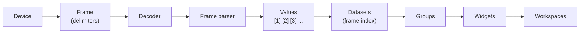

# Concepts

## Overview

Your Arduino prints `Serial.println("21.5,48");` once a second. Serial Studio reads each line as a frame, the frame parser splits it into the values 21.5 and 48, and a dataset picks each value by position and shows it as a plot, a gauge, or whatever widget you choose.

If your device prints numbers separated by commas (name:value pairs and one-line JSON also work), set Operation Mode to **Quick Plot (Auto-Detected Format)** in the Device Setup panel and you are done. **Parse via Project File** lets you change each step below; see [Operation Modes](Operation-Modes.md).

## A worked example

The device sends this line, ending in a newline:

```text
21.5,48
```

- The frame is `21.5,48`. `println` ends the line with a newline, and the default frame detection, End Delimiter Only, ends a frame at the end delimiter, which defaults to `
` (a newline).
- The default decoder, Plain Text (UTF8), turns the bytes into text, and the frame parser splits it on commas and returns the list `[21.5, 48]`. In Quick Plot the splitter is fixed; in Project File mode you pick the Built-In, JavaScript or Lua parser.
- You create datasets in the Project Editor. The dataset Temperature reads frame index 1 and gets 21.5. The dataset Humidity reads frame index 2 and gets 48.
- A second dataset may read index 1 as well, so one value can appear as a Plot and as a Gauge.

To build this two-dataset project step by step, follow the [Project File tutorial](Project-File-Tutorial.md).

Off-by-one trap: the frame index starts at 1, but the array a JavaScript `parse()` returns starts at 0, so index 1 is array element 0. Lua tables start at 1, so index N is table element N. The Built-In parser needs neither.

The [Glossary](Glossary.md) lists every term alphabetically.



## The chain, step by step

The **Operation Mode** selector in the Device Setup panel decides how much of this chain runs: **Console Only (No Parsing)** shows raw bytes, **Quick Plot (Auto-Detected Format)** plots lines of numbers, and **Parse via Project File** runs every row below. In Quick Plot the Frame, Decoder and Frame parser rows run with fixed settings; you edit them only in Project File mode.

| Step | What it is | Where you set it |
|------|------------|------------------|
| **Device** | Where the bytes come from: a serial port, a network socket, Bluetooth LE, or a Pro connection such as Modbus or CAN Bus. The **Connection** selector picks the kind; [Devices](Devices.md) lists which are free. | Device Setup panel |
| **Frame** | One complete message from the device. Frame detection decides where a frame ends. The default, End Delimiter Only, cuts at the newline, which matches `println`. In Quick Plot a frame is one line. Other modes are covered in [Project Editor](Project-Editor.md). | Project Editor, device page |
| **Decoder** | How the frame's bytes become text before parsing: Plain Text (UTF8), Hexadecimal, Base64, or Binary (Direct) for binary parsers. Plain Text (UTF8) is the default and what `println` sends. | Project Editor, device page |
| **Frame parser** | Turns a frame into an ordered list of values. It is the Built-In parser (configured, no code), a JavaScript `parse(frame)` function, or a Lua one. See [Frame Parser Reference](Frame-Parser.md). | Project Editor, frame parser page |
| **Values and frame index** | The parser's output is an ordered list of values. The frame index is a value's 1-based position in it: the first value is index 1, so in a JavaScript `parse()` index N reads array element N-1. A dataset reads exactly one index. Two datasets may read the same index. See [Dataset Identity Model](Identity-Model.md). | Project Editor, dataset page |
| **Dataset** | One named channel, such as a temperature: title, units, ranges, and the widgets that show it. | Project Editor |
| **Group** | A set of related datasets. A group can have a **Group Widget** that shows them together. | Project Editor |
| **Widget** | What appears on the dashboard. Datasets choose dataset widgets (such as Plot, Gauge or LED); groups choose a Group Widget (see the table under Rules). See [Widget Reference](Widget-Reference.md). | Project Editor |
| **Workspace** | A named page of the dashboard that shows a chosen set of widgets. Serial Studio generates workspaces from the groups until you customize them. | Project Editor, workspaces |

## Rules that follow from the chain

A value the parser does not return never arrives. If your Arduino prints three values and a dataset reads frame index 4, that dataset keeps its last value: the gauge looks fine and the number never moves. Nothing errors at once. Once the shortfall has lasted about three seconds, the [Problem Center](Problem-Center.md) (**Ctrl+K**, or Cmd+K on macOS, opens the [Command Palette](Command-Palette.md); type `Problem Center`) raises a warning titled "Frames deliver fewer values than the project expects" (id `short-frames`). See also [Troubleshooting](Troubleshooting.md).

Group Widgets bind datasets by tag, and each widget has its own count rule:

| Group Widget | Datasets it needs |
|--------------|-------------------|
| Accelerometer | Exactly three, tagged x, y and z |
| Gyroscope | Exactly three, tagged x, y, z or pitch, roll, yaw |
| Plot3D | Three or more, including x, y and z |
| GPS Map | Two or more, including lat and lon; alt is optional |
| Data Grid, Multi-Plot, Bar Panel, LED Panel | One or more |

See [Widget Reference](Widget-Reference.md).

A computed dataset (Pro) has no frame index. A transform that never reads `value` makes its dataset computed when the project loads, and the editor greys out the Frame Index field. See [Deriving values](Derived-Values.md), which also compares the ways to compute a value the device does not send.

## Optional layers

None of these is needed for a first dashboard. Two reshape values after parsing: [Value transforms](Dataset-Transforms.md) calibrate or convert one dataset (Pro), and [Variables](Variables.md) are named tables that parsers, transforms and scripts share (Pro). The rest talk to the device or run logic beside the project: [Actions](Actions.md) are free dashboard buttons that send commands, [Output widgets](Output-Controls.md) (sliders, knobs) are their Pro cousins for continuous values, and a [Control Loop](Control-Loop.md) is an optional `setup()` / `loop()` script.

## Next steps

To build a complete project along this chain, follow the [Project File tutorial](Project-File-Tutorial.md); the [Project Editor](Project-Editor.md) page covers the settings in detail.
