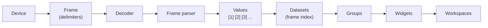

# Concepts

## Overview

Every Serial Studio dashboard comes from the same chain: bytes arrive from a device, get cut into frames, a frame parser turns each frame into a list of values, and datasets pick values out of that list by position. Datasets are organized into groups, groups and datasets choose widgets, and workspaces arrange the widgets on screen. Quick Plot runs this whole chain with fixed settings. Project File mode lets you set each step yourself in the Project Editor.

This page names each link of the chain once, in order. Each term links to the page that covers it in depth, and the [Glossary](Glossary.md) collects every term in alphabetical order.

## The chain, step by step

| Step | What it is | Where you set it |
|------|------------|------------------|
| **Device** | Where the bytes come from: a serial port, a network socket, Bluetooth LE, or one of the Pro connections such as Modbus or CAN Bus. The **Connection** selector picks the kind. See [Devices](Devices.md). | Device Setup panel |
| **Operation Mode** | How incoming data is treated: **Console Only** shows raw bytes, **Quick Plot** plots lines of numbers in a detected format, **Project File** uses a project. See [Operation Modes](Operation-Modes.md). | Device Setup panel |
| **Frame** | One complete message from the device. Frame detection decides where a frame starts and ends: End Delimiter Only, Start Delimiter Only, Start + End Delimiter, or No Delimiters. In Quick Plot a frame is one line. | Project Editor, device page |
| **Decoder** | How the frame's bytes become text before parsing: Plain Text (UTF8), Hexadecimal, Base64, or Binary (Direct) for binary parsers. | Project Editor, device page |
| **Frame parser** | Turns a frame into an ordered list of values. It is the Built-In parser (configured, no code), a JavaScript `parse(frame)` function, or a Lua one. See [Frame Parser Reference](Frame-Parser.md). | Project Editor, frame parser page |
| **Frame index** | The 1-based position of a value in the parser's output: the first value is index 1. A dataset reads exactly one index. Two datasets may read the same index to show one value two ways. See [Dataset Identity Model](Identity-Model.md). | Project Editor, dataset page |
| **Dataset** | One named channel, such as a temperature: title, units, ranges, and the widgets that show it. | Project Editor |
| **Group** | A set of related datasets. A group can have a **Group Widget** that uses all of its datasets together, such as a Data Grid, Multi-Plot, Accelerometer, or GPS Map. | Project Editor |
| **Widget** | What appears on the dashboard. Datasets choose dataset widgets (Plot, FFT, Bar, Gauge, Compass, Meter, LED); groups choose a Group Widget. See [Widget Reference](Widget-Reference.md). | Project Editor |
| **Workspace** | A named page of the dashboard that shows a chosen set of widgets. Serial Studio generates workspaces from the groups until you customize them. | Project Editor, workspaces |

## Rules that follow from the chain

- **A value the parser does not return never arrives.** If the parser returns three values and a dataset reads frame index 4, that dataset keeps its last value and looks frozen. The Problem Center reports this as a `short-frames` finding. See [Troubleshooting](Troubleshooting.md).
- **Group Widgets bind datasets by tag.** An Accelerometer or Gyroscope needs exactly three datasets tagged X, Y and Z; a GPS Map needs datasets tagged lat and lon. The group editor states the requirement and warns while it is unmet.
- **A computed dataset has no frame index.** A dataset whose value transform never reads `value` takes its value from the transform alone, so it reads no position in the frame. See [Deriving values](Derived-Values.md).

## Optional layers

These sit on top of the chain and are not needed for a first dashboard:

- **Value transforms** calibrate or convert one dataset's value after parsing (Pro). See [Dataset Value Transforms](Dataset-Transforms.md).
- **Variables** are tables of named values that parsers, transforms and scripts share (Pro). See [Variables](Variables.md).
- **Control Loop** is an optional `setup()` / `loop()` script that runs beside the project. See [Control Loop](Control-Loop.md).
- **Actions** and **output widgets** send data back to the device; output widgets are Pro. See [Actions](Actions.md) and [Output Controls](Output-Controls.md).

[Deriving values](Derived-Values.md) compares the ways to compute a value that the device does not send directly.

## Next steps

- [Project File tutorial](Project-File-Tutorial.md) builds one complete project along this chain.
- [Project Editor](Project-Editor.md) covers every setting named above.
- [Glossary](Glossary.md) lists every term alphabetically.
