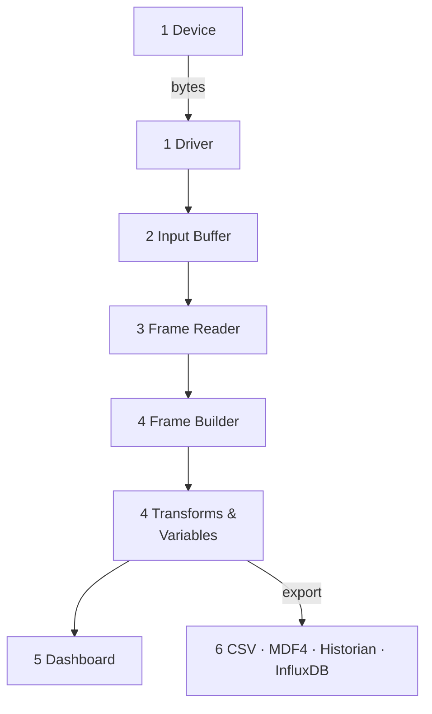

# Data flow in Serial Studio

## Overview

Your board prints `23.5,1013` followed by a newline. Serial Studio reads those bytes, finds the end of the line, splits it into two values and draws them. A frame is one complete message from your device, usually one line. If the dashboard stays empty, the bytes died at one of six stages, and the [troubleshooting table](#troubleshooting-data-flow) at the end maps symptoms to them.

## The pipeline

The diagram below shows the data flow from hardware to dashboard widgets, with the optional export path. Transforms and Variables run inside the frame builder (Stage 4).



## Stage 1: device and driver

For an Arduino or ESP32 you pick UART (the serial port) in the Setup panel and set the baud rate to match `Serial.begin()`. UART, TCP, UDP, WebSocket, HTTP and Bluetooth LE are free. Audio input, Modbus RTU/TCP, CAN Bus, MQTT, USB, HID, Process I/O and the industrial clients (OPC UA, Siemens S7, EtherNet/IP, IEC 60870-5-104) need [Serial Studio Pro](Pro-vs-Free.md). See [Devices](Devices.md) for the full list.

The selected driver receives bytes from the operating system and hands them to the input buffer. It does no parsing; its only job is raw byte transport.

## Stage 2: input buffer

Each source has a 1 MB input buffer between its driver and the frame reader. It absorbs short bursts from a device that talks faster than the computer listens. If the buffer fills, Serial Studio discards the overflowing bytes, counts them and writes a warning to its log (at most once every 5 seconds), so the lost data shows up as missing frames. In Project File mode with No Delimiters, chunks bypass this buffer.

## Stage 3: frame reader

The frame reader scans the input buffer for frame boundaries and extracts complete frames. Quick Plot needs no setup and expects one newline-terminated line per frame. In Project File mode you choose the detection mode and delimiters in the [Project Editor](Project-Editor.md). Five detection modes are available:

| Mode | Finds frames by |
|------|-----------------|
| End Delimiter Only | The end marker; everything before it is the frame. |
| Start + End Delimiter | A start marker, then an end marker; the frame is what sits between them. |
| Start Delimiter Only | Consecutive start markers; a frame runs from one to the next. |
| No Delimiters | Nothing. All data passes through, for a frame parser script that handles length-prefixed or self-delimiting protocols. |
| Fixed Length | Counting N bytes. Optional Header and Body rules re-align the reader after a lost byte; see the [Project Editor](Project-Editor.md). |

The frame reader can also validate a checksum, chosen per source in the Project Editor. The default is none. Algorithms: `XOR-8`, `MOD-256`, `CRC-8`, `CRC-16`, `CRC-16-MODBUS`, `CRC-16-CCITT`, `Fletcher-16`, `CRC-32`, and `Adler-32`. Frames that pass move to the frame builder; frames that fail are dropped.

## Stage 4: frame builder

The frame builder turns each complete frame into a structured record of groups and datasets, based on the current operation mode.

### Quick Plot mode

Set **Operation Mode** to "Quick Plot (Auto-Detected Format)" in the **Device Setup** panel. No project file is needed. Start here with an Arduino printing comma-separated values: select this mode, connect, and the values appear as plots. The frame builder does this:

1. Split the line under the detected format (comma, semicolon, tab, space, name:value or JSON).
2. If the first row is all text and has the same number of fields as the data rows, use it as column titles.
3. Auto-generate a table of values (Data Grid group) and a plot of every channel (Multi-Plot group).
4. Assign values to auto-created datasets.

### Project File mode

Set **Operation Mode** to "Parse via Project File" in the **Device Setup** panel. A parser that splits a comma-separated line is one line of JavaScript, which you enter in the source's frame parser in the [Project Editor](Project-Editor.md):

```javascript
function parse(frame) { return frame.split(","); }
```

The frame builder then does this:

1. Apply the configured decoder (Plain Text (UTF-8), Hexadecimal, Base64, or Binary (Direct)) to turn raw bytes into a parse-ready form.
2. Call the `parse(frame)` function in the source's scripting engine (Lua or JavaScript; see [Frame Parser Scripting](Frame-Parser.md)). The Built-In parser templates skip the script.
3. The function returns a list of values (or a 2D list for multi-frame output).
4. Map returned values to datasets by their Frame Index.
5. Pro: for each dataset, apply its optional `transform(value)` function to convert the raw value into an engineering value. Free users skip this step. See [Dataset Value Transforms](Dataset-Transforms.md) for ordering rules and [Variables](Variables.md) for shared constants.
6. Build the final frame with the populated dataset values. Computed datasets (datasets with no Frame Index) are filled entirely by their transform at this point.

Frames reach the dashboard and the exports in small batches, flushed on every display tick or at 64 frames (4096 samples for continuous streams), whichever comes first. No frame is skipped; the batching only changes how delivery is grouped.

### Multi-source projects (Pro)

Serial Studio Pro supports multi-device projects: each device (source) is parsed independently, with its own frame reader and its own isolated script engine. Source frames are published to the dashboard independently. See [Threading and Timing Guarantees](Threading-and-Timing.md).

## Stage 5: dashboard

The dashboard updates all active widgets with the new values as they arrive. Time-series widgets (plots, FFT, GPS trajectory) append new samples to a fixed-size history and drop the oldest samples once the history is full.

Widgets redraw at most 60 times per second by default. Open **Preferences → Plotting** and set **UI Refresh Rate (Hz)** (1 to 240), or call `dashboard.setFps` through the API Server. Raise it for smoother motion, lower it to cut CPU and GPU load. Every incoming frame is still processed and exported; only the redraw is capped.

## Stage 6: export (optional parallel path)

When CSV export, MDF4 export, the Historian or InfluxDB export is on, every frame is also handed to an export worker. Each worker writes in the background, so disk and network I/O never block the dashboard.

| Target | Edition | Output |
|--------|---------|--------|
| CSV | Free and Pro | One file per session at `Documents/Serial Studio/CSV/<project title>/<yyyy-MM-dd_HH-mm-ss>.csv` (folder `Untitled` when the project has no title). Switch it on with **CSV Spreadsheet** under **Data Export** in the Setup panel. See [CSV Export & Playback](CSV-Export-Playback.md). |
| MDF4 | Pro | A binary measurement file suited to automotive and high-rate workflows. See [MDF4](MDF4.md). |
| Historian | Pro | Every frame, raw byte and table snapshot in a per-project SQLite file that you can browse, tag and replay. See [Historian](Historian.md). |
| InfluxDB 2.x | Pro | Live samples written to a bucket. See [InfluxDB](InfluxDB.md). |

The API Server is a separate path. It is off by default; enable it with **Enable API Server** in Preferences. It then serializes each frame to JSON on TCP port 7777 for connected clients. The gRPC server on port 8888 runs only while the API Server is enabled. See the [API Reference](API-Reference.md).

## Troubleshooting data flow

| Symptom | Likely cause and fix |
|---------|----------------------|
| No data in the console | Check the driver settings in the Setup panel: port, baud rate, IP address or BLE characteristic. |
| Garbled data | Wrong baud rate, wrong decoder (set in the Project Editor) or mismatched delimiters. Open the Console and compare the raw output with the format you expect. |
| Partial frames | Delimiter mismatch. If your device sends `\r\n` while only `\n` is configured, or the reverse, the frames come out cut or padded. Compare the raw console output with the configured delimiters. |
| Data in the console, dashboard empty or not updating | Check **Operation Mode** in the Device Setup panel and that the delimiters match what your device sends. In Project File mode, check that each dataset's Frame Index matches a position in the array `parse()` returns (index 1 is the first element) and that the parser returns a valid array. |
| A widget is frozen, not blank | A dataset keeps its last value when a frame returns fewer elements than its index needs. The parser is returning a shorter array on some frames. |
| High CPU with no dashboard | Short or noisy delimiters (for example a single `\n`) can match inside payload bytes and produce many tiny frames. Use a longer start/end marker or enable a checksum. |
| Choppy animation or high CPU from the dashboard | Set **UI Refresh Rate (Hz)** under **Preferences → Plotting**: raise it for smoother motion, lower it to cut redraw work. No incoming data is lost either way. |
| Export files empty | Export writes only while a device is connected, and the file is created on the first frame. Connect, then turn the export on, or turn it on before you connect. |

## See also

- [Getting Started](Getting-Started.md): first-time setup and Quick Plot tutorial.
- [Operation Modes](Operation-Modes.md): Quick Plot and Project File modes.
- [Project Editor](Project-Editor.md): configure frame parsing and dashboard layout.
- [Frame Parser Scripting](Frame-Parser.md): full Lua and JavaScript parser reference.
- [Dataset Value Transforms](Dataset-Transforms.md): per-dataset calibration, filtering, and unit conversion.
- [Troubleshooting](Troubleshooting.md): fixes for common problems.
- [Threading and Timing Guarantees](Threading-and-Timing.md): which thread each stage runs on and what timing guarantees hold.
- [The Acquisition Pipeline](Data-Hotpath.md): the technical deep dive into this pipeline, for advanced users and plugin authors.
