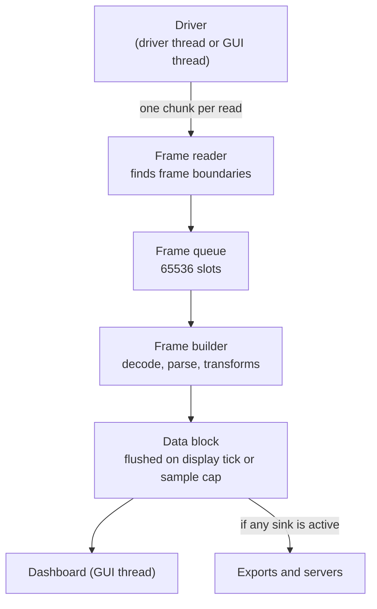

# The acquisition pipeline

Your board prints `23.5,41` and a newline. A moment later a number moves on a plot. In between,
Serial Studio splits the incoming bytes into frames, runs your parser and transforms, and hands
the values to the dashboard and to any export that is switched on. The chain that does this runs
once per received frame and is built to keep up with more than 256 kHz of frames.
[Benchmark](Benchmark.md) (About > Benchmark) measures the figure on your machine.

A parser for that line is two lines long:

```javascript
function parse(frame) {
  return frame.split(",");
}
```

Most projects never need to look at this page. If you use **Quick Plot (Auto-Detected Format)** in
the **Device Setup** panel, you write no parser at all: a built-in line tokenizer splits on
commas, spaces or tabs. See [Operation Modes](Operation-Modes.md).

A chunk is the bytes one read from the device returns, which can hold half a frame or many. A
frame is one complete message. The driver talks to the transport (UART, TCP/UDP, BLE and so on),
and a sink is any export or server that consumes frames besides the dashboard.

## Troubleshooting

| Symptom | What to do |
|---|---|
| `[FrameReader] Frame queue full -- frame dropped (total N)` in the log | A downstream stage is too slow. `N` is the running count of dropped frames. Run About > Benchmark to see which stage is slowest ([Benchmark](Benchmark.md)). Heavy string work or large loops in a parser or transform (a small per-dataset script, see [Dataset Value Transforms](Dataset-Transforms.md)) are the usual cause. |
| Several frames share one timestamp in a plot, CSV or the Historian | They arrived in one chunk, so they share its arrival time. Order is kept; the spacing between them is not measured. Only drivers that know their cadence, such as Audio, space frames. See [Timestamp ownership](#timestamp-ownership). |
| Parser appears to skip frames | Under **Operation Mode** in **Device Setup**, **Console Only (No Parsing)** skips the parser by design. Choose **Parse via Project File** or **Quick Plot (Auto-Detected Format)**, then check the delimiters in the Project Editor. In multi-source projects each source has its own parser engine; an error in one source does not affect the others. |
| Transform changes don't take effect | Transforms recompile when the project is applied to the pipeline: on project load, after a project edit, and when the Lua mode or the transform library changes. If a change still has no effect, reload the project. |
| High CPU but the dashboard is smooth | The bottleneck is upstream of the dashboard. Run About > Benchmark to find the slow stage. The UI refresh rate cap does not reduce parser load. |

## Stages



Everything from the frame reader to the data block runs on one pipeline thread. Only two hops cross
threads: the chunk from the driver, once per read rather than once per frame, and the display tick
out to the dashboard. See [Threading and Timing Guarantees](Threading-and-Timing.md).

### Stage 1: driver

Each driver wraps one transport. Every chunk it publishes carries its bytes, its arrival time and,
when the driver knows them, the frame spacing and the frame count.

### Stage 2: frame reader

`IO::FrameReader` runs on the pipeline thread. It scans for frame boundaries (start delimiter, end delimiter, both, or none) and pulls out one frame at a time.

- Single-delimiter modes use a fast single-pattern search.
- Multi-delimiter modes use a single-pass scan of up to eight patterns that never touches the
  heap.
- Optional checksum validation runs right after extraction. The algorithms are `XOR-8`,
  `MOD-256`, `CRC-8`, `CRC-16`, `CRC-16-MODBUS`, `CRC-16-CCITT`, `Fletcher-16`, `CRC-32` and
  `Adler-32`. See [Project Editor](Project-Editor.md).

Each completed frame goes into a lock-free queue with 65536 slots. When the queue is full, the
frame is dropped and the log gets `[FrameReader] Frame queue full -- frame dropped (total N)`,
where `N` is the cumulative drop count. A full queue means a stage downstream is not keeping up.
Changing the delimiters, decoder or checksum creates a new reader.

### Stage 3: pipeline routing

`IO::PipelineHost::routeFrames` drains the reader's queue on the pipeline thread and hands each
frame to the frame builder, or, for multi-source projects, to the builder for that source.

### Stage 4: frame builder, parser, and transforms

`FrameBuilder` turns raw bytes into a populated `Frame` using the project's parsing rules. That
`Frame` is a reused per-source staging buffer; once it is populated, `FrameBuilder` copies its
values into the current `DataBlock` (see [Stage 5](#stage-5-fan-out)). It runs three things in
order:

1. The selected **decoder** (Plain Text (UTF8), Hexadecimal, Base64, or Binary (Direct))
   converts the raw bytes into the form `parse()` expects.
2. The **frame parser** (`parse(frame)` in Lua or JavaScript) returns an array of values. See
   [Frame Parser Scripting](Frame-Parser.md).
3. Per-dataset **transforms** (`transform(value)`) run in group, then dataset, order. See
   [Dataset Value Transforms](Dataset-Transforms.md).

A transform:

- reads raw values from any dataset, final values from datasets earlier in the order, and shared
  variables from [Variables](Variables.md). A later dataset's final value is the previous frame's.
- can return a string for label-style datasets.
- falls back to the raw value on `NaN`, `Infinity` or an error, silently.

In Quick Plot mode, steps 1 and 2 are replaced by the built-in line tokenizer, which detects the
separator and field names once per connection. In **Console Only (No Parsing)** mode this stage does nothing: bytes go straight to the terminal.

When one chunk holds several frames, they are timestamped as described in
[Timestamp ownership](#timestamp-ownership).

The parser and transforms are the only places where your code runs. A thrown error or a
non-finite return falls back to the raw value (transform) or an empty frame (parser), and the data
stream keeps going. A JavaScript transform that runs too long for one frame is stopped by a
watchdog and the raw values are used. The parser runs once per frame, and transforms run once per
frame for each dataset that defines one, so heavy work in a transform at 10 kHz across 50 datasets
adds up quickly. Transforms that don't declare an `info` parameter (`function transform(value)`)
pay no cost for it.

Computed variables hold their last written value indefinitely, so other transforms can read them
in the same frame or any later one. For state private to one dataset, transform-local upvalues
(top-level `local` in Lua, top-level `var` or `let` in JavaScript) are the lightest option.

#### Parser engine details

- One engine instance per source, never shared across sources.
- Lua runs on embedded LuaJIT 2.1 (Lua 5.1 syntax) with `base` (which includes the coroutine
  functions), `table`, `string`, `math` and `bit` loaded. There is no `utf8` module.
- JavaScript runs on Qt's `QJSEngine` with the Console and Garbage Collection extensions.
- Each parser compiles once, then is called many times.

Two datasets that copy the same template keep separate state in both languages.

### Stage 5: fan-out

`FrameBuilder` doesn't publish per frame. It appends each parsed frame's values as one row into
the current per-source `DataBlock`, a pooled, pre-sized slot. The block flushes when it reaches
its sample cap (64 for frame sources, 4096 for dense stream sources) or when the display tick
has moved since the last flush, whichever comes first:

- The dashboard drains the pooled block from an SPSC ring on `Dashboard::onDisplayTick`, with no
  copy.
- The asynchronous sinks share one detached, trimmed copy of the same block, made once per flush
  and only when at least one sink is active:
  - CSV export (free; **CSV Spreadsheet** under **Data Export** in **Device Setup**; unavailable in **Console Only (No Parsing)** mode).
  - MDF4 export (Pro; **MDF4 Recording** under **Data Export**).
  - The Historian (Pro; **Historian Database** under **Data Export**).
  - The MQTT publisher (Pro; **Enable Publishing** in the Project Editor's **MQTT Publisher** node,
    see [MQTT Publisher](MQTT-Publisher.md)).
  - The API Server (off by default; port 7777; see [API Reference](API-Reference.md)).
  - The gRPC server (port 8888; runs only while the API Server is enabled and only in builds with
    gRPC).

The pipeline thread is the single producer for every consumer. The trimmed copy exists so a slow
export backlog can't pin the pool slot the dashboard is reading. Export workers run on dedicated
threads and consume from lock-free queues, so writing to disk or the network never blocks the
dashboard or the pipeline.

## Timestamp ownership

Each chunk is stamped with the time it arrived, at the driver. Nothing downstream calls
`steady_clock::now()` to stamp a frame after the fact.

When one read returns several frames, as UART does at high rates, they all get nearly the same
timestamp. `frameStep` defaults to 1 ns and is clamped to at least 1 ns. Only drivers that know
their cadence set a real value. Audio does: it spaces the frames of a buffer by the sample rate
and backdates the chunk start so each sample lines up with when it was captured. On UART,
network, BLE, CAN, Modbus and MQTT, all frames from one chunk land within nanoseconds of the
arrival instant.

If timestamps look wrong in a chart or an export, check how the driver stamps the chunk first. The
parser and transforms never change time.

## Performance characteristics

Steady-state frames allocate nothing, and the dashboard reads the pooled block without copying it.

The cost per frame is dominated by your code: the parser call, plus one transform call per
dataset that defines one. The dashboard widget update path is rate-capped by the UI refresh rate
(**Preferences > Plotting > UI Refresh Rate (Hz)**, default 60, range 1 to 240). Every frame is
still parsed and exported; only the visual refresh is throttled.

The [Benchmark](Benchmark.md) (About > Benchmark) drives the real `FrameReader`,
`FrameBuilder` and consumer chain and reports sustained frames per second per stage and per
parser language. The same engine runs headless for CI; see
[Command-Line Interface](Command-Line-Interface.md#acquisition-pipeline-benchmark).

### SIMD instruction set

The vector kernels that scan the byte stream for frame delimiters, reduce plot minima and
maxima, and compute FFT magnitudes and waterfall rows are written once per instruction set and
picked at startup. They are available in every build. On x86-64 the candidates are Scalar, SSE4
and AVX2; on ARM64 they are Scalar and NEON. Serial Studio detects what the processor supports
and runs the widest one.

**Preferences > Startup > System > SIMD Instruction Set** overrides that choice. The list holds
`Auto`, labelled with the level it currently resolves to, plus every level this machine supports.
Selecting one applies it immediately and persists it, with no restart. A level the machine cannot
run is never offered, and a preference carried over from another machine falls back to `Auto`
without rewriting the setting.

`--simd <level>` pins the level for one run without touching the saved preference, which is the
way to compare lanes or to rule the kernels out while diagnosing a numeric difference. See
[Command-Line Interface](Command-Line-Interface.md#general).

## See also

- [Data Flow](Data-Flow.md): a plainer overview of the same pipeline.
- [Threading and Timing Guarantees](Threading-and-Timing.md): why the pipeline runs on its own
  thread.
- [Frame Parser Scripting](Frame-Parser.md): full Lua and JavaScript `parse()` reference.
- [Dataset Value Transforms](Dataset-Transforms.md): per-dataset calibration, filtering, and
  unit conversion.
- [Variables](Variables.md): shared constants and computed variables used by transforms.
- [Operation Modes](Operation-Modes.md): how Project File, Quick Plot, and Console Only modes
  shape the pipeline.
- [Benchmark](Benchmark.md): the interactive tool that drives this pipeline and reports
  its sustained throughput against the 256 kHz gates.
- [Communication Protocols](Communication-Protocols.md): protocol comparison and per-driver
  setup.
- [API Reference](API-Reference.md): how the API server consumes the same shared frame object.
