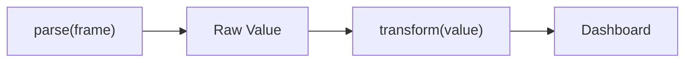

# Dataset value transforms (Pro)

Your pressure sensor prints `2048`, and an ADC count of 2048 is not a pressure. A dataset transform turns it into PSI before it reaches the dashboard. In Lua, the whole transform is three lines:

```lua
function transform(value)
  return value * 100 / 4095
end
```

You paste it into the **Transform** dialog of a dataset in the Project Editor (see [Using the transform dialog](#using-the-transform-dialog)). You need a project first; see [Project Editor](Project-Editor.md#step-4-add-datasets) for adding datasets. The **dataset** is one channel of your data, such as `pressure`. The **raw value** is the number the [frame parser](Frame-Parser.md) extracted for it; by default a comma-separated line like `2048,3.3` becomes one raw value per comma. Whatever the transform returns replaces the raw value in every plot, widget, export, and alarm.

A dataset transform can be written in **Lua**, **JavaScript**, or **Expression**, a single arithmetic formula such as `v * 0.01 + 273.15` with no function around it. If you are unsure, pick Expression for scaling and clamping and Lua for anything with memory (filters, counters). Lua and JavaScript transforms use a `transform(value)` function; Expression transforms are covered in [Expression transforms](#expression-transforms).

Dataset transforms of all three languages are a **Pro feature**. Opening the transform editor needs a license or an active trial, and so does connecting with a project that contains a transform. The first time you use one without either, Serial Studio asks in a Yes/No box whether to start the free 14-day trial. Nothing starts automatically, and registering the trial needs an internet connection. See [Pro vs Free](Pro-vs-Free.md).

To run a project without a license, right-click the dataset in the Project Editor and choose **Remove Transform**. Removing is always free and can be undone.

## Overview

The frame parser (`parse(frame)`) produces an array of raw values, and each value is mapped to a dataset by its Frame Index (the position of the value in the parsed array). An optional transform sits between the parser and the dashboard:



Calibration, unit conversion, filtering, and derived values (rate of change, running total, decibels) belong here; protocol decoding stays in the parser. A dataset without a transform shows the raw parsed value unchanged. You can reuse one parser across projects with different calibrations by changing only the per-dataset transforms.

### When a format is enough

A linear scale and offset need no script: set them under **Value Format** on the dataset page (see [Project Editor](Project-Editor.md#step-4-add-datasets)). The same page holds fixed-point and bit-field decoding, hexadecimal and binary display (**Label Format**), and value-to-text **Labels**. Formats and labels are not Pro content, so a project that uses them without a transform connects with no license.

A dataset can combine a format, a transform, and labels. The format decodes the parsed value first, and the transform receives the decoded number. On a computed dataset, whose transform is its only source, the format decodes the transform's result instead. Labels and the hexadecimal or binary notation apply last, to the text on screen only; every plot, alarm, and export reads the number the format and transform produced.

A transform can also read and write [Variables](Variables.md) tables: constants defined at project time, and computed variables that hold their value across frames. Use them to pass one calibration value into several channels, to have one transform feed another, or to keep state for an integrator, filter, or latch.

## The `transform()` function

Lua and JavaScript transforms use this function. An Expression transform has no function.

### Transform function signature

**Lua:**

```lua
function transform(value)
  return value * 0.01 + 273.15
end
```

**JavaScript:**

```javascript
function transform(value) {
    return value * 0.01 + 273.15;
}
```

### Transform function input

The `value` parameter is the value already parsed from the frame and mapped to this dataset by its Frame Index. When the parsed value is numeric it arrives as a floating-point number (Lua `number` / JS `number`); when it isn't, it arrives as a string (Lua `string` / JS `string`).

Non-numeric dataset values are still passed to the transform as a string. If the transform returns a number, the dataset becomes numeric; if it returns a string, the string value is kept.

### Transform function output

In Lua and JavaScript, the function returns a number, or a string for a text dataset. The returned value replaces the raw value everywhere: dashboard widgets, plots, CSV export, MDF4 export, and the API.

| Condition | Result |
|-----------|--------|
| Returns a number | The dataset value is that number. |
| Returns a string | The string is kept as the dataset value. |
| Returns `nil` (Lua) or `undefined` (JavaScript), or a `NaN` or infinite number in either language | The raw value is kept. |
| Throws or errors, or runs longer than 100 ms | The raw value is kept and a warning with the error message and dataset ID goes to the application log. |

## Using the transform dialog

1. Open the Project Editor and select a dataset in the tree (see [Project Editor](Project-Editor.md#step-4-add-datasets) for adding datasets).
2. Click the **Transform** button in the dataset toolbar.
3. A dialog titled "Dataset Value Transform" opens, with:
   - **Language selector.** Lua, JavaScript, or Expression. Defaults to the source's frame parser language, but each dataset can pick its own.
   - **Template dropdown.** 34 ready-made transforms for common operations. Disabled for Expression.
   - **Code editor.** Syntax-highlighted, with auto-completion.
   - **Clear** button. Resets the editor to the placeholder.
   - **Parameters table.** Named values the transform reads as `params.<name>`; see [Dataset parameters](#dataset-parameters).
   - **Test area.** Enter a raw value, click Test, see the transformed output. The test loads the shared library and the parameter table first, so a transform that calls a library function tests like it runs.
4. Write or pick a `transform(value)` function.
5. Click **Apply** to save the transform to the dataset.

On a dataset with no transform yet, the editor is pre-filled with a comment that explains `transform(value)`. The comment is a placeholder, not a transform. What **Apply** does depends on the editor content:

| Editor content | Apply result |
|----------------|--------------|
| Placeholder only, or empty | Nothing is saved, the dataset keeps showing raw values, and the dialog closes. |
| Text or comments with no `transform()` function | Refused with "The value transform must define a transform(value) function."; the dialog stays open until you define `transform()` or click **Clear**. |
| A valid transform | Saved to the dataset. |

### Switching languages

When you switch the language dropdown, the editor loads the equivalent template in the new language automatically (if the current code matches a known template). Custom code is left unchanged and not translated, so rewrite it for the new language yourself.

## Practical examples

The pressure example at the top is the simplest case. Three more:

### Example 1: noisy temperature sensor

An RTD sensor fluctuates ±0.5°C around the true value. Smooth it with EMA:

```lua
local alpha = 0.15
local ema

function transform(value)
  if ema == nil then
    ema = value
  end

  ema = alpha * value + (1 - alpha) * ema
  return ema
end
```

The state rules are in [Persistent state](#persistent-state).

### Example 2: compass heading normalization

A magnetometer reports heading in radians. Convert to degrees and wrap into 0 to 360:

```lua
function transform(value)
  local degrees = value * 180 / math.pi
  return degrees % 360
end
```

### Example 3: battery voltage with dead zone

A battery monitor fluctuates around 0 V when disconnected. Suppress noise below 0.5 V:

```lua
function transform(value)
  if value < 0.5 then
    return 0
  end

  return value
end
```

## Expression transforms

**Expression** is the third language in the transform dialog's language dropdown, beside Lua and JavaScript, and is Pro like the other two. It has no function, no statements, and no script engine. The editor holds one arithmetic expression, and its value is the dataset's new reading:

```text
v * 0.01 + 273.15
```

Expressions compile to a flat program that runs without allocating, which makes them the cheapest option for the common case of scaling, clamping, and combining channels. Use Lua or JavaScript when the transform needs state, branching over several lines, table access, or `deviceWrite`.

Lines starting with `#` are comments and run to the end of the line.

### Expression inputs

| Name | Value |
|------|-------|
| `v`  | This sample's raw value |
| `t`  | The frame's timestamp in seconds, on the app's monotonic clock (same clock as the JS transform's `info.timestampMs`). Not zero-based at stream start: use `dt`, or subtract the first sample's `t`, for an elapsed-time value. |
| `dt` | Seconds since the previous sample; 0 on the first sample after a connect or recompile |
| `n`  | Sample index, starting at 0 |
| `pi`, `e`, `nan`, `inf` | Constants |

Other datasets of the same source are read by their **Script Alias**, the same identifier `datasetGetRaw` and the API accept. Set the alias in the dataset's Script Alias field in the Project Editor. Dataset titles do not resolve: titles are display text and change freely, while the alias is stable.

```text
v * shunt_current
```

A dataset with no alias is addressed by its **dataset ID**, wrapped in braces because a bare number is a numeric constant:

```text
v * {12}
```

Braces also carry an alias containing spaces.

A sibling holds the latest value published for it, so a dataset processed later in the tree contributes its previous sample. Order datasets in the Project Editor accordingly.

`sample(name, k)` reads a dataset's value `k` samples back, up to 256:

```text
v - sample(shunt_current, 1)
```

The name is bare or braced, never quoted.

### Expression: reading Variables tables

Expressions read table variables with `table(name, variable)`, the same constants and computed variables `tableGet` reaches from Lua and JavaScript:

```text
v * table(calibration, voltage_scale)
```

Both names are bare, or braced when they contain spaces. The variable is resolved to a handle when the expression compiles, so the read costs an array lookup per sample; an unknown variable is a compile error naming the pair.

Access is **read-only**. Writing a variable from an expression would give it an execution-order dependency, which is where a Lua or JavaScript transform with `tableSet` belongs. Computed variables carry the same processing-order caveat as sibling datasets: an expression sees the last value written, which for a variable written later in the same frame is the previous frame's.

`table()` fails to compile on an audio source or any source running the stream lane, since the variable store belongs to another thread.

### Expression operators and functions

Operators, loosest binding first: `||`, `&&`, `==` `!=`, `<` `<=` `>` `>=`, `+` `-`, `*` `/` `%`, `^` (right-associative), unary `-` and `!`, and the conditional `condition ? a : b`.

| Arity | Functions |
|-------|-----------|
| One   | `abs` `floor` `ceil` `round` `sqrt` `cbrt` `exp` `log` `log10` `log2` `sin` `cos` `tan` `asin` `acos` `atan` `sinh` `cosh` `tanh` `deg` `rad` |
| Two   | `min` `max` `pow` `atan2` `hypot` |
| Three | `clamp` `lerp` |

`log` is the natural logarithm. `deg` and `rad` convert between radians and degrees.

### Expression examples

```text
# Scale and offset an ADC reading
v * 0.01 + 273.15
```

```text
# Limit to a range
clamp(v, 0, 100)
```

```text
# Ratio of two channels, guarding the divide
bus_voltage == 0 ? 0 : v / bus_voltage
```

```text
# Difference from one sample ago
v - sample(flow, 1)
```

```text
# Rate per second, guarding the first sample where dt is 0
dt == 0 ? 0 : (v - sample(flow, 1)) / dt
```

### Expression limits

An Expression transform (Pro) compiles to at most 512 nodes (each operator, function call, number, or name counts as one); a longer one is rejected with `expression too long`. `sample(name, k)` accepts `k` up to 256. A compile error is reported once and the dataset publishes its raw value.

The Template dropdown is disabled for Expression: the built-in templates are Lua and JavaScript code and have no expression equivalent.

## Persistent state

In a Lua or JavaScript dataset transform (Pro), variables declared at the top level of the transform code, outside the `transform()` function, keep their value between frames. That is how a filter remembers its last output or a counter remembers its count. Each dataset gets its own copy, so two EMAs on two channels never share a variable. A filter that remembers the last reading is a transform with a short memory; it forgets everything when you disconnect.

Declare stateful variables with `local` (Lua) or `var` (JavaScript) at the top of the file. Someone scanning the top of the transform then sees which variables carry state. The two languages differ on bare globals:

| Language | Top-level `local` / `var` | Bare global (no declaration) |
|----------|--------------------------|------------------------------|
| Lua | Private to the dataset | Also private; still use `local` |
| JavaScript | Private to the dataset | Written to the shared engine and leaks across datasets |

**Lua: declare `local` at the top of the file:**

```lua
local alpha = 0.1
local ema

function transform(value)
  if ema == nil then
    ema = value
  end

  ema = alpha * value + (1 - alpha) * ema
  return ema
end
```

`alpha` and `ema` survive between calls and are private to this dataset. Another dataset on the same source with its own `local ema` neither sees nor overwrites them.

**JavaScript: declare `var` at the top of the file:**

```javascript
var alpha = 0.1;
var ema;

function transform(value) {
  if (ema === undefined)
    ema = value;

  ema = alpha * value + (1 - alpha) * ema;
  return ema;
}
```

Serial Studio wraps each JavaScript transform so top-level `var` declarations belong to that dataset, not to the shared engine.

### Bare globals in JavaScript

An implicit global in JavaScript is written to the shared engine's global object, so another dataset with the same mistake clobbers it:

```javascript
// WRONG: ema has no var, so it is a global on the shared engine.
function transform(value) {
  if (typeof ema === 'undefined') ema = value;
  ema = 0.1 * value + 0.9 * ema;
  return ema;
}
```

Declare `var ema;` at the top instead. Lua has no such problem; see the table above.

### Helper functions

In JavaScript, helpers defined at the top of the file (for example `function clamp(x, lo, hi) { ... }`) are also private per dataset. Safe to use.

In Lua, write helpers as `local function`:

```lua
local function clamp(x, lo, hi)
  if x < lo then return lo end
  if x > hi then return hi end
  return x
end

function transform(value)
  return clamp(value, 0, 100)
end
```

A plain `function foo() end` at the top level also stays private to the dataset in Lua; `local function` is just clearer.

### When state resets

Persistent state (top-level Lua and JavaScript variables and computed table variables) is cleared when:

- The device is disconnected (transform engines are destroyed).
- The user clicks **Apply** in the transform editor (engines are recompiled with fresh state).
- The project is reloaded or saved with changes.

Filters and accumulators start from scratch on each connection; nothing wipes them between frames within one connection.

## Computed datasets

In the Project Editor, if a Lua or JavaScript transform never reads `value`, Serial Studio marks its dataset **computed** when the project loads, and the Frame Index field greys out. The check looks for the free identifier `value`, not `something.value` or `obj:value`. A transform that ignores `value` but expects a frame-driven column loses its Frame Index this way; read `value` at least once to keep the dataset driven by the incoming frame.

A computed dataset has no Frame Index, so nothing in the incoming frame feeds it. You can also tick the computed checkbox yourself in the Project Editor. The transform computes the value entirely, usually by reading other datasets or table variables, and the `value` argument is always `0`.

```lua
function transform(value)
  local a = datasetGetFinal(10)   -- final value of the dataset with ID 10
  local b = datasetGetFinal(11)
  return (a + b) / 2              -- average of two channels
end
```

Use computed datasets for derived metrics (averages, ratios, sums, percentage-of-total) that should appear on the dashboard and in exports but are not in the wire format. A computed dataset still runs every frame in tree order, so place it after the datasets it reads.

## Shared library and parameters

A large project repeats the same formula in many datasets: forty RTD channels that each carry a copy of the same conversion, differing only in three constants. Two project-level features remove the copies.

### The shared libraries

The project can hold one Lua chunk that every Lua transform of the project can call, and one JavaScript chunk that every JavaScript transform can call. Both live under **Project Scripts** at the top of the Project Editor tree, next to the Control Loop, as **Lua Library** and **JavaScript Library**; a transform editor also has an **Open Lua Library** / **Open JavaScript Library** button that jumps to the one its language uses. The API exposes them as well (`project.transformLibrary.get`, `project.transformLibrary.set`, `project.transformLibrary.dryRun`, each with an optional `language` of `lua` or `js`).

```lua
-- Shared library
function rtd(raw, p)
  return (raw * p.scale + p.offset) / p.r0
end
```

The chunk runs once, into the global table of each source's transform state, before the dataset transforms compile. Its top-level functions are visible from every Lua transform through the normal global lookup; a transform's own `local` values still stay private to that transform. Because the library is evaluated at compile time, calling one of its functions costs the same as calling a local helper.

The JavaScript library works the same way: it is evaluated once into the global object of each source's transform engine, so its top-level functions are visible from every JavaScript transform closure of that source. Each library is seen only by transforms of its own language; Expression transforms have no functions to call.

If the library fails to compile or run, the transforms still compile without it: a dataset that calls a missing function falls back to its raw value and the failure appears in the Problem Center under "the shared Lua library" or "the shared JavaScript library". Fix the library and the engines recompile on Apply, without reconnecting.

### Dataset parameters

Each dataset can carry named parameters that its transform reads as `params`. Add them in the **Parameters** table of the transform dialog, one name and value per row, or through the API (`project.dataset.update {transformParams: {...}}`). Values are typed: numeric text becomes a number, `true` and `false` become booleans, anything else stays a string.

```lua
-- Dataset transform: the same three lines on every RTD channel
function transform(value)
  return rtd(value, params)
end
```

With `transformParams` set to `{"scale": 0.1, "offset": -40, "r0": 100}` on one dataset and `{"scale": 0.1, "offset": -40, "r0": 1000}` on the next, both channels share one formula and differ only in their table rows.

`params` is available in Lua and JavaScript. In Lua it is a table in the transform's environment (`params.r0`); in JavaScript it is the object passed to the transform's closure (`params.r0`). Both are fixed at compile time: editing a parameter recompiles the transform. Expression transforms do not read `params`; use a table variable there instead.

## Table API

Lua and JavaScript dataset transforms (Pro) have four built-in functions for reading and writing the project's Variables tables. An Expression transform reads variables with `table(name, variable)` instead, and cannot write. Tables are covered in full in [Variables](Variables.md). This section documents the API surface from the transform's point of view.

| Function                       | Returns                        | Purpose |
|--------------------------------|--------------------------------|---------|
| `tableGet(table, reg)`         | number, string, or nil/undefined | Read a user-defined variable |
| `tableSet(table, reg, value)`  | nothing                        | Write a **computed** variable (constants are read-only) |
| `datasetGetRaw(id_or_alias)`   | number, string, or nil/undefined | Raw (pre-transform) value of any dataset in the current frame |
| `datasetGetFinal(id_or_alias)` | number, string, or nil/undefined | Final (post-transform) value of any dataset already processed in the current frame |

The API is identical in Lua and JavaScript. `table` and `reg` are strings. The dataset lookup takes either the integer dataset ID (`uniqueId` in the API) shown next to each dataset in the Project Editor, or the dataset's alias string (the **Script Alias** field). A number argument is always a dataset ID and a string is always an alias, so `datasetGetRaw(128)` and `datasetGetRaw("128")` are different lookups. An unknown alias returns `nil`/`undefined` with a one-time console warning, the same as an unknown dataset ID.

For a transform that touches the same variables on every value, resolving a name once to a **handle** and using `tableGetH` / `tableSetH` avoids the per-call name lookup. See [Fast table access with handles](SerialStudio-SDK.md#handles-the-fast-path-for-table-heavy-parsers).

**Lua example: scale a voltage reading by a project-wide calibration factor:**

```lua
function transform(value)
  local k = tableGet("calibration", "voltage_scale")  -- constant
  return value * (k or 1.0)
end
```

**JavaScript example: same idea.**

```javascript
function transform(value) {
  var k = tableGet("calibration", "voltage_scale");
  return value * (k !== undefined ? k : 1.0);
}
```

**Writing to a computed variable. One transform publishes, another consumes:**

```lua
-- Dataset 10 (processed first): publish the total current
function transform(value)
  tableSet("runtime", "total_current", value)
  return value
end
```

```lua
-- Dataset 20 (processed later): compute power from current × voltage
function transform(value)
  local i = tableGet("runtime", "total_current") or 0
  return value * i
end
```

### Processing order

Transforms are applied in order: groups in frame order, datasets in group order. Inside a single frame:

- `datasetGetRaw(uid)` returns the current frame's raw value only for the current dataset and the ones already processed before it. Later datasets still hold the previous frame's raw value, because raw and final values are written incrementally per dataset, not in a pre-pass.
- `datasetGetFinal(uid)` only works for datasets that have already been transformed (earlier datasets in the same group, or any dataset in an earlier group).
- Computed variables hold their last written value, so a value written in one frame is still visible in the next, which suits integrators, derivatives, and latched flags. To start a variable fresh each frame, write the reset value yourself at the top of an early transform.

If you need dataset B to consume dataset A's final value, make sure A comes before B in the Project Editor tree.

## Change-driven transforms (opt-in)

The **Change-Driven Transforms** option is a project setting for dataset transforms (Pro). By default every dataset's transform runs on every frame. For a large table-driven project, where the frame parser writes table variables and many computed datasets each read one variable, that means a frame for one device re-runs the transforms of *every* dataset, even the ones whose data did not change.

The toggle turns on a faster mode for computed datasets only; non-computed datasets still run every frame. A computed dataset's transform runs only when one of the variables (or datasets) it reads has changed since it last ran; otherwise it keeps its previous output for that frame. Serial Studio detects reads of table variables and datasets automatically, so you change nothing in your scripts. The dashboard shows the same values either way; the option skips recomputing values that did not change.

To turn it on in the Project Editor:

1. Select the project root.
2. Click the **Settings** button (wrench icon) next to the Project Title.
3. Toggle **Change-Driven Transforms** in the popup, alongside Time Range and Point Count.

It is **off by default** and saved per project. Turn it on for heavy table-driven dashboards that are dropping frames. Two things to know:

- A per-sample filter (an EMA, a deadband) then steps once per *real* new sample of its input rather than once per global frame.
- Serial Studio cannot detect clock reads. A computed dataset that reads the clock (`Date.now()`, `os.time()`) re-runs only when one of its inputs changes; leave the option off for that project, or keep such datasets non-computed.

## Frame metadata: the second `frameInfo` argument

Every transform may declare a second argument with metadata about the frame the value belongs to. One-arg transforms (`function transform(value)`) keep working and pay no extra cost: the engine inspects each transform's parameter count at compile time and skips building the info table or object entirely when it isn't used.

```lua
function transform(value, info)
  -- info.frameNumber : integer, monotonic counter per source (starts at 1)
  -- info.sourceId    : integer, the source the dataset belongs to
  -- info.timestampMs : integer, monotonic milliseconds (steady clock)
  return value
end
```

```javascript
function transform(value, info) {
  // info.frameNumber : number
  // info.sourceId    : number
  // info.timestampMs : number
  return value;
}
```

`info.timestampMs` is a **monotonic** millisecond counter taken from the OS steady clock. It increases between consecutive frames but is not wall-clock time and does not match `Date.now()`. Use it for deltas (`info.timestampMs - lastTs`), not for "what time is it now".

`info.frameNumber` is per-source and restarts at 1 after a disconnect or project reload.

### Example: rate-limit a control update

A transform that nudges the device's setpoint, but no more than ten times per second regardless of frame rate:

```lua
local lastTs = 0
function transform(temperature, info)
  if info.timestampMs - lastTs >= 100 then
    lastTs = info.timestampMs
    local sp = tableGet("Control", "setpoint") or 25.0
    deviceWrite(string.format("SP=%.2f\n", sp))
  end
  return temperature
end
```

### Example: request a status push every 50th frame

```javascript
function transform(value, info) {
  if (info.frameNumber % 50 === 0) deviceWrite("STATUS?\n");
  return value;
}
```

## Writing back to the device: `deviceWrite()`

Lua and JavaScript dataset transforms (Pro) can send bytes back to the connected device with `deviceWrite(data, sourceId?)`. `deviceWrite` is for **closed-loop control**: read a sensor value, compute a setpoint or correction, and push it back to the device in one step.

Lua and JavaScript only; Expression transforms cannot call `deviceWrite`.

### deviceWrite signature

```text
deviceWrite(data, sourceId?)
  data:     string (Lua) or string / array of bytes (JavaScript)
  sourceId: optional number; defaults to the source the transform's dataset belongs to
  returns:  { ok = true }                  on success
            { ok = false, error = "..." }  on failure
```

`deviceWrite` is **synchronous and fire-and-forget**: it pushes the bytes to the driver immediately. It does not block waiting for a reply, and it does not throw. Every failure becomes `{ ok = false, error = "..." }`.

Every call is logged to the application log as `[deviceWrite] source=<id> bytes=<n> written=<n>` so you can verify control commands fired the way you expected.

### Lua example: PWM controller

```lua
local kp = 4.0
local setpoint = 25.0

function transform(sensor_temp)
  local error = setpoint - sensor_temp
  local pwm = math.max(0, math.min(255, kp * error + 128))
  deviceWrite(string.format("PWM=%d\n", math.floor(pwm + 0.5)))
  return sensor_temp
end
```

The transform returns the raw temperature unchanged (so the dashboard still shows the measured value) and writes the computed PWM duty cycle back on every frame.

### JavaScript example: alarm latch

```javascript
var triggered = false;

function transform(value) {
  if (!triggered && value > 100) {
    var r = deviceWrite("ALARM=1\n");
    if (r.ok) triggered = true;
    else console.warn("alarm write failed:", r.error);
  }
  return value;
}
```

The `triggered` variable stops `deviceWrite` from firing again on later frames once the alarm has latched.

### Targeting another source

Pass an explicit `sourceId` to write to a different source. Useful when telemetry arrives on one source and the device's command channel lives on another:

```lua
function transform(value)
  if value < 5 then
    deviceWrite("REQ_FULL_REPORT\n", 0)  -- ask source 0 for a full status frame
  end
  return value
end
```

### deviceWrite failure modes

`deviceWrite` never throws. Possible `error` values:

- `"device not connected or write failed"`: the target source has no live driver, or the driver's `write()` returned 0/negative.
- `"deviceWrite: data is empty"`: the payload was zero bytes.
- `"deviceWrite: data must be a string"` (Lua) / `"... string or byte array"` (JS).
- `"deviceWrite: sourceId must be a number"`.

### When not to use deviceWrite

- For a button or slider the user clicks, use an **Output Widget**. Transforms run on every frame; an Output Widget runs when the user acts.
- A computed dataset can call `deviceWrite`, but it runs in tree order like any other dataset, not last, and fires every frame unless Change-Driven Transforms is on, in which case it runs only when an input changes. Put it after the datasets it reads.
- Keep payloads short. `deviceWrite` runs inside the transform, and a transform that runs longer than 100 ms is stopped and its dataset keeps the raw value.

## Firing actions: `actionFire()`

Lua and JavaScript dataset transforms (Pro) can also trigger any **Action** already defined in the project (see [Actions](Actions.md)). Reuse an existing action (with its prebuilt payload, encoding, and timer mode) instead of hardcoding bytes in a `deviceWrite`.

```text
actionFire(actionId)
  actionId: integer (the action's stable identifier)
  returns:  { ok = true } | { ok = false, error = "..." }
```

`actionId` is the action's `actionId` field: the same persistent integer the project file stores and the API returns. It is **not** the position in the action list. Find it with `project.action.list` (MCP) or read it off the Actions panel in the Project Editor.

```lua
local triggered = false
function transform(value, info)
  if not triggered and value > 100 then
    local r = actionFire(7)
    if r.ok then triggered = true end
  end
  return value
end
```

Behaves like the user pressing the action's button, including running the action's timer (`AutoStart`, `RepeatNTimes`, ...). Calls are logged as `[actionFire] id=N index=M ok`.

`actionFire` is also available in frame parsers and canvas scripts.

## Controlling the dashboard

Transforms can also drive a small set of dashboard helpers: `clearPlots()`, `setPlotPoints(n)`, `setTerminalVisible(bool)`, `setNotificationLogVisible(bool)`, `setClockVisible(bool)`, `setStopwatchVisible(bool)`, and `setActiveWorkspace(idOrName)`. They behave the same way they do in parsers and return the same `{ ok, error }` shape. The typical pattern from a transform is "fire once on a state transition", for example:

```lua
function transform(value)
  if value >= 9999 then    -- device reboot sentinel
    clearPlots()
    return 0
  end
  return value
end
```

Full reference, including argument types and longer examples (GPS fix reset, mode-driven workspace switching, focus mode): see [Controlling the dashboard](Frame-Parser.md#controlling-the-dashboard-clearplots-and-friends) in the Frame Parser Scripting Reference.

## Built-in templates

The Transform Editor includes 34 ready-to-use templates for Lua and JavaScript. Pick one from the Template dropdown and it loads into the editor ready to tune.

### Calibration and conversion

| Template                | Description |
|-------------------------|-------------|
| Linear Calibration      | `y = slope × value + offset`. Sensor calibration. |
| Polynomial (2nd order)  | `y = a×x² + b×x + c`. Non-linear response curves. |
| Map Range               | Rescale from `[inMin, inMax]` to `[outMin, outMax]`. |
| ADC to Voltage          | `value * v_ref / resolution` with `v_ref = 3.3` and `resolution = 1024`, both constants in the code. Edit them for your ADC; a 10-bit full scale is 1023 counts. |
| Calibration from a Variables table | Read slope/offset from a table variable and apply it. |

### Smoothing filters

| Template                         | Description |
|----------------------------------|-------------|
| Moving Average                   | Averages the last N samples via a circular buffer. |
| Exponential Moving Average (EMA) | Weighted average, tunable responsiveness (alpha). |
| Low-Pass Filter                  | First-order IIR, adjustable cutoff via alpha. |
| High-Pass Filter                 | First-order IIR. Removes DC drift and slow offsets. |
| Median Filter                    | Rolling-window median. Robust to outlier spikes. |
| Kalman Filter (1D)               | Scalar Kalman filter with tunable Q (process) and R (measurement) noise. |

### Statistical

| Template              | Description |
|-----------------------|-------------|
| Rolling RMS           | Root-mean-square over the last N samples. Useful for AC signals, vibration, audio. |
| Running Minimum       | Smallest value observed since the transform started. |
| Running Maximum       | Largest value observed since the transform started. |
| Running Accumulator   | Discrete integral (running sum). |
| Rate of Change        | Discrete derivative (`value - previous`). |

### Signal shaping

| Template             | Description |
|----------------------|-------------|
| Clamp                | Restrict output to `[min, max]`. |
| Dead Zone            | Suppress small values near zero. |
| Slew-Rate Limiter    | Cap how much the value can change between consecutive samples. |
| Auto-Zero / Tare     | Average the first N samples, then subtract that bias from every later value. |
| Schmitt Trigger      | Hysteresis comparator. Outputs 0/1 with separate rising and falling thresholds. |

### Angle math

| Template                  | Description |
|---------------------------|-------------|
| Unwrap Angle              | Remove ±360° jumps so the output is continuous across the boundary. |
| Integrate Rate to Angle   | Integrate an angular rate (deg/s) into an absolute angle at a fixed sample rate. |
| Radians to Degrees        | deg = rad × 180/π. |
| Degrees to Radians        | rad = deg × π/180. |

### Unit conversions

| Template                  | Description |
|---------------------------|-------------|
| Celsius to Fahrenheit     | °F = °C × 9/5 + 32. |
| Fahrenheit to Celsius     | °C = (°F - 32) × 5/9. |
| Kelvin to Celsius         | °C = K - 273.15. |
| Logarithmic (dB)          | Convert linear amplitude to decibels. |

### Logic and bit operations

| Template             | Description |
|----------------------|-------------|
| Bit Extract          | Return a single bit from a packed status word (0 or 1). |
| Absolute Value       | Unsigned magnitude. |
| Invert Sign          | Negate the value. |
| Round to N Decimals  | Precision control. |

### Sensors

| Template                    | Description |
|-----------------------------|-------------|
| Steinhart-Hart Thermistor   | NTC resistance to temperature (°C). |

## Rules and limitations

1. The function has to be named `transform` (case-sensitive).
2. It takes one required parameter (`value`), plus an optional second parameter (`info`) with frame metadata (`frameNumber`, `sourceId`, `timestampMs`).
3. It has to return a number, or a string for text datasets (a returned string is kept as the dataset value).
4. Each dataset picks its own transform language (Lua, JavaScript, or Expression); datasets on the same source can mix them. The source's frame parser language is only the default when none is picked. Rules 1 to 3 describe the `transform()` function and apply to Lua and JavaScript; an Expression dataset has no function and publishes the value of its single expression.
5. The engine is sandboxed: no file I/O, no network, no OS commands.
6. Transforms run on every incoming frame, so keep them fast. Avoid unbounded loops or heavy computation. A per-call watchdog kills a transform after 100 ms (Lua: a deadline armed before the call; JavaScript: an interrupt armed once per frame); a timed-out transform logs a warning and falls back to the raw value. Expression transforms are limited to 512 nodes instead (see [Expression limits](#expression-limits)).

## See also

- [SDK Reference](SerialStudio-SDK.md): the full helper surface a transform can call (`tableGet`/`tableSet`, `deviceWrite`, `actionFire`, notifications, protocol encoders).
- [Frame Parser Scripting](Frame-Parser.md): the `parse(frame)` function that feeds values to transforms.
- [Variables](Variables.md): shared constants and computed variables available to every transform.
- [Data Flow](Data-Flow.md): how data moves from device through parsing, transforms, and into the dashboard.
- [Project Editor](Project-Editor.md): where you configure datasets, transforms, and tables.
- [Widget Reference](Widget-Reference.md): dashboard widgets that display transformed values.
