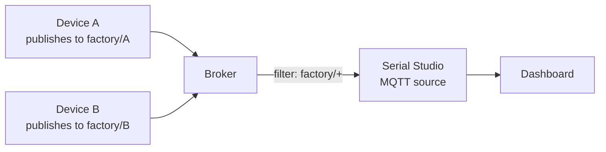

# MQTT Subscriber Driver (Pro)

Your ESP32 publishes a reading to an MQTT broker and you want it on a dashboard. Add a source with **Bus Type** set to **MQTT Subscriber**, enter the broker address and a topic filter, and Serial Studio treats each message like a line arriving on a serial port.

MQTT Subscriber is a Pro feature. Serial Studio offers the 14-day trial with a Yes/No prompt the first time you use a Pro feature; registering the trial needs an internet connection. See [Pro vs Free Features](Pro-vs-Free.md). Without an active license or trial, Connect fails with the dialog "MQTT Feature Requires a Commercial License" and the source does not open. If the license lapses while connected, received messages are dropped and logged.

New to MQTT? [MQTT Topics & Semantics](MQTT-Topics.md) explains brokers, topics and wildcards in five minutes.

## Quick start

1. In the main window's **Device Setup** pane, set the bus type to **MQTT Subscriber**.
2. Set **Hostname** to `test.mosquitto.org`, **Port** to `1883` and **Topic Filter** to `yourname/sensor`. Replace `yourname` with something unique: the broker is public and shared, and anyone using the same topic sees your data.
3. Under **Operation Mode** in the same pane, pick **Quick Plot (Auto-Detected Format)** and connect. Quick Plot needs no frame-detection setting.
4. Publish a line from any machine with the Mosquitto command-line tools installed (`mosquitto_pub` is included with the Mosquitto package):

```bash
mosquitto_pub -h test.mosquitto.org -t yourname/sensor -m "23.5,48.2"
```

Two plots appear, one per comma-separated value. On an ESP32 or Arduino, any MQTT client library can publish the same line. With PubSubClient, after the usual Wi-Fi setup:

```cpp
WiFiClient net;
PubSubClient client(net);

client.setServer("test.mosquitto.org", 1883);
client.connect("yourname-esp32");
client.publish("yourname/sensor", "23.5,48.2");
```

## What an MQTT subscriber sees

The broker keeps a routing table. When a publisher posts to a topic, the broker forwards a copy of the payload to every client whose **topic filter** matches. The driver subscribes at QoS 0 and passes each matching payload to the [frame parser](Frame-Parser.md), the same one a UART source uses. Empty payloads and messages that do not match the filter are dropped.



The broker keeps message boundaries: a 200-byte publish arrives as one 200-byte read. In Project File mode, set **Frame Detection Method** to **No Delimiters** on the source (Project Editor, source settings) and each message is one frame, which suits most MQTT payloads. If the payload carries start or end delimiters, set them there instead.

A filter like `sensors/+/temp` accepts many publishers on one source, and Serial Studio cannot tell them apart from the bytes alone. If the dashboard has to distinguish them, put the publisher's identity in the payload (an ID column in CSV, a `device` field in JSON) or use one source per publisher.

### Payload expectations

The driver does not decode the payload. It hands the bytes to the frame parser of the source's [operation mode](Operation-Modes.md):

- **Quick Plot (Auto-Detected Format)** plots comma-separated numbers: publish `23.5,48.2,1013.25` and each value becomes a plot.
- **Parse via Project File** uses whatever the project's parser accepts: JSON (with a parser that calls `JSON.parse(frame)`), CSV, fixed-byte structs, binary.
- **Console Only (No Parsing)** shows the payload as-is in the terminal.

## Fields

The same settings appear in two places: the Project Editor (the source's **Connection Settings**) and the main window's **Setup** pane. The tables use the Project Editor labels. Port and Topic Filter are enough for a first connection.

| Field | Controls |
|-------|----------|
| **Hostname** | Broker address (IP or hostname). Default `127.0.0.1`. |
| **Port** | Broker TCP port. Default `1883`. For TLS brokers set `8883` yourself; toggling TLS does not change the port. |
| **Topic Filter** | Topic to subscribe to. Supports `+` (one level) and `#` (rest) wildcards. Required; the source will not open without one. Ignored while Sparkplug is on. |
| **Client ID** | Identifier sent on CONNECT. Auto-generated (random 16 characters) when empty. |
| **Username / Password** | Optional broker authentication. |
| **MQTT Version** | MQTT 3.1, 3.1.1, or 5.0. Default MQTT 5.0. |
| **Clean Session** | Ask the broker to forget this client's previous subscriptions and queued messages on every connect. Default on. |
| **Keep Alive (s)** | Keep-alive interval sent to the broker on connect, in seconds. Default 60. |
| **Auto Keep Alive** | Sends those keep-alive pings for you; leave on. Default on. |

The TLS fields:

| Field | Controls |
|-------|----------|
| **SSL/TLS Enabled** | Master TLS toggle. Off by default; when on, the fields below appear. |
| **SSL Protocol** | TLS protocol family. One of Any Protocol, DTLS 1.2 or Later, Secure Protocols Only, TLS 1.2, TLS 1.3, or TLS 1.3 or Later. Default Secure Protocols Only. |
| **Peer Verify Mode** | One of Auto Verify Peer, None, Query Peer, or Verify Peer. Default Auto Verify Peer. |
| **Peer Verify Depth** | Maximum certificate chain length accepted. Default `10`. |
| **Client Certificate** | Path to a PEM client certificate, for mutual TLS. Optional; leave empty for ordinary CA-only (server-authentication) TLS. |
| **Private Key** | Path to the client certificate's private key. Defaults to the certificate file itself when left empty. |
| **Key Passphrase** | Passphrase for an encrypted private key, if the key requires one. |
| **ALPN (MQTT over port 443)** | Offer an ALPN protocol during the TLS handshake, which is how a broker multiplexes MQTT onto port 443. Off by default. |
| **ALPN Protocol** | The protocol name to offer, shown only while ALPN is on. Default `x-amzn-mqtt-ca`, the name AWS IoT Core expects on port 443; other brokers document their own. |

ALPN applies to the handshake only. Offering the wrong protocol name is refused during the handshake, so a failure here reads as a TLS error, not an MQTT one.

The Setup pane adds a **Regenerate** button beside **Client ID**, a **CA Certificates** row whose **Load From Folder…** button imports PEM certificates for self-signed brokers, and **Browse…** buttons beside **Client Certificate** and **Private Key** (both hidden unless **Use SSL/TLS** is on). It omits **Auto Keep Alive** and shortens four labels: **Version**, **Use SSL/TLS**, **Peer Verify** and **Verify Depth**.

Connect is refused, with a log warning and no dialog, when **Hostname** is empty, **Port** is `0` or **Topic Filter** is empty.

Broker username and password are stored obfuscated in the application settings, not in the OS keychain.

The fields are also available through the API Server (off by default, port 7777): `project.mqtt.subscriber.getConfig`, `setConfig` and `getStatus`. See the [API Reference](API-Reference.md). For another walk-through, see the [Protocol Setup Guides, MQTT section](Protocol-Setup-Guides.md#mqtt-setup-pro).

## Multiple MQTT subscribers in one project

Each MQTT source has its own broker session, TLS settings and subscription, so a project with two ESP32 fleets, one on a local broker and one in the cloud, is an ordinary multi-source project:

1. In the Project Editor, add a source and set its **Bus Type** to **MQTT Subscriber**.
2. Set **Hostname**, **Port**, **Topic Filter** and any credentials for the first fleet.
3. Add a second source the same way for the second broker, or for a different topic on the same broker.

Each source has its own frame parser, and its datasets stay tied to their source.

Two sources on one broker work as they are: each gets its own random **Client ID**, so there is no clash unless you copy an ID from one source to another. Two clients sharing an ID is a hallway with one name tag: the broker keeps the newer connection and throws out the older, and with auto-reconnect they can keep kicking each other. In the Project Editor, type a different **Client ID** by hand; the Setup pane also has a **Regenerate** button beside it.

## TLS

For a broker reachable from outside your local network, use TLS:

1. Set **Port** to `8883`, the standard MQTT-over-TLS port.
2. Turn on **SSL/TLS Enabled** (**Use SSL/TLS** in the Setup pane).
3. Leave **Peer Verify Mode** (**Peer Verify** in the Setup pane) on Auto Verify Peer. Set it to None only to test against a self-signed broker, and never against a public one.
4. If the broker uses a private CA, click **Load From Folder…** under **CA Certificates** in the Setup pane and pick the directory with the PEM chain.

For mutual TLS, fill in **Client Certificate**, **Private Key** and **Key Passphrase**. For a broker that serves MQTT on port 443, turn on **ALPN**. The [field table](#fields) lists the defaults.

TLS settings belong to the source, so two subscribers in one project can use different brokers with different trust roots.

## Common pitfalls

- **Subscribed but no data.** Topics are case-sensitive: `Sensors/Temp` is not `sensors/temp`. A filter with the wrong number of levels misses everything silently. Without a license or trial the source never connects, so check for the license dialog too. To see what the broker receives, run `mosquitto_sub -h <broker> -t '#' -v` on your own broker; on a public one, narrow the filter instead.
- **An old value appears first.** The broker replays a topic's retained message the moment you subscribe, so you see the last stored value before any live one.
- **TLS handshake fails.** The broker's certificate chain is not trusted. Import the CA with **Load From Folder…** as described in [TLS](#tls).
- **Mixed payloads on one filter.** A `sensors/+/temp` filter that catches `room1` (CSV) and `room2` (JSON) cannot be parsed cleanly by one frame parser. Standardize the format or use one source per format.
- **High publish rates.** Public brokers add jitter, and a high-rate publisher queues up at the broker. Batch several readings into one message and split them in the frame parser.

## Sparkplug

Skip this section unless your devices already speak Sparkplug.

Sparkplug is a convention layered on MQTT: a fixed topic namespace rooted at `spBv1.0` (for example `spBv1.0/Plant/NDATA/Line1`), protobuf payloads, birth certificates that declare what a node publishes, and a death certificate the broker delivers when that node drops off. As a subscriber, the MQTT driver acts as a host application and turns the namespace into datasets. As a producer, the [MQTT Publisher](MQTT-Publisher.md) acts as an edge node, and the edge-node fields are documented there. Payloads follow the Sparkplug B v1.0 specification, in the Eclipse Tahu schema.

### Subscribing

Tick **Sparkplug** in the Setup pane's MQTT section; the Project Editor does not expose it for the subscriber. The driver then subscribes to the `spBv1.0` namespace itself, so **Topic Filter** does not apply. Two more rows appear:

| Field | Controls |
|-------|----------|
| **Group ID** | Restricts the subscription to one group. Empty means every group on the broker. Wildcards and `/` are refused, because a group id is a single topic element. |
| **Create Project from Births** | A button in the **Sparkplug Project** row. Generates a project from the metrics discovered so far. Enabled once the source is connected. |

Decoding is driven by birth certificates. A node's birth certificate names its metrics and hands out the numeric aliases its later data messages carry. A data message with no birth yet, or with an alias the birth never declared, is held until the birth arrives and counted if it cannot be resolved. Every edge node also gets a synthetic `Online` metric carrying its birth and death state, so a node that dies reads as offline instead of merely going stale. Sequence numbers are checked per node, and a gap is counted rather than interpolated over.

Traffic past these ceilings is refused and counted.

| Limit | Value |
|-------|-------|
| Metrics | 2048 |
| Nodes | 256 |
| Devices per node | 64 |
| Messages held ahead of a birth | 256 |

`project.mqtt.subscriber.getStatus` returns a `sparkplug` block beside the connection state with the group id, the number of discovered metrics and the counters (sequence gaps, cap drops, decode errors, and others). See the [API Reference](API-Reference.md).

### Create Project from Births

Connect first, let the birth certificates arrive, then click **Create Project from Births**. The button builds a project with one MQTT Subscriber source carrying the broker settings and the group id, one group per publishing scope (an edge node, or a device when the node publishes devices), one dataset per discovered metric, and a Built-In frame parser using the **Sparkplug** template. The template's schema parameter is machine-managed: connect again to discover more metrics and generate again rather than editing it by hand. Generating before any birth has arrived reports that nothing was discovered instead of writing an empty project.

The project opens in the Project Editor for customization.

### Publishing as an edge node

To publish your datasets as a Sparkplug edge node instead, open the Project Editor, go to the MQTT publisher's **Sparkplug** section and turn on **Publish as Edge Node**. The fields (**Group ID**, **Edge Node ID**, **Device ID**) and the birth, data and rebirth behavior are documented in [MQTT Publisher](MQTT-Publisher.md).

## See also

- [MQTT Topics & Semantics](MQTT-Topics.md): topics, wildcards, QoS, retained messages, sessions.
- [MQTT Publisher](MQTT-Publisher.md): the outbound side, and where the edge-node fields of [Sparkplug](#sparkplug) are configured.
- [Protocol Setup Guides](Protocol-Setup-Guides.md): step-by-step MQTT setup in the Project Editor.
- [Drivers: Network](Drivers-Network.md): raw TCP/UDP, when you do not need a broker.
- [Troubleshooting](Troubleshooting.md)
- [Eclipse Mosquitto](https://mosquitto.org/): lightweight broker for self-hosting and testing.
