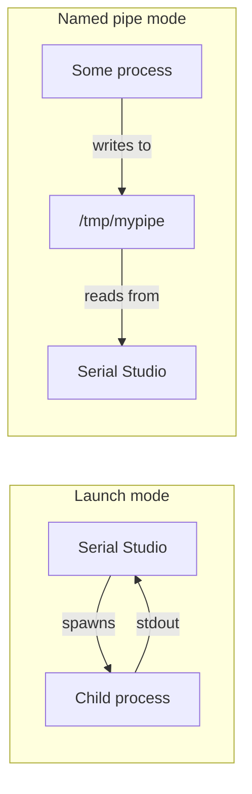

# Process I/O Driver (Pro)

You have a Python script, a command-line tool or another program that prints your readings, and no built-in driver fits it. Process I/O runs that program and reads what it prints, as if the bytes had arrived from a serial port. If your Arduino or ESP32 sits on a USB serial port, use the [UART driver](Drivers-UART.md) instead.

Process I/O is a Pro feature. Without an active license or trial the driver is unavailable. The first time you use a Pro feature, Serial Studio asks Yes or No whether to start a trial; registering the trial needs an internet connection. See [Pro vs Free](Pro-vs-Free.md).

In the Setup pane, choose the Process I/O driver, then set **Mode**:

- **Launch Process** (Launch mode). Serial Studio starts a program and reads what it prints to standard output (stdout), the same stream `Serial.println` feeds on an Arduino. A shell script or a Python program works.
- **Named Pipe** (Named pipe mode). A named pipe is a file-like channel that one program writes into and another reads from. Serial Studio reads from it and creates it when it does not exist. The producer is whatever process opens the same path for writing.

## Example: piping a Python data generator

Save this as `sine.py`. It prints two CSV values about 100 times a second:

```python
import time, math
t = 0
while True:
    t += 0.01
    print(f"{math.sin(t):.3f},{math.cos(t):.3f}", flush=True)
    time.sleep(0.01)
```

1. In the Setup pane, choose the **Process I/O** driver and set **Mode** to **Launch Process**.
2. Set **Executable** to `python3` (use `python` or `py` on Windows if `python3` is not on PATH) and **Arguments** to the full path of `sine.py`.
3. Set **Operation Mode** to Quick Plot, which plots comma-separated values with no project file (see [Operation Modes](Operation-Modes.md)).
4. Click Connect. Serial Studio asks **Allow this project to launch programs?**; answer Yes (see [launch consent](#launch-consent)).

Two lines, a sine and a cosine, start plotting. If the plot stays flat, the script is still holding its output back; the `flush=True` is what prevents that (see [Common pitfalls](#common-pitfalls)). For step-by-step setup, see the [Protocol Setup Guides, Process I/O section](Protocol-Setup-Guides.md).

## How Process I/O works

Serial Studio treats whatever the program writes to stdout as incoming bytes. Data you send from the console goes to the program's standard input (stdin). In Launch mode, stderr is shown in the console only and is never parsed as frames, so a program that logs diagnostics to stderr does not corrupt your data.



Use Launch mode when a fresh process should start with each connection. Use Named pipe mode when the producer is already running. Serial Studio timestamps each chunk when it reads it, so a slow producer does not distort the time axis; see [Threading and Timing Guarantees](Threading-and-Timing.md).

### Launch mode configuration

In the Setup pane, with the Process I/O driver selected, set **Mode** to **Launch Process**.

| Setting | Controls |
|---------|----------|
| **Executable** | Path to the program to run, or a bare name resolved against PATH plus common install directories that GUI apps often miss (Homebrew, `/usr/local/bin`, `~/.local/bin`, snap and Flatpak exports on Linux; `WindowsApps` and Scoop shims on Windows) |
| **Arguments** | Command-line arguments (whitespace-separated; wrap an argument that contains spaces in double quotes) |
| **Working Dir** | The directory the child should be spawned in (cwd); optional |

The extra search directories are also appended to the child's PATH, so a script that spawns `python3` or similar finds it even when Serial Studio was launched from a desktop shortcut.

### Launch consent

Process I/O Launch mode runs a program with your account's privileges, so it asks before it starts one. The first time a project starts its program, Serial Studio asks **Allow this project to launch programs?** and names the program. Click Yes; the answer is remembered for that project file, so later connects of that project do not ask again. The prompt appears whatever triggered the start: the Connect button, an API connect, a reconnect, a project load, or a program set through the API. A Control Loop's `system.exec` needs the same per-project consent.

- **Yes** starts the Process I/O program, and the connect that was refused while the prompt was open is retried once.
- **No** blocks the Process I/O launch until you reopen the project or restart Serial Studio.
- After a remote API client changes the project's scripts or program, or loads a project, the project's remembered answer is cleared once per session, so the next start asks again. Once you answer yes again, later remote changes in the same session leave it granted.
- In a headless run, a project named on the command line (`--headless`) may launch its programs for that run without a prompt. Any other headless start is denied unless `SERIAL_STUDIO_API_AUTO_CONSENT=1` is set.

Named pipe mode starts no program and never asks.

### Named pipe mode configuration

In the Setup pane, with the Process I/O driver selected, set **Mode** to **Named Pipe**.

| Setting | Controls |
|---------|----------|
| **Pipe Path** | Filesystem path (Linux/macOS) or pipe name (Windows) |

Named pipe mode is read-only; the write path (console send) only exists in Launch mode.

For Linux/macOS, if the path does not already exist Serial Studio creates the FIFO for you (with `0600` permissions) when you connect. If the path exists but is not a FIFO, the connection fails with a **Pipe Error** dialog. You can also create the FIFO yourself beforehand:

```sh
mkfifo /tmp/serialstudio_in
```

For Windows, name the pipe with the standard prefix: `\\.\pipe\serialstudio_in`. A Unix-style path makes pipe creation fail with a **Pipe Error** dialog. On Windows the pipe accepts one writer, and on Linux/macOS several writers can share one FIFO, but only Serial Studio should read it because a second reader steals bytes. On Windows Serial Studio acts as the pipe server and always creates the named pipe (byte mode, inbound only), then waits for a writer to connect. The connection stays in the connecting state until a writer opens the pipe. On Linux/macOS it reports connected as soon as the FIFO is open for reading.

In Named Pipe mode, **Pick Running Process…** lists running processes and fills **Pipe Path** with `/tmp/ss-<name>.fifo` (Windows: `\\.\pipe\ss-<name>`), where `<name>` is the process name lowercased with characters other than letters, digits, `_` and `-` replaced by `_`. The producer still has to open that path itself.

### Remote API commands

With the API Server enabled (off by default, TCP port 7777), the TCP API and the in-app AI assistant configure this driver through the `io.process.*` scope. Paths are checked against the API path policy described in the [API Reference](API-Reference.md).

| Command | Parameters | Notes |
|---------|------------|-------|
| `io.process.setMode` | `mode` (0 = Launch, 1 = NamedPipe) | |
| `io.process.setExecutable` | `executable` (string) | Path is validated against the API path policy |
| `io.process.setArguments` | `arguments` (string) | Shell-style argument string; double-quoted substrings stay one argument |
| `io.process.setWorkingDir` | `workingDir` (string) | Path is validated against the API path policy |
| `io.process.setPipePath` | `pipePath` (string) | Path is validated against the API path policy |
| `io.process.listRunning` | none | Refreshes and returns running processes as `name [pid]` |
| `io.process.getConfig` | none | Returns mode, executable, arguments, workingDir, pipePath |

These commands configure the driver; none of them starts a program. Starting it asks the [launch consent](#launch-consent), whoever set the program, so a remote client that points a source at a program still cannot run it without your answer.

Transport details are in the [API Reference](API-Reference.md); command safety tiers are in [AI Assistant](AI-Assistant.md#the-safety-tiers).

## Common pitfalls

- **Nothing plots and the child is running.** The child is buffering its own output. Most runtimes (C stdio, Python `print`) block-buffer stdout when it is a pipe instead of a terminal, so nothing arrives until the buffer fills. Force a flush after each line: in Python use `print(..., flush=True)`; in C use `fflush(stdout)`; for programs you cannot modify, `stdbuf -oL my_program` (Linux coreutils) forces line-buffered output.
- **"Waiting for permission to launch" or "was denied for this project".** The [launch consent](#launch-consent) prompt is open, or it was answered no. Answer the prompt (a yes retries the connect), or reopen the project to be asked again after a no.
- **"Failed to start process" or `Executable "X" not found in PATH.`** The name did not resolve. Give the full path to the executable.
- **Child process exits immediately.** Serial Studio drains any remaining output, shows a dialog titled `Process "<name>" stopped`, with the exit code, and disconnects. Run the child from a normal terminal first to confirm it starts.
- **Arguments with spaces.** The Arguments field splits on whitespace: wrap an argument that contains spaces in double quotes; single quotes are not special. Some programs read files relative to their working directory, so set **Working Dir** when yours does.
- **Permission denied on the pipe.** On Linux/macOS, the FIFO inherits filesystem permissions. `chmod 666 /tmp/mypipe` opens it to all users; tighter permissions require both reader and writer to share a user or group.
- **Data stops after the writer exits.** When the writer closes the pipe, Serial Studio disconnects and shows a **Pipe Closed** dialog. Click Connect again to wait for the next writer. See [Named pipe mode configuration](#named-pipe-mode-configuration) for the writer rules.
- **Pipe buffer fills up.** Linux pipes buffer 64 KB by default, and a writer that outruns Serial Studio blocks until the reader catches up. If the producer must never block, use a TCP socket (see [Drivers: Network](Drivers-Network.md)).

## Further reading

- [subprocess (Python Standard Library)](https://docs.python.org/3/library/subprocess.html)

## See also

- [Protocol Setup Guides](Protocol-Setup-Guides.md): step-by-step Process I/O setup, with both Launch and Named pipe examples.
- [Operation Modes](Operation-Modes.md): Quick Plot is the easiest way to visualize ad-hoc CSV from a script.
- [Frame Parser Scripting](Frame-Parser.md): for parsing whatever your producer emits.
- [Drivers: Network](Drivers-Network.md): for higher-rate streaming when a pipe isn't enough.
