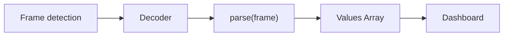

# Frame Parser Reference

Your Arduino prints `Serial.println("23.5,1013,45.2")`. That line is one frame, and its three comma-separated values become three datasets on the dashboard. A new project already parses this with the Built-In *Delimited text* template, so for this device you write no code.

When a device sends something the templates do not cover, you write a `parse()` function. For the same line, in Lua:

```lua
function parse(frame)
  return frame:split(",")
end
```

To run it, set **Operation Mode** to "Parse via Project File" in the **Device Setup** panel and click the **Project Editor** button in the toolbar. Select your source, open its **Frame Parser** tab, set **Platform** to Lua and paste the function. The code is saved with the project as you type; **Validate** checks that it compiles. Then set each dataset's **Frame Index** to 1, 2 and 3. Quick Plot mode needs none of this (see [Operation Modes](Operation-Modes.md)).

## Overview

A frame is one complete message from the device, and a dataset is one value on the dashboard. The frame parser turns each frame into the array of values Serial Studio maps to your datasets. It applies in Project File mode; Quick Plot mode splits lines itself and needs no parser. You edit it in the Project Editor, on the source's **Frame Parser** tab. The frame parser, on all three platforms, is available in the free edition; Pro features are noted where they apply (see [Pro vs Free](Pro-vs-Free.md)).

**Built-In** templates are compiled C++ parsers for common formats (delimited text, key=value, JSON, NMEA, Modbus, TLV and more). You pick a template, adjust its parameters in a form, and read the bundled documentation page for the wire format and channel mapping. No code is involved, and it is the fastest option. New projects start with the Built-In *Delimited text* template configured for comma-separated values.

**Lua** is the recommended scripting language. It runs faster than JavaScript and holds up better at high data rates. **JavaScript** stays supported for existing projects. Scripting is the most flexible way to handle custom protocols: you write a `parse()` function with full control over the frame.

The **Platform** dropdown in the frame parser editor toolbar switches between the three. Every switch converts the current template to its closest equivalent on the new platform: the CSV/TSV/pipe/semicolon script templates map to and from the Built-In *Delimited text* separator, and the other formats map by name.

> **Switching Platform replaces custom code.** Script code that does not match a template is replaced by the default template, so copy it first.

| | Built-In | Lua | JavaScript |
|---|---|---|---|
| **Authoring** | Template + parameters, no code | `parse()` script | `parse()` script |
| **Speed** | Fastest (no interpreter) | Fast | Slower |
| **Timeout** | Not needed (bounded parsers) | 500 ms per call (Safe mode only, see [Safe and Fast Execution Modes](#safe-and-fast-execution-modes)) | 500 ms per call |

## Built-In Templates

Selecting **Built-In** in the **Platform** dropdown replaces the code editor with a template configurator: the template combobox sits in the editor toolbar, with the parameter form and the template's documentation page below it.

To test any parser, see [Test Your Parser](#test-your-parser).

### Available Templates

| Family | Templates |
|---|---|
| Text | Delimited text (CSV by default; any separator text works), Fixed-width fields, Key-value pairs, INI/config format, AT command responses, NMEA 0183 sentences, URL-encoded data, JSON data, XML data, YAML data |
| Binary | Raw bytes, Hexadecimal bytes, Base64-encoded data, Binary TLV, COBS-encoded frames, SLIP-encoded frames, UBX protocol (u-blox), SiRF binary protocol, MAVLink messages, NMEA 2000 messages, RTCM corrections, Modbus frames, MessagePack data |
| Multi-frame | Batched sensor data, Time-series 2D arrays |

Every template exposes typed parameters. For example, *Delimited text* takes the separator text (a comma by default; type `;`, `|` or an escape sequence such as `\t` for tab), an optional quote character, whitespace trimming and empty-field removal. Templates that map named keys to channels (key-value, JSON, NMEA and similar) take an ordered key list: the position of each key in the list is the channel index, and missing keys keep their previous values between frames.

Binary protocol templates expect the matching decoder: select **Binary (Direct)** for TLV, COBS, SLIP, UBX, SiRF, MAVLink, NMEA 2000, RTCM, Modbus and MessagePack, and **Hexadecimal** for the Hexadecimal bytes template. The frame delimiters, checksum and decoder are configured per source, exactly as with scripted parsers.

### Built-In Templates Over the API

The Built-In configuration persists in the project file as `frameParserTemplate` (the template id) and `frameParserParams` (the parameter object) on each source. The control API mirrors this:

- `project.frameParser.listTemplates` returns the template catalog (id, name, description).
- `project.frameParser.getTemplateSchema` returns the parameter schema for a template id.
- `project.frameParser.setTemplate` applies a template (with optional params) to a source and switches it to the Built-In language.
- `project.frameParser.getTemplate` reads the current template and params for a source.
- `project.frameParser.dryRun` accepts `language: 2` with the JSON descriptor `{"template": "delimited", "params": {"separator": ";"}}` as the `code` payload to preview parsing without touching the project. Every `dryRun` call requires `code`, `language`, and one non-empty input (`inputBytesHex`, binary-safe and preferred, or `inputBytes` for UTF-8 text); the pipeline parameters (detection, delimiters, decoder, checksum) are optional and have defaults.

### When to Write a Script Instead

Use Lua or JavaScript when your device speaks a custom protocol that no template covers, when channel values need computation inside the parser, or when you need the scripting extras (`tableGet`/`tableSet`, `deviceWrite`, notifications). For everything the templates cover, Built-In parses the same frames with less setup and more headroom.

## Parser Pipeline



Frame detection (the source's **Frame Detection Method**) cuts the incoming bytes into frames using the **Frame Start Delimiter** and **Frame End Delimiter** (for `Serial.println`, the newline). The source's **Data Conversion Method** then decides what type `frame` has. The default, Plain Text (UTF8), gives a string.

## The `parse()` Function

### `parse()` signature

**Lua:** `function parse(frame) ... return {value1, value2, value3} end`

**JavaScript:** `function parse(frame) { ... return [value1, value2, value3]; }`

### Input Parameter

The `frame` parameter type depends on the **Data Conversion Method** selected for the source in the Project Editor:

| Data Conversion Method | Lua `frame` Type             | JS `frame` Type              | Example Value                      |
|------------------------|------------------------------|------------------------------|------------------------------------|
| Plain Text (UTF8)      | String                       | String                       | `"23.5,1013,45.2"`                 |
| Hexadecimal            | String (hex pairs)           | String (hex pairs)           | `"03ff020035a0"`                   |
| Base64                 | String (base64-encoded)      | String (base64-encoded)      | `"A/8CADWg"`                       |
| Binary (Direct)        | Table of numbers (0--255)    | Array of numbers (0--255)    | `{3, 255, 2, 0, 53, 160}`         |

**Plain Text** is the default. The frame string contains whatever the device sent, decoded as UTF-8, with start/end delimiters already stripped.

**Binary (Direct)** passes byte values directly. In Lua, this is a 1-indexed table; in JavaScript, a 0-indexed array.

### Binary (Direct) frames

With Binary (Direct), `frame` is **not a string**, so string functions fail on it. In Lua, `string.byte(frame, 1)` raises `bad argument #1 to 'byte' (string expected, got table)` and `frame:match(...)` raises `attempt to call a nil value (method 'match')` (tables have no `match` method); in JavaScript, `frame.split(",")` throws `frame.split is not a function`. Read bytes by indexing (`frame[1]` in Lua, `frame[0]` in JavaScript), as in [Example 2](#example-2-binary-protocol-with-header-binary-direct).

LuaJIT has no `string.pack`/`string.unpack`: decode multi-byte or float fields with the `bit` library and manual arithmetic, reading straight from the byte table. Both snippets below read a big-endian 32-bit float followed by a big-endian unsigned 16-bit field, so the same six bytes give the same numbers in either language. For little-endian data, swap the byte order in Lua, or pass `true` as the last argument to the `DataView` getters in JavaScript.

**Lua:**
```lua
local function readFloat32(b1, b2, b3, b4)
  local sign = bit.band(b1, 0x80) ~= 0 and -1 or 1
  local expo = bit.band(b1, 0x7F) * 2 + bit.rshift(b2, 7)
  local mant = bit.band(b2, 0x7F) * 65536 + b3 * 256 + b4
  if expo == 0 then return sign * mant * 2 ^ (-126 - 23) end
  return sign * (1 + mant / 2 ^ 23) * 2 ^ (expo - 127)
end

function parse(frame)
  if #frame < 6 then return {} end
  local temp  = readFloat32(frame[1], frame[2], frame[3], frame[4])
  local flags = bit.lshift(frame[5], 8) + frame[6]
  return { temp, flags }
end
```

**JavaScript:**
```javascript
function parse(frame) {
    if (frame.length < 6) return [];
    var view = new DataView(Uint8Array.from(frame).buffer);
    return [view.getFloat32(0, false), view.getUint16(4, false)];
}
```

### Save-time validation probe

The editor rejects your parser with *"parse function contains an error"* even though the code is fine? When you save, it test-runs `parse()` with a tiny or empty frame, and a function that reads fixed offsets without checking the frame length fails with a runtime error such as `index out of range`. Return `{}` (Lua) or `[]` (JavaScript) when the frame is too short; the length guards in the examples above do exactly this. The same guard matters on a live link, where a truncated frame will eventually arrive.

The probe inputs are `"0"` then `""` in Lua, falling back to the one-element table `{0}` if both fail, and `"0"`, a one-byte array, then `""` in JavaScript. Only source 0 is probed. A broken parser on another source is caught only by a live frame or **Test With Sample Data**.

### Return Value

`parse()` returns a table (Lua) or array (JavaScript). Each position maps to the dataset **Frame Index** you set in the [Project Editor](Project-Editor.md):

| Lua | JavaScript | Dataset Frame Index |
|---|---|---|
| `result[1]` | `result[0]` | 1 |
| `result[2]` | `result[1]` | 2 |
| `result[3]` | `result[2]` | 3 |

Lua tables are 1-indexed and JavaScript arrays are 0-indexed, while Frame Index counts from 1 in both. Return an empty table `{}` (Lua) or `[]` (JavaScript) for invalid or incomplete frames.

#### Flat Array (most common)

**Lua:**
```lua
function parse(frame)
  return frame:split(",")
end
-- Input:  "23.5,1013,45.2"
-- Output: {"23.5", "1013", "45.2"}  (one frame, three datasets)
```

`string.split` is a native, Serial Studio-provided helper: it splits on the literal separator and keeps empty fields (`"1,,3"` -> `{"1", "", "3"}`), exactly like JavaScript's `String.split`. Prefer it over a `gmatch`/`find` loop for delimited frames; it runs in C and is the fast path.

Serial Studio converts numeric text to numbers, so returning the strings `"23.5"` and `"1013"` works without `tonumber()`.

**JavaScript:**
```javascript
function parse(frame) {
    return frame.split(",");
}
```

#### 2D Array (batch / multi-frame)

Return a table of tables (Lua) or array of arrays (JavaScript). Each inner table/array becomes a separate frame:

**Lua:**
```lua
function parse(frame)
  local result = {}
  for _, line in ipairs(frame:split(";")) do
    result[#result + 1] = line:split(",")
  end
  return result
end
-- Input:  "23.5,1013;24.0,1012"
-- Output: {{"23.5","1013"}, {"24.0","1012"}}  (two frames)
```

#### Mixed Scalar/Vector Array

Uncommon, but useful for a header followed by a run of readings: mix scalar values with sub-tables/arrays. Scalars repeat across generated frames; vectors expand, one element per frame. If multiple vectors have different lengths, shorter ones are extended by repeating their last value.

**Lua:**
```lua
function parse(frame)
  local parts = {}
  for _, field in ipairs(frame:split(",")) do
    parts[#parts + 1] = tonumber(field) or field
  end

  local timestamp = parts[1]
  local sensorId  = parts[2]
  local readings  = {}
  for i = 3, #parts do
    readings[#readings + 1] = parts[i]
  end

  return {timestamp, sensorId, readings}
end
-- Input:  "100.0,7,1.1,2.2,3.3"
-- Generates three frames:
--   {100.0, 7, 1.1}
--   {100.0, 7, 2.2}
--   {100.0, 7, 3.3}
```

## Test Your Parser

Before you connect a device, open the source's **Frame Parser** tab in the Project Editor and press **Test With Sample Data**. The Test Frame Parser dialog works with every platform (JavaScript, Lua and Built-In). Paste a sample such as `23.5,1013,45.2` and it shows the extracted frames, the decoder output and the parsed rows as a tree. You can adjust the extraction pipeline in the dialog (detection, delimiters, decoder, checksum). The **Validate** button in the same toolbar checks that the script compiles.

## Debugging

Add `print` calls to see what `parse()` receives. Output goes to the Serial Studio application log, through Qt's message system. Inside **Test With Sample Data**, `print` and `console` output is dropped (see [In dry-run code](#in-dry-run-code-test-dialogs-and-dryrun-commands)); run against a live link to see it.

**Lua:**
```lua
function parse(frame)
  print("Frame:", frame, "| Type:", type(frame), "| Length:", #frame)
  local result = frame:split(",")
  print("Parsed " .. #result .. " fields")
  return result
end
```

**JavaScript:**
```javascript
function parse(frame) {
    console.log("Frame:", frame, "| Type:", typeof frame, "| Length:", frame.length);
    var values = frame.split(",");
    console.log("Parsed:", JSON.stringify(values));
    return values;
}
```

Both languages provide `console.log`, `console.debug`, `console.info`, `console.warn` and `console.error`; `print()` is Lua shorthand for `console.log()`. In both, `console.error` also raises an application notification, and `console.warn` does too when **Route Warnings to Notifications** is enabled in Settings (off by default). Lua joins arguments with tab separators.

## Available APIs

### Lua Standard Libraries

The Lua engine loads a safe subset of the standard library. The following modules are available:

| Module | Key Functions |
|--------|--------------|
| **base** | `print`, `type`, `tonumber`, `tostring`, `pairs`, `ipairs`, `select`, `error`, `pcall`, `xpcall`, `assert`, `rawget`, `rawset`, `rawlen`, `rawequal`, `next`, `setmetatable`, `getmetatable` |
| **string** | `string.byte`, `string.char`, `string.find`, `string.format`, `string.gmatch`, `string.gsub`, `string.len`, `string.lower`, `string.upper`, `string.match`, `string.rep`, `string.reverse`, `string.sub` |
| **table** | `table.concat`, `table.insert`, `table.remove`, `table.sort`, `table.move`, `table.pack`, `table.unpack` |
| **math** | `math.abs`, `math.ceil`, `math.floor`, `math.max`, `math.min`, `math.sqrt`, `math.sin`, `math.cos`, `math.tan`, `math.pi`, `math.huge`, `math.log`, `math.exp`, `math.random` |
| **bit** | `bit.band`, `bit.bor`, `bit.bxor`, `bit.bnot`, `bit.lshift`, `bit.rshift`, `bit.tobit`, `bit.tohex` |

**Serial Studio extensions** (added on top of the standard library):

- `string.split(s, sep)`: native; splits on the literal separator and keeps empty fields, like JavaScript's `String.split`.
- `string.trim`, `string.startswith`, `string.endswith`, and `string.gfind` (alias for `string.gmatch`).
- The Lua 5.1/5.2 compatibility names `math.log10`, `math.pow`, `math.atan2`, `bit32.*`, and `unpack`.

**Not available** (sandboxed): `io`, `os`, `debug`, `package`, `require`, `dofile`, `loadfile`, `load`.

**Bitwise operations**: LuaJIT's 5.1 grammar has no `& | ~ << >>` operators. Use the `bit` library instead: `bit.band(a, b)` (AND), `bit.bor(a, b)` (OR), `bit.bxor(a, b)` (XOR), `bit.bnot(a)` (NOT), `bit.lshift(a, n)` (left shift), `bit.rshift(a, n)` (right shift). If the editor detects `& | ~ << >> //` in code position it offers to rewrite the script to `bit.*` calls automatically (see [Migrating from JavaScript to Lua](#migrating-from-javascript-to-lua)).

**Integer division**: no `//` operator either. Use `math.floor(a / b)`.

### Safe and Fast Execution Modes

Lua only. Each project has one Lua execution mode, set with the **Fast Lua Execution** toggle in the Project Editor's project view. It is off by default (Safe mode).

**Safe mode (default):** the Lua state runs interpreted, with a debug hook that enforces these limits:

| Limit | Value |
|---|---|
| Timeout per call | 500 ms, checked every 10,000 VM instructions |
| Memory | 256 MiB per Lua state (parser, transforms, and the editor's test runs each have their own) |
| Disable after | 3 consecutive timeouts on the same source |

A call that blows the deadline is interrupted with `execution timed out after 500 ms`. A disabled parser stays off until you fix the script and reload the project. A chunk that pushes the state past the memory budget fails with `Lua memory budget exceeded (N MiB in use, limit 256 MiB)`, that frame is dropped, and the state keeps running, so a script that holds its data in a global keeps failing until it releases it. A single allocation of 256 MiB or more is refused outright.

**Fast mode:** the JIT compiler is forced on and the instruction-count hook is never installed, because a JIT-compiled trace never fires a debug hook and an armed watchdog would be a silently dead safety control. Lua parsers and transforms run much faster (the [Benchmark Dialog](Benchmark.md) measures it on your hardware), but a script stuck in an infinite loop stalls that device's pipeline until you disconnect; nothing interrupts it. Enabling Fast mode requires confirming a warning dialog that names this tradeoff. Test scripts in Safe mode first, then switch once trusted.

### JavaScript Standard APIs

The JavaScript engine provides standard ECMAScript built-ins. No browser DOM, no Node.js modules.

| Category | Available |
|----------|-----------|
| **String** | `split`, `substring`, `indexOf`, `trim`, `replace`, `toUpperCase`, `toLowerCase`, `charAt`, `charCodeAt`, `startsWith`, `endsWith`, `includes`, `match`, `search`, `slice`, `padStart`, `padEnd` |
| **Array** | `length`, `push`, `pop`, `shift`, `unshift`, `slice`, `splice`, `reverse`, `sort`, `join`, `concat`, `map`, `filter`, `forEach`, `reduce`, `find`, `findIndex`, `indexOf`, `includes`, `every`, `some`, `fill`, `Array.from`, `Array.isArray` |
| **Number** | `parseInt`, `parseFloat`, `isNaN`, `isFinite`, `Number()`, `.toFixed()`, `.toString(radix)` |
| **Math** | `abs`, `min`, `max`, `round`, `floor`, `ceil`, `sqrt`, `pow`, `sin`, `cos`, `tan`, `atan2`, `log`, `exp`, `PI`, `E`, `random` |
| **JSON** | `JSON.parse()`, `JSON.stringify()` |
| **RegExp** | `/pattern/flags`, `.test()`, `.exec()`, `String.match()`, `String.replace()` |
| **Console** | `console.log()`, `console.debug()`, `console.info()`, `console.warn()`, `console.error()` |

### Global State

Variables declared outside `parse()` persist between calls within the same engine session. Use for frame counters, state machines, moving averages, and protocol state tracking.

**Lua:**
```lua
local frameCount = 0
local history = {}

function parse(frame)
  frameCount = frameCount + 1
  -- ...
end
```

**JavaScript:**
```javascript
var frameCount = 0;
var history = [];

function parse(frame) {
    frameCount++;
    // ...
}
```

Globals are reset when: the project is reloaded, parser code is edited and reapplied, or Serial Studio is restarted. A disconnect and reconnect on the source keeps them, so a stale counter or state machine carries over unless one of those three events fires.

### Fast table access with handles

If your parser writes many [table variables](Variables.md) every frame, looking each one up by name with `tableSet(table, variable, value)` becomes the bottleneck. Resolve the names to **handles** once in global state, then write by handle on the per-frame path:

```javascript
// Runs once at load: resolve variable names to handles.
var H = tableHandleMany("DAQ/BRD-1", ["ch1", "ch2", "ch3", "ch4"]);

function parse(frame) {
  for (var i = 0; i < H.length; i++)
    tableSetH(H[i], frame[i]);   // no name lookup per write
  return [0];
}
```

`tableHandle(table, variable)` resolves one variable (returns `-1` if it does not exist); `tableHandleMany` resolves several of one table at once; `tableGetH(handle)` / `tableSetH(handle, value)` read and write by handle. A stale handle (after a table-definition edit) is a safe no-op, and the script re-resolves on the next load. Full reference: [SDK Reference](SerialStudio-SDK.md#handles-the-fast-path-for-table-heavy-parsers).

## Script Templates (Lua and JavaScript)

On the Lua or JavaScript platform, the **Select Template…** button in the frame parser editor toolbar opens a picker with 28 ready-to-use script templates, the same formats in both languages. On the Built-In platform, the template combobox replaces it and offers Built-In templates instead (see [Built-In Templates](#built-in-templates)).

The script template picker lists: AT Commands, Base64 Encoded, Batched Sensor Data, Binary TLV, COBS Encoded, Comma Separated, Fixed Width Fields, Hexadecimal Bytes, INI Config, JSON Data, Key-Value Pairs, MAVLink, MessagePack, Modbus, NMEA 0183, NMEA 2000, Pipe Delimited, Raw Bytes, RTCM Corrections, Semicolon Separated, SiRF Binary, SLIP Encoded, Tab Separated, Time-Series 2D, UBX (u-blox), URL Encoded, XML Data and YAML Data.

> **MessagePack decode subset:** the template decodes fixint (positive and negative), uint8/16/32, int8/16/32, float32, `nil`, booleans, and fixstr (up to 31 bytes), plus fixarray/array16 and fixmap/map16 for routing to channels. It does **not** decode float64 (`0xCB`), 64-bit ints (`0xCF`/`0xD3`), or str8/str16/str32; a value using one of those markers stops the decode. Python's `msgpack` library packs floats as float64 by default, so a stock Python-side simulator emitting `msgpack.packb(value)` produces frames this template can't decode past the first float field.
>
> **COBS decode scope:** the template only undoes byte-stuffing and emits one decimal channel per recovered byte; a payload packing floats, uint16 fields, or other multi-byte values inside the COBS frame still needs a scripted parser (Binary Direct decoder) to unpack those fields afterward.

When you switch between Lua and JavaScript, Serial Studio automatically loads the same template in the new language.

## Practical Examples

The plainest case, a CSV line, is under [Flat Array](#flat-array-most-common). Examples 2 to 5 are shown in Lua; the [Migrating table](#migrating-from-javascript-to-lua) gives the JavaScript spelling of each construct.

### Example 1: JSON Payload

The two versions differ on purpose. The Lua one returns every numeric value of a flat object in the order the keys appear; the JavaScript one reads three named keys through `JSON.parse`.

**Lua:**
```lua
function parse(frame)
  local result = {}
  for key, value in frame:gmatch('"([^"]+)"%s*:%s*([%d%.%-]+)') do
    result[#result + 1] = tonumber(value)
  end
  return result
end
```

**JavaScript:**
```javascript
function parse(frame) {
    try {
        var obj = JSON.parse(frame);
        return [obj.temperature, obj.humidity, obj.pressure];
    } catch (e) {
        return [];
    }
}
```

### Example 2: Binary Protocol with Header (Binary Direct)

**Lua:**
```lua
function parse(frame)
  if #frame < 8 then return {} end
  if frame[1] ~= 0xAA or frame[2] ~= 0x55 then return {} end

  local temp     = bit.bor(bit.lshift(frame[3], 8), frame[4]) / 100.0
  local pressure = bit.bor(bit.lshift(frame[5], 8), frame[6]) / 10.0
  local humidity = frame[7]
  return {temp, pressure, humidity}
end
```

**JavaScript:**
```javascript
function parse(frame) {
    if (frame.length < 8) return [];
    if (frame[0] !== 0xAA || frame[1] !== 0x55) return [];

    var temp = (frame[2] << 8 | frame[3]) / 100.0;
    var pressure = (frame[4] << 8 | frame[5]) / 10.0;
    var humidity = frame[6];
    return [temp, pressure, humidity];
}
```

### Example 3: Stateful Frame Counter

**Lua:**
```lua
local frameCount = 0

function parse(frame)
  frameCount = frameCount + 1
  local result = {frameCount}
  for _, field in ipairs(frame:split(",")) do
    result[#result + 1] = field
  end
  return result
end
```

### Example 4: XOR Checksum Validation

**Lua:**
```lua
-- Frame format: "1023,512,850*AB"
function parse(frame)
  local data, checkHex = frame:match("^(.+)%*(%x+)$")
  if not data then return {} end

  local checksumReceived = tonumber(checkHex, 16)
  local checksumCalc = 0
  for i = 1, #data do
    checksumCalc = bit.bxor(checksumCalc, data:byte(i))
  end

  if checksumCalc ~= checksumReceived then return {} end

  return data:split(",")
end
```

The loop shows the shape; the built-in helpers do the same in one call, in either language: `if checksumHex("XOR-8", data) ~= checkHex:lower() then return {} end`. See [Checksum Helpers](#checksum-helpers).

### Example 5: Multi-Message State Machine

**Lua:**
```lua
-- Device sends "A:temp,humidity" and "B:voltage,current"
local envValues   = {0, 0}
local powerValues = {0, 0}

function parse(frame)
  local msgType = frame:sub(1, 1)
  local data = frame:sub(3)

  if msgType == "A" then
    local fields = data:split(",")
    for i = 1, #fields do
      envValues[i] = tonumber(fields[i]) or 0
    end
  elseif msgType == "B" then
    local fields = data:split(",")
    for i = 1, #fields do
      powerValues[i] = tonumber(fields[i]) or 0
    end
  end

  return {envValues[1], envValues[2], powerValues[1], powerValues[2]}
end
```

## Checksum Helpers

Use these when the device appends a CRC or XOR trailer you want to verify, or when you build a frame to send. Every script engine, in both languages, exposes the checksum library the frame reader uses for its own trailer validation, so a parser, transform, output widget, canvas or Control Loop never needs its own CRC table:

| Function | Description |
|----------|-------------|
| `checksum(algorithm, data)` | Digest bytes as a binary string in wire order (`CRC-16-MODBUS` little-endian, the rest big-endian), ready to append to a payload |
| `checksumHex(algorithm, data)` | The same digest as lowercase hex, for comparing against a text trailer |
| `checksumAlgorithms()` | The algorithm names: `XOR-8`, `MOD-256`, `CRC-8`, `CRC-16`, `CRC-16-MODBUS`, `CRC-16-CCITT`, `Fletcher-16`, `CRC-32`, `Adler-32` |

`data` is a string (one byte per character in JavaScript, raw bytes in Lua) or an array of byte values (a Lua table of numbers). An unknown algorithm or an argument of any other type raises an error in the script. In Lua the digest is a plain string, so `checksum("CRC-16", body):byte(1, -1)` yields the bytes as numbers; in JavaScript use `charCodeAt`.

```lua
-- Validate a "payload*HH" frame with an XOR-8 trailer
function parse(frame)
  local body, trailer = frame:match("^(.+)%*(%x%x)$")
  if not body or checksumHex("XOR-8", body) ~= trailer:lower() then return {} end
  return body:split(",")
end
```

## Per-Source Parsers

A project with several sources gives each source its own **Frame Parser** tab in the Project Editor and its own engine, so globals in one source do not affect another.

A source with no parser code of its own uses source 0's parser, but only if both sources use the same Platform (Lua, JavaScript or Built-In). With different platforms its frames are dropped. A source that falls back runs in source 0's engine and shares its globals.

## Rules and Limitations

1. The function **must** be named `parse` (case-sensitive).
2. `parse` takes one parameter, the frame.
3. It must return a table (Lua) or array (JavaScript), not a string, number or nil; return an empty one for invalid or incomplete frames.
4. **Synchronous only.** The engine never yields to the host, so the result must be ready when `parse()` returns. Lua's coroutine functions exist but cannot make `parse()` asynchronous; the same goes for JavaScript Promises/async.
5. **500 ms execution timeout** per parse call: JavaScript always, Lua in Safe mode only (see [Safe and Fast Execution Modes](#safe-and-fast-execution-modes)). A call that runs longer is interrupted and the frame is dropped. Three consecutive timeouts on the same source disable that source's parser.
6. No direct file system or network access and no module imports from the script itself; `deviceWrite` and `apiCall` are the only ways out. The excluded libraries are listed under [Lua Standard Libraries](#lua-standard-libraries); JavaScript has no DOM, `window` or `require`.
7. Global tables/arrays that grow without bound will leak memory. Always cap history buffers.
8. **Runtime.** Lua is LuaJIT 2.1 (5.1 syntax plus compatibility shims) with the `base` (including the coroutine functions), `table`, `string`, `math` and `bit` libraries. JavaScript is ECMAScript 7 (ES2016) plus `console`. Numbers are IEEE 754 doubles in both, so there are no native 64-bit integers.

## Migrating from JavaScript to Lua

If you have an existing JavaScript parser and want to switch to Lua for better performance:

| JavaScript | Lua |
|---|---|
| `frame.split(",")` | `frame:split(",")` |
| `frame.length` | `#frame` |
| `frame.indexOf("x")` | `frame:find("x", 1, true)` |
| `parseInt(s, 16)` | `tonumber(s, 16)` |
| `parseFloat(s)` | `tonumber(s)` |
| `Math.floor(x)` | `math.floor(x)` |
| `array.push(v)` | `table[#table + 1] = v` |
| `array[0]` (0-indexed) | `table[1]` (1-indexed) |
| `var x = 0;` | `local x = 0` |
| `for (var i = 0; ...)` | `for i = 1, n do ... end` |
| `0xFF & mask` | `bit.band(0xFF, mask)` |
| `value << 8` | `bit.lshift(value, 8)` |
| `JSON.parse(frame)` | Pattern extraction as in [Example 1](#example-1-json-payload), or the Built-In *JSON data* template |
| `try { } catch(e) { }` | `pcall(function() ... end)` |
| `console.log(x)` | `console.log(x)` or `print(x)` |

## Calling Serial Studio from a parser

A parser can answer the device, fire an action, drive the dashboard or call any API command. None of this is needed to parse a line. The four helpers below are free in frame parsers; dataset transforms and Canvas widgets need Pro (see [Pro vs Free](Pro-vs-Free.md)).

### Writing back to the device: `deviceWrite()`

Use `deviceWrite` when the script that just parsed a frame should answer the device: acknowledge a frame, raise an alarm setpoint, switch the device into a new mode, or pulse a request line. Frame parsers (free and Pro) can call it; calls from dataset transforms need a Pro license (see [Pro vs Free](Pro-vs-Free.md)).

#### deviceWrite() signature

```text
deviceWrite(data, sourceId?)
  data:     string (Lua) or string / array of bytes (JavaScript)
  sourceId: optional number; defaults to the source the parser belongs to
  returns:  { ok = true }                  on success
            { ok = false, error = "..." }  on failure
```

`deviceWrite` is **synchronous and fire-and-forget**: it pushes bytes to the driver and returns immediately. It does not wait for a reply, it does not retry, and it does not block parsing.

Every call is logged to the application log as `[deviceWrite] source=<id> bytes=<n> written=<n>` for debugging.

#### deviceWrite() Lua example

```lua
function parse(frame)
  local values = {}
  for _, field in ipairs(frame:split(",")) do
    values[#values + 1] = tonumber(field) or field
  end

  -- Raise alarm if temperature exceeds threshold
  if (tonumber(values[1]) or 0) > 80 then
    local r = deviceWrite("ALARM=1\n")
    if not r.ok then
      print("alarm write failed:", r.error)
    end
  end

  return values
end
```

#### deviceWrite() JavaScript example

```javascript
function parse(frame) {
  const values = frame.split(",");

  // Acknowledge every frame we successfully parsed
  if (values.length === 4) {
    const r = deviceWrite("ACK\n");
    if (!r.ok) console.warn("ack failed:", r.error);
  }

  return values;
}
```

#### Targeting a specific source with deviceWrite()

In multi-source projects, omit `sourceId` to write back to the same source the parser owns. Pass an explicit `sourceId` to write to a different one. This is useful when one source is the command channel and another is the telemetry channel:

```lua
function parse(frame)
  -- read telemetry on source 1, write commands to source 0
  deviceWrite("STATUS?\n", 0)
  return parseTelemetry(frame)
end
```

#### deviceWrite() failure modes

`{ ok = false, error = ... }` covers all failure cases (`deviceWrite` never throws). The most common reasons:

- `"device not connected or write failed"`: no live driver for that source, or the driver's `write()` returned 0/negative.
- `"deviceWrite: data is empty"`: the payload was zero bytes.
- `"deviceWrite: data must be a string"` (Lua) / `"... string or byte array"` (JS): wrong argument type.
- `"deviceWrite: sourceId must be a number"`: the optional second argument was non-numeric.
- `"dryRun"`: the script is running in a test or dry run, which never writes to a device (see [In dry-run code](#in-dry-run-code-test-dialogs-and-dryrun-commands)).

#### When not to use deviceWrite()

For one-shot user-triggered commands (button press, slider drag), use an **Output Widget** instead: output widgets carry UI, validation, and protocol helpers (CRC, Modbus, NMEA, ...). `deviceWrite` is the right tool when the *parser itself* needs to react to incoming data.

Do not loop on `deviceWrite` inside a single `parse()` call, because the parser stage runs on every frame and runaway writes saturate the link.

### Firing actions: `actionFire()`

Use `actionFire` when the parser itself should trigger an existing project [Action](Actions.md), by its integer `actionId`. Same return shape as `deviceWrite`: `{ ok = true }` on success, `{ ok = false, error = "..." }` on failure. Calls are logged `[actionFire] id=N index=M ok`.

```lua
function parse(frame)
  local values = frame:split(",")
  if tonumber(values[1]) and tonumber(values[1]) < 5 then
    actionFire(3)   -- "Emergency Shutdown"
  end
  return values
end
```

`actionId` is the action's stable identifier (from `project.action.list` or the Project Editor), NOT its position in the action list.

`actionFire` is also available in dataset transforms and canvas scripts; those need a Pro license (see [Pro vs Free](Pro-vs-Free.md)). Frame parsers can call it on the free build.

### Controlling the dashboard: `clearPlots()` and friends

Parsers and dataset transforms can call a small set of dashboard helpers that affect what the user sees on the active window. Use them when the data should change the view: clearing a stale GPS trace the moment a valid fix arrives, hiding the terminal once the device is talking cleanly, or switching to a different workspace when the device reports a new operating mode. These do NOT change the project file, do NOT touch widgets, datasets, or actions, and do NOT log anything to the console.

All of them return the same shape as `deviceWrite` / `actionFire`:

```text
{ ok = true }
{ ok = false, error = "..." }
```

Dashboard helpers never throw and never block. Frame parsers (free and Pro) can call them; calls from dataset transforms and Canvas widgets need a Pro license (see [Pro vs Free](Pro-vs-Free.md)).

#### Dashboard helper function reference

| Function                               | Argument(s)                          | What it does                                                                                          |
|----------------------------------------|--------------------------------------|-------------------------------------------------------------------------------------------------------|
| `clearPlots()`                         | none                                 | Empties every time-series buffer: line plots, multiplots, FFT, GPS traces, 3D plots, waterfall.       |
| `setPlotPoints(n)`                     | integer, >= 1                        | Changes the horizontal sample window for all line plots. Mirrors the **Points** spinner in the toolbar. |
| `setTerminalVisible(visible)`          | boolean                              | Shows or hides the dashboard terminal pane.                                                            |
| `setNotificationLogVisible(visible)`   | boolean                              | Shows or hides the notification log.                                                                   |
| `setClockVisible(visible)`             | boolean                              | Shows or hides the dashboard clock.                                                                    |
| `setStopwatchVisible(visible)`         | boolean                              | Shows or hides the dashboard stopwatch.                                                                |
| `setActiveWorkspace(idOrName)`         | integer workspace id, or string name | Switches the dashboard to the named (or numbered) workspace tab. String match is case-insensitive.     |

`clearPlots` only resets the plot data buffers. Widget settings, dataset definitions, FFT configuration, axis bounds, and actions are left alone. After the call, plots continue to draw the next incoming sample as usual.

`setPlotPoints` has the same effect as the user changing the **Points** value: every line plot reconfigures its rolling buffer. Call it once after detecting a regime change, not on every frame.

The four visibility helpers map one-to-one to the user-facing **Show terminal / notifications / clock / stopwatch** toggles. Per-window: the change applies to whichever dashboard window is active.

`setActiveWorkspace` accepts either the workspace's numeric `workspaceId` (>= 1000) or its title string. If no workspace matches the name, it returns `{ ok = false, error = "setActiveWorkspace: no workspace named \"X\"" }`.

#### Example: reset a GPS plot once a valid fix arrives

Many GPS receivers emit `0, 0` (or last-known stale coordinates) for several seconds before the first real fix. The plot ends up with a garbage line from the origin out to the first valid sample. Watch for the fix transition and clear once.

**Lua:**
```lua
local hadValidFix = false

function parse(frame)
  -- Frame: "lat,lon,quality"  (quality 1 = GPS fix, 0 = no fix)
  local lat, lon, quality = frame:match("([^,]+),([^,]+),([^,]+)")
  lat     = tonumber(lat)
  lon     = tonumber(lon)
  quality = tonumber(quality) or 0

  if not hadValidFix and quality > 0 then
    clearPlots()
    hadValidFix = true
  end

  return {lat, lon, quality}
end
```

**JavaScript:**
```javascript
var hadValidFix = false;

function parse(frame) {
  const parts   = frame.split(",");
  const lat     = parseFloat(parts[0]);
  const lon     = parseFloat(parts[1]);
  const quality = parseInt(parts[2], 10) || 0;

  if (!hadValidFix && quality > 0) {
    clearPlots();
    hadValidFix = true;
  }

  return [lat, lon, quality];
}
```

#### Example: switch workspaces when the device changes mode

A multi-mode device (for example, a flight controller that toggles between *Standby*, *Calibration*, and *Flight*) can drive the dashboard layout from the parser, so the user always sees the workspace that matches the current device mode.

**Lua:**
```lua
local lastMode = nil

function parse(frame)
  -- Frame: "MODE=Flight,alt=120,speed=42"
  local mode = frame:match("MODE=([^,]+)")
  if mode and mode ~= lastMode then
    setActiveWorkspace(mode)
    lastMode = mode
  end

  local alt   = tonumber(frame:match("alt=([%-%d%.]+)"))   or 0
  local speed = tonumber(frame:match("speed=([%-%d%.]+)")) or 0
  return {alt, speed}
end
```

**JavaScript:**
```javascript
var lastMode = null;

function parse(frame) {
  const modeMatch  = frame.match(/MODE=([^,]+)/);
  const mode       = modeMatch ? modeMatch[1] : null;
  if (mode && mode !== lastMode) {
    setActiveWorkspace(mode);
    lastMode = mode;
  }

  const alt   = parseFloat((frame.match(/alt=([\-\d.]+)/)   || [])[1] || 0);
  const speed = parseFloat((frame.match(/speed=([\-\d.]+)/) || [])[1] || 0);
  return [alt, speed];
}
```

#### When not to use the dashboard helpers

These are coarse UI commands, so gate every call behind a state transition (`hadValidFix`, `lastMode`) and let it fire once per event: `clearPlots` on every frame produces an empty graph, and `setActiveWorkspace` on every frame yanks the user's view away.

Script-driven changes are ephemeral. The user's toolbar toggles, **Points** spinner and active workspace are persisted to QSettings or the project file, and a script reacts to the data without overwriting that choice. The helpers affect the active dashboard window only; in a multi-window setup a script cannot address a specific window.

### Calling any API command: `apiCall()`

Use `apiCall` when none of the dedicated helpers (`deviceWrite`, `actionFire`, the [dashboard helpers](#controlling-the-dashboard-clearplots-and-friends)) covers what you need. It is the same command surface exposed on TCP port 7777 for external clients. Frame parsers (free and Pro) can call it; calls from dataset transforms and Canvas widgets need a Pro license (see [Pro vs Free](Pro-vs-Free.md)); the control loop can call it too.

The project's own scripts are first-party, so the gateway is ungated for them: the full command catalog is callable with no allow-list, no rate limit and no payload cap. The consent gates live on the network side. A remote TCP client still clears the user-consent prompts before any device write and before installing or replacing project scripts.

One exception applies to every caller: starting a program (`system.exec`, or a Process I/O source launching its program) asks once per project (see [Control Loop](Control-Loop.md) and [Process I/O](Drivers-Process-IO.md#launch-consent)).

```text
apiCall(method, params?) -> { ok, result?, error?, errorCode?, errorData? }
```

`method` is a dotted command name (for example `"dashboard.snapshot"`, `"ui.window.setActiveGroup"`, `"console.send"`). `params` is an optional object/table that maps to the same JSON parameters the TCP API accepts. See [API Reference](API-Reference.md) for the complete catalog.

A second helper, `apiCallList()`, returns an array of every registered command name, handy for quick discovery from the parser console.

#### apiCall() return shape

| Field        | When set     | Description                                                                  |
|--------------|--------------|------------------------------------------------------------------------------|
| `ok`         | always       | `true` if the command executed successfully, `false` otherwise.              |
| `result`     | success      | The command-specific result object. Absent when the command returns nothing. |
| `error`      | failure      | Human-readable error message.                                                |
| `errorCode`  | failure      | One of `INVALID_PARAM`, `MISSING_PARAM`, `UNKNOWN_COMMAND`, ...              |
| `errorData`  | failure      | Optional structured diagnostic payload (e.g. nearest-name suggestions).      |

`apiCall` never throws. Every failure mode (unknown command, bad params, internal exception) returns a structured `{ ok = false, ... }` table.

#### In dry-run code (test dialogs and dryRun commands)

The **Test With Sample Data** dialog, the transform editor's test, and the dry-run API commands (`project.frameParser.dryRun`, `project.dataset.transform.dryRun`, and the rest listed under [Dry Runs Have No Side Effects](API-Reference.md#dry-runs-have-no-side-effects)) run your script on an inert surface, so a test leaves no trace. In that code:

- `apiCall()`, `deviceWrite()`, `actionFire()` and the dashboard helpers return `{ ok = false, error = "dryRun" }` without dispatching anything.
- `notify*`, `console` and `print` output is dropped.
- `mqttPublish` returns `-1`.
- Table writes go to a scratch copy that is discarded: reads see the current values, the live tables never change.

A script that checks `ok` behaves in a dry run as it does with no device attached.

#### apiCall() examples

**Lua -- bring up the right workspace when a fault flag goes high:**

```lua
local lastFaultBit = 0

function parse(frame)
  local values = frame:split(",")

  local fault = tonumber(values[4] or "0") or 0
  if fault ~= 0 and lastFaultBit == 0 then
    apiCall("ui.window.setActiveGroup", { groupId = 1002 })
    print("[FAULT] code=" .. fault)
  end
  lastFaultBit = fault

  return values
end
```

**JavaScript -- check the dashboard state when an alert arrives:**

```javascript
function parse(frame) {
    const values = frame.split(",");
    if (values[0] === "ALERT") {
        const status = apiCall("dashboard.getStatus");
        if (status.ok && status.result.running)
            console.warn("ALERT received, dashboard at " + status.result.fps + " fps");
    }
    return values;
}
```

**Lua -- discover what's available:**

```lua
function parse(frame)
  if not _G.__listed then
    _G.__listed = true
    local cmds = apiCallList()
    print("Registered commands: " .. #cmds)
    for i = 1, math.min(5, #cmds) do
      print("  " .. cmds[i])
    end
  end
  return { frame }
end
```

#### When not to use apiCall()

`apiCall` runs synchronously inside the parser call: on the pipeline thread it blocks until the command finishes on the GUI thread. Heavy work (mass mutations, project save, MDF4 export) stalls frame processing, so gate every call on an event transition and never call it on every frame.

For clearing plots, toggling panes or switching the workspace, the dedicated `clearPlots()`, `setPlotPoints()` and `setActiveWorkspace()` shortcuts are clearer and cheaper. Commands that mutate the project (`project.save`, `project.batch`, `groups.delete`) are fine from a one-time setup hook but should not fire from the streaming pipeline.

In a build without the commercial features (see [Pro vs Free](Pro-vs-Free.md)) the commercial-tier handlers (Modbus, CAN, sessions, MDF4, MQTT...) are not registered, so `apiCall` returns `{ ok = false, errorCode = "UNKNOWN_COMMAND" }`. Check `ok` before assuming success.

## Performance Tips

- **Use Built-In when a template covers your format; otherwise use Lua for high-frequency data.** Lua's stack-based API avoids the QJSValue boxing overhead. The [Benchmark Dialog](Benchmark.md) measures the difference on your hardware.
- Prefer early returns for invalid frames to skip expensive logic.
- Cap global history buffers with a fixed maximum size.
- Reuse a global result table when possible to minimize allocations.
- In Lua, use `string.find` with `plain=true` (3rd argument) for literal string searches instead of pattern matching.

## See Also

- [SDK Reference](SerialStudio-SDK.md): the `deviceWrite`/`actionFire`/`apiCall`/`tableGet` surface a parser can call to act on what it decodes.
- [Dataset Value Transforms](Dataset-Transforms.md): per-dataset `transform(value)` for calibration, filtering, and unit conversion.
- [Console Annotations](Console-Annotations.md): a decoder that labels raw console bytes for inspection, separate from the parsing pipeline.
- [Data Flow](Data-Flow.md): how data moves from device through parsing to the dashboard.
- [Output Controls](Output-Controls.md): output widgets run `transmit(value)` in a separate JavaScript engine (Pro); that is not parser code.
- [Project Editor](Project-Editor.md): where you write and configure parser code.
- [Operation Modes](Operation-Modes.md): when Project File mode (and thus custom parsers) applies.
- [Benchmark Dialog](Benchmark.md): measures `parse()` throughput per language (Lua vs JavaScript, numeric vs mixed) on your hardware.
- [Troubleshooting](Troubleshooting.md): common parser issues and fixes.
