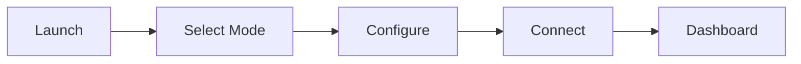

# Getting started with Serial Studio

## Overview

Serial Studio is a cross-platform telemetry dashboard for visualizing real-time data from embedded devices, sensors, and other devices. It runs on Windows, macOS, and Linux.

**Core capabilities:**

- **Devices.** Serial/UART, TCP/UDP, and Bluetooth LE are included in the free edition. MQTT, Modbus, CAN Bus, Audio input, raw USB, HID, and Process I/O are available in Pro.
- **15+ widget types.** Plot, Multi-Plot, FFT Plot, Bar, Gauge, Compass, Meter, Gyroscope, Accelerometer, GPS Map, Data Grid, LED Panel, Terminal, 3D Plot (Pro), Image View (Pro), plus Clock and Stopwatch utility widgets. The Plot widget can take its X axis from another dataset for XY/scatter plots. Bar, Gauge, Meter, and Compass each ship as a two-page swipe view (analog face + large digital readout) so the same tile shows both a quick-glance summary and the exact numeric value.
- **Export.** Save sessions to CSV, or to MDF4 and the Historian (both Pro), for offline analysis.
- **Performance.** Built with Qt 6 and C++20, aimed at 256 kHz+ data rates.
- **Three operation modes.** Console Only for inspecting the raw stream, Quick Plot for instant visualization of text lines, and Project File for fully customized dashboards.

It handles the visualization layer for a range of cases: reading temperature from an Arduino, monitoring a CAN Bus in a vehicle, or building a ground station for a rocket.

If a term on this page is new to you, [Concepts](Concepts.md) explains the chain from device to dashboard on one page, and the [Glossary](Glossary.md) defines every term.

## First connection workflow

This diagram shows the path from launching Serial Studio to seeing data on the dashboard.



## Installation

### Windows

Download the installer from the [releases page](https://github.com/Serial-Studio/Serial-Studio/releases/latest) and run it. [Windows Installation](Windows-Installation.md) covers the unsigned-installer warning, the Visual C++ Redistributable, the portable ZIP, and the Microsoft Store edition.

### macOS

1. Download the DMG from the [releases page](https://github.com/Serial-Studio/Serial-Studio/releases/latest).
2. Open the DMG and drag Serial Studio into **Applications**.

Or install via Homebrew (community-maintained):

```bash
brew install --cask serial-studio
```

The Homebrew cask isn't officially maintained by the Serial Studio team. Use the DMG for guaranteed compatibility.

### Linux

Download the AppImage, DEB, or RPM from the [releases page](https://github.com/Serial-Studio/Serial-Studio/releases/latest), or install from Flathub (`com.serial_studio.Serial-Studio`). [Linux Installation](Linux-Installation.md) covers each package, signature verification, and the [serial port permissions](Linux-Installation.md#serial-port-permissions) a serial device needs.

### Building from source (GPL)

If you'd rather compile from source, you need Qt 6.9+ and CMake:

```bash
git clone https://github.com/Serial-Studio/Serial-Studio.git
cd Serial-Studio
cmake -B build -DCMAKE_BUILD_TYPE=Release
cmake --build build --config Release -j$(nproc)
```

The binary ends up in `build/`.

On Windows the default generator (Visual Studio) is multi-config: it ignores `CMAKE_BUILD_TYPE`, so pass `--config Release` to the build step or you'll build the Debug config (which fails with `'/O2' and '/RTC1' command-line options are incompatible` when production optimization is enabled). Configuring with `-G Ninja` avoids this entirely.

## Interface overview

When you launch Serial Studio, the main window splits into four areas.

### 1. Toolbar (top)

The toolbar runs along the top of the window:

- **Project controls.** Open and edit project files. The **Project Editor** button opens the [Project Editor](Project-Editor.md).
- **Problem Center.** Lists what is stopping data from reaching the dashboard, with a cause and a fix for each finding.
- **Connect/Disconnect button.** Starts or stops the data connection.
- **Examples browser.** Load example projects, downloaded from GitHub on first open (internet required), to see working configurations.
- **CSV / MDF4 (Pro) playback.** Replay previously recorded sessions.

For a button-by-button map of the toolbar, the Setup panel, the dashboard taskbar, and every widget toolbar, see the [Toolbar & Button Reference](Toolbar-Reference.md).

### 2. Console (center, default view)

Before you connect, the console shows the edition details and a one-line hint on how to start. Once connected, it shows raw incoming data from your device, in Text or Hex. The console is handy for confirming that your device is sending data before you configure a dashboard. If a connection stays silent for 10 seconds in Quick Plot or Project File mode, the console prints a hint naming the likely cause.

### 3. Dashboard (center, replaces the console)

Once Serial Studio parses at least one valid frame, the view switches from the Console to the Dashboard. The Dashboard shows real-time widgets (plots, gauges, maps, grids, and so on) arranged according to your configuration. You can show, focus, or restore individual widgets from the taskbar's window buttons at the bottom of the dashboard.

### 4. Device Setup panel (right side, collapsible)

The Device Setup panel is where you configure the connection:

- **Operation Mode.** Console Only, Quick Plot, or Project File, each with a tooltip describing what it expects.
- **Data Export.** CSV, MDF4 (Pro), the Historian (Pro), and the console log.
- **Connection and its settings.** The link type (UART, Network, Bluetooth LE, and the Pro connections), then the port, baud rate, IP address, and so on.

Frame delimiters, the decoder, and the frame parser belong to a project and are set in the [Project Editor](Project-Editor.md).

You can resize the Device Setup panel by dragging its left edge to give the Dashboard more space.

## Your first connection: Quick Plot mode

This is the fastest way to get data on screen. The example uses an Arduino, but the approach works with any device that prints numbers, one line per sample, over a serial port.

### Step 1: prepare your device

Upload this sketch to an Arduino (or adapt it for your board):

```cpp
void setup() {
  Serial.begin(115200);
  pinMode(A0, INPUT);
  pinMode(A1, INPUT);
}

void loop() {
  float t = analogRead(A0) * 0.1;
  float h = analogRead(A1) / 10.0;
  Serial.print("temp:");
  Serial.print(t);
  Serial.print(", hum:");
  Serial.println(h);
  delay(20);
}
```

The requirement is that your device prints numbers, one line per sample, ended by a newline (`\n`, `\r`, or `\r\n`). Serial Studio detects the line format from the first line: `temp:23.5, hum:60`. Names such as `temp` and `hum` title the channels.

Plain comma-separated values work too, with an optional header row of the same width before the first data line:

```
Temperature,Pressure,Humidity
23.5,1013.2,45.0
```

### Step 2: configure Serial Studio

1. Open Serial Studio.
2. In the Device Setup panel on the right, set **Operation Mode** to **Quick Plot (Auto-Detected Format)**.
3. Set **Connection** to **UART**.
4. Pick your device's port in **COM Port** on Windows or **Serial Port** elsewhere (for example `COM3` on Windows, `/dev/ttyUSB0` on Linux, `/dev/cu.usbmodem*` on macOS).
5. Set the baud rate to `115200` (it has to match the value in your Arduino sketch).

### Step 3: connect

Click the **Connect** button in the toolbar. Then:

1. The Console panel displays the raw incoming lines.
2. After a moment, Serial Studio detects valid frames and switches to the Dashboard.
3. The Dashboard shows a Data Grid with your current values and a Multi-Plot with one line per field.

That's all. No project file, no JSON, just connect and visualize.

### Step 4: explore the dashboard

- Use the taskbar's window buttons at the bottom of the dashboard to show, focus, or restore individual widgets (see [Toolbar & Button Reference](Toolbar-Reference.md#dashboard-taskbar)).
- Hover over plots to inspect values.
- Enable CSV export in the Device Setup panel to record the session for later playback.

### Step 5: keep it as a project

When the plot looks right, open the dashboard's start menu and choose **Save as Project**, then pick where to save it. Serial Studio disconnects, switches to Project File mode, and opens the saved project: one device with the current connection settings and Quick Plot's framing, one dataset per channel, and automatic workspaces. The Project Editor opens on the new project. Serial Studio does not reconnect; click **Connect** when you are ready. From there you can rename channels, set units, and pick widgets in the Project Editor. The saved project splits frames on `\n`, which covers `\n` and `\r\n` line endings; a device that ends lines with a bare `\r` needs its end delimiter changed in the Project Editor.

## Your first connection: Project File mode

Project File mode gives full control over how Serial Studio interprets your data and which widgets appear. A `.ssproj` project file, built in the Project Editor, defines the device, its frame delimiters and decoder, the frame parser, and the datasets, groups, and widgets. It is the recommended mode for most real-world projects.

The [Project File tutorial](Project-File-Tutorial.md) builds a complete project from a sample sketch, step by step, and ends with the exact dashboard you should see. In short:

1. Click **Project Editor** in the toolbar. While disconnected, opening the editor switches Serial Studio to Project File mode.
2. On the device page, set the frame detection and delimiters to match what your device sends.
3. On the frame parser page, pick the parser. The Built-In **Delimited text** template splits on commas and needs no code; **Test With Sample Data** shows which dataset reads each value.
4. Add a group and its datasets. Each dataset reads one frame index, the 1-based position of its value in the parser's output.
5. Save the project, pick the device's connection in the Device Setup panel, and click **Connect**.

## Your first connection: Console Only mode

Console Only is a diagnostic mode. Serial Studio doesn't try to parse anything; raw bytes from the device go straight to the terminal. Use it when you want to verify that a device is alive, check the baud rate and framing, or send commands interactively.

### Steps

1. In the Device Setup panel, set **Operation Mode** to **Console Only (No Parsing)**.
2. Pick the **Connection** and configure it (port, baud rate, IP, and so on).
3. Click **Connect**.
4. Raw bytes appear in the terminal. Toggle between Text and Hex display from the console toolbar.
5. Use the input box at the bottom of the console to send bytes back to the device.

No dashboard, no CSV export, no parsing. Once the stream looks correct, switch to Quick Plot or Project File to visualize the data.

## Choosing an operation mode

Start with Quick Plot if your device prints numbers one line per sample, move to Project File when you want your own widgets, labels, and units, and use Console Only to inspect a stream you do not understand yet. [Operation Modes](Operation-Modes.md) compares the three in detail.

## Common first-time issues

The [Problem Center](Problem-Center.md) (the **Problem Center** button in the toolbar, or **Ctrl+K**, then `Problem Center`) diagnoses most of these for you: **Connection Diagnostics** checks port permissions, drivers, and Bluetooth state, and the link checkers say whether bytes, frames, or values are the stage where data stops.

### Serial port not showing up in the dropdown

- **Windows:** Open Device Manager and check under "Ports (COM & LPT)". You may need a USB-to-serial driver: [CH340](http://www.wch-ic.com/downloads/CH341SER_EXE.html), [FTDI](https://ftdichip.com/drivers/vcp-drivers/), or [CP210x](https://www.silabs.com/developers/usb-to-uart-bridge-vcp-drivers).
- **Linux:** Your user needs access to serial devices; see [serial port permissions](Linux-Installation.md#serial-port-permissions). Check the device shows up with `ls /dev/ttyUSB*` or `ls /dev/ttyACM*`.
- **macOS:** Try a different USB port. Check System Settings for security prompts blocking the device. Your device usually appears as `/dev/cu.usbmodem*` or `/dev/cu.usbserial*`.

### No data showing in the console

- Check the baud rate matches your device configuration exactly.
- Make sure no other app (like the Arduino IDE Serial Monitor) has the port open. Only one app can use a serial port at a time.
- Confirm the device is sending data. A logic analyzer or second terminal program is handy for verifying this.
- Try disconnecting and reconnecting.

### Console shows data but no dashboard

- In Quick Plot mode, make sure the device prints numbers, one line per sample. A text-only line is ignored by the dashboard, and a field that is not a number shows as text in the Data Grid and is not plotted.
- In Project File mode, check that your frame delimiters match what the device sends. Switch to Console Only mode to inspect the raw stream, then come back once you know the framing.
- If nothing parses, try Console Only first. If the raw bytes look wrong there, it's a connection/baud/wiring problem, not a parsing problem.

### Some widgets stop updating while others move

The parser returns fewer values than a dataset's frame index expects, so that dataset keeps its last value. The Problem Center names the affected datasets in a `short-frames` finding. See [Parser returns the wrong number of values](Troubleshooting.md#parser-returns-the-wrong-number-of-values).

### Garbled or corrupted data in the console

- Almost always a baud rate mismatch. Double-check both the device firmware and the Serial Studio setting.
- Also check data bits, parity, and stop bits match your device (the 8-N-1 default works for most).

## Next steps

Now that you've made your first connection, here are the recommended paths from here.

### Fundamentals

- **[Concepts](Concepts.md):** the chain from device to dashboard on one page.
- **[Project File tutorial](Project-File-Tutorial.md):** build a complete project step by step.
- **[Operation Modes](Operation-Modes.md):** detailed comparison of all three modes, with examples.
- **[Dataset Identity Model](Identity-Model.md):** how frame index, dataset IDs, and unique IDs relate. The index-versus-ID distinction is the most common beginner trap when editing projects.
- **[Devices](Devices.md):** configure Serial, Network (TCP/UDP), Bluetooth LE, and Pro-edition drivers.
- **[Communication Protocols](Communication-Protocols.md):** compare all supported protocols and pick the right one.
- **[Data Flow](Data-Flow.md):** how Serial Studio processes data from raw bytes to dashboard widgets.

### Custom dashboards

- **[Project Editor](Project-Editor.md):** create and edit project files with custom groups, datasets, and widget configurations.
- **[Widget Reference](Widget-Reference.md):** all 15+ widget types, with configuration details and use-case guidance.
- **[Frame Parser Reference](Frame-Parser.md):** custom frame parsers in Lua or JavaScript for binary or non-standard formats.
- **[Dataset Value Transforms](Dataset-Transforms.md) (Pro):** per-dataset calibration, filtering, and unit conversion.
- **[Deriving values](Derived-Values.md):** which mechanism to use for a value the device does not send directly.

### Advanced features

- **[CSV Export and Playback](CSV-Export-Playback.md):** record sessions and replay them later.
- **[MQTT Subscriber](Drivers-MQTT.md)** and **[MQTT Publisher](MQTT-Publisher.md):** ingest telemetry from a broker or republish parsed frames to one. The protocol vocabulary is in [MQTT Topics & Semantics](MQTT-Topics.md).
- **[Protocol Setup Guides (Pro)](Protocol-Setup-Guides.md):** step-by-step guides for Modbus, CAN Bus, Audio, USB, HID, and Process I/O.
- **[API Reference](API-Reference.md):** automate Serial Studio from external scripts, or connect AI models via MCP on TCP port 7777.

### Explore examples

Click **Examples** in the toolbar to browse working project files bundled with Serial Studio, including GPS trackers, IMU visualizers, and sensor dashboards. Opening an example is one of the best ways to see how project files are structured.

### Get help

- **[Troubleshooting](Troubleshooting.md):** detailed fixes for common problems.
- **[FAQ](FAQ.md):** frequently asked questions.
- **[GitHub Discussions](https://github.com/Serial-Studio/Serial-Studio/discussions):** ask questions and share projects with the community.
