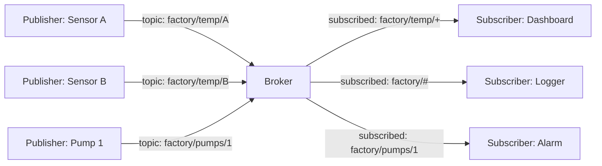
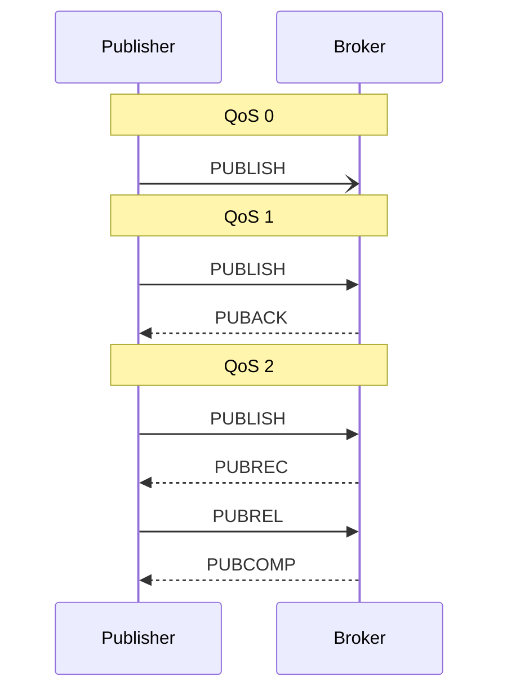

# MQTT Topics & Semantics (Pro)

Your ESP32 publishes a reading to a broker, and Serial Studio subscribes to it and plots it:

```text
topic:   home/esp32-001/temperature
publish: mosquitto_pub -t home/esp32-001/temperature -m 23.5
filter:  home/esp32-001/#        (or home/+/temperature)
```

The broker is the server in the middle, and `mosquitto_pub` is Mosquitto's command-line tool, standing in for your ESP32 (on the board itself, an MQTT client library such as PubSubClient does the publishing).

To try it, install [Eclipse Mosquitto](https://mosquitto.org/) on your PC. In the main window's **Setup** pane, set the bus type to **MQTT Subscriber**, **Hostname** to `localhost`, **Port** to `1883` and **Topic Filter** to `home/esp32-001/#`, pick **Quick Plot** and connect, then run the `mosquitto_pub` line. The payload `23.5` is one number, so it becomes one plot.

The Pro [MQTT subscriber driver](Drivers-MQTT.md) takes data from a broker into Serial Studio. The Pro [MQTT Publisher](MQTT-Publisher.md) sends data from Serial Studio to a broker. This page defines the MQTT terms both use.

## MQTT overview

MQTT is a publish/subscribe protocol. The current version is 5.0; 3.1.1 is still common. Serial Studio supports 3.1, 3.1.1, and 5.0 on both of its MQTT surfaces and defaults to 5.0.

Publishers and subscribers do not connect to each other. They connect to a **broker**, a server that both Serial Studio and your device reach over the network, and the broker handles routing.



Publishers send to a topic and subscribers register a pattern. Neither side knows the other exists, so you can add or remove either without touching the rest.

## Topics

Topics are hierarchical strings separated by `/`:

```text
factory/floor1/zone3/temperature
home/livingroom/sensors/humidity
serial-studio/devices/esp32-001/data
```

The broker does not enforce a schema; topics are just strings. Put the general scope first and the specific last, so one wildcard can select a whole branch.

Topic names are case-sensitive. `Sensors/Temperature` and `sensors/temperature` are two different topics; the broker will not route between them.

### Wildcards

Only subscribers can use **wildcards**, in the filter they register. Enter the filter in the subscriber driver's **Topic Filter** field (Project Editor: the source's Connection Settings; main window: **Setup** pane):

- `+` matches exactly one level. `factory/+/temperature` matches `factory/floor1/temperature` and `factory/floor2/temperature` but not `factory/floor1/zone3/temperature`.
- `#` matches the parent level and every level below it. `factory/#` matches `factory`, `factory/a` and `factory/a/b`. It must be the last character of the filter.

Neither wildcard matches a topic whose first level starts with `$`, such as `$SYS/#`. A common diagnostic trick is to temporarily subscribe to `#` (or `your/prefix/#`) and watch every non-`$` topic the broker routes. `mosquitto_sub -t '#' -v` does the same from a terminal.

Turning **Sparkplug** on in the subscriber replaces the filter with the Sparkplug namespace, so **Topic Filter** is ignored.

## Naming your own topics

Serial Studio does not create the subtopics below. The Publisher writes to the **Topic Base** you set, plus a retained `<TopicBase>/header` for the CSV column names. The layout here is a suggestion for your own devices:

```text
<project>/<device>/data
<project>/<device>/notify
```

Putting the project at the top makes it easy to scope subscribers and ACLs (per-user permission rules on the broker) per project. Putting the device next lets a single subscriber follow one device with `myproject/esp32-001/#` or watch the whole fleet with `myproject/+/data`.

Give each MQTT source in a project its own topic filter. If one filter matches several devices, Serial Studio cannot tell them apart unless the device identifies itself in the payload.

## Quality of Service (QoS)

MQTT publishes can carry one of three QoS levels:

| QoS | Name             | Guarantees |
|-----|------------------|-----------|
| 0   | At most once     | Fire and forget. The message is sent, and it's gone. No retransmission, no ack. May be lost. |
| 1   | At least once    | The publisher resends until the broker acknowledges. The subscriber may receive duplicates. |
| 2   | Exactly once     | Four-message handshake: PUBLISH, PUBREC, PUBREL, PUBCOMP. Guaranteed delivery, no duplicates. Slowest. |

For telemetry, QoS 0 is enough: if a temperature reading is lost, the next one is already on its way. Choose QoS 1 when a lost message is a problem but a duplicate is not; your application ignores the repeat. QoS 2 is for "must arrive exactly once" cases such as billing events and is rarely worth its cost for streaming data.

The Pro [subscriber driver](Drivers-MQTT.md) subscribes at QoS 0. The Pro [MQTT Publisher](MQTT-Publisher.md) publishes its built-in payload modes at QoS 0. In Sparkplug edge-node mode (**Publish as Edge Node**) it also registers its death certificate at QoS 1 and subscribes to its command topic at QoS 1. In the Publisher's script mode, the `mqttPublish()` hook can request any QoS from 0 to 2 and set the retain flag per message.



## Retained messages

A publisher can mark a message as **retained**. The broker remembers the last retained message on each topic and delivers it immediately to any new subscriber. This is the way to signal "current state" rather than "events":

- `home/heating/setpoint` retained: the current setpoint, available to anyone who subscribes.
- `home/heating/events/setpoint-changed` non-retained: the change events, only seen by clients listening at the time.

Retained messages do not expire unless MQTT 5 message expiry is set. Publishing an empty payload to a topic with the retain flag clears the retained message.

Serial Studio's Publisher uses a retained message for the CSV header on `<TopicBase>/header`, so a subscriber that joins late still receives the column schema (see [MQTT Publisher](MQTT-Publisher.md)).

A retained message is delivered first on subscribe and looks like live data until the next publish arrives. The subscriber does not flag retained messages, so a stale value right after connecting is a retained one. Clear it by publishing an empty retained payload to that topic.

## Last Will and Testament

When a client connects, it can register a **Last Will** message: a topic, payload, and QoS that the broker publishes if the client disconnects ungracefully. Devices use it for presence: publish a retained "online" message on connect, and register a will of "offline" on the same topic.

The Pro subscriber driver registers no Last Will. The Pro MQTT Publisher registers one only in Sparkplug edge-node mode (**Publish as Edge Node**): an NDEATH message at QoS 1, not retained.

## Sessions and clean session

Leave **Clean Session** on unless you need the broker to hold messages while a client is offline. A persistent session means the broker remembers a client's subscriptions and queued messages across disconnects, keyed by the client ID. **Clean Session** is on by default in both the Pro subscriber driver (Setup pane) and the Pro MQTT Publisher (Project Editor, MQTT Publisher), so the broker forgets the client between connections.

To have the broker queue messages for an offline client, turn **Clean Session** off, set a fixed client ID, and publish to it at QoS 1 or 2 from your own device or from the Publisher's `mqttPublish()` hook (the built-in modes are QoS 0). The subscriber driver itself subscribes at QoS 0, so a subscriber source gets no queued messages whatever the setting.

## Keep alive

The keep-alive interval, set at CONNECT, is the longest the broker waits for a packet from the client. When the client is idle it sends a ping, so the timer resets. The subscriber driver sends pings only while **Auto Keep Alive** is on (the default; Project Editor only). If the broker hears nothing within 1.5 × keep-alive, it drops the connection and publishes the Last Will, if one is set.

**Keep Alive (s)** defaults to 60 in both the Pro subscriber driver (Setup pane) and the Pro MQTT Publisher (Project Editor, MQTT Publisher). The range is 0 to 65535. Pick a value shorter than the shortest idle timeout on the path (router, corporate firewall, mobile network); on flaky cellular links, use 30 or 15. `0` disables the mechanism, and the broker then notices a dead client only when TCP does.

## Client IDs

Every MQTT client on a broker needs a unique client ID. Serial Studio generates a random 16-character ID for each surface:

| Surface | ID | Where to change it |
|---------|----|--------------------|
| Pro subscriber driver | Kept until you change it | Setup pane, **Regenerate** |
| Pro MQTT Publisher | New on every project load, unless **Custom Client ID** is on | Project Editor, MQTT Publisher, **Custom Client ID** |

If two clients connect to the same broker with the same client ID, the broker disconnects the older one. Two Serial Studio instances on one broker need distinct client IDs, and so do two MQTT sources in one project.

## Popular brokers

For a first test, use [Eclipse Mosquitto](https://mosquitto.org/) on your PC: a single binary, easy to configure. For something bigger, [EMQX](https://www.emqx.io/) and [VerneMQ](https://vernemq.com/) scale out, and AWS IoT Core, Azure IoT Hub, HiveMQ Cloud and EMQX Cloud are managed.

Public test brokers such as `test.mosquitto.org` and `broker.hivemq.com` suit development only; check each site for its current ports. Do not use them for anything that should stay private. They are public.

## Further reading

- [HiveMQ MQTT guide](https://www.hivemq.com/mqtt/)
- [mqtt.org, the official MQTT site](https://mqtt.org/)

## See also

- [MQTT Driver (Subscriber)](Drivers-MQTT.md): setup fields and behavior for the subscriber side.
- [MQTT Publisher](MQTT-Publisher.md): the project-level outbound side and its payload modes.
- [Protocol Setup Guides](Protocol-Setup-Guides.md): step-by-step MQTT setup in the project editor.
- [Communication Protocols](Communication-Protocols.md): overview of all supported transports.
- [Drivers: Network](Drivers-Network.md): raw TCP / UDP, the transport MQTT runs on.
- [Pro vs Free Features](Pro-vs-Free.md): MQTT is a Pro feature.
