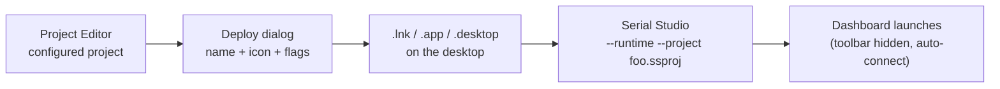
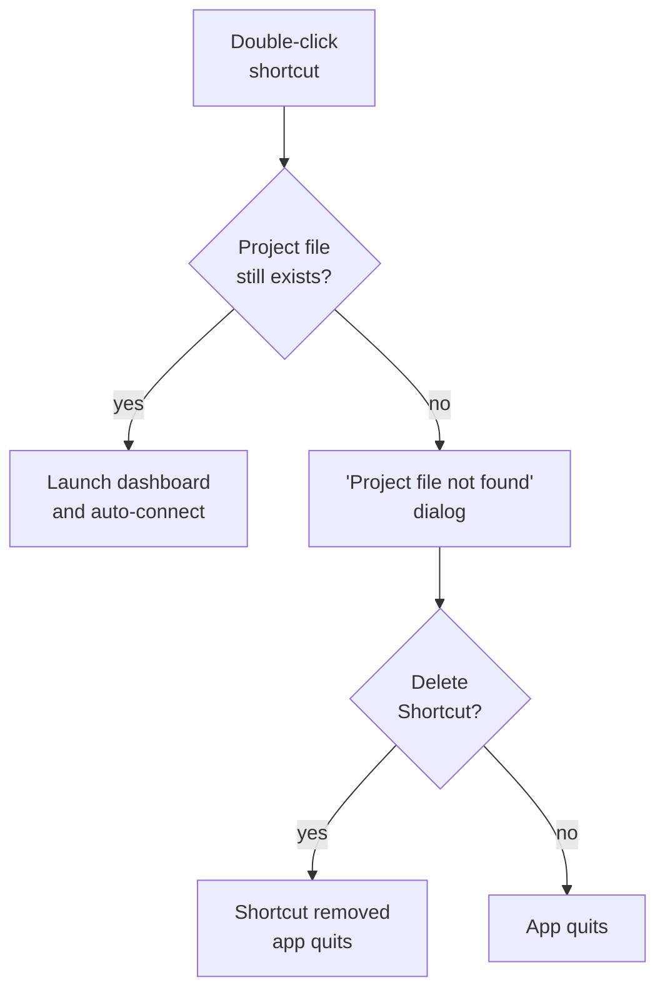

# Operator Deployments (Pro)

You built a dashboard on your bench. The person at the test rig should see it with one double-click: project loaded, device connected, no toolbar to wander into. That is a **deployment**, and Serial Studio writes it for you.

To make one:

1. Load the project.
2. Click **Deploy** in the toolbar (or run it from the command palette) to open **New Deployment**.
3. Keep the defaults and press **Save**.
4. Give the `.ssdeploy` file to the operator, who double-clicks it.

An *operator* is whoever runs the dashboard without editing it. A deployment is either a **deployment package** (`.ssdeploy`, the default **Format**), which carries the project inside it, or a **shortcut** (`.lnk`, `.app` or `.desktop`), which launches a project file on the same machine. Both open Serial Studio in [runtime mode](#runtime-mode): toolbar hidden, device connected on its own.

> **Deploy is a Pro feature.** The target machine needs the official Serial Studio binary; a build compiled from source under the GPL cannot launch a deployment. See [Licensing](#licensing).

> **Serial Studio must be installed on the target machine.** A shortcut records the absolute path of the executable and of the project file; if either moves, double-clicking fails with the OS's missing-file error. A package needs the install too, but not your paths.

## Shortcut files

With **Format** set to **Shortcut to the project file**, Serial Studio writes a native launcher for your platform. Fill in a name, optionally swap the icon, and choose where to save:

| Platform | File written          | Where it goes by default |
|----------|------------------------|--------------------------|
| Windows  | `.lnk` (shell-link binary) | Desktop, with the Serial Studio executable as the target |
| macOS    | `.app` bundle (Bash-launched, with custom `.icns`) | Desktop, opens via Finder/Dock |
| Linux    | `.desktop` (freedesktop.org Desktop Entry) | Desktop; move to `~/.local/share/applications/` to surface it in the launcher |

A shortcut hard-codes a single project file path plus the runtime flags you picked in the dialog. Double-clicking it relaunches Serial Studio with those exact arguments. A package opens with `--deployment` and needs no project path; **Desktop Shortcut** writes a launcher for it that is saved the same way.

The shortcut launch path:



The path and flags are captured when the shortcut is created. Editing the project later does not re-stamp the shortcut; it keeps pointing at the same file.

## The dialog

**New Deployment** has three tabs, plus **Contents** when exporting a package. Open it with **Deploy** in the toolbar; the button is hidden once a project is running in runtime mode.

### General

In the **New Deployment** dialog (Pro), the General tab holds:

- **Format.** **Deployment package (.ssdeploy)** (the default) or **Shortcut to the project file**.
- **Project.** Read-only field showing the currently loaded project. In shortcut mode, use the folder button to switch projects without leaving the dialog. A project must be loaded for **Save** to enable.
- **Desktop Shortcut.** Package mode only: also writes a launcher for the package.
- **Name.** Defaults to the project's title. Used as the deployment filename and the displayed label in the operator's shell. Reserved characters (`\ / : * ? " < > |`) are replaced with `_` automatically when saving. The name is trimmed; an empty name saves as `Untitled Deployment`.
- **Icon.** Click the preview (or **Change Icon…**) to pick your own. macOS prefers `.icns`, Windows prefers `.ico`, Linux accepts SVG or PNG. Leave it alone to use the bundled deployment icon.
- **Theme.** Defaults to **Same as Serial Studio**, the theme set on the operator's installation. Pick a name from the dropdown to pin the deployment to that palette.
- **Fullscreen.** Launches the dashboard full-screen. Off by default.
- **Actions Panel.** On by default. Shows the dashboard's actions panel.
- **File Transmission.** Off by default. Lets the operator open the File Transmission dialog in runtime mode.

Pinning a theme suits kiosks that should always look the same, or paired light/dark deployments of one project. An unknown theme name on the target machine falls back to the host's saved preference with a warning. The [CLI reference](#cli-reference) maps each switch to its flag.

### Taskbar

In the **New Deployment** dialog (Pro), the Taskbar tab controls the dashboard taskbar in runtime mode.

- **Mode.** **Always shown** (default), **Auto-hide** (slides in near the bottom edge), or **Hidden**. Hidden removes the window minimize, maximize and close buttons and switches the dashboard to auto-layout, so it always fills the available area.
- **Search Bar.** On by default. Turning it off hides the taskbar search bar.
- **Pinned Buttons.** Which taskbar buttons stay pinned. **Notifications** and **Pause** are on by default; **Console**, **Clock**, **Stopwatch** and **File Transmission** are off. The File Transmission button needs the **File Transmission** switch on the General tab. The group is disabled when the mode is **Hidden**.

### Logging

In the **New Deployment** dialog (Pro), the Logging tab has a **Recorders** section of switches that pre-arm the export modules at startup. Each one enables the matching export, so recording starts the moment the device connects, with no extra clicks.

| Switch              | CLI flag              | What it does on launch |
|---------------------|-----------------------|------------------------|
| **CSV File**        | `--csv-export`        | Enables CSV export. |
| **MDF4 File**       | `--mdf-export`        | Enables MDF4 export. |
| **Historian**       | `--session-export`    | Enables Historian recording. |
| **Console Log**     | `--console-export`    | Enables Console export. |

The tab notes that recordings are saved in the Serial Studio workspace folder.

### Save

Press **Save**. A native Save dialog opens with the right file filter for your OS. Pick a location, and Serial Studio writes the file and reveals it in your file manager so you can move it onto a desktop, share it, or include it in an installer payload.

If anything goes wrong while writing the file, an inline error banner shows the OS error in the dialog. The dialog stays open so you can retry without losing your selections.

## Deployment packages

In **New Deployment**, **Format** set to **Deployment package (.ssdeploy)** (the default) exports a **deployment package**: one `.ssdeploy` file holding the open project and the files it uses. These are alarm sounds, Canvas images, the widget extensions it uses, and any credentials and private keys you choose to include. The package also carries the runtime options from the dialog, its title, and its icon. Copy the file to any machine with a commercial (Pro) build of Serial Studio installed and double-click it. No paths from your machine are needed, and the project file can stay where it is.

| Shortcut to project file | Deployment package |
|--------------------------|--------------------|
| Points at a `.ssproj` on this machine | Carries the project and its files inside one file |
| Breaks if the project file moves | Does not depend on the project file path |
| The project stays readable JSON | The package is binary and does not show its content in a text editor |
| Editing the project updates every operator | Re-export the package after editing |

Use packages to hand a dashboard to someone else, such as a customer, a test lab or a demo laptop. Keep project shortcuts for in-house benches that share one centrally edited project.

> **Encoded, not encrypted.** A package is binary, so its content does not appear in a text editor. It is not encrypted: anyone who studies the file format can decode it. Do not treat a package as a way to keep secrets from a determined person.

### Contents tab

In package mode the dialog adds a **Contents** tab:

- **Carried Files.** Every file the package will carry, with its size. Canvas images are found by scanning the Canvas code for image file names. Use **Add Files…** for images whose path the code builds while it runs; they must sit inside the project folder.
- **External Dependencies.** Things the package cannot carry, such as programs the Process driver launches or web pages. The target machine must provide them.
- **Missing Files.** Referenced files that no longer exist. Export stays blocked until they are back.
- **Credentials and Private Keys.** Each password and private key the project uses, all excluded by default. Tick an item to carry it inside the package; the dialog then reminds you that anyone with the file can recover it. Excluded items are entered by the operator on first connect, through the same recovery dialog runtime mode always shows, and stay on that machine as usual.

Exporting a package needs a Pro license, the same as generating a shortcut; see [Licensing](#licensing). Turn on **Desktop Shortcut** on the General tab to get a launcher for the package as well. After the package is saved the dialog stays open and offers **Open Package**, so you can try the result right away.

### Opening a package

There are three ways to open a `.ssdeploy` file:

- Double-click it. The installers register the file type on Windows, macOS and Linux.
- Pick it in the **Open Project** dialog, or drag it onto the Serial Studio window.
- From a terminal, run `serial-studio --deployment demo.ssdeploy`.

A package always opens in a new window, so the window you are working in is left as it was. The dashboard opens in runtime mode with the package's options, title and icon.

A damaged package, or one changed after export, is refused with a message, and so is a package larger than 64 MiB. A package made by a newer version of Serial Studio names the version it needs.

### Sealed sessions

In Serial Studio Pro, a session opened from a `.ssdeploy` package is **sealed**: the operator can run the dashboard but cannot read, save, export or edit the project through any part of the app.
- The Project Editor, Preferences, Macros, the Problem Center, the AI assistant, the players, the Extension Manager and the Deploy dialog are unreachable, including from the command palette and keyboard shortcuts. A sealed session cannot re-export a package, so keep the source project.
- API, gRPC and MCP commands that would return or change the project answer `SEALED_SESSION`. Live data, device control, exports, alarms and window layout keep working, so integrations that read data still run. The same rule applies to the project's own scripts when they call the API.
- Live frames and mirror viewers carry the layout and values but no script source, so Canvas widgets appear as placeholders on a mirror viewer.
- Nothing from the package is written to disk in readable form. There are no backups, no project autosave and no copy in the settings. Historian recordings keep what replay needs but not the scripts, so Canvas widgets replay as placeholders and **Verify** and **Regress** report the recording as sealed.
- Only the widget extensions inside the package load; extensions installed on the machine do not. The usual extension consent prompt appears the first time.

## Licensing

Generating a shortcut or exporting a package needs a Pro license. Without one, the first use of a Pro feature offers a trial through a Yes/No prompt; the trial never starts on its own, and accepting it needs an internet connection. Once the trial has expired, the prompt offers activation or purchase instead. If you decline the trial or it has expired, **Save** fails with "A Pro license is required to generate shortcuts."

Opening a deployment is a separate matter: any official (Pro) build launches it, and the license matters only at connect time. A package without Pro content connects without a license. A package that uses Pro features asks for a license (or an accepted trial) when it connects. A GPL build cannot open either kind. Compare [Pro vs Free Features](Pro-vs-Free.md#operator-deployment-generation).

## Runtime mode

Shortcuts and packages both run in runtime mode: every shortcut adds `--runtime`, and a package reaches the same mode through `--deployment`. Runtime mode adjusts the dashboard for unattended, operator use:

| Behaviour                             | Effect |
|---------------------------------------|--------|
| Toolbar                               | Hidden from launch. The Setup, Console, and Project Editor buttons are not visible. |
| Project loading                       | Loads the project immediately, in Project mode, with no project picker: the file passed via `--project` for a shortcut, the project inside the package for a package. |
| Auto-connect                          | Once the interface loads, Serial Studio connects on its own, provided the device configuration is valid and it is not already connected. |
| Failed initial connect (4 s grace)    | If no connection is established within 4 seconds of launch, the **Device Unavailable** dialog is shown. |
| User-initiated disconnect             | Disconnecting from the dashboard quits Serial Studio; it counts as "I'm done." |
| Device-initiated drop                 | Shows the **Connection Lost** dialog. The operator can **Reconnect**, pick a different device, or **Quit**; the dashboard layout is preserved underneath. |
| Project file missing at launch (shortcuts only) | A pre-flight check runs before the QML loads. If the project file is missing, a "Project file not found" dialog is shown and offers to **Delete Shortcut** (when `--shortcut-path` is provided) or **Quit**. |

Runtime mode changes only the chrome. The data pipeline, frame parsers and exports behave as usual, and so does the API Server (off by default, port 7777; gRPC on port 8888 runs only while the API Server is enabled). Sealed packages additionally restrict project-reading commands; see [Sealed sessions](#sealed-sessions).

### The recovery dialog

In Pro runtime mode, the recovery dialog is the only part of the setup UI an operator sees, and only while there is no connection. When the first connection fails, the **Device Unavailable** dialog opens. When an active connection drops, the **Connection Lost** dialog opens. Both have two pages:

1. **The first page** shows a warning icon, a one-line headline ("The connection to your device was lost." or "Serial Studio couldn't reach your device."), and three buttons: **Quit**, **Pick Different Device**, and **Reconnect** after a drop or **Try Again** after a failed first connect. The dialog closes itself when a connection is re-established, so the operator can leave it open and come back.
2. **The second page**, opened by **Pick Different Device**, has a bus-type combo plus the Hardware setup pane. It lets the operator choose a different port or device without exposing the rest of the toolbar. Press **Connect** when ready.

## CLI reference

A shortcut is a saved invocation of `serial-studio` with these flags. The same command can be run by hand, dropped into a service unit, or scripted in CI (the full flag list lives in [Command-Line Interface](Command-Line-Interface.md)):

```sh
serial-studio \
    --project /path/to/project.ssproj \
    --runtime \
    --fullscreen \
    --csv-export \
    --mdf-export \
    --session-export \
    --console-export \
    --shortcut-path /path/to/deployment.lnk
```

Flags marked (Pro) exist only in commercial builds; a GPL build rejects the whole command above.

| Flag                | Notes |
|---------------------|-------|
| `-p, --project <file>` | Path to the `.ssproj` to load. Available in GPL builds. |
| `--deployment <file>` | Open a `.ssdeploy` package in a sealed runtime session (Pro). The package's options replace the display and export flags; bus and API flags still apply. |
| `--runtime`         | Operator runtime mode (Pro): hides the toolbar and quits on disconnect. See [Runtime mode](#runtime-mode) for the full list. |
| `--actions-panel`   | Show the actions panel in runtime mode (Pro). The dialog adds it by default. |
| `--file-transmission` | Allow the File Transmission dialog in runtime mode (Pro). |
| `--taskbar-mode <mode>` | Taskbar visibility in runtime mode: `shown`, `autohide` or `hidden` (Pro). |
| `--taskbar-buttons <ids>` | Comma-separated pinned taskbar buttons in runtime mode (Pro). The IDs are `console`, `notifications`, `clock`, `stopwatch`, `pause` and `file_transmission`. |
| `--no-taskbar-search` | Hide the taskbar search bar in runtime mode (Pro). |
| `--profile <name>`  | Open the project under the named [workspace profile](Project-Editor.md#workspace-profiles). |
| `-f, --fullscreen`  | Launch the dashboard full-screen. Available in GPL builds. |
| `--no-toolbar`      | Hide the toolbar without enabling runtime behaviour (Pro). Useful for embedded HMIs that have their own chrome. |
| `--csv-export`      | Pre-arm CSV export (Pro). |
| `--mdf-export`      | Pre-arm MDF4 export (Pro). |
| `--session-export`  | Pre-arm Historian recording (Pro). |
| `--console-export`  | Pre-arm Console export (Pro). |
| `--shortcut-path <p>` | Identifies which shortcut file launched this process (Pro). Lets the runtime offer to delete a broken shortcut when its project file goes missing. The flag is named `--shortcut-path` for backwards compatibility with deployments generated by earlier versions. |
| `--theme <name>`    | Override the application theme for this deployment only (Pro). The name matches one of the entries in the **Theme** dropdown of the Deploy dialog. Unknown names log a warning and fall back to the host's saved preference. |

The generator passes `--shortcut-path` automatically; you only need it when crafting flags by hand and want the broken-shortcut self-cleanup.

## When the project file goes missing

If a project file is moved or deleted after a shortcut was generated, the runtime detects this **before** any window appears and offers to clean up:



The cleanup treats macOS `.app` bundles as directories (recursive remove) and Windows `.lnk` / Linux `.desktop` as plain files. Nothing else on disk is touched.

## Tips for kiosk-style setups

Pair the deployment with a project lock: a locked `.ssproj` plus runtime mode limits the editor surface available at the workstation. See [Project Lock](Project-Lock.md). When one `.ssproj` serves several machine variants, declare a [workspace profile](Project-Editor.md#workspace-profiles) per variant and start each bench with `--profile <name>`, so the operator only sees that variant's workspaces and you keep a single project file. On a dedicated display, combine **Fullscreen** with the OS's autostart hook to bring the dashboard up on boot.

A deployment shortcut on Linux (`.desktop`) appears in the application menu once you save it to `~/.local/share/applications/`. If the entry does not show up, run `update-desktop-database ~/.local/share/applications`.

A deployment `.lnk` on Windows that keeps showing the previous icon after you regenerate it is the icon cache: sign out and back in, or rebuild it with `ie4uinit.exe -show`.

A deployment `.app` on macOS may ask for confirmation on first launch because it is unsigned. Right-click it and choose **Open**.

An update that overwrites the Serial Studio executable in place keeps shortcuts working; one that moves it means regenerating them.

## Frequently asked

**Does the deployment include Serial Studio itself?**
No. A shortcut or package needs the official (Pro) build of Serial Studio installed on the target machine, because a build compiled from source under the GPL cannot launch it. Install Serial Studio first, then copy the deployment over. See [Licensing](#licensing).

**Can a deployment launch in Quick Plot or Console-Only mode?**
Not via the dialog. Deployments target Project mode, which is the intended use.

**Does the deployment bundle the project file inside it?**
A shortcut does not; see [When the project file goes missing](#when-the-project-file-goes-missing). A [deployment package](#deployment-packages) does.

**Can I edit a deployment after creating it?**
A shortcut, yes. Windows `.lnk` exposes Properties → Target. The macOS `.app` keeps a small Bash launcher at `Contents/MacOS/<bundle-name>` (the executable named in `Info.plist`'s `CFBundleExecutable`). Linux `.desktop` files are plain text. All three can be edited by hand to adjust the flags. A package is not meant to be edited: change the project and export it again.

**Will the deployment work on a machine without a Pro license?**
It launches on any official (Pro) build without a license. Connecting needs a license, or an accepted trial, only if the project uses Pro features. A build compiled from source under the GPL cannot launch it. See [Licensing](#licensing).

**What if the machine has several devices and the deployment points at one of them?**
The **Pick Different Device** page of the recovery dialog lets the operator switch without leaving runtime mode. Auto-connect is a starting point, not a hard wire.

## See also

- [Project Lock](Project-Lock.md): pair a locked project with a runtime deployment to limit the editor surface at the workstation.
- [Operation Modes](Operation-Modes.md): how Project mode (the only one runtime deployments use) compares to QuickPlot and Console-Only.
- [Project Editor](Project-Editor.md): where the project that the deployment points to is built.
- [CSV Export & Playback](CSV-Export-Playback.md), [Historian](Historian.md): the recorders the Logging tab pre-arms.
- [Pro vs Free Features](Pro-vs-Free.md): what's bundled with a Pro license.
