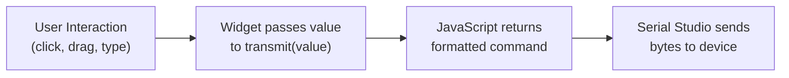

# Output Controls (Pro)

## Overview

Your Arduino reads a line from the serial port and sets an LED from it: `LED 1` turns it on, `LED 0` turns it off. A dashboard control can send that line. On the Arduino:

```cpp
void setup() {
  Serial.begin(9600);
  pinMode(LED_BUILTIN, OUTPUT);
}

void loop() {
  if (Serial.available()) {
    String line = Serial.readStringUntil('\n');
    if (line.startsWith("LED "))
      digitalWrite(LED_BUILTIN, line.substring(4).toInt());
  }
}
```

The baud rate must match the one in your Serial Studio connection. On the Serial Studio side, each output control runs a small JavaScript function you edit. Whatever string the function returns is sent to the device as bytes; an empty string sends nothing:

```javascript
function transmit(value) {
  return "LED " + value + "\r\n";
}
```

A Button passes `1` to `transmit()`, so a click sends `LED 1` followed by a carriage return and a newline. That turns the LED on and never off again; enable **Toggle Button** on the button and it latches, sending `1` when switched on and `0` when released. A Slider passes its number, a Text Field passes what you typed. To make one:

1. Connect your device. Output controls appear in an Output Panel on the dashboard only while a device is connected or a replay is open.
2. Open the Project Editor (wrench icon in the main toolbar) and click **Button** in its toolbar. An **Output Panel** group is created for it if the project has none.
3. Select the new control, click **Edit Code** and paste the function above.

Output controls are a Pro feature. The first send without a license or trial shows the trial offer, a Yes/No prompt (registering a trial needs an internet connection); see [Pro vs Free](Pro-vs-Free.md). If you decline, or the trial has expired, nothing is sent and the control shows no error. For a fixed command on a free license, use [Actions](Actions.md).

## How Output Controls Work



The function decides the bytes, so the same slider can drive a plain-text command, a JSON payload or a binary packet. Binary payloads are byte-strings built with `String.fromCharCode`.

While a slider or knob is dragged, Serial Studio sends at most one value every 50 ms. The most recent value is held and sent when the interval ends. An Emergency Stop press skips the wait.

## Output Control Types

### Button

Sends a single command on click, or latches on and off when **Toggle Button** is enabled. A Button passes `1` to `transmit()`, or `1` / `0` when latching; see [Writing a Transmit Function](#writing-a-transmit-function). The separate [Toggle](#toggle) control is a switch widget; Toggle Button makes a Button latch, and both send `1` and `0`.

| Property | Default | Description |
|----------|---------|-------------|
| Button Icon | (none) | Icon shown next to the caption |
| Colorize Icon | off | Tint the icon with the button color |
| Button Color | Automatic | Custom fill color; automatic uses the group accent color |
| Button Size | Normal | Small, Normal, Large or Extra Large |
| Button Style | Standard | Standard, Illuminated Push Button, Emergency Stop or Selector Switch |
| Toggle Button | off | Stay pressed between clicks and send `1` (on) / `0` (off) |
| On Label | (empty) | Caption while latched; falls back to the widget label |
| Off Label | (empty) | Caption while released; falls back to the widget label |

A latching button is filled with the button color while it is on and drawn as a plain
button while it is off, so its state is readable without opening the device. It sends
the same values as a Toggle, so a transmit function written for one works for the other.

Button Size scales the button, its icon and its caption together, and the Output Panel reserves a proportionally larger cell for it.

#### Button Style

Button Style sets what the button is. It is stored in the project and works under every
theme; the theme only decides how a Standard button is painted.

| Style | Behavior |
|-------|----------|
| Standard | The button described above. |
| Illuminated Push Button | A round colored head in a metal ring. It sends what a Standard button sends, and its head is lit while a latching button is on. |
| Emergency Stop | A red mushroom head on a yellow ring. One press latches it and sends `1`. A second, separate press releases it and sends `0`. |
| Selector Switch | Converts the button into a Knob set to **Rotary Selector** with two positions, labelled from On Label and Off Label (`OFF` and `ON` when empty), Min 0 and Max 1. `transmit()` receives `0` or `1`; see [Knob Style](#knob-style). |

An Emergency Stop always latches, so Toggle Button is fixed on:

- A press latches it and sends `1`. A second, separate press sends `0`.
- The press is sent at once, without the 50 ms pacing delay other control changes get.
- A release is ignored for a moment after the press, so a double-click cannot press and release it.
- If the transmit function returns nothing for `0`, the release sends nothing.
- With no [state source](#state-feedback) the button starts released each time the dashboard opens; bound to one, it shows what the equipment reports.
- When there is no connection to send on, the head shows **NOT SENT**.

> **An on-screen emergency stop is a command sent over the data link.** It reaches the
> equipment only if the computer, Serial Studio, the connection and the device firmware
> are all working. It is never a substitute for a hardwired emergency-stop circuit.

### Slider

Sends a numeric value from a draggable slider.

| Property | Default | Description |
|----------|---------|-------------|
| Min | 0 | Lower bound of the slider range |
| Max | 100 | Upper bound of the slider range |
| Step | 1 | Increment between discrete positions |
| Decimals | Automatic | Decimals shown for the value; automatic shows two when Step is below 1, otherwise none |
| Units | (empty) | Suffix shown after the value, such as `%` or `rpm` |
| Initial Value | 0 | Starting position |

The value passed to `transmit()` is a number inside [Min, Max]. Transmissions occur continuously while dragging, at the rate in [How Output Controls Work](#how-output-controls-work). Keyboard and wheel behavior is in [Limits](#limits).

### Toggle

Binary on/off switch.

| Property | Default | Description |
|----------|---------|-------------|
| Initial Value | 0 | Starting state (0 = off, 1 = on) |
| On Label | (empty) | Caption while on; falls back to the widget label |
| Off Label | (empty) | Caption while off; falls back to the widget label |

Passes `1` to `transmit()` when switched on, `0` when switched off.

### Text Field

Accepts typed input and sends it. The **Input** property selects how the typed text is read.

| Property | Text | Number |
|----------|------|--------|
| Value passed to `transmit()` | The typed string | The typed number |
| Interaction | Press Enter or click Send | Press Enter or click Send |
| Range | None | Min to Max, checked before `transmit()` runs |
| Use cases | AT commands, debug console, custom queries | Setpoints, duty cycles, servo angles |

A Number field adds the same numeric properties as a slider:

| Property | Default | Description |
|----------|---------|-------------|
| Min | 0 | Lowest value the field accepts |
| Max | 100 | Highest value the field accepts |
| Step | 1 | Increment for the arrow keys and the mouse wheel |
| Decimals | Automatic | Decimals shown when the field displays a value |
| Units | (empty) | Suffix shown beside the field |
| Quantize to Step | off | Snap a typed value to the nearest Step, counted from Min, before the range check |

A value outside Min to Max, or text that is not a number, is out of range: nothing is transmitted, the field keeps what was typed, and a message under the field names the allowed range. The message clears on the next accepted value. After a send the field shows the value that was accepted.

Keyboard and wheel editing of a Number field is described in [Limits](#limits). A Text-mode field still clears after sending.

### Knob

Rotary dial for continuous setpoint adjustment. It has the same numeric properties as Slider (Min 0, Max 100, Step 1, Decimals Automatic, Units empty, Initial Value 0) and is displayed as a circular dial. The value passed to `transmit()` is a number inside [Min, Max].

#### Knob Style

Set **Knob Style** to **Rotary Selector** to draw the knob as a selector switch with one
labelled position per Step from Min to Max. Three positions are Min 0, Max 2, Step 1;
**Position Labels** takes their names, separated by commas (`Off, Low, High`). The transmit
function receives the selected position's value, so a `switch` on it gives each position its
own payload.

Turn on **Spring Return** for a selector that only holds a position while it is pressed, like a
jog switch. The position under the pointer, or the one an arrow key moves to, is sent when you
press. When you let go, the selector goes back to its **Initial Value** position and sends that
value once. Releasing it at rest sends nothing, and the mouse wheel does not move it.

A selector with a state source shows the position the device reports. The report can be a
position's value (`2`) or one of the position labels (`Hand`, in any letter case). A report that
matches no position shows the selector as unknown rather than pointing between two marks.
Showing a reported position never sends anything.

## Creating Output Controls

The steps are in the [Overview](#overview): open the Project Editor, click **Button**, **Slider**, **Toggle**, **Text Field** or **Knob** in its toolbar (see [Toolbar & Button Reference](Toolbar-Reference.md)), then **Edit Code** to write the transmit function.

Output controls live inside **Output Panel** groups. You can also click **Output** in the toolbar to add an empty Output Panel first, then add controls to it. A new control goes into the selected Output Panel, or the first one in the project. Each Output Panel can hold multiple controls of mixed types, packed automatically into as many columns as fit the available width.

## The Transmit Function

Every output control has a JavaScript `transmit(value)` function that defines how interactions become device commands. Variables declared outside `transmit()` persist across calls.

### Writing a Transmit Function

Select the control and click **Edit Code** in the Project Editor toolbar. The transmit function opens in its own window, with the template list, import, validation and testing all in its header, a live preview of the control beside the code, and a status line that reports whether the script compiles and defines `transmit(value)` as you type.

A script that does not compile, or that never defines `transmit(value)`, is not saved: the project keeps the last version that worked, and closing the window with a broken script asks before discarding it.

The preview drives the real control through its own range, step size and labels, and shows the exact bytes the script produces. It never transmits: nothing reaches a connected device from the preview, so a relay or PWM script is safe to exercise with hardware attached.

The function takes `value`, and optionally `token` (see [Acknowledged Commands](#acknowledged-commands)), and returns a string:

```javascript
function transmit(value) {
  return "CMD " + value + "\r\n";
}
```

| Control | `value` |
|---------|---------|
| Button | `1` |
| Toggle, latching Button | `0` or `1` |
| Slider, Knob, Number Text Field | A number |
| Text-mode Text Field | A string |

The return value must be a string. Returning an empty string sends nothing. For binary protocols, build a byte-string with `String.fromCharCode(...)` (see the Binary Packet template); returning a plain array of numbers transmits nothing. Payloads are capped at 65536 bytes, and a `transmit()` call that runs longer than 500 ms is stopped by a watchdog. Both conditions abort the transmission and flash a red border on the control; hover the control to see the error message.

### Built-in Templates

The code editor includes a set of ready-to-use templates: Simple command, JSON command, Serial Studio library command, Binary packet, PWM control, PID setpoint, Relay toggle, AT command, Modbus write, CAN Bus frame, G-Code command, GRBL command, NMEA sentence, SCPI command, SLCAN command, and Default template. Select one from the template dropdown and customize it for your device. Full code is shown below for the four most common; the others are summarized in a table.

#### Simple Command

Sends plain text with a line terminator. Adapts to the widget type automatically.

```javascript
function transmit(value) {
  if (typeof value === "string")
    return value + "\r\n";

  if (value === 1)
    return "ON\r\n";

  if (value === 0)
    return "OFF\r\n";

  return "SET " + value + "\r\n";
}
```

#### Serial Studio Library Command

Sends `#ss!<control>=<value>` followed by a newline, the command format the SerialStudio device library parses. A [device declaration](Device-Declarations.md) that declares controls generates an Output Panel whose controls use this template, with `CONTROL` set to the declared control's name. The library hands the sketch the name and the value. When a reply token is passed, `@<token>` follows the value.

```javascript
const CONTROL = "control";

function transmit(value, token) {
  const command = "#ss!" + CONTROL + "=" + value;
  if (token === undefined || token === null)
    return command + "\n";

  return command + "@" + token + "\n";
}
```

#### JSON Command

Sends structured JSON objects. Useful for firmware that parses JSON input.

```javascript
function transmit(value) {
  var obj = {
    cmd: "set",
    value: value,
    ts: Date.now()
  };
  return JSON.stringify(obj) + "\n";
}
```

#### Binary Packet

Sends framed binary data with STX/ETX delimiters and an XOR checksum over the command and value bytes.

```javascript
function transmit(value) {
  var STX = String.fromCharCode(0x02);
  var ETX = String.fromCharCode(0x03);
  var cmd = String.fromCharCode(0x01);
  var val = String.fromCharCode(Math.round(value) & 0xFF);
  var chk = String.fromCharCode(0x01 ^ (Math.round(value) & 0xFF));
  return STX + cmd + val + chk + ETX;
}
```

#### Other Templates

The rest of the dropdown follows the same pattern: pick one, read it in the editor and change the constants.

| Template | What it sends |
|----------|---------------|
| PWM control | `PWM <CHANNEL> <duty>`; set the control's Max to 255 |
| PID setpoint | `SP <value>` with 2 decimals |
| Relay toggle | `RELAY <CHANNEL> ON` or `OFF` from a `0` / `1` value |
| AT command | `AT+<text>` for a typed string, plain `AT` otherwise |
| Modbus write | `modbusWriteRegister(0x0001, value)`; see [Modbus Helpers](#modbus-helpers) |
| CAN Bus frame | `canSendValue(0x100, value, 2)`; see [CAN Bus Helpers](#can-bus-helpers) |
| G-Code, GRBL, NMEA, SCPI, SLCAN | Starting points for those protocols |
| Default template | The template a new control starts from |

### Importing from File

Click **Import** in the transmit function window's header to load a `.js` file from disk. This is useful for sharing transmit functions across projects or version-controlling them separately.

## Examples

### Motor Speed Controller

Control motor speed with a slider and a stop button.

| Control | Type | Properties |
|---------|------|------------|
| Speed | Slider | Min: 0, Max: 100, Units: "%" |
| Stop | Button | Button Style: Emergency Stop |

Speed transmit function:
```javascript
function transmit(value) {
  return "SPD " + Math.round(value) + "\r\n";
}
```

Stop transmit function. The release (`0`) sends nothing. An on-screen stop is never a substitute for a hardwired one; see [Button Style](#button-style):
```javascript
function transmit(value) {
  return value === 1 ? "ESTOP\r\n" : "";
}
```

### Relay Control Panel

Toggle 3 relays independently.

| Control | Type | Properties |
|---------|------|------------|
| Relay 1 | Toggle | On Label: "Closed", Off Label: "Open" |
| Relay 2 | Toggle | On Label: "Closed", Off Label: "Open" |
| Relay 3 | Toggle | On Label: "Closed", Off Label: "Open" |

All three relays use the same function; Relay 2 and Relay 3 change only `RELAY`:
```javascript
var RELAY = 1;

function transmit(value) {
  return "R" + RELAY + (value ? " ON" : " OFF") + "
";
}
```

### Sensor Calibration Interface

Combine a text field for commands with a knob for fine adjustment.

| Control | Type | Properties |
|---------|------|------------|
| Command | Text Field | Input: Text |
| Offset | Knob | Min: -10, Max: 10, Step: 0.1, Units: "mV" |

Command transmit function:
```javascript
function transmit(value) {
  return "CAL " + value + "\r\n";
}
```

Offset transmit function:
```javascript
function transmit(value) {
  return "OFFSET " + Number(value).toFixed(1) + "\r\n";
}
```

### Modbus PID Controller

Control a PID loop over Modbus by writing setpoint, Kp, and enable/disable to holding registers.

| Control | Type | Properties |
|---------|------|------------|
| Setpoint | Slider | Min: 0, Max: 500, Step: 0.5, Units: "°C" |
| Kp Gain | Knob | Min: 0, Max: 10, Step: 0.01 |
| Enable | Toggle | On Label: "Running", Off Label: "Stopped" |

Setpoint transmit function (32-bit float to registers 0x0010–0x0011):
```javascript
function transmit(value) {
  return modbusWriteFloat(0x0010, value);
}
```

Kp Gain transmit function (32-bit float to registers 0x0012–0x0013):
```javascript
function transmit(value) {
  return modbusWriteFloat(0x0012, value);
}
```

Enable transmit function (holding register 0x0000 via the `modbusWriteCoil` alias, mapped to a relay downstream):
```javascript
function transmit(value) {
  return modbusWriteCoil(0x0000, value);
}
```

### CAN Bus Motor Controller

Control a motor over CAN Bus with a speed setpoint and a stop.

| Control | Type | Properties |
|---------|------|------------|
| Speed | Slider | Min: 0, Max: 10000, Units: "RPM" |
| Direction | Toggle | On Label: "Forward", Off Label: "Reverse" |
| Stop | Button | Button Style: Emergency Stop |

Speed transmit function (16-bit value on CAN ID 0x100):
```javascript
function transmit(value) {
  return canSendValue(0x100, value, 2);
}
```

Direction transmit function (single byte on CAN ID 0x101):
```javascript
function transmit(value) {
  return canSendFrame(0x101, [value ? 0x01 : 0x00]);
}
```

Stop transmit function (fixed command frame on CAN ID 0x1FF, nothing on release):
```javascript
function transmit(value) {
  return value === 1 ? canSendFrame(0x1FF, [0xFF, 0x00]) : "";
}
```

## Protocol Helper Functions

Every output widget's JavaScript engine includes built-in helper functions for Modbus and CAN Bus protocols. These handle binary byte-packing so you don't have to construct raw bytes manually. The checksum helpers (`checksum`, `checksumHex`, `checksumAlgorithms`) are available too, so a protocol that trails its payload with a CRC appends `checksum('CRC-16-MODBUS', payload)` instead of carrying its own table; see [Checksum Helpers](Frame-Parser.md#checksum-helpers).

### Modbus Helpers

Every Modbus helper takes an optional trailing `unit` (1 to 247). When given, the payload is prefixed with `0xFF 0x83 <unit>` and the Modbus driver writes to that device instead of the connection's own unit, which is how a control commands the second device on a shared RS-485 bus. A unit outside 1 to 247 is ignored and the write goes to the connection's own unit.

#### `modbusWriteRegister(address, value, unit)`

Writes a 16-bit integer to a single holding register.

| Parameter | Type | Description |
|-----------|------|-------------|
| `address` | Number | Register address (0x0000–0xFFFF) |
| `value` | Number | Value to write; rounded, then wrapped to 16 bits (-1 sends 65535). Not clamped. |
| `unit` | Number | Optional, 1 to 247 |

```javascript
function transmit(value) {
  return modbusWriteRegister(0x0001, value);
}
```

#### `modbusWriteCoil(address, on, unit)`

Writes the ON/OFF convention (ON = 0xFF00, OFF = 0x0000) to a holding register. This helper is presently an alias for `modbusWriteRegister()`: it packs the same 4-byte holding-register write and does not issue a native Modbus coil write (function code 5/15) — the driver always targets holding registers (function code 6/16). Use it when a downstream PLC program maps that holding register to a physical relay or coil; it will not work against a device that expects an actual coil write.

| Parameter | Type | Description |
|-----------|------|-------------|
| `address` | Number | Holding register address (0x0000–0xFFFF) |
| `on` | Boolean/Number | Truthy = ON, falsy = OFF |
| `unit` | Number | Optional, 1 to 247 |

```javascript
// Toggle widget writing ON/OFF to a holding register a PLC maps to a relay
function transmit(value) {
  return modbusWriteCoil(0x0000, value);
}
```

#### `modbusWriteFloat(address, value, unit)`

Writes an IEEE-754 32-bit float across two consecutive holding registers (big-endian).

| Parameter | Type | Description |
|-----------|------|-------------|
| `address` | Number | Starting register address |
| `value` | Number | Floating-point value |
| `unit` | Number | Optional, 1 to 247 |

```javascript
// Slider writing a temperature setpoint as a 32-bit float
function transmit(value) {
  return modbusWriteFloat(0x0010, value);
}
```

#### `modbusWriteRegisters(address, values, unit)`

Writes an array of 16-bit integers to consecutive holding registers starting at `address`. Each element is rounded and wrapped to 16 bits like `value` above. `unit` is optional, 1 to 247.

```javascript
function transmit(value) {
  return modbusWriteRegisters(0x0020, [1, Math.round(value)]);
}
```

### CAN Bus Helpers

#### `canSendFrame(id, payload)`

Sends an arbitrary CAN frame with the given identifier and payload.

| Parameter | Type | Description |
|-----------|------|-------------|
| `id` | Number | CAN identifier. 0 to 0x7FF is sent as an 11-bit standard id; anything higher is masked to 29 bits (0x1FFFFFFF) and sent as an extended id |
| `payload` | Array or String | Payload bytes as an array of numbers (0–255), or a raw string. The helper adds a length byte after the id |

```javascript
// Button sending a fixed command frame
function transmit(value) {
  return canSendFrame(0x200, [0x01, 0x00, 0xFF]);
}
```

```javascript
// Slider packing its value into a 3-byte payload
function transmit(value) {
  var v = Math.round(value);
  return canSendFrame(0x100, [0x01, (v >> 8) & 0xFF, v & 0xFF]);
}
```

#### `canSendValue(id, value, bytes)`

Sends a numeric value packed big-endian into a CAN frame.

| Parameter | Type | Default | Description |
|-----------|------|---------|-------------|
| `id` | Number | Required | CAN identifier |
| `value` | Number | Required | Numeric value (rounded to integer) |
| `bytes` | Number | 2 | Number of payload bytes, 1 to 4 for a correct value. JavaScript shifts are 32-bit, so higher counts repeat the low bytes |

```javascript
// Slider sending a 16-bit value on CAN ID 0x100
function transmit(value) {
  return canSendValue(0x100, value, 2);
}
```

```javascript
// Knob sending a 32-bit value on CAN ID 0x300
function transmit(value) {
  return canSendValue(0x300, value, 4);
}
```

### Combining Helpers with Custom Logic

The helpers return strings that can be concatenated or conditionally selected:

```javascript
// Write different registers based on a toggle state
function transmit(value) {
  if (value)
    return modbusWriteRegister(0x0010, 1);  // Enable
  else
    return modbusWriteRegister(0x0010, 0);  // Disable
}
```

```javascript
// Send a CAN frame with a header byte and the widget value
function transmit(value) {
  return canSendFrame(0x150, [0xAA, Math.round(value) & 0xFF]);
}
```

## Output Panel Layout

Output controls are displayed in an Output Panel widget on the dashboard. The panel uses an adaptive layout engine:

- Controls are packed automatically into as many columns as fit the available width, derived from each control's minimum width.
- Larger Button Sizes and tall controls such as the Knob get proportionally larger cells.
- If controls overflow the visible area, the panel scrolls vertically.

## Multi-Source Projects

In projects with multiple devices, the target device is determined by the source of the Output Panel group a control belongs to, not by a per-control property. Every control in a group transmits to that group's source. To send to a different device, place the control in an Output Panel group assigned to that source.

## Output Controls vs. Actions

Output controls and [Actions](Actions.md) both send data to connected devices:

| Feature | Output Controls | Actions |
|---------|----------------|---------|
| Widget types | 5 (button, slider, toggle, text, knob) | Button only |
| Data formatting | JavaScript `transmit()` function | Fixed TX Data + EOL |
| Continuous values | Yes (slider, knob) | No |
| Timer/auto-repeat | No | Yes (5 timer modes) |
| Auto-execute on connect | No | Yes |
| License | Pro | Free |

## Limits

In Serial Studio Pro, a Slider, Knob or Number Text Field enforces the Min and Max set in the Project Editor before the transmit function runs. `transmit()` never receives a value outside that range, whether it came from the pointer, the keyboard or an API client driving the dashboard, so the function needs no range check of its own. The slider and knob cannot be moved past either end; a Number field refuses the value and says so.

Step also moves a control from the keyboard. With a slider, knob or Number field focused, the arrow keys and the mouse wheel move the value by one Step, or by ten with Shift held. In a Number field they edit the text and Enter sends. The wheel acts only on the focused control, so scrolling a panel never moves a setpoint.

The limits are part of the project, and `project.outputWidget.get` reports them (`inputKind`, `minValue`, `maxValue`, `stepSize`, `units`) so a remote client knows the range before it drives a control. The console and the API's raw write are not controls and stay unrestricted. The limits guard against a typing mistake; they do not check what the device accepts.

## State Feedback

In Serial Studio Pro, an output control can show the equipment's reported state. In the Project Editor, select the control, open **State Feedback** and set **State Source**. By default an output control shows the state **you** last set it to. The equipment can change on its own: an interlock trips, someone uses a local panel, a command is refused. The control keeps showing your last click and quietly says something untrue about the machine.

Bind a control to a **state source** and it shows what the equipment reports instead. Set **State Source** to a dataset (one named value from your device's frame) or a table variable, then pick the source itself.

A load bank makes the case. Stopping the bank also stops its cooling fan, because the two are interlocked in the equipment rather than in Serial Studio. Bind the fan's control to the dataset carrying fan status and it stops claiming the fan is running the moment the bank goes down.

### On Value

For a toggle or a latching button, **On Value** decides which readings mean on.

Leave it empty and any non-zero number means on. That works for a dataset reporting `1` and `0`, but a device reporting text like `RUN` and `STOP` carries no number at all, so it would read as off even while running — fill in `RUN` and the control matches it exactly, comparing as text or as a number automatically.

Anything more involved (a bit within a status word, a threshold, hysteresis) belongs in the dataset's own [transform](Dataset-Transforms.md), which already exists for exactly this. Produce a clean `0` or `1` there and leave **On Value** empty.

### Waiting and No Data

A bound control shows three states rather than two.

**live**: the source is reporting, and the control shows what it says.

**waiting…**: you acted and the equipment has not confirmed yet. **Confirm Within (ms)** sets how long this lasts (default 3000, capped at 120000); a contactor may close in well under a second while a fan takes several. During this window the control keeps showing what you asked for, and feedback does not override it. The wait ends as soon as the source reports the state you asked for, and otherwise when **Confirm Within** runs out, even if the device has stopped sending data.

**no data**: the source has not reported, or has gone quiet. The control dims and says so, because showing "off" when the truth is "we have not heard" is the failure this feature exists to remove.

Feedback never transmits. Reflecting equipment state is not an operator action, so a bound control cannot command itself in a loop. Dragging a bound slider is also never interrupted: feedback is held until you let go.

If you delete the dataset or variable a control was bound to, the project still loads and the control still works — it stops correcting itself, and the Problems list reports it.

## Acknowledged Commands

In Serial Studio Pro, an output control can wait for the device's reply to each command. In the Project Editor, select the control and open **State Feedback**. State feedback shows what the equipment reports. An **acknowledged command** answers a narrower question: did the device accept the command I just sent? The control sends a number with each command, the device echoes it with a result, and the control shows whether the command was acknowledged, refused or never answered.

The `transmit` function receives the number as a second argument:

```javascript
function transmit(value, token) {
  return "SP " + value + " " + token + "\n";
}
```

The token counts up from 1, wraps after 32767 and is never 0. A script that ignores `token` works as before.

### The Reply Convention

A text frame carries the reply as its last three fields, and the device repeats the latest reply in every frame until the next command arrives:

```
42,18,0,OK
42,19,2,above limit
```

| Field | Meaning |
|-------|---------|
| Token | The number the command carried. A reply with any other token is ignored. |
| Code | `0` acknowledges the command; any other number refuses it. |
| Message | Optional text shown beside a refusal. It holds no separator character. |

Each field is an ordinary dataset; hide them with **Hide on Dashboard** if they are not for display. Under **State Feedback**, pick **Reply Token**, then **Result Code** and the optional **Reply Message**. A reply needs both a token and a code. **Confirm Within (ms)** sets how long the control waits, with a floor of 100 ms for a reply.

The dashboard reads the datasets once per display tick, so a reply sent once and not repeated can be missed under load and then reads as unanswered.

### The Three Outcomes

| Readout | Meaning |
|---------|---------|
| acknowledged | The device echoed the token with code 0. |
| refused: *message* | The device echoed the token with another code. The control also shows its red border and tooltip. |
| unanswered | **Confirm Within** ran out with no reply carrying the token, whether frames kept arriving or the device went silent. |

While the reply is outstanding the control shows **waiting…**. A control with a state source as well holds what you asked for after an acknowledgement until the source confirms it or the window ends; after a refusal it returns to the reported state at once.

Controls that share a Reply Token dataset share one token counter, so two of them never wait on the same number. The outcome lasts as long as the control's tile does: switching workspaces drops it, and the next command starts over.

The `examples/Acknowledged Commands` example pairs an Arduino sketch with a Blink button and a Setpoint field; the sketch refuses a setpoint above 80 although the control accepts up to 100.

## Common Mistakes

### Controls Do Not Appear on Dashboard

**Symptom:** Output controls are configured in the Project Editor but do not appear on the dashboard.

**Fix:** Connect the device. Output panels appear on the dashboard only while a device is connected or a replay is open. Also verify that the controls are inside an Output Panel group.

### Commands Not Received by Device

**Symptom:** The control is visible and interactive, but the device does not respond.

**Fix:**
1. Check the **Console** view to confirm data is being sent.
2. Verify the transmit function returns a properly terminated string (most devices expect `\r\n`).
3. In multi-source projects, confirm the control is in an Output Panel group assigned to the correct device.
4. Confirm the sketch reads the port and that its baud rate matches the connection; a line the sketch never reads looks like a dead control.
5. Output controls are a Pro feature. The first send without a license or trial shows the trial offer; if you decline or the trial has expired, nothing is sent and the control shows no error. See [Pro vs Free](Pro-vs-Free.md).

### Slider Sends Too Many Commands

**Symptom:** The device is overwhelmed or the serial buffer overflows while dragging a slider.

**Fix:** A slider sends at most 20 values per second, one per 50 ms. If your device still cannot keep up, increase Step, which reduces how many distinct values a drag produces. A `transmit()` call cannot delay a send; returning an empty string skips that value.

### Transmit Function Not Saved

**Symptom:** Closing the transmit function window shows the message "No transmit function is defined."

**Fix:** The script does not compile or does not define `transmit(value)`. Define `function transmit(value)` that returns a string; the status line in the window reports when it does.

### Red Border on a Control

**Symptom:** The control flashes a red border after a send.

**Fix:** Runtime errors raised during a transmit (watchdog timeout, a script exception, or an oversize payload) flash a red border on the control for a few seconds; hover it to read the error message.

## Tips

For protocols beyond the built-in [Protocol Helper Functions](#protocol-helper-functions), define your own helper functions next to `transmit()` in the same script. A helper is only a function: if the dashboard sends the wrong bytes, the Console shows them before the device does.

## See Also

- [SDK Reference](SerialStudio-SDK.md): the protocol encoders (`modbusWriteRegister`, `canSendFrame`, ...) a `transmit()` function returns, and the wider scripting surface.
- [Actions](Actions.md): simple command buttons with timer support.
- [Project Editor](Project-Editor.md): full guide to creating and configuring projects.
- [Toolbar & Button Reference](Toolbar-Reference.md): the Project Editor's add-control buttons and the rest of the app's chrome.
- [Widget Reference](Widget-Reference.md): all input and visualization widget types.
- [Frame Parser Scripting](Frame-Parser.md): Lua and JavaScript parser reference.
- [Devices](Devices.md): configuring device connections.
- [Device Declarations](Device-Declarations.md): controls declared by the device's firmware.
