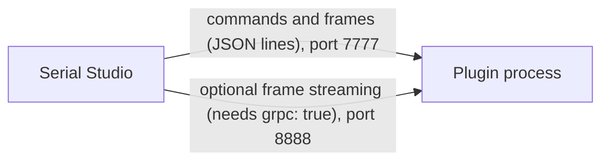

# Plugin Development

## Overview

Your device prints readings, and you want every frame in a database, or an FFT window Serial Studio does not draw. A plugin is that script: a small program (Python is the easiest) that Serial Studio launches and that talks to it over localhost.

Plugins can be written in any language (Python, C++, Go, Rust, Node.js) and are installed and started from the [Extension Manager](Extensions.md), which you open with the **Extensions** toolbar button. This page is for writing one; to install one, see [Extensions](Extensions.md).

Plugins and the default repository work in the free edition. Adding, listing or removing other repositories (Repository Settings and the `extensions.*Repository` commands) requires Serial Studio Pro, see [Pro vs Free](Pro-vs-Free.md).

## How Plugins Work



1. You install the plugin from the Extension Manager.
2. You open the plugin in the Extension Manager and click **Run**.
3. If the API Server is off, Serial Studio asks "API Server Required". **Yes** turns it on and launches the plugin; **No** cancels the launch.
4. The plugin connects to Serial Studio and starts sending commands or reading data.
5. You click **Stop** (or quit Serial Studio) to end the plugin.

Serial Studio also stops running plugins when the device disconnects and relaunches them when a device connects again, except plugins you stopped yourself or that exited on their own. Plugins do not run in a deployment package session, see [Operator Deployments](Operator-Deployments.md).

The API Server is the local server Serial Studio exposes for scripts. It is off by default and listens on port 7777. The gRPC server (port 8888, a faster streaming protocol you only need at high frame rates) runs only while the API Server is on. If you start your script yourself, or test with `nc`, turn on **Preferences > General > API & Plugins > Enable API Server** first. The port is the **API Server Port** field below it.

## Getting Started

### Minimal Python Plugin (TCP/JSON)

Create a folder with two files.

`info.json`:

```json
{
  "id": "my-first-plugin",
  "type": "plugin",
  "title": "My First Plugin",
  "description": "Prints connection status every second.",
  "author": "Your Name",
  "version": "1.0.0",
  "entry": "plugin.py",
  "runtime": "python3",
  "terminal": true,
  "files": ["info.json", "plugin.py"]
}
```

`plugin.py`:

```python
import json
import socket
import time

sock = socket.create_connection(("127.0.0.1", 7777))
lines = sock.makefile("r")

def send_command(command, params=None):
    msg = {"type": "command", "id": "1", "command": command}
    if params:
        msg["params"] = params
    sock.sendall((json.dumps(msg) + "\n").encode())
    while True:
        msg = json.loads(lines.readline())
        if msg.get("type") == "response" and msg.get("id") == "1":
            return msg

while True:
    result = send_command("io.getStatus")
    print(f"Connected: {result.get('result', {}).get('isConnected')}")
    time.sleep(1)
```

While a device is streaming, the server also pushes frame batches, raw data and lifecycle events on the same socket. Reading line by line and matching responses by `id`, as above, keeps them apart. See [Server-Push Messages](API-Reference.md#server-push-messages).

To try it in two minutes, turn on the API Server (**Preferences > General > API & Plugins > Enable API Server**), save `plugin.py` and run `python3 plugin.py`. It prints `Connected: False` once a second until a device connects, then `True`. It is not much, but it is a plugin.

To run it from the Extension Manager instead, the folder needs a `manifest.json` and a SHA-256 digest for `plugin.py`, and installing a local folder needs Serial Studio Pro. The `info.json` above lists `plugin.py` without a digest, so add one first (see [File Digests](#file-digests) and [Testing Your Plugin](#testing-your-plugin)). Started from the Extension Manager, a terminal window opens and the plugin runs only while a device is connected, so it prints `Connected: True`.

### Minimal Python Plugin (gRPC)

For sustained frame streaming, use gRPC. The TCP/JSON example is enough to start, so skip this until you need high frame rates.

You need `pip install grpcio grpcio-tools` and the two generated stub files; the `protoc` command is in the [gRPC Server](gRPC-Server.md) guide.

`info.json`:

```json
{
  "id": "my-grpc-plugin",
  "type": "plugin",
  "title": "My gRPC Plugin",
  "description": "Streams frames via gRPC.",
  "author": "Your Name",
  "version": "1.0.0",
  "entry": "plugin.py",
  "runtime": "python3",
  "grpc": true,
  "files": [
    "info.json",
    "plugin.py",
    "serialstudio_pb2.py",
    "serialstudio_pb2_grpc.py"
  ]
}
```

`plugin.py`:

```python
import grpc
import serialstudio_pb2 as pb
import serialstudio_pb2_grpc as rpc

channel = grpc.insecure_channel("localhost:8888")
stub = rpc.SerialStudioAPIStub(channel)

print("Streaming frames...")
for batch in stub.StreamFrames(pb.StreamRequest()):
    for frame in batch.frames:
        print(frame.frame)
```

Any API command also runs over gRPC with `stub.ExecuteCommand(pb.CommandRequest(id="1", command="io.getStatus"))`.

### Choosing a Transport

| Transport | Port | Use it for | How to enable |
|-----------|------|------------|---------------|
| TCP/JSON | 7777 | Commands, lifecycle events and your first plugin. | API Server on. See the [API Reference](API-Reference.md). |
| gRPC | 8888 | Sustained frame streaming. | API Server on and `"grpc": true` in `info.json`. See [gRPC Server](gRPC-Server.md). |

## Plugin Structure

A plugin lives in its own folder inside a repository:

```
plugin/my-plugin/
  info.json          # Required: metadata and entry point
  plugin.py          # Entry point script
  requirements.txt   # Optional: Python dependencies
  run.sh             # Optional: launcher for macOS/Linux
  run.cmd            # Optional: launcher for Windows
  serialstudio_pb2.py       # Optional: gRPC stubs
  serialstudio_pb2_grpc.py  # Optional: gRPC stubs
```

### Launcher Scripts

A launcher script (`run.sh` or `run.cmd`) installs dependencies into a local venv, sets environment variables, or starts a native binary without a runtime. Set `"runtime": ""` in `info.json`. If you omit `runtime`, Serial Studio runs `run.sh` through `python3`.

`run.sh`:

```bash
#!/bin/bash
cd "$(dirname "$0")"

if [ ! -d "venv" ]; then
    python3 -m venv venv
    ./venv/bin/pip install -r requirements.txt
fi

./venv/bin/python plugin.py
```

`run.cmd` follows the same pattern with `python -m venv venv`, `venv\Scripts\pip` and `venv\Scripts\python`.

## info.json Reference

| Field | Required | Description |
|-------|----------|-------------|
| `id` | Yes | Unique identifier (lowercase, hyphens). Must be unique across all extensions. |
| `type` | Yes | Must be `"plugin"`. |
| `title` | Yes | Display name in the Extension Manager. |
| `description` | Yes | Short description shown on the card. |
| `author` | Yes | Author name or organization. |
| `version` | Yes | Semantic version string (e.g., `"1.0.0"`). |
| `license` | No | License identifier (e.g., `"MIT"`, `"GPL-3.0"`). |
| `category` | No | Category for filtering in the Extension Manager. |
| `screenshot` | No | Relative path to a preview image. |
| `files` | Yes | Array of relative file paths to install. Must include `info.json` itself. Every file except `info.json` also needs a SHA-256 digest, see [Packaging and Distribution](#packaging-and-distribution). |
| `entry` | Yes | Script or binary entry point (e.g., `"plugin.py"`, `"run.sh"`). |
| `runtime` | No | The program that runs `entry` (e.g., `"python3"`). Default: `python3`. Use `""` for native binaries and launcher scripts. |
| `terminal` | No | `true` to launch in a system terminal window, which shows the plugin's output and errors while you debug; the output then goes to that window instead of the plugin log. Default: `false`. On macOS the entry file is opened in Terminal and `runtime` is not applied, so give a launcher script with a shebang. On Linux Serial Studio tries `x-terminal-emulator`, `gnome-terminal`, `konsole`, `xfce4-terminal`, then `xterm`, and runs without a terminal if none is installed. |
| `grpc` | No | `true` if the plugin uses gRPC (port 8888). A build without gRPC support refuses to launch the plugin. Default: `false`. |
| `platforms` | No | Per-platform overrides (see [Platform-Specific Builds](#platform-specific-builds)). |
| `dependencies` | No | Array of `{name, executables, url, pip}`. Serial Studio checks `executables` on `PATH` before launch. |
| `icon` | No | Relative path to an image, shown next to the plugin in the Extension Manager's installed-plugins list. |

Before launch, Serial Studio looks for each `executables` entry on `PATH` and shows a "Missing Dependency" dialog with a link to `url` if none is found (**Yes** opens the page, and the launch is cancelled either way). An entry with a `pip` key skips that check; Serial Studio does not run `pip` itself, it only logs "[Setup] Installing required packages" when no `venv` folder exists, so install the packages from your launcher script:

```json
"dependencies": [
  { "name": "Python", "executables": ["python3", "python"], "url": "https://www.python.org/downloads/" }
]
```

### Full Example

```json
{
  "id": "signal-analyzer",
  "type": "plugin",
  "title": "Signal Analyzer",
  "description": "Real-time FFT and spectral analysis of incoming data.",
  "author": "Example Corp",
  "version": "2.1.0",
  "license": "MIT",
  "category": "Analysis",
  "screenshot": "screenshot.png",
  "entry": "plugin.py",
  "runtime": "python3",
  "grpc": true,
  "files": [
    "info.json",
    "plugin.py",
    "analyzer.py",
    "serialstudio_pb2.py",
    "serialstudio_pb2_grpc.py",
    "requirements.txt",
    "screenshot.png"
  ],
  "platforms": {
    "darwin/*":    { "entry": "run.sh",  "runtime": "", "files": ["run.sh"] },
    "linux/*":     { "entry": "run.sh",  "runtime": "", "files": ["run.sh"] },
    "windows/*":   { "entry": "run.cmd", "runtime": "", "files": ["run.cmd"] }
  }
}
```

## Platform-Specific Builds

Plugins can provide different entry points for each operating system and architecture with the `platforms` field in `info.json`:

```json
"platforms": {
  "darwin/*":        { "entry": "run.sh",  "runtime": "", "files": ["run.sh"] },
  "linux/x86_64":   { "entry": "run.sh",  "runtime": "", "files": ["run.sh", "bin/analyzer-linux-x64"] },
  "linux/arm64":    { "entry": "run.sh",  "runtime": "", "files": ["run.sh", "bin/analyzer-linux-arm64"] },
  "windows/*":      { "entry": "run.cmd", "runtime": "", "files": ["run.cmd", "bin/analyzer.exe"] }
}
```

Platform keys use the format `os/arch` or `os/*` (for universal builds). `darwin` is macOS.

| Key | Matches |
|-----|---------|
| `darwin/*` | macOS (any architecture) |
| `darwin/arm64` | macOS Apple Silicon only |
| `linux/x86_64` | Linux x86_64 |
| `linux/arm64` | Linux ARM64 (Raspberry Pi, etc.) |
| `windows/*` | Windows (any architecture) |
| `windows/x86_64` | Windows x86_64 only |
| `*` | Any platform (generic fallback) |

Resolution order: exact `os/arch` key first, then `os/*`, then `*`.

- Platform-specific `files` are **merged** with the base `files` array during installation.
- If a plugin has no matching platform entry, the **Install** button is disabled and an **Unavailable** badge is shown.
- If no `platforms` field is present, the plugin is assumed to work on all platforms.

## State Persistence

Plugin state (window positions, settings, configurations) is saved in the project file alongside widget layout data. Different projects can have different plugin configurations.

Serial Studio never calls `extensions.saveState` on its own. Call it from your plugin after any change worth restoring, not only on the `disconnected` event: Serial Studio stops running plugins when the device disconnects, so a save on that event can race the shutdown. Call `extensions.loadState` when the plugin starts and when a device connects, since the project may have changed. Both commands are Confirm-tier in the API safety table, so an AI-driven plugin can meet a confirmation prompt.

`send_command` is the helper from [Getting Started](#minimal-python-plugin-tcpjson):

```python
send_command("extensions.saveState", {
    "pluginId": "my-plugin",
    "state": {"windowX": 100, "windowY": 200, "zoom": 1.5}
})

result = send_command("extensions.loadState", {"pluginId": "my-plugin"})
state = result.get("result", {}).get("state", {})
```

### Auto-Relaunch

Plugins that were running when the device disconnected are relaunched at the next connection, except the ones you stopped yourself. A plugin that exits on its own while a device is connected is not relaunched either.

## Lifecycle Events

The API Server broadcasts events to all connected TCP/JSON clients as standalone JSON lines. gRPC clients do not receive them; they can poll `io.getStatus` or watch stream activity instead.

| Event | When | Typical Plugin Action |
|-------|------|----------------------|
| `{"event": "connected"}` | The I/O connection comes up | Start processing, restore state |
| `{"event": "disconnected"}` | The I/O connection goes down | Pause processing |

On disconnect Serial Studio also terminates the plugin, so treat `disconnected` as a short warning, not a pause hook. Read the events from the socket's line reader (`lines = sock.makefile("r")`, as in [Minimal Python Plugin](#minimal-python-plugin-tcpjson)):

```python
for line in lines:
    msg = json.loads(line)
    if msg.get("event") == "connected":
        on_device_connected()
    elif msg.get("event") == "disconnected":
        on_device_disconnected()
```

## Extension Manager API

Plugins can also drive the Extension Manager with these API commands:

| Command | Description |
|---------|-------------|
| `extensions.list` | List all available extensions. |
| `extensions.getInfo` | Get details for a specific extension (`extensionId`). |
| `extensions.install` | Install an extension by index (`addonIndex`). |
| `extensions.uninstall` | Uninstall an extension by index (`addonIndex`). |
| `extensions.refresh` | Refresh catalogs from all repositories. |
| `extensions.saveState` | Save plugin state to the project (`pluginId`, `state`). |
| `extensions.loadState` | Load plugin state from the project (`pluginId`). |
| `extensions.listRepositories` | List repository URLs (Pro only). |
| `extensions.addRepository` | Add a repository (`url`; Pro only). |
| `extensions.removeRepository` | Remove a repository (`index`; Pro only). |

## Testing Your Plugin

### Manual Testing

In the free edition, turn on the API Server and run `python3 plugin.py` yourself while you develop. The steps below install the plugin through the Extension Manager and need Serial Studio Pro.

1. Create a folder with your `info.json` and plugin files, and a `manifest.json` beside it (see [Packaging and Distribution](#packaging-and-distribution)).
2. Add the folder as a repository with **Browse** in Repository Settings, then click **Install** on the plugin.
3. Click **Run** in the Extension Manager detail view.
4. Read the plugin's output and errors in the log on the Extension Manager detail view, or set `"terminal": true` to read them in the terminal window that opens.

Copying files into the Extensions folder by hand does not work: Run refuses a plugin Serial Studio has not installed.

### Testing the API Connection

Before building a full plugin, test the connection on its own. `nc` (netcat) is included with macOS and Linux; on Windows, run the [minimal Python plugin](#minimal-python-plugin-tcpjson) with `python plugin.py` instead.

```bash
# TCP/JSON
echo '{"type":"command","id":"1","command":"io.getStatus"}' | nc localhost 7777

# gRPC (grpcurl is a command-line gRPC client)
grpcurl -plaintext localhost:8888 serialstudio.SerialStudioAPI/ListCommands
```

### Common Issues

| Problem | Cause | Fix |
|---------|-------|-----|
| Connection refused | Script started outside Serial Studio and API Server off | Turn on Preferences > General > API & Plugins > Enable API Server. The port is the API Server Port field below it (default 7777). |
| `grpcio` import error | Package not installed | `pip install grpcio grpcio-tools` |
| Plugin exits immediately | Unhandled exception, which stays invisible until you look at the output | Read the log on the Extension Manager detail view, or set `"terminal": true` to watch it in a terminal window. |
| No frames streaming | Device not connected, API Server off, or a gRPC plugin without `"grpc": true` | Connect a device. For a gRPC plugin, confirm the API Server is on and `"grpc": true` is in `info.json`. |

## Packaging and Distribution

### Repository Structure

```
my-extensions-repo/
  manifest.json
  plugin/my-plugin/
    info.json
    plugin.py
    run.sh
    run.cmd
    requirements.txt
    screenshot.png
```

### manifest.json

```json
{
  "version": 1,
  "repository": "My Extensions",
  "extensions": [
    "plugin/my-plugin/info.json"
  ]
}
```

### File Digests

Serial Studio refuses to install a file it cannot verify, local folders included. Every file in `files` except `info.json` needs a 64-character hex SHA-256 digest (uppercase is normalised to lowercase). Give it inline:

```json
"files": [
  "info.json",
  { "path": "plugin.py", "sha256": "<64 lowercase hex characters>", "size": 1234 }
]
```

or keep `files` a plain list and add a `sha256` table beside it:

```json
"sha256": { "plugin.py": { "sha256": "<64 lowercase hex characters>", "size": 1234 } }
```

If any file other than `info.json` has a missing or malformed digest, Serial Studio refuses the whole extension, and the Problem Center shows an "Extension ... cannot be verified" warning.

### Hosting Options

Repository Settings and `extensions.addRepository` require Serial Studio Pro on the installing user's side.

- **GitHub**: Push to a repository and share the raw manifest URL, for example `https://raw.githubusercontent.com/your-org/extensions/main/manifest.json`.
- **Local folder**: Use **Browse** in Repository Settings to point to a local folder during development.
- **Any web server over https://**: Relative paths in `files` resolve against the `info.json` URL. Plain `http://` is refused with "Repositories must be a local folder or an https:// URL."

### Installation Path

Installed plugins live in `Extensions/plugin/your-plugin/` inside your Serial Studio workspace folder, which defaults to `Documents/Serial Studio` (Windows: `Documents\Serial Studio`).
