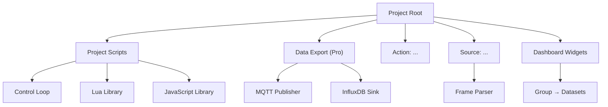

# Project Editor

## Overview

Your board prints `23.5,45.2,1013` once a second. The Project Editor is where you tell Serial Studio that these are Temperature, Humidity and Pressure, and which widget draws each. If you only want a quick plot with no project, [Quick Plot](Operation-Modes.md) needs no editor at all.

Open the editor from the Project Editor button on the main toolbar (or the wrench button in the Setup panel). Changes apply to the open project at once; **Save** writes them to a `.ssproj` file, which is JSON. A project holds the structure of your data (groups and datasets), how to cut frames out of the byte stream and parse them, and the actions (commands) the dashboard can send back to the device.

## Quick start: Arduino CSV

A sketch prints one comma-separated line per reading:

```cpp
void setup() {
  Serial.begin(9600);
}

void loop() {
  Serial.println(String(t) + "," + String(h) + "," + String(p));
  delay(1000);
}
```

That line is a **frame**. Each comma-separated value is a **dataset**. Datasets live in a **group**. The **Frame Index** of a dataset is the position of its value in the line, counting from 1. A new project already expects newline-terminated, comma-separated text, so you change nothing about parsing.

1. Click **New** in the toolbar, then select the project root and set the **Project Title**.
2. Click **Group** to add a group and set its **Group Title** (for example "Environment").
3. With the group selected, click **Dataset** three times. Name them Temperature, Humidity and Pressure. The editor gives them Frame Index 1, 2 and 3 in the order you add them, which matches the line the sketch prints.
4. On each dataset, set **Enable Plot Widget** (a Yes/No selector) to **Yes**.
5. In the Setup panel, set **Operation Mode** to "Parse via Project File", choose the serial port and the same baud rate as the sketch (9600), and click **Connect** (see [UART driver](Drivers-UART.md)). The dashboard shows one Plot widget per dataset.

The **Examples** button on the main toolbar opens finished projects (see [Saving and loading](#saving-and-loading)). The rest of this page is the reference for every field.

## Interface layout

The editor window has three areas: a toolbar across the top, a tree view on the left, and a property panel on the right.

### Toolbar

File actions sit on the left; the rest of the toolbar is "add" buttons grouped by what they create.

- **New / Open / Save / Save As.** File actions. **Save** (Ctrl+S / Cmd+S) writes the project to disk; **Open** loads an existing `.json` or `.ssproj` file.
- **Protobuf.** Generate a project from a Protocol Buffers (`.proto`) schema. Available in all builds; only the Pro widgets it can generate need a license or the free trial. See [Auto-Generating Projects](Auto-Generating-Projects.md).
- **Restore.** Restore a recent automatic snapshot. See [Backups & Recovery](Backup-Recovery.md).
- **Lock.** Set a password and lock the editor. See [Project Lock](Project-Lock.md).
- **Add Device** (Pro). Add another device for multi-device projects.
- **Output / Action / Slider / Toggle / Knob / Text Field / Button.** Add an [output control](Output-Controls.md) panel or an [action](Actions.md).
- **Dataset / Plot / FFT Plot / Gauge / Bar / Compass.** Add a dataset to the selected group, pre-configured for that widget. There is no Meter button; add a Dataset and set its **Widget** to Meter.
- **Group / Image / Web View / Canvas / Table / Bar Panel / LED Panel / Multi-Plot / 3D Plot / Accelerometer / Gyroscope / GPS Map.** Add a group with the matching group widget (Image, Canvas, and 3D Plot are Pro). The **Table** button creates a group with the Data Grid group widget, and **Image** creates an Image View.

The first time you use an item marked Pro, Serial Studio asks whether to start the free trial (Yes/No); registering the trial needs an internet connection. See [Pro vs Free](Pro-vs-Free.md).

Every button, with its icon, is listed in the [Toolbar & Button Reference](Toolbar-Reference.md#project-editor-toolbar).

### Tree view (left panel)

Shows the project's hierarchical structure:

```text
Project Root
  Project Scripts
    Control Loop
    Lua Library
    JavaScript Library
  Data Export
    MQTT Publisher
    InfluxDB Sink
  Action: "Reset Device"
  Source: "Main Device"
    Frame Parser
  Dashboard Widgets
    Group: "Sensors"
      Dataset: "Temperature"   [IDX 1]
      Dataset: "Humidity"      [IDX 2]
      Dataset: "Pressure"      [IDX 3]
    Group: "Status"
      Dataset: "Battery"       [IDX 4]
```

The number in brackets is the dataset's frame index: its position in the parsed data array. Click any item to edit its properties in the right panel.

#### Navigation and quick actions

The caption bar above the tree carries **Back** and **Forward**, which step through the items you have visited, like a browser. Deleted items are skipped, and selecting a new item after going back drops the forward trail. They answer to the platform's standard Back and Forward keys (Alt+Left and Alt+Right on Windows and Linux; Cmd+[ and Cmd+] on macOS) and to a mouse's back and forward buttons.

On the right of the caption bar are **Move Up** and **Move Down**, which reorder the current selection among its siblings. Each button is enabled only when it applies to what is selected, and produces the same result as the matching entry in the right-click menu. **New Folder** and **Move to Folder** are not on the caption bar; reach them from the right-click context menu (New Folder is also available as an **Add Folder** button in the property panel when a branch root is selected — see [Organizing with folders](#organizing-with-folders)).

### Property panel (right panel)

Shows a form for the selected tree item. Every change applies to the open project immediately; use **Save** to write it to disk. The form fields vary depending on whether you selected the project root, a group, a dataset, an action, or a source.

## Creating a project step by step

### Step 1: create a new project

1. Open the Project Editor.
2. Click **New** in the toolbar.
3. Click the project root in the tree. The **Project Title** field is in the bar at the top of the panel; the [overview diagram](#project-overview-diagram) is below it.
4. Set the **Project Title** (shown in the dashboard header).

### Step 2: configure frame parsing

For `Serial.println` output you change nothing: a new project starts on End Delimiter Only with a `\n` delimiter, Plain Text (UTF8) decoding and the Built-In delimited-text parser, which splits on commas. Change these settings only if your device sends binary data or ends frames with something else.

Every project has one source, named "Device A" by default. Select it in the tree to configure how the byte stream is sliced into frames, how each frame is decoded, and which parser turns it into values. These settings live on the source form; selecting the project root only shows the Project Title field.

#### Detection, decoding, and integrity

These settings run *before* the parser and apply to every parser type (Built-In, Lua, and JavaScript alike):

| Setting | Description | Options |
|---------|-------------|---------|
| Frame detection method | How Serial Studio finds frame boundaries in the byte stream. | *End Delimiter Only* (frames end with a known sequence such as `\n`; the most common choice); *Start + End Delimiter* (bounded by a start and an end marker, e.g. `/*` and `*/`); *Start Delimiter Only* (a header begins each frame, and the next header ends the previous one); *No Delimiters* (the whole captured chunk is one frame; use it for length-prefixed protocols); *Fixed Length* (every frame is the same number of bytes: set the Frame Length, and optionally a Header Rule and a Body Rule as a mask and a value for one byte; the delimiter fields are hidden). Frame Length is 1 to 524288 bytes, checksum included; an out-of-range value falls back to No Delimiters. |
| Start delimiter / end delimiter | The actual delimiter strings. Which ones apply depends on the detection method. | Any string, e.g. `\n`, `/*`, `*/`. |
| Hex delimiters | Tick when the delimiter strings are written in hex. | e.g. `0A` for newline. |
| Data conversion (decoder) | How the bytes inside the delimiters are decoded before the parser sees them. | *Plain Text (UTF8)* (default text mode); *Hexadecimal* (each byte pair read as a hex value); *Base64* (Base64-decoded first); *Binary (Direct)* (raw bytes passed straight to the parser as a byte array/table). |
| Checksum algorithm | Optional integrity check appended to each frame; frames that fail are dropped. | XOR-8, MOD-256, CRC-8, CRC-16, CRC-16-MODBUS, CRC-16-CCITT, Fletcher-16, CRC-32, Adler-32. |

Picking the wrong decoder/detection pair silently turns binary bytes into garbage characters or never produces a frame. The trap to remember: **Plain Text decodes bytes as UTF-8**, so any byte that is not valid UTF-8 (most binary payloads contain `0x00` or values above `0x7F`) is replaced with `U+FFFD` and the original bytes are lost. For anything non-text, pick **Binary (Direct)**.

**Checksum parameters.** The algorithm names differ in polynomial, initial value, and byte
order; picking the wrong one for a device that expects a specific profile makes every frame
fail validation silently.

| Algorithm | Width | Polynomial | Init | Reflect in/out | Byte order | Check (`"123456789"`) |
|-----------|-------|------------|------|-----------------|------------|------------------------|
| XOR-8 | 8-bit | - | 0x00 | - | single byte | `0x31` |
| MOD-256 | 8-bit | - (modular sum) | 0x00 | - | single byte | `0xDD` |
| CRC-8 | 8-bit | 0x31 | 0xFF | no / no | single byte | `0xF7` |
| CRC-16 (CRC-16/CCITT-FALSE) | 16-bit | 0x1021 | 0xFFFF | no / no | big-endian | `0x29B1` |
| CRC-16-MODBUS | 16-bit | 0x8005 (reflected 0xA001) | 0xFFFF | yes / yes | **little-endian** | `0x4B37` |
| CRC-16-CCITT (CRC-16/XMODEM) | 16-bit | 0x1021 | 0x0000 | no / no | big-endian | `0x31C3` |
| Fletcher-16 | 16-bit | - (modular sum) | 0 | - | big-endian | `0x1EDE` |
| CRC-32 | 32-bit | 0x04C11DB7 (reflected 0xEDB88320) | 0xFFFFFFFF | yes / yes | big-endian | `0xCBF43926` |
| Adler-32 | 32-bit | - (modular sum) | 1 | - | big-endian | `0x091E01DE` |

The check column is the checksum of the ASCII string `123456789`; use it to confirm a device speaks the same profile. **CRC-16** and **CRC-16-CCITT** share the `0x1021` polynomial but not the initial value, so they produce different bytes for the same input. **CRC-16-MODBUS** is the one exception to big-endian packing: Serial Studio writes it least-significant-byte first.

#### Parser language

The **parser** turns a decoded frame into an array of values, one per dataset frame index. Pick the language from the Platform dropdown in the parser editor toolbar:

| Language | What you configure | Best for |
|----------|--------------------|----------|
| Built-In | No code. Pick a template and fill in its parameter form. The default for a new project (comma-separated lines already work). | Common wire formats with no setup: delimited/CSV, fixed-width, key-value, NMEA 0183/2000, JSON, XML, YAML, MessagePack, Modbus, UBX, MAVLink, COBS/SLIP, and batched/time-series multi-frame data. |
| Lua | A `parse(frame)` function (recommended scripting language). | Custom logic the templates do not cover. |
| JavaScript | A `parse(frame)` function. | Custom logic when you prefer JavaScript or need `JSON.parse`-style ergonomics. |

For Built-In, the parameter form is per template. For example, *Delimited text* exposes a separator, an optional quote character, and trim/skip-empty toggles, while *Modbus frames* exposes a channel count, register offset, and a signed-registers toggle. The full template catalog and its parameters live in [Frame Parser Scripting](Frame-Parser.md).

Writing a Lua or JavaScript `parse()` function is covered in [Step 7](#step-7-write-a-frame-parser-script-optional). The Built-In templates need no script: the parameter form *is* the configuration, so you can skip straight to [Step 3](#step-3-add-groups).

### Step 3: add groups

Groups organize related datasets and determine which group-level widget is used on the dashboard.

1. Click one of the group buttons in the toolbar (**Group** for a plain container, or **Table**, **Multi-Plot**, **Accelerometer**, **Gyroscope**, **GPS Map**, and so on for a pre-configured one).
2. Select the new group in the tree to configure it.
3. Set the **Group Title** (for example "Environmental Sensors").
4. Set the **Group Widget** (the group's widget-type selector):

| Widget          | Description                        | Dataset requirements |
|-----------------|------------------------------------|----------------------|
| Data Grid       | Tabular view of all values         | Any number           |
| Bar Panel       | One alarm-band-colored bar per dataset | Any number        |
| LED Panel       | One status light per dataset       | Any number           |
| Multi-Plot      | Overlaid time-series curves        | One or more          |
| Accelerometer   | 3D acceleration visualization      | Exactly 3 (X, Y, Z)  |
| Gyroscope       | 3D orientation visualization       | Exactly 3 (X, Y, Z)  |
| GPS Map         | Geographic tracking on a map       | 2 or 3 (lat, lon, optional alt) |
| 3D Plot (Pro)   | 3D scatter/trajectory              | Exactly 3 (X, Y, Z)  |
| Image View (Pro)| Binary image stream                | None (image data in frame) |
| Canvas Widget (Pro)| Custom JavaScript-rendered canvas | Any number          |
| Web View        | Embedded web page                  | Any number           |
| None            | No group widget. Datasets shown individually | Any number |

### Step 4: add datasets

Datasets map to individual data fields in your device's output. To plot a value you need three fields: **Dataset Title**, **Frame Index** and **Enable Plot Widget** set to Yes. Everything else below is optional.

1. Select a group in the tree.
2. Click **Dataset** in the toolbar (or one of the dataset widget buttons next to it: **Plot**, **FFT Plot**, **Gauge**, **Bar**, **Compass**).
3. Configure the dataset properties:

**General**

- **Dataset Title.** Display label (for example "Temperature").
- **Measurement Unit.** Measurement suffix (for example "deg C", "hPa", "%").
- **Frame Index.** 1-based position in the parsed data array. If your device sends `23.5,1013,45.2`, then Temperature = 1, Pressure = 2, Humidity = 3. Reorder the values in the sketch and the indices change with them.
- **Widget.** Per-dataset visualization: Bar, Gauge, Compass, Meter, or None. All four render on the dashboard as a two-page swipe view — the first page is the analog visualization and the second is a large monospace digital readout. The active page is saved per widget in the project file.
- **Minimum Value / Maximum Value.** The dataset's base value range. Both default to 0. Widgets and FFT fall back to this range when their own min/max is left unset.

**Value Format**

- **Format.** Decodes the parsed value before the transform runs: **None** (the default), **Fixed point**, **Bit field**, or **Scale**. The transform, plots, alarms, and exports all receive the decoded number; a text value is left as received. On a computed dataset, whose transform is its only source, the format applies to the transform's result instead.
- **Integer Width (bits).** Fixed point and Bit field only. Width of the raw integer, 1 to 64 (default 16): the value is rounded to an integer and cut to this many bits. Integers wider than 53 bits lose precision, because the value travels as a double.
- **Signed.** Fixed point and Bit field only. Reads the raw integer as two's complement at the declared width.
- **Fraction Bits.** Fixed point only. The decoded value is the raw integer divided by 2^N, for N from 0 up to one less than the Integer Width. A Q15 sample is width 16, Signed, 15 fraction bits: the raw word 16384 (0x4000) reads 0.5 and 32768 (0x8000) reads -1.
- **Bit Offset / Bit Count.** Bit field only. Cuts **Bit Count** bits starting at **Bit Offset** (0 is the least significant bit) out of the raw integer; the field is never sign-extended. Bit 3 of a status word is offset 3, count 1, which reads 0 or 1 and suits an LED. Several datasets can share one Frame Index and cut different fields of the same word.
- **Scale / Offset.** Scale only. The decoded value is `raw * Scale + Offset` (defaults 1 and 0), with no integer reinterpretation.

**Plot Settings**

- **Enable Plot Widget.** Yes/No selector (not a checkbox); **Yes** plots this dataset as a time series.

**FFT (frequency analysis)**

- **Enable FFT Analysis.** Yes/No selector; **Yes** adds a spectrum plot for the dataset.
- **FFT Window Size.** Window size (64, 128, 256, 512, 1024, and so on).
- **FFT Window Function.** Window applied before the transform to reduce spectral leakage; affects both the FFT plot and the waterfall. Default is **Blackman-Harris**. Options: Rectangular (None), Bartlett (Triangular), Hann, Hamming, Blackman, Blackman-Harris, Nuttall, Blackman-Nuttall, Flat Top, Welch, Bartlett-Hann, Bohman, Cosine (Sine), Lanczos, Parzen.
- **FFT Sampling Rate (Hz, required).** Has to match the actual data rate for correct frequency axis labeling.
- **Minimum Value (optional) / Maximum Value (optional).** Y-axis range for the FFT plot; falls back to the General section's Minimum Value / Maximum Value when left unset.
- **Freq. Markers** (dataset toolbar, or **Edit Frequency Markers** in the dataset's right-click menu and the command palette). Names frequencies or ranges on the FFT plot and the waterfall, with optional level colors. See [Frequency markers](Widget-Reference.md#frequency-markers).

**Waterfall (Pro)**

- **Enable Waterfall Plot.** Show a scrolling time-frequency plot (spectrogram) for this dataset. Reuses the FFT settings above (samples, sampling rate, range).
- **Waterfall Y Axis.** Source for the vertical axis. Default is **Time** (older spectra scroll down). Pick another dataset here to drive the Y axis from that dataset's value instead, for example RPM vs. frequency for order tracking.

**LED Panel**

- **LED On Threshold (required).** Shown for a dataset in an LED Panel group that has no alarm bands: the light turns on when the value reaches this level. Once bands are defined, they drive the light's color, label, and blink state instead. A dataset becomes a light by being in an LED Panel group; there is no per-dataset switch.

**Alarm bands**

- **Alarm Bands** (dataset toolbar, next to **Transform**, or **Edit Alarm Bands** in the dataset's right-click menu and the command palette). Opens a dialog to define colored value ranges with severity tiers for Bar, Gauge, and Meter datasets and for any dataset in a Bar Panel or LED Panel group. The button is disabled for every other dataset, and for a dataset with **Hide on Dashboard** on outside a Bar Panel or LED Panel, because bands there are ignored (see [Alarm bands](Widget-Reference.md#alarm-bands)). With several datasets selected, the button applies one set of bands to the selected datasets that qualify and leaves the rest unchanged. Each band has a min/max range, a severity (Info / OK / Warning / Critical), an optional color override and label, and a blink toggle for LED panels. Opening the dialog for an LED Panel member with no bands pre-fills one band from the **LED On Threshold** so existing setups migrate in place. To keep a dataset's bands on screen without alerting, turn on **Suppress Alarms** under **Widget Settings**.

**Labels**

- **Labels** (dataset toolbar, next to **Transform**, or **Edit Value Labels** in the dataset's right-click menu and the command palette). Opens a two-column table of integer values and the text shown for each, plus an **Any other** row whose text stands in for every unlisted value (left empty, an unlisted value shows its number). The value is rounded to the nearest integer before the lookup. On **Apply**, a row with empty text or a value already listed is dropped. Wherever the value appears as text, the label replaces it: the Data Grid, the Bar, Gauge, Meter, and Compass caption, the Bar Panel caption, the LED Panel status text, the plot tooltip, alarm notifications, and widget extensions. Everything that reads the number keeps it: plot curves, needles and fills, alarm bands, FFT, exports, and the Historian. For a status byte labeled 0 Idle, 1 Running, and 2 Fault, with **Any other** set to Unknown, the Data Grid reads Running while the value is 1 and the plot keeps drawing 1. Value Format and Labels are free.

**Widget Settings**

- **Label Format.** Editable for every dataset. Notation of a Bar, Gauge, or Meter scale and value box: Auto, Integer (0 decimals), 1 to 3 decimals, Scientific, Hexadecimal, or Binary. Hexadecimal and Binary also replace the number in the widget caption, the Data Grid, and widget extensions: a `0x` or `0b` prefix and upper-case hex digits, two's complement zero-padded to the Integer Width when a Fixed point or Bit field format declares one, minimal digits with a minus sign otherwise. A non-integer value is rounded first, and **Decimal Points**, when set, overrides the Label Format.
- **Minimum Value (optional) / Maximum Value (optional).** Range for Bar, Gauge, and Meter displays; falls back to the General section's Minimum Value / Maximum Value when left unset.
- **Suppress Alarms.** Shown while the dataset has alarm bands that a widget draws. Keeps the bands on the widget but stops the dataset's band notifications, alarm points, and sounds. With several datasets selected, the row follows the first one, and a change applies to every selected dataset.
- **Alarms only while visible.** Shown under the same condition, beside Suppress Alarms. The dataset's bands notify, raise alarm points, and sound only while a widget showing it is on screen: the active tab of a dashboard window that is not minimized, the widget neither minimized nor closed, or an open pop-out. Revealing it while the value sits in a band counts as entering the band; hiding it removes the point. Suppress Alarms wins when both are on. Multi-selection behaves as for Suppress Alarms.
- **Alarm Deadband.** Shown under the same condition. Hysteresis in the dataset's units: once a band is active it holds until the value leaves it by more than this amount, so a reading hovering on a threshold raises one alarm instead of one per frame. A step into a more severe band is never delayed. 0 (the default) disables it.

### Step 5: add actions (optional)

Actions place buttons on the dashboard that send commands to the connected device.

1. Click **Action** in the toolbar.
2. Configure the action:

- **Action Title.** Button label (for example "Reset Device").
- **Action Icon.** Pick from the built-in icon set.
- **Send as Binary.** When checked, the payload is entered as hexadecimal bytes instead of text.
- **Transmit Data.** The string or hex bytes to transmit (for example `RST`).
- **End-of-Line Sequence.** Append a line ending: New Line (`\n`), Carriage Return (`\r`), CRLF (`\r\n`), or None. Only editable while **Send as Binary** is off; if a sequence was already configured before switching to binary mode, it is still appended as raw bytes after the hex payload.
- **Auto-Execute on Connect.** Send the command automatically when the device connects.
- **Timer Mode:**

| Mode               | Behavior |
|--------------------|----------|
| Off                | Manual click only (default). |
| Auto Start         | Timer starts automatically on connect. Command repeats at the configured interval. |
| Start on Trigger   | Timer starts on the first click. Command repeats until stopped. |
| Toggle on Trigger  | Each click toggles the repeating timer on or off. |
| Repeat N Times     | Each click sends the command a fixed number of times (Repeat Count), spaced by the configured interval. |

- **Interval (ms).** Repeat interval in milliseconds (default 100 ms). Disabled when the mode is Off.
- **Repeat Count.** Number of sends in Repeat N Times mode (default 3).

The full action reference, including multi-source targeting and worked examples, is on the [Actions](Actions.md) page.

### Step 6: add sources (multi-device projects)

Sources define where data comes from. Every project has one source, Device A, selected in the tree; **Add Device** (Pro) adds more for multi-device projects. A free build is capped to one source.

To configure a source, select it in the tree, or click **Add Device** in the toolbar to create another:

- **Title.** Descriptive label (for example "Arduino Uno").
- **Bus Type.** Free: Serial Port, Network, Bluetooth LE. Pro: Audio Input, Modbus, CAN Bus, Raw USB, HID Device, Process, MQTT Subscriber, OPC UA, Siemens S7, EtherNet/IP, IEC 60870-5-104.
- **Connection Settings.** Bus-specific parameters (serial port, baud rate, IP address, and so on) saved with the project. For a serial device see the [UART driver](Drivers-UART.md).
- **Framing and decoding.** Frame detection, delimiters, data conversion and checksum take the same fields as in [Detection, decoding, and integrity](#detection-decoding-and-integrity), set per source.

Each source has its own Frame Parser tab for a per-source parser script.

### Step 7: write a frame parser script (optional)

This step applies to the **Lua** and **JavaScript** parsers. A new project starts on **Built-In**, whose parameter form is the parser (there is no script to write), so skip ahead unless you need custom logic.

When no Built-In template fits, write a `parse()` function to transform each frame into an array of values. Lua is the recommended scripting language; JavaScript works the same way. Pick the language from the Platform dropdown in the parser editor toolbar.

1. Select the source in the tree, then its **Frame Parser** node.
2. Open the Frame Parser view.
3. Pick the scripting language from the Platform dropdown.
4. Write a function:

**Lua:**

```lua
function parse(frame)
  -- 'frame' is a string (PlainText/Hex/Base64) or byte table (Binary (Direct)).
  -- Return a table of values matching dataset frame indices.
  local result = {}
  for field in (frame .. ","):gmatch("([^,]*),") do
    result[#result + 1] = tonumber(field)
  end
  return result
end
```

**JavaScript:**

```javascript
function parse(frame) {
  // 'frame' is a string (PlainText/Hex/Base64) or byte array (Binary (Direct)).
  // Return an array of values matching dataset frame indices.
  return frame.split(",");
}
```

5. The parser code is stored in the project automatically as you type. Use the **Validate** button to check the script (syntax, and a runtime probe for the first source — see [Testing a parser with sample data](#testing-a-parser-with-sample-data)), and **Test With Sample Data** to run it against a sample frame.

**Rules:**

- The function has to be named `parse` and has to accept **at least one parameter** (the frame payload). JavaScript rejects the deprecated two-parameter `parse(frame, separator)` form specifically, but declaring extra unused parameters is otherwise allowed; Lua performs no arity check at all.
- It has to return a table (Lua) or array (JavaScript). Each element maps to a dataset frame index.
- Global variables declared outside `parse()` persist between calls. Useful for stateful protocols.
- Use `console.log()` (both languages) or `print()` (Lua shorthand) to print debug messages to the Serial Studio terminal. The full `console` table (`log`, `debug`, `info`, `warn`, `error`) is available in JavaScript and Lua alike; `error` also raises an application notification, and `warn` does too when **Route Warnings to Notifications** is enabled in Settings (off by default).

**Example: binary protocol (Lua).**

```lua
function parse(frame)
  -- frame is a byte table in Binary (Direct) mode (1-indexed)
  local temp     = (frame[1] << 8) | frame[2]
  local humidity = (frame[3] << 8) | frame[4]
  return {temp / 10.0, humidity / 10.0}
end
```

### Testing a parser with sample data

The **Test With Sample Data** button on the parser toolbar opens the **Test Frame Parser** dialog. It runs the same byte-to-channels pipeline the live dashboard uses, so what you see here is what the dashboard would see for the same input. (The separate **Validate** button in the code-editor toolbar does more than check syntax: it compiles the script and then calls `parse()` with a runtime probe frame — trying `"0"`, a one-byte array, and `""` in turn — to catch errors that only surface when the function runs. The probe only fires for the first source in a multi-source project; additional sources are syntax-checked only.)

The dialog has three sections:

1. **Pipeline configuration.** Detection mode, start / end delimiter, hex-delimiter toggle, decoder method, and checksum algorithm. These are wired to the active source: editing them in the dialog rewrites the project source immediately, and the live frame reader picks up the change. There is no separate "Apply" step.
2. **Frame data input.** A line edit for the raw stream bytes you want to test. Tick **Hex** to type bytes as space-separated hex pairs (`01 A2 FF 3C`) - the safe way to feed binary protocols. Plain text mode reads the field as UTF-8. Press **Return** in the field, or click **Evaluate** at the bottom of the dialog, to run the pipeline and populate the results below.
3. **Pipeline results.** A stats line shows `frames extracted | bytes consumed | bytes buffered | dropped`. Below it, a tree expands each extracted frame into its raw bytes (hex), its decoder output (what the parser receives), and the parsed rows with one node per channel.

Reading the tree top-down tells you exactly which stage failed:

- **Zero frames extracted.** The delimiters / detection mode did not match the input. Re-check the start / end fields.
- **Frames extracted but empty rows.** The parser ran but returned no array: `parse()` returned `nil`, `undefined`, or a non-array value.
- **Rows present but the wrong count.** Index mapping in `parse()` is off; compare row indices to the **Frame Index** field on each dataset.
- **Rows present and correct in the dialog but missing on the dashboard.** A transform on the dataset is rejecting the value (returns `nil` / `NaN`) or a widget min/max is clipping it.

### How the decoder + detection settings reach the parser

The decoder from [Detection, decoding, and integrity](#detection-decoding-and-integrity) decides what `parse(frame)` receives: a UTF-8 string for Plain Text, a hex or Base64 string, or the raw byte buffer (a 1-indexed table in Lua, a length-keyed object in JavaScript) for Binary (Direct).

## Frame index mapping

Your device sends a sequence of values. The frame parser (or the default comma splitter) produces an array. Each dataset's **Frame Index** tells Serial Studio which array position to read:

```text
Device sends:  23.5,45.2,1013
Parser returns: ["23.5", "45.2", "1013"]
                  ^        ^       ^
               Index 1  Index 2  Index 3
```

- Frame indices are 1-based. Index 1 corresponds to array element 0.
- Each index is used once, except by Bit field datasets, which cut different fields out of one word and share its index. A sketch that prints humidity before temperature gets its humidity plotted as temperature, and the dashboard does not object.
- The Project Editor assigns one past the highest index currently in use when you add a dataset; it does not refill a gap left by a deleted dataset.

## Dataset value transforms

Each dataset can optionally define a `transform(value)` function that converts the raw parsed value into an engineering value before it reaches the dashboard. Use transforms for calibration, unit conversion, filtering, and signal conditioning.

To add a transform, select a dataset and click the **Transform** button in the toolbar. That opens a dedicated editor with syntax highlighting, built-in templates, and a live test area.

For the full documentation, see [Dataset Value Transforms](Dataset-Transforms.md).

## Project hierarchy

The diagram below shows the tree structure of a Serial Studio project file and how each element maps to the dashboard.



The scripts, Data Export and Control Loop nodes are optional and not needed for a first project. Actions and sources sit directly under the project root; there is no "Actions" or "Sources" node. Three nodes hold the rest: Project Scripts (Control Loop, Lua Library, JavaScript Library), Data Export (MQTT Publisher and InfluxDB Sink; Pro) and Dashboard Widgets (all groups). How values map to datasets is covered in [Frame index mapping](#frame-index-mapping).

## Project Overview diagram

Select the project root in the tree and the right panel shows the **Project Summary** pane: the **Project Title** field in a bar at the top, and below it the **Project Overview**, a read-only diagram of the entire project configuration, laid out left-to-right in four columns:

1. **Sources** (devices). One card per device, with its bus type, frame detection, and decoder.
2. **Frame parsers and actions**. The parser script attached to each source, plus any global action buttons.
3. **Groups**. The dataset containers and group-level widgets (Multi-Plot, GPS, Accelerometer, etc.).
4. **Datasets**. Per-dataset pills, with their transform block (if any) drawn between the group and the dataset pill.

Variables tables, output widgets, and workspaces are drawn alongside as their own cards. Arrows show how parsed bytes flow into datasets and how transforms feed downstream consumers.

The diagram is interactive:

- **Double-click any block** to jump into the matching configuration form. Double-clicking a source card opens that source's settings; a group card opens the group form; a dataset pill opens the dataset form; a frame-parser card opens the script editor; an action card opens the action form; a shared-table card opens the table editor; an output-widget card opens the output editor.
- **Right-click any block** for a context menu tailored to that node: add a sibling group, add a dataset to that group, rename, move up or down, duplicate, delete, edit the frame parser or canvas code, and open a dataset's transform, alarm bands, value labels or frequency markers. Right-clicking empty background opens the "add source / add table / add action" shortcuts. This lets you grow a project once the high-level shape is in place without walking back through the tree on the left.
- **Ctrl+scroll wheel** zooms the diagram in and out; plain scrolling pans it (Shift+scroll pans horizontally). The toolbar has a reset-zoom button.

## Organizing with folders

Once a project grows past a handful of groups, the flat tree gets long. Folders let you file items under named, collapsible containers so the tree stays readable. Folders are available in every edition (free and Pro); they are purely organizational and never change how data is parsed.

Three independent folder trees exist, one per branch:

- **Group folders** organize groups.
- **Table folders** organize [Variables tables](Variables.md).
- **Workspace folders** organize [workspaces](Toolbar-Reference.md#a-note-on-workspaces).

A folder in one branch cannot hold an item from another (a group folder holds groups, not tables). Items left outside any folder stay at the top level of their branch.

```text
Groups
  Folder: "Powertrain"
    Folder: "Battery"
      Group: "Cell Voltages"
      Group: "Pack Temps"
    Group: "Motor"
  Group: "Cabin"          (top level, no folder)
```

### Creating and filling folders

- **Add a folder.** Select the branch root (Groups, Variables, or Workspaces); the property panel shows an **Add Folder** button in its own toolbar, or right-click the branch and choose **New Folder**.
- **Nest a folder.** Select an existing folder and click **Add Sub-folder**, or right-click it and choose **New Sub-Folder**. Folders nest to any depth.
- **Move an item in.** Right-click a group, table, workspace, or folder and use the **Move to Folder** submenu. It mirrors the folder tree, so you can drop the item into any folder at any depth, or back to the top level.
- **Add items directly into a folder.** With a folder selected, the matching add button (**Add Group**, **Add Variables Table**, **Add Workspace**) creates the new item already filed inside it.

### Workspace profiles

A workspace profile is a named subset of the workspace folders: the workspaces one operator, bench or machine variant should see. A project that serves several engine variants keeps every group and every workspace in one file and declares one profile per variant.

- **Define them** in the Workspaces view (customised workspaces only): **Add Profile**, then tick the folders it shows. A ticked folder shows its whole subtree; a profile with nothing ticked shows everything. Profiles are saved with the project.
- **Pick one at load.** A project with two or more profiles asks which one to show when it opens, and remembers the answer for that file. Start the application with `--profile <name>` to skip the question, or select one at runtime with `project.workspace.profile.select`.
- **What it changes.** Only the taskbar's workspace list and switcher. The Project Editor always shows the whole project, the automatic per-group workspaces stay visible, and nothing about the project's data changes.

### Renaming and deleting

Select a folder and use **Rename** to change its title. **Delete** removes the folder but never its contents: the folder's items and sub-folders are promoted to the deleted folder's parent (or to the top level if the folder was already there). The confirmation dialog states this explicitly, for example "The folder is removed; its groups and sub-folders move up to the parent." For table folders it also notes that the accessor path of the moved tables changes accordingly.

### How group folders shape the dashboard

In the automatic dashboard layout, the workspace tree on the taskbar's Start menu mirrors your group-folder tree as a cascading menu (folders become submenus, workspaces become clickable items). Two rules decide how groups become workspaces:

- A **leaf** group folder (one with no sub-folders) collapses into a **single workspace** that aggregates every widget of every group inside it. The workspace takes the folder's name.
- A group in a **container** folder (one that has sub-folders) or at the **top level** gets **its own workspace**, named after the group.

This lets you group several small groups into one dashboard screen by dropping them in a leaf folder, while keeping larger groups on their own screens. Table and workspace folders are organizational only and have no dashboard side effect.

### Persistence and compatibility

Folders are saved additively in the `.ssproj` file as `groupFolders`, `tableFolders`, and `workspaceFolders` arrays, and each group, table, and workspace carries a `parentFolderId` (omitted when it sits at the top level). Older projects that predate folders load unchanged: with no folder arrays present, every item is treated as top-level. A project that uses folders still opens in older builds, which ignore the unknown keys and show a flat tree.

## Multi-source architecture

When a project has multiple sources, each source represents a separate physical device with its own connection, bus type, frame detection, and parser (Built-In, Lua, or JavaScript).

1. Add one source per device in the tree.
2. Assign groups to sources via the **Input Device** dropdown in the group or dataset properties.
3. All devices connect at the same time when you click "Connect" in the main window.
4. Each device's data routes independently to its assigned groups and datasets.

## Saving and loading

- Click **Save** (Ctrl+S / Cmd+S) to write the project to disk as a `.ssproj` file.
- You can reopen it later with **Open**, or load it automatically if it's set as the default project.
- Serial Studio prompts to save unsaved changes when you close the editor or open a different file.
- The **Examples** button on the main toolbar downloads example projects from GitHub the first time you open it, so it needs an internet connection.

### If the project file changes on disk

Serial Studio watches the open project file. The check compares file content rather than timestamps, so the app's own saves never trigger it; only an external change does.

- **Modified by another program** (a text editor, a git checkout, a sync tool): a "Project file changed on disk" prompt asks whether to reload it. When you have unsaved changes, the prompt warns that reloading discards them. Answering **No** keeps the in-memory project and marks it modified, so the next save overwrites the external edit.
- **Deleted or renamed**: a warning notification posts and the project is marked modified. Save the project to recreate the file at its original path.

Reloading replaces the in-memory project. The **Restore** dialog still lists the snapshots taken before the reload, so an unwanted reload can be undone from [Backups & Recovery](Backup-Recovery.md).

## Common mistakes

| Symptom | Cause | Fix |
|---------|-------|-----|
| A widget shows "0", wrong data, or no data. | A dataset's frame index does not match its position in the parser's array. | Index 1 is the first element, index 2 the second. See [Frame index mapping](#frame-index-mapping). |
| The console shows "undefined" or parsing errors. | The `parse()` function throws or returns something other than an array. | Check the console, add `console.log()` calls to inspect the frame, make `parse()` always return an array, and run **Validate** after editing. |
| Frames are not detected, or data is garbled. | The delimiter or decoder does not match what the device sends. | Open the Console view and turn on hex view to spot hidden bytes like `\r` or `\0`. Delimiters seen in the wild are `\n`, `\r\n`, or markers like `/*` and `*/`. |
| A widget appears but displays incorrectly. | The data does not suit the widget. | Gauge, Bar and Meter need bounded numeric values: set Minimum Value / Maximum Value in Widget Settings. Compass expects 0 to 360. |
| A group widget does not appear on the dashboard. | The group lacks the datasets its widget needs. | Accelerometer and Gyroscope need exactly 3, GPS Map 2 or 3. See the table in [Step 3](#step-3-add-groups). |

## Tips

- Use **Duplicate** (right-click) to quickly create similar groups or datasets.
- Test your configuration with the Console view before switching to the Dashboard.
- Record a session to CSV, then use the CSV Player to iterate on your dashboard layout without hardware connected.

## File format notes

These matter only for hand-edited or very old project files. When a project's `sources` array is absent entirely (legacy single-source format), the frame detection method defaults to **Start + End Delimiter**; when an individual entry inside a `sources` array omits the key, it defaults to **End Delimiter Only**. The editor always writes the key, so the two defaults surface only on hand-crafted or pre-multi-source files.

Every saved source writes both the short JSON alias (`checksum`, `decoder`) and the long name (`checksumAlgorithm`, `decoderMethod`); on load the long name wins if both are present. The short aliases are legacy, load-only fields: never target them when hand-editing a project file.

## See also

- [Widget Reference](Widget-Reference.md): full guide to all widget types.
- [Frame Parser Scripting](Frame-Parser.md): full Lua and JavaScript parser reference.
- [Dataset Value Transforms](Dataset-Transforms.md): per-dataset calibration, filtering, and unit conversion.
- [Data Flow](Data-Flow.md): how data moves through Serial Studio.
- [Operation Modes](Operation-Modes.md): Console Only, Quick Plot, and Project File modes.
- [Troubleshooting](Troubleshooting.md): fixes for common problems.
