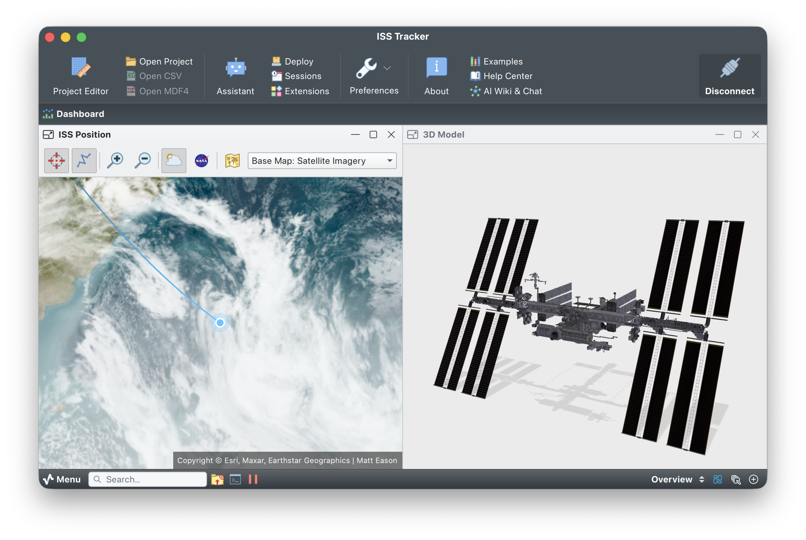

# ISS Tracker

**What you'll learn:** a Control Loop that polls a public HTTP API over TCP, a JavaScript frame parser, a GPS Map group, and an embedded web view.

**Prerequisites:** an internet connection and no extra hardware. The web view needs a Serial Studio build with Qt WebEngine, and some features need a paid license.

## Overview

This project visualizes the real-time position of the International Space Station (ISS) in Serial Studio. A built-in control loop polls a public API directly over TCP, so there is no companion program to run and no extra hardware. Serial Studio parses the response and shows the station on an interactive map alongside an embedded 3D model viewer.

Real-time satellite tracking with nothing but Serial Studio and an internet connection.

> Some Serial Studio features need a paid license. See [serial-studio.com](https://serial-studio.com/) for details.



## Telemetry source

ISS position is pulled from the [Open Notify](http://open-notify.org/Open-Notify-API/ISS-Location-Now/) `iss-now.json` API. The project's control loop opens a TCP connection to `api.open-notify.org:80`, issues an HTTP `GET /iss-now.json` request every few seconds, and lets the frame parser read the response. Two fields are extracted:

- `latitude`: geographic latitude in degrees.
- `longitude`: geographic longitude in degrees.

## Project features

- Real-time map tracking of the ISS.
- 3D Model view of the station via an embedded NASA glTF viewer (Web View widget).
- API polling driven entirely by an in-project control loop, no external program.
- TCP source with a JSON frame parser, configured in Serial Studio's project editor.

## Data format

The API returns a JSON object. The project's frame delimiters isolate the
`iss_position` block, and the parser reads its two fields:

```json
{
  "iss_position": { "latitude": "29.35", "longitude": "-94.98" },
  "timestamp": 1747294302,
  "message": "success"
}
```

Serial Studio parses the position into an array:

```json
[29.35, -94.98]
```

The widgets then map to array indices:

- `Latitude`: index 1.
- `Longitude`: index 2.
- `Altitude`: index 3 (the `ISS Position` map group's altitude channel).

## How to run

1. Open Serial Studio and load `iss-tracker.ssproj` (project file included).
2. Click **Connect**.

That is all. The bundled control loop opens the TCP connection to the API and polls it for you, so the map updates automatically; the 3D panel loads NASA's embedded model once Serial Studio connects and does not change with the telemetry. The source is preconfigured as a **Network Socket** in **TCP** mode pointing at `api.open-notify.org`, port **80**.

## Visualizations

- **Map widget.** Live ISS position by latitude and longitude.
- **3D Model.** A Web View widget that embeds NASA's public glTF model viewer
  for the ISS (`solarsystem.nasa.gov`) via Qt WebEngine. Camera controls and
  any on-screen readouts belong to that external page, not to Serial Studio.
  Requires a build compiled with Qt WebEngine; other builds show a
  "Web View Unavailable" placeholder in its place.

## Files

- `iss-tracker.ssproj`: Serial Studio project file (pre-configured, includes the control loop).
- `README.md`: project documentation.
- `doc/screenshot.png`: visualization screenshot.

## Notes

- The API occasionally returns incomplete or missing fields. The parser skips a frame that fails to decode and waits for the next poll.
- The open-notify API exposes only latitude and longitude; altitude and orbital velocity are not part of this feed.
