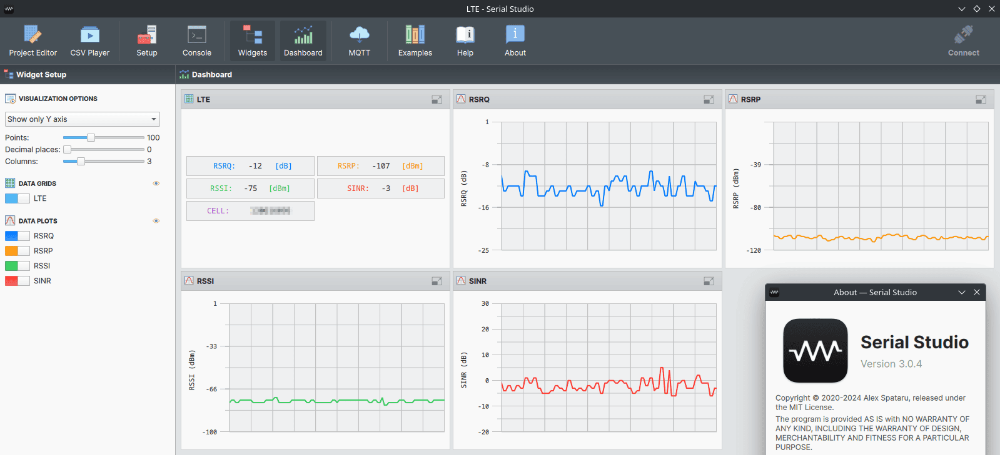
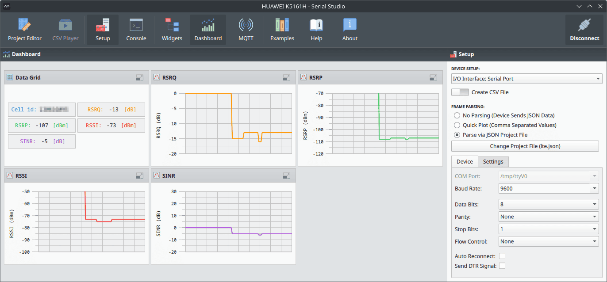
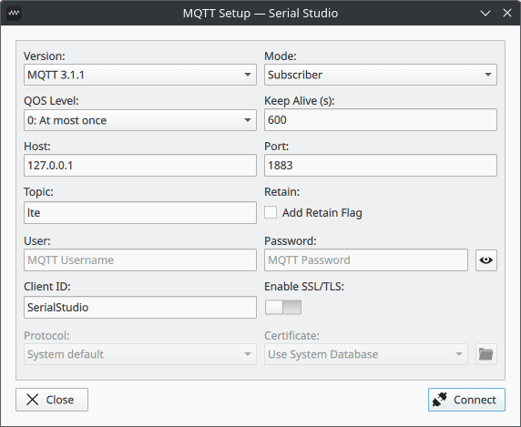
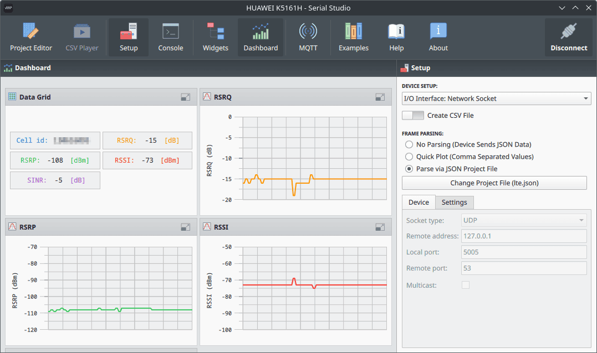

# Serial Studio and LTE modem HUAWEI K5161H

**What you'll learn:** three ways to get the same signal-quality data into a Data Grid: a virtual serial port, MQTT, and UDP.

**Prerequisites:** a HUAWEI K5161H LTE modem, Python 3 with `requests`, and `socat` and `pyserial` for the serial method. The MQTT method needs Serial Studio Pro.

## Overview

This project shows how to use Serial Studio to visualize signal quality data from a HUAWEI K5161H LTE modem.



Three methods of sending data are described:

- [Virtual Serial Port](#method_1)
- [MQTT](#method_2)
- [UDP Socket](#method_3)

The examples were built on [Arch Linux](https://archlinux.org/), where you can:

- Run **Serial Studio** from [AppImage](https://github.com/serial-studio/serial-studio/releases/latest).
- Install it from the [Arch User Repository](https://aur.archlinux.org/packages/serial-studio-bin) (AUR) [manually](https://wiki.archlinux.org/title/Arch_User_Repository#Installing_and_upgrading_packages) or with an AUR helper like `yay`:

    ```
    yay -S serial-studio-bin
    ```

- Build it with [cmake](/#building-serial-studio).

Data from the HUAWEI K5161H is pulled from the URL API `http://192.168.9.1/api/device/signal`. Python is used to receive, process, and generate data frames. All three scripts read the API with the **requests** library:

```
sudo pacman -S python-requests
```

Each frame carries five values, matching the datasets in `LTE Modem.ssproj`: cell ID, RSRQ (dB), RSRP (dBm), RSSI (dBm), and SINR (dB). All three scripts wrap each frame in the project's `/*` and `*/` start and end sequences.

<a name="method_1"></a>

## Method 1: Virtual serial port

### Create a virtual serial port

1. Install [socat](http://www.dest-unreach.org/socat/):

    ```
    sudo pacman -S socat
    ```

2. Create a linked pair of virtual serial ports, `ttyV0` for listening and `ttyV1` for sending data:

    ```
    socat -d -d pty,rawer,echo=0,link=/tmp/ttyV0,b9600 pty,rawer,echo=0,link=/tmp/ttyV1,b9600
    ```

3. Test the virtual serial ports by reading from `/tmp/ttyV0`:

    ```
    cat /tmp/ttyV0
    ```

    and writing data to `/tmp/ttyV1`:

    ```
    echo 100 > /tmp/ttyV1
    ```

4. Install `python-pyserial`:

    ```
    sudo pacman -S python-pyserial
    ```

5. Run the Python script `lte_serial.py` to process data and send it to `/tmp/ttyV1`:

    ```
    python lte_serial.py
    ```

### Serial Studio configuration for the virtual serial port

1. Run Serial Studio.
2. In **Device Setup**, set Connection to UART/COM.
3. Set **Operation Mode** to Project File.
4. Pick **Project file** → `LTE Modem.ssproj`.
5. Manually enter **Serial Port** → `/tmp/ttyV0` and press Enter.
6. Pick **Baud Rate** → 9600.
7. Click **Connect** in the upper right corner.

After the first frame of data arrives, Serial Studio opens the dashboard with plots automatically.



<a name="method_2"></a>

## Method 2: MQTT

> The MQTT driver is a Pro feature and requires a Serial Studio Pro license (trial or paid). See [serial-studio.com](https://serial-studio.com/) for details.

### Set up the MQTT broker

1. Install the MQTT broker [Mosquitto](https://mosquitto.org/):

    ```
    sudo pacman -S mosquitto
    ```

2. Run the MQTT broker with default settings:

    ```
    mosquitto --verbose
    ```

3. Test the broker by sending data:

    ```
    mosquitto_pub -m "abcd,100,50,75,89" -t "lte"
    ```

4. Install the Python MQTT client library, **paho**:

    ```
    sudo pacman -S python-paho-mqtt
    ```

5. Run the Python script `lte_mqtt.py` to process data and send it to the broker:

    ```
    python lte_mqtt.py
    ```

### Serial Studio configuration for MQTT

1. Run Serial Studio.
2. In **Device Setup**, set Connection to MQTT Subscriber.
3. Set **Operation Mode** to Project File.
4. Pick **Project file** → `LTE Modem.ssproj`.
5. Set **Hostname** → 127.0.0.1.
6. Set **Port** → 1883.
7. Set **Topic Filter** → lte.
8. Set **Keep Alive (s)** → 600.
9. Click **Connect**.

After the first frame of data arrives, Serial Studio opens the dashboard with plots automatically.



<a name="method_3"></a>

## Method 3: UDP socket

The UDP socket approach is simpler than the others.

Run the Python script `lte_udp.py` to process data and send it to the UDP socket:

```
python lte_udp.py
```

### Serial Studio configuration for UDP socket

1. Run Serial Studio.
2. In **Device Setup**, set Connection to Network Socket.
3. Set **Operation Mode** to Project File.
4. Pick **Project file** → `LTE Modem.ssproj`.
5. Pick **Socket Type** → UDP.
6. Set **Remote Address** → 127.0.0.1.
7. Set **Local Port** → 5005.
8. Click **Connect** in the upper right corner.

After the first frame of data arrives, Serial Studio opens the dashboard with plots automatically.


