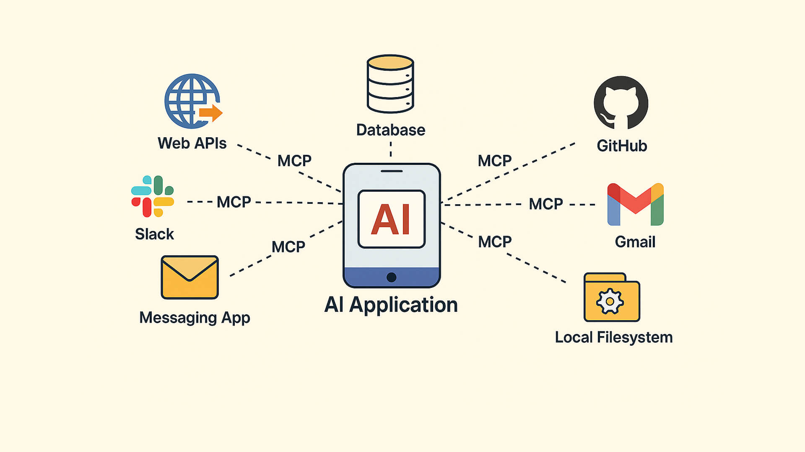

# Model Context Protocol (MCP) Example

**What you'll learn:** how an AI assistant such as Claude reads telemetry and controls Serial Studio through the Model Context Protocol, using the API server and a Python client.

**Prerequisites:** Python 3, the API server enabled in Serial Studio's preferences, and optionally Claude Desktop for the bridge script.

This example demonstrates how to use the **Model Context Protocol (MCP)** with Serial Studio, enabling AI models like Claude to interact with telemetry data and control Serial Studio remotely.



## Quick Start

### 1. Enable the API Server

1. Launch **Serial Studio**
2. Open **Preferences** (⚙️ icon in the toolbar, or `Cmd+,` on macOS)
3. Enable **"Enable API Server (Port 7777)"** switch
4. Close Preferences - server is now running on `localhost:7777`

### 2. Run the Example Client

```bash
cd "examples/MCP Client"
python3 client.py
```

### Expected Output

```
✓ Connected to Serial Studio at localhost:7777
✓ Initialized MCP session
  Server: Serial Studio
  Version: <your Serial Studio version>

✓ Available tools (...):
  • api.getCommands: Get list of all available commands
  • io.connect: Open the configured connection
  • io.disconnect: Close the current connection
  • io.getStatus: Query connection status
  • io.uart.setBaudRate: Set UART baud rate
  • project.template.list: List bundled project templates
  ...

✓ Available resources (2):
  • serialstudio://frame/current: Current Frame
    The most recent telemetry frame received
  • serialstudio://frame/history: Latest Frame
    The latest telemetry frame, as a JSON array

✓ Resource 'serialstudio://frame/current' read successfully
{
  "title": "Current Frame",
  "groups": [...],
  "actions": [...]
}
```

## What is MCP?

**Model Context Protocol (MCP)** is Anthropic's open standard for connecting AI models to external tools and information. Serial Studio implements MCP to allow AI assistants like Claude to:

- **Execute commands** - Control Serial Studio (connect devices, start exports, etc.)
- **Read telemetry data** - Access the current real-time sensor frame
- **Analyze data** - Use AI to find patterns, anomalies, or insights

## Architecture

Serial Studio uses a **hybrid protocol** approach:

- **Same TCP server** (port 7777) handles both legacy API and MCP
- **Automatic detection** - Protocol auto-detected based on message format
- **Shared commands** - All API commands automatically become MCP tools

### Protocol Detection

```json
// MCP message (has "jsonrpc": "2.0")
{
  "jsonrpc": "2.0",
  "id": 1,
  "method": "tools/list",
  "params": {}
}

// Legacy API (has "type" field)
{
  "type": "command",
  "id": "1",
  "command": "io.getStatus",
  "params": {}
}
```

## MCP Capabilities

### 1. Tools

Every Serial Studio API command is exposed as an MCP tool, except the licensing
mutations and the process launcher, which the tool list omits. Each tool carries a
`title` and the MCP annotations derived from the in-app assistant's safety tiers:
`readOnlyHint` on reads and queries, `destructiveHint` on the delete, clear,
open-replace, credential and device-control families, and neither on reversible
settings. A hint describes the tool; every call still passes the remote gate and
the consent prompts of the TCP API.

```json
{
  "name": "io.getStatus",
  "title": "IO / Get Status",
  "description": "Get connection status",
  "inputSchema": {"type": "object"},
  "annotations": {"readOnlyHint": true, "destructiveHint": false, "openWorldHint": false}
}
```

**I/O Management:**

| Command | Description |
|---------|-------------|
| `io.connect` | Connect to device |
| `io.disconnect` | Disconnect |
| `io.getStatus` | Get connection status |
| `io.setBusType` | Set bus type (UART, Network, BLE, etc.) |

**UART Configuration:**

| Command | Description |
|---------|-------------|
| `io.uart.setBaudRate` | Set baud rate |
| `io.uart.setDataBits` | Set data bits |
| `io.uart.setParity` | Set parity |

**Network Configuration:**

| Command | Description |
|---------|-------------|
| `io.network.setRemoteAddress` | Set remote host |
| `io.network.setTcpPort` | Set TCP port |
| `io.network.setUdpRemotePort` | Set UDP remote port |
| `io.network.setUdpLocalPort` | Set UDP local port |

**Project Management:**

| Command | Description |
|---------|-------------|
| `project.exportJson` | Read the active project as JSON |
| `project.template.list` / `project.template.apply` | Browse and apply bundled starters |
| `project.group.add` / `project.dataset.add` / `project.workspace.add` | Edit the in-memory project |
| `project.frameParser.setCode` | Update frame parser source |

**Export:**

| Command | Description |
|---------|-------------|
| `csvExport.setEnabled` | Toggle CSV export |
| `csvExport.close` | Close the current CSV file |
| `mdf4Export.setEnabled` (Pro) | Toggle MDF4 export |

**...and many more!** Send `tools/list` over MCP (or
`{"command": "api.getCommands"}` over the legacy JSON protocol) to
enumerate the complete surface.

### 2. Resources

**Available resources:**

- **`serialstudio://frame/current`** - Latest telemetry frame (JSON)
  - Real-time sensor data
  - Updated whenever new frame arrives

- **`serialstudio://frame/history`** - Latest telemetry frame, as a JSON array
  - Same frame as `serialstudio://frame/current`, wrapped in a single-element array
  - No rolling buffer: the array holds 0 or 1 frames

An MCP connection receives replies only: no frame broadcasts, raw device data or lifecycle
events. Telemetry is read on request with `resources/read`, or by polling `dashboard.getData` and
`dashboard.tailFrames`. Resources cannot be subscribed to, and the connection-scoped push commands
(`mirror.subscribe`, `stream.subscribe`) are refused.

Tool failures arrive as a successful `tools/call` result with `isError: true`. Its text blocks name
the tool, the arguments sent and the reason, so a model can correct the call. Only protocol faults
(an unknown tool, a missing tool name, non-object `arguments`) are JSON-RPC errors.

### 3. Prompts

**Available prompts:**

- `analyze_telemetry` - Analyze current telemetry data

## Example Usage

### Python Client

See `client.py` for a complete example. Key methods:

```python
from client import MCPClient

client = MCPClient()
client.connect()
client.initialize()

# List all available tools
tools = client.list_tools()

# Call a tool
result = client.call_tool("io.getStatus")

# Read current frame
frame = client.read_resource("serialstudio://frame/current")

# Read the latest frame as a single-element array
frame_array = client.read_resource("serialstudio://frame/history")
```

### Manual Testing with netcat

```bash
# Connect to Serial Studio
nc localhost 7777

# Initialize MCP session
{"jsonrpc":"2.0","id":1,"method":"initialize","params":{"protocolVersion":"2024-11-05","clientInfo":{"name":"Test","version":"1.0"}}}

# List tools
{"jsonrpc":"2.0","id":2,"method":"tools/list"}

# Call a tool
{"jsonrpc":"2.0","id":3,"method":"tools/call","params":{"name":"io.getStatus","arguments":{}}}

# Read current frame
{"jsonrpc":"2.0","id":4,"method":"resources/read","params":{"uri":"serialstudio://frame/current"}}
```

### Claude Desktop Integration

**Claude Code and Cowork: the directory plugin.** Install the **Serial Studio**
plugin (`serial-studio`) from the Claude directory. It runs this bridge from the
plugin folder, lists the tools and bundles a skill that states the prerequisite,
the read-first workflow and the consent prompts, so no configuration file is
edited. Source: https://github.com/Serial-Studio/claude-plugin. Claude Desktop's
chat does not load plugin servers; the manual configuration below is the route
for it and for any other MCP host.

**Complete Step-by-Step Guide to Connect Claude Desktop with Serial Studio**

#### Step 1: Enable Serial Studio API Server

1. Launch **Serial Studio**
2. Open **Preferences** (⚙️ icon in the toolbar, or `Cmd+,` on macOS)
3. Enable **"Enable API Server (Port 7777)"**
4. Keep Serial Studio running in the background

#### Step 2: Locate the Bridge Script

A ready-to-use MCP bridge script is included: `claude_desktop_bridge.py`

The bridge is located at:
```
examples/MCP Client/claude_desktop_bridge.py
```

This script connects Claude Desktop (stdio) to Serial Studio's TCP API (port 7777).

**Features:**
- Stays up while Serial Studio is away and reconnects by itself, at startup and
  mid-session; until then it lists one status tool, fails every other call with the
  fix, and names the fix on its last log line
- Proper error handling and logging
- Graceful shutdown
- Detailed status messages in Claude Desktop logs

**Make it executable (Linux/macOS):**
```bash
chmod +x claude_desktop_bridge.py
```

**No installation needed** - uses Python standard library only.

#### Step 3: Configure Claude Desktop

Locate your Claude Desktop configuration file:

**macOS:**
```
~/Library/Application Support/Claude/claude_desktop_config.json
```

**Windows:**
```
%APPDATA%\Claude\claude_desktop_config.json
```

**Linux:**
```
~/.config/Claude/claude_desktop_config.json
```

Edit (or create) the file and add the Serial Studio MCP server:

```json
{
  "mcpServers": {
    "serial-studio": {
      "command": "python3",
      "args": ["/absolute/path/to/Serial-Studio/examples/MCP Client/claude_desktop_bridge.py"]
    }
  }
}
```

**Important:** Replace `/absolute/path/to/Serial-Studio` with the actual path to your Serial Studio repository/installation.

**Example (macOS/Linux):**
```json
{
  "mcpServers": {
    "serial-studio": {
      "command": "python3",
      "args": ["/Users/YOUR_USERNAME/Documents/GitHub/Serial-Studio/examples/MCP Client/claude_desktop_bridge.py"]
    }
  }
}
```

**Example (Windows):**
```json
{
  "mcpServers": {
    "serial-studio": {
      "command": "python",
      "args": ["C:\\Users\\YOUR_USERNAME\\Documents\\Serial-Studio\\examples\\MCP Client\\claude_desktop_bridge.py"]
    }
  }
}
```

**Tip:** Use the full absolute path to avoid issues. You can get it with:
```bash
# macOS/Linux:
cd examples/MCP\ Client && pwd
# Then append /claude_desktop_bridge.py to the output

# Windows (PowerShell):
cd "examples\MCP Client"; (Get-Location).Path
# Then append \claude_desktop_bridge.py to the output
```

#### Step 4: Restart Claude Desktop

1. **Quit Claude Desktop completely** (not just close window)
2. **Start Serial Studio** (if not already running)
3. **Enable API Server** in Serial Studio Preferences
4. **Launch Claude Desktop**

#### Step 5: Verify Integration

In Claude Desktop, try asking:

```
"Can you list all available Serial Studio tools?"
```

Claude should respond with a list of tools like:
- `io.connect`
- `io.uart.setBaudRate`
- `project.open`
- etc.

#### Step 6: Use It!

You can now ask Claude to:

**Connect to a device:**
```
"List available serial ports, then connect to the Arduino on the first port with 115200 baud rate"
```

**Read telemetry:**
```
"Read the current telemetry frame from Serial Studio"
```

**Analyze data:**
```
"Read the current telemetry frame and tell me if the temperature sensor readings look anomalous"
```

**Control Serial Studio:**
```
"Change the baud rate to 9600, disconnect, and reconnect"
```

**Export data:**
```
"Start CSV export and tell me where the file will be saved"
```

### Troubleshooting Claude Desktop Integration

#### Claude says "I don't have access to Serial Studio tools"

**Fix:**
1. Check Claude Desktop logs:
   - macOS: `~/Library/Logs/Claude/mcp*.log`
   - Windows: `%APPDATA%\Claude\logs\mcp*.log`
   - Linux: `~/.config/Claude/logs/mcp*.log`
2. Look for errors like "Failed to start" or "Connection refused"
3. Verify the bridge script path in config is absolute (not relative)
4. Test the bridge manually:
   ```bash
   python3 claude_desktop_bridge.py
   # Should show: "✓ Connected to Serial Studio"
   # Press Ctrl+C to stop
   ```
5. Check the path is correct:
   ```bash
   # Verify file exists
   ls -l /path/to/claude_desktop_bridge.py
   ```

#### Bridge starts but Claude can't connect

**Fix:**
1. Ensure Serial Studio is running (the tools appear once it answers, in either start order)
2. Enable API server in Serial Studio Preferences
3. Check port 7777 is not blocked: `lsof -i :7777` (macOS/Linux) or `netstat -ano | findstr :7777` (Windows)
4. Try connecting manually: `nc localhost 7777` (should connect immediately)

#### "Connection refused" in logs

**Fix:**
1. Serial Studio is not running → Start Serial Studio
2. API server not enabled → Enable in Preferences
3. Port already in use → Kill process using port 7777 or restart Serial Studio

#### Bridge works but no telemetry data

**Fix:**
1. Connect a device or load a CSV/MDF4 file in Serial Studio
2. Verify data is flowing (you should see frames in Serial Studio UI)
3. Ask Claude: `"Read serialstudio://frame/current resource"`
4. If empty, no data is being received by Serial Studio

#### Python not found

**Fix:**
- macOS/Linux: Use `python3` in config (not `python`)
- Windows: Use `python` in config and verify Python is in PATH
- Specify full path: `"command": "/usr/bin/python3"` or `"command": "C:\\Python39\\python.exe"`

### Advanced: Custom Bridge Configuration

You can modify the bridge script to:

**Change host/port:**
```python
SERIAL_STUDIO_HOST = "192.168.1.100"  # Remote Serial Studio
SERIAL_STUDIO_PORT = 7777
```

**Add reconnection logic:**
```python
while True:
    try:
        sock = socket.socket(socket.AF_INET, socket.SOCK_STREAM)
        sock.connect((SERIAL_STUDIO_HOST, SERIAL_STUDIO_PORT))
        break
    except ConnectionRefusedError:
        log("Retrying in 2 seconds...")
        time.sleep(2)
```

**Filter messages:**
```python
# Only forward specific tool calls
if b'"method":"tools/call"' in line:
    sock.sendall(line)
```

## Troubleshooting

### Connection Refused

- ✓ Check API server is enabled in Serial Studio Preferences
- ✓ Verify Serial Studio is running
- ✓ Confirm port 7777 is free: `lsof -i :7777`

### No Tools Listed

- ✓ Make sure you called `initialize` first
- ✓ Check Serial Studio console for errors
- ✓ Verify you're using the correct protocol format

### Empty Frame Data

- ✓ Connect a device or load CSV/MDF4 file
- ✓ Start receiving data in Serial Studio
- ✓ Frames only available when data is flowing

## Security

MCP connections use the same security as the legacy API:

- **Localhost only by default** - Server binds to 127.0.0.1; the "Allow External API
  Connections" setting opts into binding all interfaces, gated behind a confirmation
  warning and a required auth token
- **Rate limiting** - 200 messages/second per client
- **Buffer limits** - 4MB max buffer, 1MB max message
- **JSON depth** - Max 64 nesting levels
- **Client limit** - Max 32 concurrent connections

## Specification Compliance

Serial Studio answers protocol revisions **2024-11-05**, **2025-03-26** and
**2025-06-18**: `initialize` echoes the revision the client offers when it is one
of these and answers 2025-06-18 to any other. Supported methods:

- ✅ JSON-RPC 2.0 protocol
- ✅ `initialize` handshake
- ✅ `tools/list` and `tools/call`
- ✅ Tool `title` and `annotations` (`readOnlyHint`, `destructiveHint`, `openWorldHint`)
- ✅ `resources/list`, `resources/read`
- ✅ `prompts/list`, `prompts/get`
- ✅ `ping` health check
- ✅ Notification support

## Example Use Cases

### 1. Automated Testing

```python
# Connect device via API
client.call_tool("io.connect")

# Read telemetry
frame = client.read_resource("serialstudio://frame/current")

# Verify sensor values
assert frame["groups"][0]["datasets"][0]["value"] < 100
```

### 2. AI-Powered Anomaly Detection

```python
# Poll the current frame
frame = client.read_resource("serialstudio://frame/current")

# Send each frame to Claude for analysis
# "Analyze this telemetry data and identify any anomalies..."
```

### 3. Remote Control

```python
# Change baud rate
client.call_tool("io.uart.setBaudRate", {"baudRate": 115200})

# Reconnect
client.call_tool("io.disconnect")
client.call_tool("io.connect")
```

## Learn More

- **MCP Specification**: https://spec.modelcontextprotocol.io/
- **Serial Studio API**: See `app/src/API/` for implementation
- **Claude Desktop**: https://claude.ai/download

## License

This example follows Serial Studio's dual-licensing:
- GPL-3.0-or-later for open source builds
- Commercial license for Pro builds

See main project LICENSE for details.
